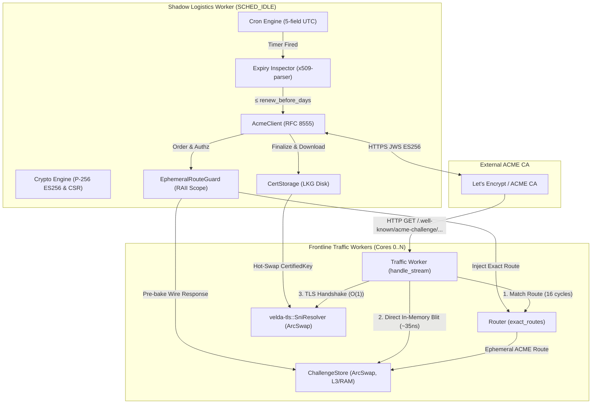

# ACME Certificate Rotator — Architecture Specification

This document details the architectural invariants, socket model, challenge handling, and memory topology of the **ACME Automated Certificate Rotator Plugin**.

---

## 1. Subsystem Mission & Responsibilities

The `acme_cert_rotator` operates on the **Shadow Logistics Worker** (`SCHED_IDLE`) to ensure:
1. Continuous X.509 certificate availability with zero manual intervention.
2. 100% decoupling from frontline request processing: Frontline traffic workers never execute ACME network calls, never generate cryptographic keys, and never block on certificate rotation.
3. Zero-downtime hot-swap: Inbound TLS connections seamlessly transition to updated certificates without connection drops.

---

## 2. Architecture & Workflow

---

## 3. Subsystem Invariants & Performance Contract

### 3.1 Zero-Allocation In-Memory Challenge Serving
- **Pre-Baked Wire Response**:
  The Shadow worker pre-formats the entire HTTP/1.1 200 OK wire response (status line, Content-Type, Content-Length, and key authorization) into an immutable `Bytes` slice before notifying the CA.
- **Short-Circuit Action**:
  When Let's Encrypt requests `GET /.well-known/acme-challenge/<token>`, the Frontline worker matches the ephemeral route and immediately blits the pre-baked wire slice into the socket buffer. Upstream pools and socket connections are completely bypassed (0 upstream allocations).

### 3.2 L3/RAM Cache Isolation (Anti-L1D Thrashing)
- Between challenge creation and external validation (typically 1 to 5 seconds), millions of real customer requests pass through frontline cores.
- Keeping the transient challenge response in L3/RAM rather than pinning it in L1D ensures that customer request state, parsing buffers, and router tables maintain 100% cache line residency.
- Cold lookup latency from L3/RAM is ~560 ns, which is negligible compared to Internet round-trip latency (20–80 ms).

### 3.3 RAII Guaranteed Teardown
- Challenge lifetime is strictly governed by `EphemeralRouteGuard`.
- Upon order completion, error, timeout, or task shutdown, `drop()` automatically removes the ephemeral route from `Router` and the challenge entry from `ChallengeStore`. Leaking routes into the router table is mathematically prevented by Rust ownership.

### 3.4 Zero-Coordination Frontline Serving (Rule 2.9)
- Hot-path request serving never sends tasks over channels, never takes mutex locks, and never awaits logistics workers.
- `Router` lookup is lock-free; `ChallengeStore` lookup uses `ArcSwap::load()`.
