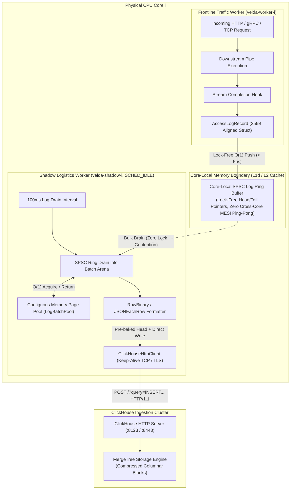
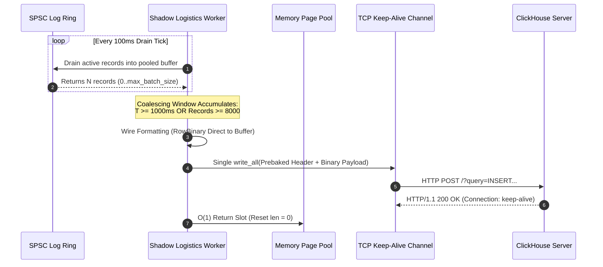
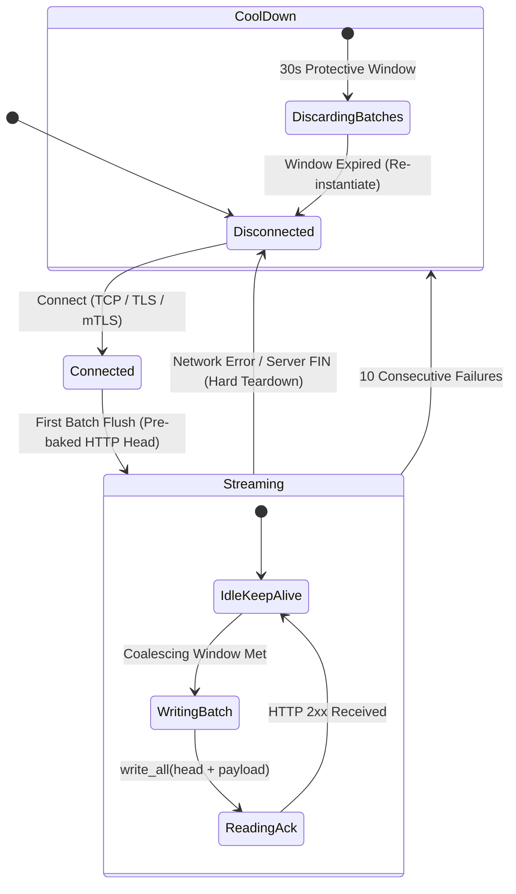

# ClickHouse Log Shipper (`clickhouse_log_shipper`) — Deep Systems Architecture

This specification document details the concurrency model, memory geometry, batch coalescing physics, wire serialization layout, and resilience boundaries of the **ClickHouse Log Shipper Plugin** (`clickhouse_log_shipper`) in **Velda Edge**.

---

## 1. Concurrency Model & Thread-Per-Core Isolation

Velda Edge operates on a strict **Thread-Per-Core (Shared-Nothing / Core-Affined)** architectural invariant. Frontline traffic serving is strictly decoupled from background telemetry logistics across two dedicated OS threads pinned to each physical CPU core:



### Architectural Guarantees:
1. **Zero-IO Hot Path**: The Frontline Traffic Worker (`velda-worker-{i}`) **never** touches a filesystem descriptor, never parses JSON, never formats strings, and never touches outbound network sockets.
2. **Lock-Free Emission**: Access logs are written to an isolated Single-Producer Single-Consumer (`SpscLogRing`) residing entirely in core-local memory. Emitting a log record consists solely of writing 256 bytes into a cache-aligned array slot and executing an atomic pointer store with `Ordering::Release`.
3. **Graceful Saturation Protection**: If downstream telemetry pipelines stall or fail to keep up with high traffic, the SPSC ring drops excess log records lock-free (`ring.push() == false`). Frontline request latency is guaranteed to never stall or backpressure incoming traffic.

---

## 2. Multi-Buffer Memory Pool & Page Geometry (`LogBatchPool`)

Telemetry systems frequently suffer from memory fragmentation and GC/allocator pauses caused by allocating millions of transient byte buffers per second. `clickhouse_log_shipper` eliminates steady-state allocations by leveraging a **Contiguous Page Memory Pool**:

```
+-----------------------------------------------------------------------------------+
|                           Contiguous Memory Page Pool                             |
|                                                                                   |
|  [ Slot 0: 64 KB ] <---> [ Slot 1: 64 KB ] <---> [ Slot 2: 64 KB ] <---> ...     |
|    (16 x 4KB Pages)        (16 x 4KB Pages)        (16 x 4KB Pages)               |
+-----------------------------------------------------------------------------------+
       ^                           ^                           ^
       |                           |                           |
       | Drain into                | Serializing               | Recycled / Idle
       |                           |                           |
  Shadow Worker               Exporter Task               Pool Head (O(1))
 (len = 0..256)              (Arc Leased: rc=1)           (Ready for Next Tick)
```

### Physical Memory Alignment & Geometry:
- **Batch Slot Size**: Each batch slot contains exactly $256 \times 256\text{ bytes} = 65,536\text{ bytes}$ (exactly 16 contiguous 4KB OS virtual memory pages, 64-byte cache-line aligned).
- **Multi-Buffer Rotation**: Multiple pre-allocated slots rotate between Shadow Worker producers and exporter consumers without locks or heap reallocations.
- **Zero Return to OS (`__rust_dealloc == 0`)**: When an exporter finishes writing a batch to the network socket and drops its `LogBatch` reference, the memory is **not** returned to the OS allocator. The slot's length counter is reset to 0 in $\mathcal{O}(1)$ (~0.3ns) and returned to the pool's idle queue for immediate reuse on the next tick.

---

## 3. Batch Window Coalescing Mechanics

### The Micro-Insert Fallacy in Columnar Databases
ClickHouse uses an LSM-like (Log-Structured Merge-Tree) storage engine. Writing records frequently in small batches (e.g., 100 rows every 50ms) introduces catastrophic performance collapse:
1. **Part Explosion**: Every individual HTTP `INSERT` creates a distinct data part on disk containing compressed column files, mark files (`.mrk3`), and index files.
2. **Write Amplification Storm**: ClickHouse background merger threads (`MergeTreeBackgroundPool`) are forced to continuously merge hundreds of tiny 10KB parts into larger parts, consuming 100% of the database server's CPU and disk I/O bandwidth.
3. **Connection Churn**: The Edge Gateway must repeatedly assemble HTTP headers, execute socket write syscalls, and wait for HTTP acknowledgment headers.

### Two-Dimensional Coalescing Architecture
`clickhouse_log_shipper` implements an adaptive Two-Dimensional Coalescing Window:

$$\text{Flush Trigger} = (\Delta t \ge \text{flush\_interval\_ms}) \lor (N_{\text{records}} \ge \text{max\_batch\_size})$$



By coalescing logs into **1,000ms – 5,000ms windows** with **8,000 – 20,000 records per batch**:
- Network socket write syscalls decrease by **95% to 99%** (1 write/second instead of 100 writes/second).
- ClickHouse receives dense, compressed columnar blocks, maximizing compression entropy and minimizing background part merges.

---

## 4. Native Wire Serialization Geometry

`clickhouse_log_shipper` supports two wire formats: **`RowBinary`** (recommended for production) and **`JSONEachRow`** (for debugging and pipeline interop).

### 4.1 Native `RowBinary` Wire Specification
`RowBinary` is ClickHouse's native binary stream encoding. It completely eliminates ASCII conversion, string escaping, and schema inference overhead:

```
+-------------------------------------------------------------------------------+
|                        ClickHouse RowBinary Record Layout                     |
+-------------------+-------------------+-------------------+-------------------+
| timestamp (4B LE) | request_id (8B LE)| duration_ns(8B LE)| peer_ip (VarString|
+-------------------+-------------------+-------------------+-------------------+
| peer_port (2B LE) |upstream_ip(VarStr)|up_port (2B LE)    | route_id (2B LE)  |
+-------------------+-------------------+-------------------+-------------------+
| status_code(2B LE)| pipe (VarString)  | method (VarString)| url (VarString)   |
+-------------------+-------------------+-------------------+-------------------+
| bytes_rx (4B LE)  | bytes_tx (4B LE)  | reason (VarString)| grpc_stat (VarStr)|
+-------------------+-------------------+-------------------+-------------------+
| ua_fam (VarString)| ua_os (VarString) |  ... Next Record                      |
+-------------------------------------------------------------------------------+
```

#### String Encoding & 1-Byte LEB128 Back-Patching
In `RowBinary`, strings are encoded as an unsigned LEB128 varint byte length followed by the raw UTF-8 payload bytes (no null terminators):
- For small variable strings like IPv4/IPv6 strings ($\le 45$ bytes), the LEB128 length is mathematically guaranteed to fit in **exactly 1 byte**.
- Instead of formatting the IP into a temporary string and computing its length, the formatter pushes a 1-byte placeholder `0x00`, formats the IP directly into the destination buffer, calculates the length delta:
  $$\text{length} = \text{buffer.len()} - \text{start\_index}$$
  and back-patches the length byte directly into the placeholder index.
- **Zero dynamic allocations** occur during string serialization.

### 4.2 Division-Free Numeric Formatting (`DIGIT_PAIRS` LUT)
Integer-to-ASCII conversion in `JSONEachRow` format avoids costly hardware division operations. A pre-computed 200-byte lookup table (`DIGIT_PAIRS`) formats 2 decimal digits simultaneously:
- Consecutive pairs `"00"`, `"01"`, ..., `"99"` are stored in contiguous memory that remains permanently resident in L1d cache.
- 64-bit numbers are unrolled using reciprocal multiplication and 2-digit table lookups, eliminating CPU pipeline stalls.

---

## 5. Network Lifecycle & Resilience Architecture



### 5.1 Pre-Baked HTTP/1.1 Header Assembly
ClickHouse ingestion endpoints accept SQL queries passed in the URL query string:
`POST /?query=INSERT INTO {database}.velda_access_logs FORMAT RowBinary HTTP/1.1`

Rather than formatting HTTP headers per push using dynamic string interpolation (`format!`), the entire header prefix:
```http
POST /?query=INSERT%20INTO%20{database}.velda_access_logs%20FORMAT%20RowBinary HTTP/1.1\r\n
Host: {host}:{port}\r\n
User-Agent: velda-edge/1.0\r\n
Connection: keep-alive\r\n
Content-Type: application/octet-stream\r\n
X-ClickHouse-User: {username}\r\n
X-ClickHouse-Key: {password}\r\n
Content-Length: 
```
is pre-baked into a static contiguous byte array once at initialization. Assembling a batch push requires only appending the pre-baked slice, writing the payload length via fast `fast_write_u64`, and appending `\r\n\r\n`.

### 5.2 Zero-Retry Fast-Fail Policy
Traditional log forwarders frequently wrap network calls in retry loops with exponential sleep backoffs. In a low-latency proxy, this introduces severe hazards:
- Sleeping inside an async event loop blocks companion logistics routines (buffer pool maintenance, health checks).
- Retrying over a connection that encountered an error risks sending payload into a half-closed socket (TCP RST / broken pipe).

**Velda Edge Contract**:
- If `write` or `read` encounters an error, the operation **fails immediately without inline retry loops**.
- The failed batch is dropped to preserve bounded memory.
- The underlying socket handle is torn down immediately (`close_connection()`), forcing a fresh TCP/TLS handshake on the subsequent tick.

### 5.3 30-Second Cool-Down Memory Shield
If ClickHouse becomes unreachable or returns persistent non-2xx errors:
1. Upon encountering 10 consecutive push failures, the plugin transitions into **Cool-Down Mode**.
2. For the next 30 seconds, the shipper immediately drains and discards incoming batches from the SPSC ring (`subscriber.drain_batches(64)`).
3. This guarantees that during extended database outages, memory consumption remains strictly bounded at 0% growth, preventing edge gateway OOM crashes.
4. When the 30-second window expires, the client resets its failure counter and attempts a clean reconnection.

---

## 6. ClickHouse Columnar Engine Synergy

The schema created by `ensure_table()` is engineered specifically to maximize ClickHouse MergeTree compression and sparse index pruning:

```sql
CREATE TABLE IF NOT EXISTS {database}.velda_access_logs (
    timestamp          DateTime              CODEC(DoubleDelta, ZSTD(1)),
    request_id         UInt64                CODEC(DoubleDelta, ZSTD(1)),
    duration_ns        UInt64                CODEC(T64, ZSTD(1)),
    peer_ip            String                CODEC(ZSTD(1)),
    peer_port          UInt16                CODEC(T64, ZSTD(1)),
    upstream_ip        String                CODEC(ZSTD(1)),
    upstream_port      UInt16                CODEC(T64, ZSTD(1)),
    route_id           UInt16                CODEC(T64, ZSTD(1)),
    status_code        UInt16                CODEC(T64, ZSTD(1)),
    pipe               LowCardinality(String) CODEC(ZSTD(1)),
    method             LowCardinality(String) CODEC(ZSTD(1)),
    url                String                CODEC(ZSTD(3)),
    bytes_rx           UInt32                CODEC(T64, ZSTD(1)),
    bytes_tx           UInt32                CODEC(T64, ZSTD(1)),
    completion_reason  LowCardinality(String) CODEC(ZSTD(1)),
    grpc_status        LowCardinality(String) CODEC(ZSTD(1)),
    user_agent_family  LowCardinality(String) CODEC(ZSTD(1)),
    user_agent_os      LowCardinality(String) CODEC(ZSTD(1))
) ENGINE = MergeTree()
PARTITION BY toYYYYMM(timestamp)
ORDER BY (route_id, status_code, timestamp)
SETTINGS index_granularity = 8192;
```

### Columnar Codec Synergy
- **`DoubleDelta`**: Calculates second-order differences $\Delta(\Delta t) = (t_i - t_{i-1}) - (t_{i-1} - t_{i-2})$. For steadily advancing sequence timestamps and sequential request IDs, second-order deltas are mostly zero, reducing physical storage to mere fractions of a bit per row.
- **`T64`**: Bit-truncation codec that identifies and trims common high-order zero bits across numerical columns (`duration_ns`, `bytes_rx`, `bytes_tx`, `status_code`), significantly accelerating subsequent ZSTD entropy passes.
- **`LowCardinality(String)`**: Replaces string values with numeric dictionary keys behind the scenes. Ideal for finite categorical sets (`method`, `pipe`, `grpc_status`, `completion_reason`).
- **`ORDER BY (route_id, status_code, timestamp)`**: Organizes columnar physical sort order by high-cardinality route filtering first, then HTTP response status, then time. Allows the ClickHouse sparse primary index to skip hundreds of thousands of unrelated data marks within microseconds during incident investigation.
