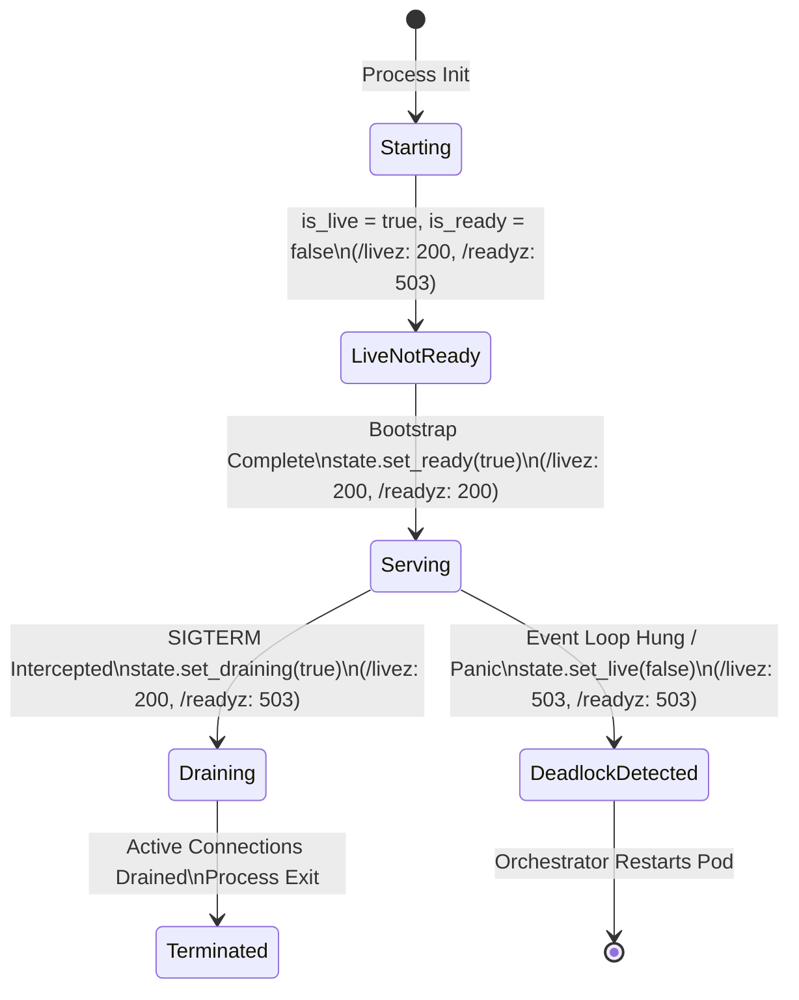

# Health & Readiness Probe Plugin (`health_probe`) — Micro-Architectural Specification

This document specifies the micro-architectural invariants, memory geometry, execution loops, empirical assembly proof, and physical hardware boundaries of the **`health_probe`** background daemon in Velda Edge.

---

## 1. Architectural Mission & Invariants

The `health_probe` plugin (`crates/velda-plugin/src/background/health_probe/`) runs an out-of-band, zero-allocation HTTP management server on a dedicated port (e.g. `0.0.0.0:9091`). It serves orchestrator liveness and readiness checks (`/livez`, `/readyz`) completely decoupled from the Data Plane request serving path.

```mermaid
flowchart TD
    subgraph DataPlane["Data Plane Hot Path (Cores 0..N-1)"]
        W0["velda-worker-0"]
        W1["velda-worker-1"]
        WN["velda-worker-n"]
        W0 & W1 & WN -->|Zero Contention / Zero Lock| Serving["Serve Ingress Traffic\n(Ports 80, 443, 8080)"]
    end

    subgraph Bootstrap["Bootstrap & Configuration (velda-edge / velda-sync)"]
        Snap["RuntimeSnapshot\n(plugins.background_plugins)"] -->|Zero MPSC Channel / Direct Handoff| ShadowInit["Mount into velda-shadow-{i}\n(bg_tasks: JoinSet)"]
    end

    subgraph ShadowWorker["Shadow Logistics Worker (Assigned Core i, SCHED_IDLE)"]
        ShadowInit --> HealthLoop["HealthProbePlugin::run()\n(Sequential Inline Accept Loop)"]
        
        HealthLoop --> Accept{"listener.accept()"}
        Accept -->|Probe Connected| TimeoutGuard["tokio::time::timeout(timeout_ms)"]
        TimeoutGuard --> FastRead["stream.read(512B stack buffer)"]
        FastRead -->|n == 0| EarlyExit["Instant Clean Return\n(Zero 404 write to closed socket)"]
        FastRead -->|n > 0| EvalSWAR["Register SWAR Path Match\n(eval_swar_64 / eval_swar_32x2)"]
        
        EvalSWAR --> BranchlessALU["Branchless ALU Index Selection:\nindex = 2 - probe_match - probe_ok"]
        
        BranchlessALU -->|index 0| Resp200["RESP_200 (200 OK, 57B)"]
        BranchlessALU -->|index 1| Resp503["RESP_503 (503 Service Unavailable, 74B)"]
        BranchlessALU -->|index 2| Resp404["RESP_404 (404 Not Found, 64B)"]
        
        Resp200 & Resp503 & Resp404 --> FastWrite["stream.write_all(static_bytes)\nfrom WIRE_RESPONSES (195B L1D block)"]
        FastWrite --> LoopNext["Next Probe (Zero Spawn, Zero Heap Allocation)"]
    end

    subgraph Orchestrator["Cluster Orchestrator (Out-of-Band)"]
        Kubelet["Kubernetes Kubelet / AWS ALB"] -->|GET /livez (Port 9091)| Accept
        Kubelet -->|GET /readyz (Port 9091)| Accept
    end
```

### Core Invariants:

1. **Bootstrap Direct Handoff (Zero-mpsc)**:
   - At system bootstrap, the background plugin descriptor is parsed, validated, and embedded directly into `RuntimeSnapshot`.
   - `velda-edge` mounts `health_probe` straight into `velda-shadow-{i}` (`bg_tasks: JoinSet<()>`).
   - Frontline Traffic Workers (`velda-worker-{id}`) **never** exchange messages, send tasks over `mpsc` channels, or coordinate with `health_probe`.
   - On runtime hot-reload, `velda-shadow-{i}` reads the updated snapshot pointer (`shared_runtime.load()`), cancels old background tasks, and mounts updated instances — **100% zero-mpsc**.

2. **Port Isolation Invariant**:
   - The probe socket (`listen_addr`) runs strictly on a dedicated management port:
     $$\text{ManagementPort} \cap \text{TrafficPorts} = \emptyset$$
   - A catastrophic traffic spike, connection flood, or L7 DDoS attack on ingress ports (80/443) cannot saturate or delay orchestrator probes. Kubelet receives responses without false-positive container evictions or restarts.

3. **Flat Sequential Inline Execution (Zero Task Spawn)**:
   - Eliminates per-probe `tokio::spawn` allocations and task scheduling overhead.
   - Incoming connections are processed sequentially inline on the Shadow Worker. Because streaming static memory frames involves no dynamic string serialization, sequential inline execution operates with **zero heap allocations on the serving path** and eliminates task queue scheduling contention.

4. **Hard Timeout Protection (`timeout_ms`)**:
   - Every connection read and write is strictly bounded by `tokio::time::timeout(Duration::from_millis(config.timeout_ms), ...)`.
   - Slowloris probes or stalled TCP handshakes are aborted after `timeout_ms`, completely preventing socket descriptor leaks or zombie tasks.

5. **Zero-Byte Static Payload (`&'static [u8]`)**:
   - Emits pre-compiled HTTP/1.1 response slices embedded directly in the binary's `.rodata` with `Content-Length: 0` and `Connection: close`:
     - `HTTP/1.1 200 OK\r\nContent-Length: 0\r\nConnection: close\r\n\r\n` (57 bytes)
     - `HTTP/1.1 503 Service Unavailable\r\nContent-Length: 0\r\nConnection: close\r\n\r\n` (74 bytes)
     - `HTTP/1.1 404 Not Found\r\nContent-Length: 0\r\nConnection: close\r\n\r\n` (64 bytes)
   - Zero dynamic formatting strings, zero allocations, zero chunked encoding overhead.

6. **Graceful Draining Semantics**:
   - When a termination signal (SIGTERM/SIGINT) is intercepted by the lifecycle supervisor, `HealthState::set_draining(true)` is executed atomically.
   - The `/readyz` endpoint immediately responds with `503 Service Unavailable`, prompting the Kubernetes Endpoints Controller and external load balancers to prune the pod from upstream routing pools *before* active TCP/H2/QUIC client connections enter termination.

---

## 2. Memory Geometry & Data Structures

### 2.1 Contiguous L1D Cache-Resident Wire Responses (`WIRE_RESPONSES`)

To eliminate pointer indirection and multi-cacheline scattering across `.rodata`, all three HTTP/1.1 wire responses are packed contiguously into a single 64-byte aligned structure:

```rust
#[repr(C, align(64))]
pub struct ContiguousWireResponses {
    /// 195 bytes: 200 OK (57B) + 503 Service Unavailable (74B) + 404 Not Found (64B)
    pub raw: [u8; TOTAL_WIRE_LEN], // TOTAL_WIRE_LEN = 195
}
```

#### Cache Line Footprint & Memory Offsets:
- **Total Span**: 195 payload bytes aligned to 64 bytes allocates $\lceil 195 / 64 \rceil \times 64 = 256\text{ bytes}$ (exactly 4 contiguous 64-byte cache lines, with 61 trailing padding bytes).
- **L1D Cache Share**: Consumes $\approx 0.59\%$ of a standard 32 KiB L1 Data Cache ($256 / 32768$).

```text
Memory Offset    Cache Line      Payload Content                     Slice Reference
═════════════    ══════════      ═══════════════                     ═══════════════
0x0000 - 0x0038  Cache Line 0    HTTP/1.1 200 OK\r\n... (57 bytes)   raw[0..57]
0x0039 - 0x003F  Cache Line 0/1  HTTP/1.1 503 Service Unav...        raw[57..131]
0x0040 - 0x007F  Cache Line 1    ...ailable\r\nContent-Length: 0...  (Spans Line 0..2)
0x0080 - 0x0082  Cache Line 2    ...\r\nConnection: close\r\n\r\n
0x0083 - 0x00BF  Cache Line 2    HTTP/1.1 404 Not Found\r\n...       raw[131..195]
0x00C0 - 0x00C2  Cache Line 3    ...\r\n\r\n (ends at byte 195)
0x00C3 - 0x00FF  Cache Line 3    [ Trailing Padding (61 bytes) ]     Unused
```

#### Zero Double-Dereference Slicing:
```rust
const OFFSETS: [u8; 3] = [0, 57, 131];
const LENGTHS: [u8; 3] = [57, 74, 64];

#[inline(always)]
pub fn get_wire_response(index: usize) -> &'static [u8] {
    let idx = index.min(2);
    let start = OFFSETS[idx] as usize;
    let end = start + LENGTHS[idx] as usize;
    &WIRE_RESPONSES.raw[start..end]
}
```
Accessing the response requires only a single direct offset lookup from a fixed `.rodata` base address.

---

### 2.2 SWAR Token Representation (`SwarToken` & `HealthProbeTokens`)

Path matching tokens are pre-computed at configuration load into fixed-size structures:

```rust
#[derive(Debug, Clone, Copy, PartialEq, Eq)]
pub struct SwarToken {
    pub val_u64: u64,       // 8 bytes: 64-bit integer representation of path prefix
    pub mask_u64: u64,      // 8 bytes: 64-bit bitmask isolating relevant bytes
    pub lo: u32,            // 4 bytes: lower 32-bit word (bytes 0..4)
    pub mask_lo: u32,       // 4 bytes: lower 32-bit mask
    pub hi: u32,            // 4 bytes: upper 32-bit word (bytes 4..8)
    pub mask_hi: u32,       // 4 bytes: upper 32-bit mask
    pub trail_offset: u8,   // 1 byte:  offset for trailing delimiter check
    pub trail_mask: u8,     // 1 byte:  mask for trailing delimiter
    // 6 bytes compiler padding to maintain 8-byte alignment
} // Total: 40 bytes

pub struct HealthProbeTokens {
    pub live: SwarToken,    // 40 bytes
    pub ready: SwarToken,   // 40 bytes
    pub can_use_swar: bool, // 1 byte (+ 7 bytes padding)
} // Total: 88 bytes
```

---

## 3. Lock-Free Atomic State Transitions & Memory Ordering

The operational state is encapsulated by `HealthState` backed by `AtomicBool` flags:

```rust
#[derive(Debug, Clone)]
pub struct HealthState {
    is_live: Arc<AtomicBool>,
    is_ready: Arc<AtomicBool>,
    is_draining: Arc<AtomicBool>,
}
```



### State Evaluation Table:

| Lifecycle Phase | `is_live` | `is_ready` | `is_draining` | `/livez` Status | `/readyz` Status | Orchestrator Action |
| :--- | :---: | :---: | :---: | :---: | :---: | :--- |
| **Bootstrapping** | `true` | `false` | `false` | `200 OK` | `503 Service Unavailable` | Waits for warm caches & socket binding |
| **Serving (Healthy)** | `true` | `true` | `false` | `200 OK` | `200 OK` | Routes live customer traffic |
| **Draining (SIGTERM)** | `true` | `true` | `true` | `200 OK` | `503 Service Unavailable` | Prunes pod from endpoints; drains traffic |
| **Deadlock / Fatal** | `false` | Any | Any | `503 Service Unavailable` | `503 Service Unavailable` | Orchestrator restarts container |

### Memory Ordering Semantics:
- **Stores**: `Ordering::Release`. Ensures any prior memory modifications (such as completed snapshot compilation) become visible to other threads before the flag flip is visible.
- **Loads**: `Ordering::Acquire`. Ensures that downstream operations read the latest synchronized state.

---

## 4. Empirical Assembly Proof: Adaptive SWAR & Branchless ALU Selection

### 4.1 Ground-Truth Assembly Extraction (`eval_swar_64`)

The assembly below was compiled with `rustc 1.98-nightly` (`opt-level = 3`, LTO enabled) on x86_64:

```assembly
_RNvNtNtNtCs1c9pon4n1RG_12velda_plugin10background12health_probe8response12eval_swar_64:
.cfi_startproc
    # [1] Pre-load default 404 response pointer (offset 131 in WIRE_RESPONSES)
    movl    $131, %eax
    addq    WIRE_RESPONSES@GOTPCREL(%rip), %rax
    movl    $64, %r8d                          # length = 64 bytes

    # [2] Validate buffer minimum length >= 12 bytes
    cmpq    $12, %rsi
    jb      .LBB_EXIT

    # [3] Verify method prefix "GET " using single 32-bit scalar comparison
    # 0x20544547 is little-endian representation of *b"GET "
    cmpl    $542393671, (%rdi)
    jne     .LBB_EXIT

    # [4] Register SWAR: Load 8 bytes of URI path from buf[4..12] into single 64-bit register %rax
    movq    4(%rdi), %rax

    # [5] Match liveness token: (word ^ token) & mask == 0
    movq    (%rcx), %r8                        # %r8 = tokens.live.val_u64
    xorq    %rax, %r8                          # %r8 = word ^ token
    andq    8(%rcx), %r8                       # %r8 = (word ^ token) & mask
    testq   %r8, %r8
    sete    %r11b                              # %r11b = (diff == 0) as u32 (Branchless!)

    # [6] Match readiness token: (word ^ token) & mask == 0
    xorq    40(%rcx), %rax                     # %rax = word ^ tokens.ready.val_u64
    andq    48(%rcx), %rax                     # %rax = (word ^ token) & mask
    testq   %rax, %rax
    sete    %al                                # %al = (diff == 0) as u32 (Branchless!)

    # [7] Merge match flags with atomic health state loads
    orb     %cl, %al                           # probe_match = m_live | m_ready
    andb    %r8b, %sil                         # m_live & live_ok
    andb    %cl, %dl                           # m_ready & ready_ok
    orb     %sil, %dl                          # probe_ok = (m_live & live_ok) | (m_ready & ready_ok)

    # [8] Branchless ALU Response Index Calculation:
    # index = 2 - (probe_match + probe_ok)
    movzbl  %al, %eax                          # %eax = probe_match (0 or 1)
    movzbl  %dl, %edx                          # %edx = probe_ok (0 or 1)
    movl    $2, %ecx
    subl    %eax, %ecx                         # %ecx = 2 - probe_match
    subl    %edx, %ecx                         # %ecx = 2 - probe_match - probe_ok (0, 1, or 2)

    # [9] Constant-time L1D wire response array slice resolution
    movzbl  OFFSETS(%rcx), %eax
    addq    WIRE_RESPONSES@GOTPCREL(%rip), %rax
    movzbl  LENGTHS(%rcx), %r8d
.LBB_EXIT:
    retq
.cfi_endproc
```

### 4.2 Branchless ALU Mechanics

Response selection is executed purely through integer subtraction without conditional jump instructions (`jmp`, `jne`, `je`):

$$\text{index} = 2 - \text{probe\_match} - \text{probe\_ok}$$

| Request State | `probe_match` | `probe_ok` | Evaluation: $2 - \text{match} - \text{ok}$ | Result Index | Target Response |
| :--- | :---: | :---: | :---: | :---: | :--- |
| **Unknown Path / Method** | `0` | `0` | $2 - 0 - 0$ | **2** | `RESP_404` |
| **Valid Probe & Unhealthy** | `1` | `0` | $2 - 1 - 0$ | **1** | `RESP_503` |
| **Valid Probe & Healthy** | `1` | `1` | $2 - 1 - 1$ | **0** | `RESP_200` |

Because there are no conditional branches in steps 4–9, branch misprediction penalties on this path are structurally eliminated.

---

## 5. Physical Hardware Boundaries & Operational Caveats

The architectural designs described above represent empirical structural properties that govern system behavior under production conditions:

### 1. CFS `SCHED_IDLE` Preemption under Extreme CPU Saturation
- `health_probe` runs on `velda-shadow-{i}` under `SCHED_IDLE` on its assigned core $i$ (recommended: Core 0).
- When frontline traffic workers experience prolonged 100% CPU saturation (e.g., during line-rate DDoS attacks or heavy cryptographic handshakes), the Linux CFS scheduler allocates near-zero time slices to `SCHED_IDLE` threads.
- If an orchestrator enforces a sub-second probe deadline (e.g., Kubelet `timeoutSeconds: 1`), scheduling latency could delay probe responses past the deadline, resulting in false-positive container termination.
- *Mitigation*: Ensure adequate CPU headroom or allocate dedicated CPU quotas to prevent worker starvation.

### 2. Orchestrator Endpoint Propagation Lag on SIGTERM
- While `health_probe` atomically flips `/readyz` to `503` upon intercepting SIGTERM, the external cluster propagation path (Kubelet detection $\to$ Kubernetes API Server $\to$ Endpoints Controller $\to$ kube-proxy / CoreDNS / Ingress) is asynchronous and incurs physical network latency (typically 500ms to 3s).
- Fliping `/readyz` does not instantaneously stop incoming ingress traffic. Operators must configure container `preStop` hooks (e.g. `sleep 3`) to allow cluster-wide propagation before active connection draining commences.

### 3. SWAR Path Length Boundary ($\le 8$ Bytes)
- Register SWAR matching evaluates exactly 8 bytes of the request path in a single register operation.
- Paths longer than 8 bytes (e.g., `/internal/custom/liveness`) cleanly trigger `eval_fallback`, which performs standard UTF-8 parsing and whitespace splitting. While safe and fully functional, the fallback path does not benefit from zero-branch register SWAR execution.

### 4. Memory Allocation Boundaries
- On the request serving path, `health_probe` incurs **zero heap allocations** (`0 B / req`).
- However, during daemon initialization and configuration reload, initial heap allocations occur for `Arc<AtomicBool>` instances and Tokio socket abstractions.

### 5. Sequential Inline Execution vs Slowloris Concurrency Trade-off
- To eliminate unbounded `tokio::spawn` task allocations and green-thread queue synchronization overhead under probe storms, `health_probe` processes incoming connections sequentially inline within the shadow worker loop.
- *Trade-off*: Sequential inline execution means each active connection monopolizes the daemon loop until completion or until `timeout_ms` triggers. If slowloris clients trickle bytes right below the timeout threshold (e.g. 200ms per connection), subsequent legitimate probes queued in the kernel TCP accept backlog experience cumulative latency:
  $$T_{\text{wait}} \approx \sum_{i=1}^{k} t_{\text{slowloris}, i}$$
- *Operational Requirement*: SREs operating in hostile or multi-tenant network topologies must keep `timeout_ms` tightly bounded (e.g. 250ms) and restrict network access to port 9091 exclusively to cluster orchestrator CIDRs (Kubelet / internal LB) via firewall/security groups.
