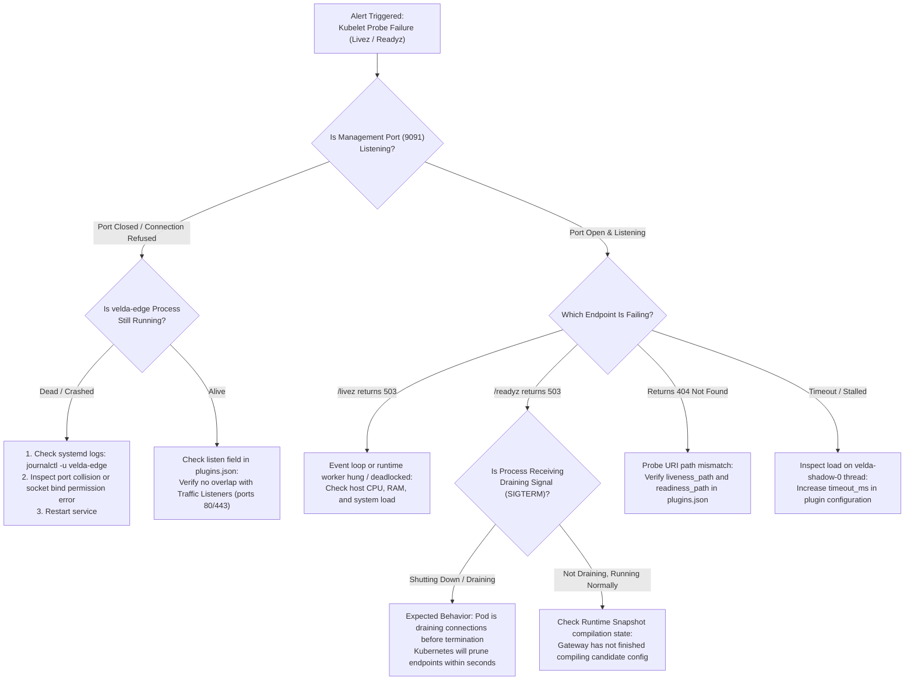

# Health & Readiness Probe Plugin (`health_probe`) — SRE Operational Runbook

This document serves as the emergency incident playbook and on-call runbook (**SRE Incident Playbook & On-Call Runbook**) designed for SRE, DevOps, and Platform Engineers responsible for operating Velda Edge Gateway clusters, monitoring Kubernetes liveness/readiness probes, and supervising upstream load balancers.

---

## 1. Emergency Incident Triage Matrix (On-Call Triage Matrix)

| Severity | Symptoms & Alerts | Root Cause Analysis | Rapid Mitigation Action | Resolution SLA |
| :---: | :--- | :--- | :--- | :---: |
| **P0** | Entire Pod replica set being killed/restarted in cascade by Kubelet (`CrashLoopBackOff` triggered by failed `/livez`) | Port conflict (port 9091 bound by another process), or process complete deadlock | Verify port conflicts via `ss -tulpn`; inspect core dumps and bootstrap startup logs | **< 5 minutes** |
| **P1** | `VeldaReadinessFailing` (`/readyz` continuously returns `503 Service Unavailable`) | Gateway has not finished loading `RuntimeSnapshot`, or lost connectivity to Control Plane to retrieve LKG | Inspect bootstrap logs; verify `is_ready` state and connectivity to PostgreSQL / Go Control Plane | **< 15 minutes** |
| **P2** | `VeldaProbeTimeout` (Kubelet reports connection timeout when probing `/livez` or `/readyz`) | Host-wide CPU saturation, or configured `timeout_ms` threshold is set too low for network jitter | Increase `timeout_ms` to 1000ms in plugin configuration via Control Plane API | **< 30 minutes** |
| **P3** | Kubelet receives `404 Not Found` when executing health probe | Path mismatch in Pod YAML (`livenessProbe.httpGet.path` differs from `plugins.json`) | Synchronize probe URI paths between Kubernetes Manifest and `plugins.json` (e.g. `/livez` vs `/healthz`) | **< 2 hours** |

---

## 2. Incident Triage Decision Flowchart (Triage Flowchart)



---

## 3. Diagnostic CLI Toolkit (Field Diagnostics)

When an alert fires via PagerDuty or Prometheus, SSH directly into the affected Velda Edge node and execute the following commands in sequence:

### 3.1 Direct Health Probe Verification
```bash
# Verify liveness (must return HTTP/1.1 200 OK with Content-Length: 0)
curl -i -m 2 http://127.0.0.1:9091/livez

# Verify readiness
curl -i -m 2 http://127.0.0.1:9091/readyz
```

*Response Evaluation*:
- `HTTP/1.1 200 OK`: Fully healthy state.
- `HTTP/1.1 503 Service Unavailable`: Process not yet ready or in graceful draining phase.
- `HTTP/1.1 404 Not Found`: Request URI path does not match `liveness_path` / `readiness_path` in `plugins.json`.
- `Connection refused`: Service failed to bind management socket or crashed.

---

### 3.2 Socket State & Port Conflict Verification
```bash
# Check if port 9091 is actively listened by velda-edge
ss -tulpn | grep 9091

# Alternative using netstat
netstat -tulpn | grep 9091
```

---

### 3.3 Inspecting Health Probe Operational Logs
```bash
# Inspect bootstrap initialization and socket binding logs
journalctl -u velda-edge -n 100 --no-pager | grep -i "health_probe"

# Follow real-time logs during shutdown / graceful draining events
journalctl -u velda-edge -f -o cat | grep -E "Health & readiness|draining"
```

---

## 4. Emergency Remediation Procedures

### 4.1 Pod Restart Loop Caused by Path Mismatch
If Kubelet is configured with `httpGet.path: /healthz` but the Gateway is configured with `liveness_path: /livez`:
1. Update configuration file or dispatch API mutation to Control Plane:
   ```json
   {
     "liveness_path": "/healthz",
     "readiness_path": "/readyz"
   }
   ```
2. Trigger Hot-Reload via UDS or Control Plane API:
   ```bash
   velda-cli reload
   ```
3. Verify that `curl -i http://127.0.0.1:9091/healthz` returns `200 OK`.

### 4.2 Management Port Colliding with Another Process
1. Identify the process holding port 9091:
   ```bash
   lsof -i :9091
   ```
2. If it is an orphaned or stale process: `kill -9 <PID>`.
3. Restart service cleanly: `systemctl restart velda-edge`.
