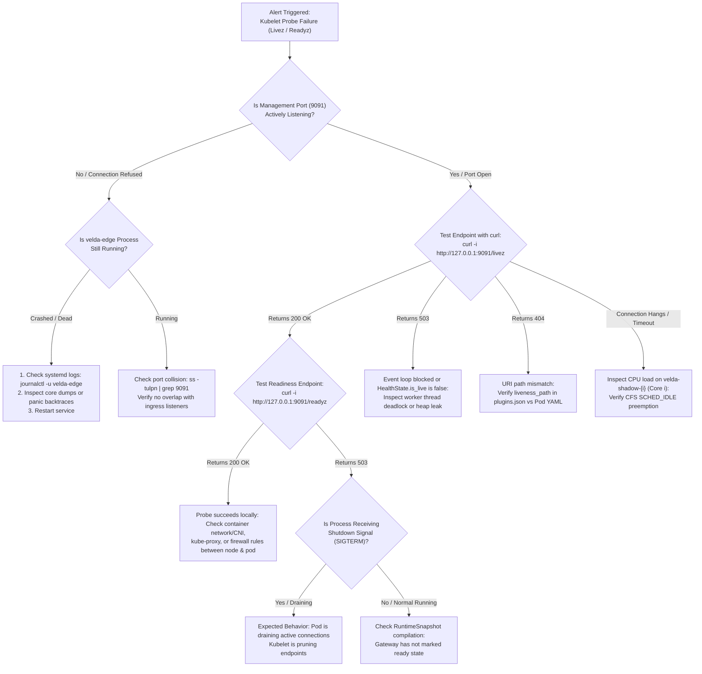

# Health & Readiness Probe Plugin (`health_probe`) — SRE Operational Runbook

This document serves as the operational runbook and emergency incident playbook for SRE, DevOps, and Platform Engineers operating Velda Edge Gateway clusters across Kubernetes, container orchestrators, and bare-metal environments.

---

## 1. Configuration Parameter Reference

Every configuration parameter is strictly validated by `validation.rs` at bootstrap and configuration reload. There are no implicit defaults or silent fallbacks.

| Field | Type | Validation Constraints | Operational Description | Recommended Production Value |
| :--- | :---: | :--- | :--- | :--- |
| `listen` | `String` | Non-empty; must parse into a valid `std::net::SocketAddr` (`IP:PORT`). | Dedicated IP:Port socket to bind and serve health check traffic. Must not overlap with any traffic listener. | `"0.0.0.0:9091"` |
| `liveness_path` | `String` | Must start with `/`; $\le 8$ bytes for SWAR acceleration (e.g. `"/livez"`). | HTTP request path for liveness probes. Returns `200 OK` when process is responsive; `503` if deadlocked. | `"/livez"` |
| `readiness_path` | `String` | Must start with `/`; $\le 8$ bytes for SWAR acceleration (e.g. `"/readyz"`). | HTTP request path for readiness probes. Returns `200 OK` when ready to serve traffic; `503` when draining or initializing. | `"/readyz"` |
| `check_interval_ms` | `u64` | `100` to `60_000` ms. | Background health assessment cadence. Determines how frequently internal subsystem health flags are synchronized. | `1000` (1s) |
| `timeout_ms` | `u64` | `100` to `30_000` ms; must be $\le \text{check\_interval\_ms}$. | Hard per-connection execution timeout. Aborts slowloris probes, stalled handshakes, or hung TCP sockets. | `500` (500ms) |

---

## 2. Tuned Operational Configuration Presets

### Preset 1: Kubernetes Production Microservices Cluster
Designed for dense Kubernetes clusters where Kubelet performs frequent, low-latency node-local checks over container virtual interfaces (`cbr0` / CNI).

```json
{
  "id": "health_probe",
  "type": "health_probe",
  "enabled": true,
  "config": {
    "listen": "0.0.0.0:9091",
    "liveness_path": "/livez",
    "readiness_path": "/readyz",
    "check_interval_ms": 1000,
    "timeout_ms": 250
  }
}
```

*Rationale*:
- `timeout_ms: 250`: Clamps malicious slowloris or stalled connection state machines quickly, preserving shadow worker capacity.
- `check_interval_ms: 1000`: Synchronizes readiness transitions rapidly to match Kubelet's `periodSeconds: 2`.

---

### Preset 2: Bare-Metal Edge Appliance & WAN / Hybrid Ingress
Designed for physical edge deployments where health checks originate from external hardware load balancers (F5, NetScaler, AWS Route53 Health Checks) traversing WAN or campus networks.

```json
{
  "id": "health_probe",
  "type": "health_probe",
  "enabled": true,
  "config": {
    "listen": "0.0.0.0:9091",
    "liveness_path": "/healthz",
    "readiness_path": "/readyz",
    "check_interval_ms": 5000,
    "timeout_ms": 1000
  }
}
```

*Rationale*:
- `timeout_ms: 1000`: Accommodates network jitter, multi-hop routing variance, and packet loss on WAN paths.
- `check_interval_ms: 5000`: Lowers CPU wakeups on power-constrained edge appliances.

---

### Preset 3: High-Reliability Graceful Draining & Canary Deployments
Optimized for zero-downtime rolling deployments where readiness transitions must be instantly detected by ingress controllers to eliminate connection resets.

```json
{
  "id": "health_probe",
  "type": "health_probe",
  "enabled": true,
  "config": {
    "listen": "0.0.0.0:9091",
    "liveness_path": "/livez",
    "readiness_path": "/readyz",
    "check_interval_ms": 500,
    "timeout_ms": 500
  }
}
```

*Pairing with Kubernetes Pod Spec*:
```yaml
lifecycle:
  preStop:
    exec:
      command: ["/bin/sh", "-c", "sleep 3"]
```

*Rationale*:
- `check_interval_ms: 500`: Flips readiness to `503` with sub-second responsiveness when SIGTERM arrives.
- The Kubernetes `preStop` hook `sleep 3` delays actual process teardown, giving kube-proxy and Ingress controllers sufficient time to propagate endpoint deletion across the cluster before active connections are severed.

---

## 3. Incident Triage Matrix (P0–P3)

| Severity | Symptoms & Alerts | Root Cause Analysis | Rapid Mitigation Action | Resolution SLA |
| :---: | :--- | :--- | :--- | :---: |
| **P0** | **Cluster-Wide Pod Cascade Restart**<br>`CrashLoopBackOff` on all edge pods. Kubelet events: `Liveness probe failed: connection refused`. | Management port collision (port 9091 already bound by another daemon), or catastrophic process panic during bootstrap. | 1. Run `ss -tulpn \| grep 9091` to check port conflicts.<br>2. Check system logs `journalctl -u velda-edge -n 100`.<br>3. Change `listen` port in `plugins.json` and hot-reload. | **< 5 minutes** |
| **P1** | **Pod Traffic Blackhole**<br>`/readyz` continuously returns `503 Service Unavailable`. Ingress removes pod from routing pool. | `RuntimeSnapshot` compilation pending, LKG snapshot missing, or database synchronization failure with Go Control Plane. | 1. Verify Control Plane connectivity.<br>2. Check logs for snapshot compilation errors.<br>3. Inspect `/var/lib/velda/lkg/` for corrupted cache files. | **< 15 minutes** |
| **P2** | **Intermittent Probe Timeouts**<br>Kubelet reports `Liveness probe timed out after 1s`. | Host CPU saturation on Core 0 starving the `SCHED_IDLE` companion worker, or `timeout_ms` set lower than network RTT. | 1. Check `pidstat -u -p <pid> 1` for Core 0 CPU steal.<br>2. Increase `timeout_ms` from 250ms to 1000ms.<br>3. Ensure CFS quota or dedicated core reservation. | **< 30 minutes** |
| **P3** | **Probe Returns 404 Not Found**<br>Monitoring dashboards or Kubelet receive HTTP 404. | URI path mismatch between Kubernetes Pod manifest (`httpGet.path`) and `plugins.json` (`liveness_path`). | Align path strings between pod manifest and `plugins.json` (e.g. ensure both use `/livez`). | **< 2 hours** |

---

## 4. Incident Triage Decision Flowchart



---

## 5. Field Diagnostic CLI Toolkit

When triaging health probe incidents, execute the following commands on the affected node:

### 5.1 Direct Socket & HTTP Probing
```bash
# Test Liveness Probe (Expect HTTP/1.1 200 OK, Content-Length: 0)
curl -i -m 2 http://127.0.0.1:9091/livez

# Test Readiness Probe
curl -i -m 2 http://127.0.0.1:9091/readyz

# Inspect exact raw headers and wire response
nc -zv 127.0.0.1 9091
printf "GET /livez HTTP/1.1\r\nHost: localhost\r\n\r\n" | nc 127.0.0.1 9091
```

### 5.2 Socket State & Conflict Inspection
```bash
# Check if port 9091 is bound and identify the owner PID
ss -tulpn | grep 9091

# Inspect socket backlog and receive/send queue lengths
ss -tlm 'sport = :9091'

# Check if another process holds port 9091
lsof -i :9091
```

### 5.3 Thread Scheduling & CPU Verification
```bash
# Check CPU usage of the gateway process broken down by thread
pidstat -t -p $(pgrep -f velda-edge) 1 5

# Inspect SCHED_IDLE scheduling status for shadow workers
chrt -p $(pgrep -f velda-shadow)

# Check operational logs for socket binding or draining messages
journalctl -u velda-edge -n 100 --no-pager | grep -E "health_probe|draining|listening"
```

---

## 6. Emergency Remediation Playbooks

### Playbook 1: Resolving Management Port Collision
**Symptom**: Gateway fails to start; logs display `Failed to acquire health probe shadow socket: Address already in use`.
1. Identify the offending process:
   ```bash
   lsof -i :9091
   ```
2. If an orphaned gateway process is holding the socket:
   ```bash
   kill -15 <PID>
   sleep 2
   kill -9 <PID> 2>/dev/null
   ```
3. If port 9091 is allocated to an external daemon, update `plugins.json` with an available port:
   ```json
   {
     "config": {
       "listen": "0.0.0.0:9095"
     }
   }
   ```
4. Restart service or trigger hot-reload:
   ```bash
   systemctl restart velda-edge
   ```

---

### Playbook 2: Resolving Continuous 503 on `/readyz`
**Symptom**: Pod fails readiness checks; traffic is not routed.
1. Check process uptime and logs:
   ```bash
   journalctl -u velda-edge -n 50 --no-pager | grep -i "snapshot"
   ```
2. Verify if Go Control Plane is reachable and supplying configuration:
   ```bash
   curl -i http://127.0.0.1:8080/v1/snapshot/status
   ```
3. If Control Plane is down, verify if Data Plane loaded its Local Last-Known-Good (LKG) snapshot:
   ```bash
   ls -la /var/lib/velda/lkg/
   ```
4. If the snapshot was corrupted, restore LKG from backup and trigger reload.

---

### Playbook 3: Mitigating Slowloris & Stalled Probes
**Symptom**: Health probe port becomes unresponsive under port scanning or slowloris connections.
1. Inspect active TCP connections on port 9091:
   ```bash
   ss -tan state established '( sport = :9091 )'
   ```
2. Check for connections lingering in `CLOSE_WAIT` or `FIN_WAIT`:
   ```bash
   ss -tan '( sport = :9091 )'
   ```
3. Verify that `timeout_ms` is actively configured in `plugins.json`:
   ```json
   {
     "timeout_ms": 250
   }
   ```
4. Trigger hot-reload to clamp stalled connections.

---

### Playbook 4: Zero-Downtime Rolling Update & Pod Teardown
**Symptom**: During Kubernetes pod rolling updates, clients experience sporadic `502 Bad Gateway` or `ECONNRESET`.
1. **Root Cause**: Kubernetes endpoint propagation is asynchronous. When Kubelet sends SIGTERM, kube-proxy, CoreDNS, and ingress controllers take 1–3 seconds to remove the terminating pod from their forwarding tables.
2. **Mitigation**: Add a `preStop` hook to the pod specification:
   ```yaml
   lifecycle:
     preStop:
       exec:
         command: ["/bin/sh", "-c", "sleep 3"]
   ```
3. **Execution Sequence**:
   - Step 1: Kubelet triggers `preStop` hook (`sleep 3`).
   - Step 2: During the sleep, Velda Edge continues serving in-flight and newly arrived traffic normally.
   - Step 3: Kubelet updates `EndpointSlice`; ingress routes traffic to remaining healthy pods.
   - Step 4: After 3 seconds, Kubelet sends `SIGTERM`.
   - Step 5: Velda Edge intercepts SIGTERM, sets `is_draining = true`, flips `/readyz` to `503`, drains active connections gracefully, and terminates cleanly.
