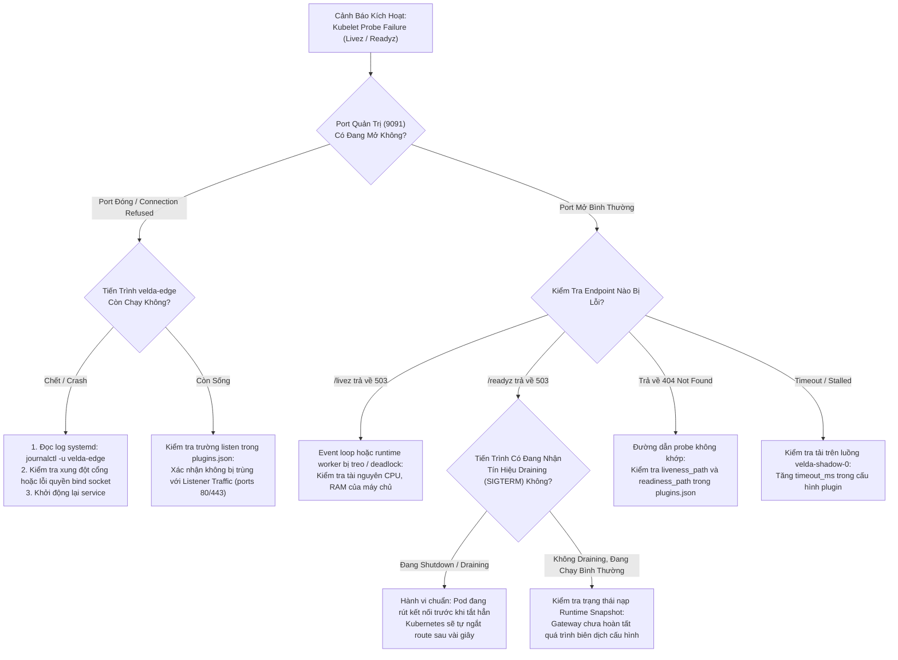

# Health & Readiness Probe Plugin (`health_probe`) — SRE Operational Runbook

Tài liệu này là cẩm nang vận hành khẩn cấp (**SRE Incident Playbook & On-Call Runbook**) dành riêng cho kỹ sư SRE, DevOps và Operator chịu trách nhiệm trực ca vận hành cụm Velda Edge Gateway, giám sát các probe liveness/readiness của Kubernetes và các bộ cân bằng tải thượng tầng.

---

## 1. Ma Trận Ứng Cứu Sự Cố Khẩn Cấp (On-Call Triage Matrix)

| Mức Độ | Triệu Chứng & Cảnh Báo | Nguyên Nhân Khả Dĩ | Hành Động Khắc Phục Nhanh (Mitigation) | SLA Xử Lý |
| :---: | :--- | :--- | :--- | :---: |
| **P0** | Toàn bộ cụm Pod bị Kubelet restart hàng loạt (`CrashLoopBackOff` do fail liveness `/livez`) | Port xung đột (port 9091 bị chiếm), hoặc tiến trình bị deadlock hoàn toàn | Kiểm tra xung đột cổng qua `ss -tulpn`; kiểm tra core dump hoặc log lỗi khởi động | **< 5 phút** |
| **P1** | `VeldaReadinessFailing` (`/readyz` trả về `503 Service Unavailable` liên tục) | Gateway chưa nạp xong RuntimeSnapshot, hoặc chưa kết nối được Control Plane để lấy LKG | Kiểm tra log bootstrap; xác nhận trạng thái `is_ready` và kết nối tới PostgreSQL / Go Control Plane | **< 15 phút** |
| **P2** | `VeldaProbeTimeout` (Kubelet báo timeout khi gọi probe `/livez` hoặc `/readyz`) | Quá tải CPU toàn hệ thống, hoặc cấu hình `timeout_ms` quá thấp so với tải mạng | Tăng `timeout_ms` lên 1000ms trong cấu hình plugin qua Control Plane API | **< 30 phút** |
| **P3** | Kubelet nhận mã `404 Not Found` khi gọi probe | Sai đường dẫn trong Pod YAML (`livenessProbe.httpGet.path` lệch so với `plugins.json`) | Đồng bộ lại đường dẫn URI giữa Kubernetes Manifest và `plugins.json` (ví dụ `/livez` vs `/healthz`) | **< 2 giờ** |

---

## 2. Cây Quyết Định Xử Lý Sự Cố (Triage Flowchart)



---

## 3. Bộ Lệnh Chẩn Đoán Trực Tiếp Tại Hiện Trường (Diagnostic CLI Toolkit)

Khi nhận cảnh báo từ PagerDuty/Prometheus, SSH trực tiếp vào node Velda Edge bị cảnh báo và thực thi tuần tự các lệnh sau:

### 3.1 Kiểm Tra Phản Hồi Trực Tiếp Của Health Probe
```bash
# Kiểm tra liveness (phải trả về HTTP/1.1 200 OK với Content-Length: 0)
curl -i -m 2 http://127.0.0.1:9091/livez

# Kiểm tra readiness
curl -i -m 2 http://127.0.0.1:9091/readyz
```

*Đánh giá kết quả*:
- `HTTP/1.1 200 OK`: Trạng thái hoàn toàn khỏe mạnh.
- `HTTP/1.1 503 Service Unavailable`: Tiến trình đang chưa sẵn sàng hoặc đang trong trạng thái draining.
- `HTTP/1.1 404 Not Found`: Đường dẫn URL không khớp với cấu hình trong `plugins.json`.
- `Connection refused`: Service chưa bind được port hoặc đã sập.

---

### 3.2 Kiểm Tra Trạng Thái Socket & Xung Đột Cổng
```bash
# Kiểm tra port 9091 có đang được listen bởi velda-edge không
ss -tulpn | grep 9091

# Hoặc dùng netstat
netstat -tulpn | grep 9091
```

---

### 3.3 Đọc Log Vận Hành Của Health Probe Từ Tiến Trình
```bash
# Đọc log khởi động và lắng nghe của health_probe
journalctl -u velda-edge -n 100 --no-pager | grep -i "health_probe"

# Theo dõi log thời gian thực khi có tín hiệu shutdown/draining
journalctl -u velda-edge -f -o cat | grep -E "Health & readiness|draining"
```

---

## 4. Quy Trình Khắc Phục Khẩn Cấp (Emergency Remediation)

### 4.1 Pod Bị Kubelet Restart Liên Tục Do Sai Đường Dẫn
Nếu Kubelet cấu hình `httpGet.path: /healthz` nhưng Gateway cấu hình `liveness_path: /livez`:
1. Mở file cấu hình runtime hoặc gửi API cập nhật tới Control Plane:
   ```json
   {
     "liveness_path": "/healthz",
     "readiness_path": "/readyz"
   }
   ```
2. Gửi tín hiệu Hot-Reload qua UDS hoặc qua API Control Plane:
   ```bash
   velda-cli reload
   ```
3. Kiểm tra lại `curl -i http://127.0.0.1:9091/healthz` trả về `200 OK`.

### 4.2 Port Quản Trị Bị Chiếm Dụng Bởi Tiến Trình Khác
1. Xác định tiến trình đang chiếm cổng:
   ```bash
   lsof -i :9091
   ```
2. Nếu là tiến trình rác hoặc phiên bản cũ bị treo: `kill -9 <PID>`.
3. Khởi động lại service: `systemctl restart velda-edge`.
