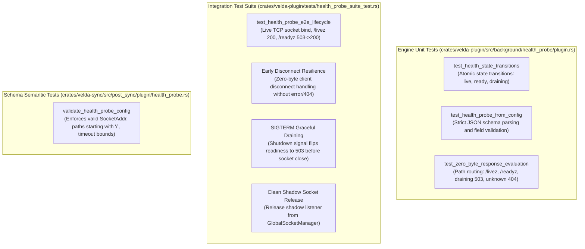

# Health & Readiness Probe Plugin (`health_probe`) — Test Specification

This document details the automated unit test catalog, end-to-end integration test suite, Kubernetes lifecycle simulation, and reproduction instructions for the **`health_probe`** background plugin in Velda Edge.

---

## 1. Test Architecture & Scope

The `health_probe` test suite verifies configuration validation, lock-free state transitions, zero-byte body static responses, timeout enforcement, early disconnect handling, and Kubernetes pod lifecycle simulation across three distinct boundaries:



---

## 2. Automated Test Catalog

### 2.1 Engine Unit Tests (`crates/velda-plugin/src/background/health_probe/plugin.rs`)

| Test Identifier | Module | Description | Assertions & Invariants |
| :--- | :--- | :--- | :--- |
| `test_health_state_transitions` | `plugin.rs` | Verifies atomic state transitions on `HealthState`. | Initial state has `is_live=true`, `is_ready=false`, `is_draining=false`. Calling `set_ready(true)` updates readiness; calling `set_draining(true)` updates draining state. |
| `test_health_probe_from_config` | `plugin.rs` | Verifies declarative plugin instantiation from `PluginConfig`. | Parses `listen: "127.0.0.1:9095"`, `liveness_path: "/livez"`, `readiness_path: "/readyz"`, `check_interval_ms: 1000`, `timeout_ms: 500`. |
| `test_zero_byte_response_evaluation` | `plugin.rs` | Validates path matching and static byte selection. | Evaluates `/healthz` $\to$ `200 OK` (when live), `/healthz` $\to$ `503` (when not live), `/readyz` $\to$ `503` (not ready), `/readyz` $\to$ `200` (ready), `/readyz` $\to$ `503` (draining), `/status` $\to$ `404 Not Found`. |

---

### 2.2 Integration Test Catalog (`crates/velda-plugin/tests/health_probe_suite_test.rs`)

| Test Identifier | Scope | Scenario | Verification & Assertions |
| :--- | :--- | :--- | :--- |
| `test_health_probe_e2e_lifecycle` | End-to-End | Live TCP socket binding on `127.0.0.1:19091` | 1. Sends `GET /livez` $\to$ verifies `HTTP/1.1 200 OK`.<br>2. Sends `GET /readyz` before ready $\to$ verifies `HTTP/1.1 503 Service Unavailable`.<br>3. Flips `state.set_ready(true)` $\to$ sends `GET /readyz` $\to$ verifies `HTTP/1.1 200 OK`.<br>4. Sends `GET /status` $\to$ verifies `HTTP/1.1 404 Not Found`.<br>5. Connects and immediately drops socket $\to$ verifies early return without panic.<br>6. Sends shutdown signal $\to$ verifies readiness flips to 503 and socket releases cleanly. |

---

### 2.3 Semantic Configuration Tests (`crates/velda-sync/src/post_sync/plugin/health_probe.rs`)

| Test Case | Condition | Expected Result |
| :--- | :--- | :--- |
| Valid Config | `{"listen": "0.0.0.0:9091", "liveness_path": "/livez", ...}` | `Ok(HealthProbeConfig)` |
| Missing Field | Missing `listen` or `timeout_ms` | `Err(SyncError::Validation)` |
| Invalid SocketAddr | `listen: "invalid-ip:9091"` | `Err(SyncError::Validation)` |
| Invalid Path | `liveness_path: "livez"` (missing leading `/`) | `Err(SyncError::Validation)` |
| Out of Bounds Timeout | `timeout_ms: 50` ($< 100\text{ms}$) or `50000` ($> 30000\text{ms}$) | `Err(SyncError::Validation)` |

---

## 3. Reproduction & Execution Commands

### 3.1 Run All Health Probe Unit Tests
```bash
cargo test -p velda-plugin -- health_probe::plugin::tests
```

### 3.2 Run End-to-End Integration Suite
```bash
cargo test -p velda-plugin --test health_probe_suite_test
```

### 3.3 Run Configuration Validation Tests
```bash
cargo test -p velda-sync -- post_sync::plugin::health_probe::tests
```

### 3.4 Verification with Clippy & Warnings
```bash
cargo clippy -p velda-plugin --all-targets --all-features -- -D warnings
```
