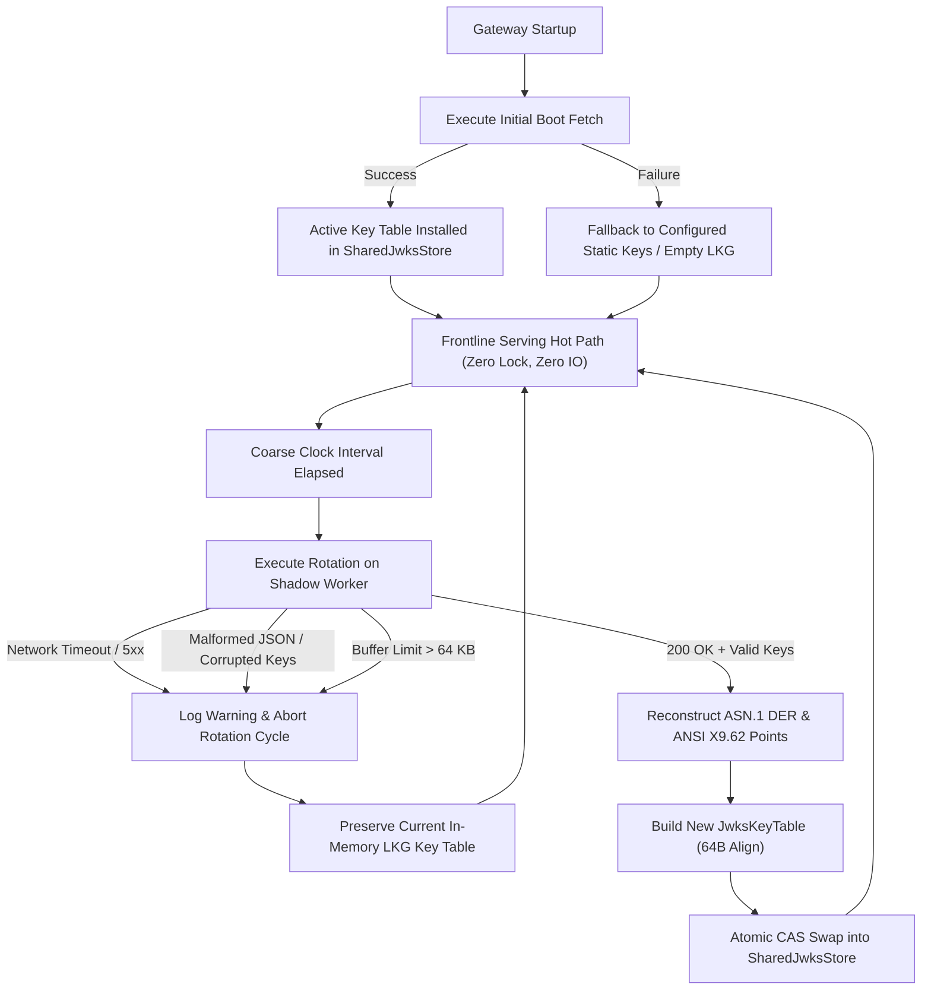

# JWKS Key Rotator — Deep Architectural Specification

```text
+-----------------------------------------------------------------------------------------------------------------+
|                               JWKS KEY ROTATOR: MULTI-CORE HARDWARE & MEMORY TOPOLOGY                           |
|                                                                                                                 |
|  [SHADOW LOGISTICS DOMAIN: SCHED_IDLE]                      [FRONTLINE SERVING DOMAIN: REAL-TIME HOT PATH]      |
|  Assigned Core i (velda-shadow-{i})                         Cores 0..N-1 (velda-worker-0..n)                    |
|  ┌──────────────────────────────────────────────┐           ┌──────────────────────────────────────────────┐    |
|  │ JwksRotatorPlugin (plugin.rs)                │           │ JwtAuthPlugin (crypto.rs)                    │    |
|  │  - Coarse Clock interval check               │           │  - Active request serving hot path           │    |
|  │  - Outbound TCP/TLS 1.3 socket engine        │           │  - Zero syscall, zero heap allocation        │    |
|  │  - Bounded 64 KB receive buffer (fetcher.rs) │           │  - Load JwksKeyTable pointer via ArcSwap     │    |
|  └──────────────────────┬───────────────────────┘           └──────────────────────┬───────────────────────┘    |
|                         │ (Build New Table)                                        │ (Lock-Free Read Lease)     |
|                         ▼                                                          ▼                            |
|  ┌──────────────────────────────────────────────┐           ┌──────────────────────────────────────────────┐    |
|  │ Staging in Private RAM:                      │           │ L1D / L2 Cache Lines (State: Shared [S]):    │    |
|  │ JwksKeyTable (2240 Bytes, Align 64)          │           │ [Cache Line 0: kid_index [u64; 8]] (64B)     │    |
|  │ - CL 0: kid_index [u64; 8]                   │           │ [Cache Lines 1..32: Slots 0..7] (2048B)      │    |
|  │ - CL 1..32: Key Slots 0..7 (256B each)       │           │ [Cache Line 33: Metadata & Alignment] (64B)  │    |
|  └──────────────────────┬───────────────────────┘           └──────────────────────▲───────────────────────┘    |
|                         │                                                          │                            |
|                         │ lock cmpxchgq (Atomic CAS Swap)                          │ Pointer Invalidation       |
|                         ▼                                                          │ (RFO Broadcast: S -> I)    |
|  ┌─────────────────────────────────────────────────────────────────────────────────┴───────────────────────┐    |
|  │ SharedJwksStore (ArcSwap<JwksKeyTable>) — CPU Interconnect Bus (Intel UPI / AMD Infinity Fabric)        │    |
|  └─────────────────────────────────────────────────────────────────────────────────────────────────────────┘    |
+-----------------------------------------------------------------------------------------------------------------+
```

---

## 1. System Placement & Asymmetric Worker Model

The `jwks_rotator` background service enforces Velda Edge's **Rule 2.9 (Frontline Traffic Worker vs Shadow Logistics Invariant)** by isolating key lifecycle management from request execution:

```text
Latency Domain Separation:
┌──────────────────────────────────────────┐       ┌──────────────────────────────────────────┐
│ Frontline Serving Domain (Hot Path)      │       │ Shadow Logistics Domain (Background)     │
├──────────────────────────────────────────┤       ├──────────────────────────────────────────┤
│ - Throughput-critical request forwarding │       │ - Periodic IdP polling (e.g., 3600s)     │
│ - Strict 0-allocation invariant          │       │ - TCP handshake & TLS 1.3 negotiation    │
│ - Zero lock contention                   │       │ - RFC 7517 JSON deserialization          │
│ - Zero network I/O, zero disk I/O        │       │ - ASN.1 DER & EC point reconstruction    │
│ - Direct cacheline indexing              │       │ - Contiguous table allocation & layout   │
└──────────────────────────────────────────┘       └──────────────────────────────────────────┘
```

1. **Frontline Serving Workers (`velda-worker-{id}`)**:
   - Execute strictly on dedicated CPU cores pinned to user traffic.
   - Read key tables lock-free via immutable reference leases.
   - Never initiate outbound network connections, never block on mutexes, and never parse JSON.
2. **Shadow Logistics Worker (`velda-shadow-{id}`)**:
   - Operates on a dedicated companion thread pinned under `SCHED_IDLE`.
   - Owns outbound network I/O to the Identity Provider (IdP), certificate parsing, and DER format reconstruction.
   - Constructs the complete replacement data structure in background memory before atomically swapping it into the serving path.

---

## 2. Physical Memory Geometry & Cache Alignment

To ensure deterministic CPU cache behavior across all cores, the shared key table is laid out with strict cacheline alignment:

```rust
#[repr(C, align(64))]
pub struct JwksKeyTable {
    pub kid_index: [u64; MAX_JWKS_SLOTS],       // 64 Bytes  (Cache Line 0)
    pub slots: [JwksKeySlot; MAX_JWKS_SLOTS],   // 2048 Bytes (Cache Lines 1..32)
    pub active_count: u8,                       // Metadata
    pub default_slot: u8,                       // Metadata
    // Explicit padding to 64-byte alignment boundary (Cache Line 33)
}
```

### 2.1 Hexadecimal Memory Map (`0x0000` – `0x08C0`)

The memory layout spans exactly 2,240 bytes (35 cache lines of 64 bytes each):

```text
Offset Range      Size   Cache Line        Contents / Structural Field
───────────────────────────────────────────────────────────────────────────────────────────
0x0000 – 0x003F    64 B   Cache Line 0      kid_index: [u64; 8] (Slots 0..7 64-bit FNV hashes)
───────────────────────────────────────────────────────────────────────────────────────────
0x0040 – 0x013F   256 B   Cache Lines 1..4  Slot 0: JwksKeySlot
  +0x00 – +0x07     8 B                     internal_kid: u64
  +0x08 – +0x0F     8 B                     raw_kid_hash: u64
  +0x10 – +0x2F    32 B                     raw_kid: [u8; 32] (Inline ASCII string, 0 heap)
  +0x30 – +0x30     1 B                     raw_kid_len: u8
  +0x31 – +0x31     1 B                     alg: JwtAlgorithm (Enum tag)
  +0x32 – +0x32     1 B                     is_active: u8
  +0x33 – +0x37     5 B                     _reserved: [u8; 5] (Padding to 8-byte boundary)
  +0x38 – +0xFF   200 B                     key: Option<VerifierKey> (Crypto key handle)
───────────────────────────────────────────────────────────────────────────────────────────
0x0140 – 0x023F   256 B   Cache Lines 5..8  Slot 1: JwksKeySlot (Identical 256-byte layout)
0x0240 – 0x033F   256 B   Cache Lines 9..12 Slot 2: JwksKeySlot
0x0340 – 0x043F   256 B   Cache Lines 13..16 Slot 3: JwksKeySlot
0x0440 – 0x053F   256 B   Cache Lines 17..20 Slot 4: JwksKeySlot
0x0540 – 0x063F   256 B   Cache Lines 21..24 Slot 5: JwksKeySlot
0x0640 – 0x073F   256 B   Cache Lines 25..28 Slot 6: JwksKeySlot
0x0740 – 0x083F   256 B   Cache Lines 29..32 Slot 7: JwksKeySlot
───────────────────────────────────────────────────────────────────────────────────────────
0x0840 – 0x087F    64 B   Cache Line 33     Table Metadata & Alignment Tail
  +0x00 – +0x00     1 B                     active_count: u8
  +0x01 – +0x01     1 B                     default_slot: u8
  +0x02 – +0x3F    62 B                     Alignment Padding to multiple of 64 bytes
───────────────────────────────────────────────────────────────────────────────────────────
Total Size: 2240 Bytes (35 x 64-byte Cache Lines)
```

### 2.2 Micro-Architectural Invariants of the Layout

1. **Cache Line 0 as Guard Cacheline**:
   - `kid_index: [u64; 8]` is placed at offset `0x0000`.
   - When a request thread evaluates a JWT, the CPU brings only Cache Line 0 into L1D cache during key lookup.
   - If the key ID does not match any slot, key search terminates without touching Cache Lines 1..32. The CPU never requests or prefetches the 2,048 bytes of slot key data on key mismatches.
2. **Struct Boundary Cacheline Separation**:
   - Each `JwksKeySlot` is exactly 256 bytes (a power-of-two multiple of 64 bytes).
   - Slot boundaries align with physical cache line boundaries. No single field in a slot crosses a 64-byte boundary, mitigating split-load penalties and hardware bus lock cycles.
3. **Inline Key Identifier**:
   - Raw `kid` bytes are stored directly inside the struct (`raw_kid: [u8; 32]`).
   - String verification after an integer hash match resolves within the already-loaded slot cache lines without chasing heap pointers.

---

## 3. Hardware Bus & MESI Coherence State Transitions

Updating the key table across multiple CPU cores without mutex locks relies on atomic pointer replacement and the CPU's cache coherence protocol:

```text
                                MESI CACHE STATE TRANSITIONS
                                
  Frontline Cores (Cores 1..N)                         Shadow Core (Core 0)
  ┌───────────────────────────┐                         ┌───────────────────────────┐
  │ L1D Cache: [Pointer -> T0]│                         │ Builds T1 in Private RAM  │
  │ State: Shared [S]         │                         │ State: Modified [M]       │
  └─────────────┬─────────────┘                         └─────────────┬─────────────┘
                │                                                     │
                │              1. Atomic Pointer CAS                  │
                │           (SharedJwksStore::update)                 │
                │        ◄────────────────────────────────────────────┤
                │             [RFO Broadcast via Bus]                 │
                │                                                     ▼
                ▼                                       ┌───────────────────────────┐
  ┌───────────────────────────┐                         │ Store Buffer Flushed      │
  │ Invalidation Queue Acts:  │                         │ State: Modified [M]       │
  │ Line holding Pointer      │                         └───────────────────────────┘
  │ transitions to:           │
  │ State: Invalid [I]        │
  └─────────────┬─────────────┘
                │
                │ 2. Next Hot-Path Read:
                │    L1D Miss on Pointer
                ▼
  ┌───────────────────────────┐
  │ Fetch T1 from L3/LLC      │
  │ State transitions to:     │
  │ State: Shared [S]         │
  └───────────────────────────┘
```

### 3.1 Step-by-Step Coherence Mechanics

1. **Normal Serving State (Read-Dominant)**:
   - Frontline cores run requests concurrently, each holding the memory address of the active `JwksKeyTable` ($T_0$) in their private L1D/L2 caches.
   - The cache lines containing this pointer are in the **Shared (S)** state across all socket cores. Reading the pointer incurs zero bus traffic.
2. **Atomic Swap & Request For Ownership (RFO)**:
   - The Shadow worker finishes populating the new table ($T_1$) in background memory.
   - It performs an atomic pointer swap into `SharedJwksStore` (`ArcSwap`).
   - The CPU core executing the swap issues a **Request For Ownership (RFO)** broadcast across the interconnect bus (Intel UPI or AMD Infinity Fabric).
   - This broadcast marks the cache line holding the table pointer as **Invalid (I)** in the L1D/L2 caches of all other cores.
3. **Core Local Transition & Zero Request Stall**:
   - The pointer cache line transitions to **Modified (M)** on the shadow core, and its store buffer is flushed.
   - Frontline cores currently in the middle of validating a request hold an active reference handle to $T_0$. Their access to $T_0$'s key slots proceeds uninterrupted because $T_0$'s memory has not been altered or freed.
4. **Subsequent Serving Cycle**:
   - The next request on a frontline core attempts to load the pointer from `SharedJwksStore`.
   - The invalid cache line triggers an L1D read miss, pulling the updated pointer address ($T_1$) from shared L3 cache into L1D, transitioning the line back to **Shared (S)**.

---

## 4. Memory Reclamation & RCU Debt-Tracking Lifecycle

Because frontline workers read key tables concurrently without mutual exclusion locks, the memory of superseded tables cannot be immediately deallocated:

```text
                             TABLE LIFECYCLE & RECLAMATION
                             
    Time
     │    Shadow Worker                 Frontline Worker A           Frontline Worker B
     │   (Rotator Daemon)              (Fast In-Flight Request)     (Slow In-Flight Request)
     ▼  ────────────────────────────────────────────────────────────────────────────────────
        T0 Active in RAM
                                        Acquires Guard(T0)
                                        (Debt Slot Registered)
                                                                     Acquires Guard(T0)
                                                                     (Debt Slot Registered)
        Staged T1 Ready
        Atomic Swap (CAS)
        T0 Superseded
        (Enters Grace Period)
                                        Completes Verification
                                        Drops Guard(T0)
                                        (Debt Slot Cleared)
                                                                     Serving in-flight...
                                                                     (T0 remains pinned in RAM)
                                                                     
                                                                     Completes Verification
                                                                     Drops Guard(T0)
                                                                     (Last Debt Slot Cleared)
        Grace Period Discharged
        Free T0 (___rust_dealloc)
```

### 4.1 Debt-Based Hazard Tracking (`ArcSwap`)

`SharedJwksStore` utilizes epoch-based debt tracking rather than global mutex locks or unconditional atomic increments:
1. **Fast-Path Read (`load`)**:
   - Frontline threads register an atomic read debt in a thread-local or core-local reservation slot.
   - If the slot is uncontended, the pointer is loaded without modifying the global atomic reference counter of the `Arc`.
2. **Grace Period Deferral**:
   - When `SharedJwksStore::update()` installs a new table, the old table enters a **Grace Period**.
   - The thread checks for active reader debts across all worker slots. If active debts exist, deallocation is deferred.
3. **Deallocation on Final Release**:
   - As in-flight requests finish cryptographic verification, they drop their guards, clearing their debt slots.
   - Once all debts referencing $T_0$ reach zero, the underlying buffer and its cryptographic handles are reclaimed without pausing active serving threads.

---

## 5. Non-Blocking Outbound IdP Engine & Boundary Enforcement

The background fetcher (`fetcher.rs`) implements strict boundary enforcement to protect edge infrastructure during key rotation:

```text
                         OUTBOUND FETCH PIPELINE & BOUNDARIES
                         
      IdP URI: "https://auth.example.com/.well-known/jwks.json"
                             │
                             ▼
     ┌──────────────────────────────────────────────────────────────┐
     │ Non-blocking TCP Stream (tokio::net::TcpStream)              │
     │  - Strict connect_timeout (bounded to <= 5s)                 │
     │  - Asynchronous DNS resolution via Tokio runtime             │
     └──────────────────────────────┬───────────────────────────────┘
                                    │
                                    ▼
     ┌──────────────────────────────────────────────────────────────┐
     │ TLS 1.3 Handshake (tokio_rustls + AWS-LC Crypto Provider)    │
     │  - Root Certificate Store validation                         │
     │  - Server Name Indication (SNI) enforcement                  │
     └──────────────────────────────┬───────────────────────────────┘
                                    │
                                    ▼
     ┌──────────────────────────────────────────────────────────────┐
     │ HTTP/1.1 Bounded Stream Intake                               │
     │  - Fixed receive chunk buffer: [0u8; 4096]                   │
     │  - Hard ceiling: MAX_JWKS_RESPONSE_BYTES = 64 KB (65,536 B)  │
     │  - Immediate error & disconnect if response exceeds 64 KB    │
     └──────────────────────────────┬───────────────────────────────┘
                                    │
                                    ▼
     ┌──────────────────────────────────────────────────────────────┐
     │ In-Memory HTTP Header Parsing (httparse)                     │
     │  - Zero heap allocation status code & header validation      │
     │  - Status != 200 -> Abort rotation, preserve in-memory LKG   │
     └──────────────────────────────────────────────────────────────┘
```

### 5.1 Defense Against Buffer Exhaustion

1. **Fixed Memory Ceiling (64 KB)**:
   - Malicious or compromised IdPs might stream unbounded JSON payloads (e.g., hundreds of megabytes).
   - The stream intake loop accumulates incoming chunks into an in-memory buffer up to `MAX_JWKS_RESPONSE_BYTES` (64 KiB).
   - If `resp_raw.len() > 64 * 1024`, the connection is severed immediately, the buffer is dropped, and an error is logged.
2. **Socket Cancellation Safety**:
   - Network operations are wrapped in `tokio::time::timeout`.
   - If an IdP stalls mid-transfer, timeout futures cleanly tear down the `TcpStream` handle, closing the underlying file descriptor and preventing socket descriptor leaks.

---

## 6. Cryptographic Derivation & DER Normalization

The JSON Web Key Set (RFC 7517) transports public keys as base64url-encoded parameters. The rotator translates these representations into contiguous binary DER / raw structures:

```text
  RFC 7517 JSON Format                           Contiguous In-Memory Layout
┌───────────────────────────────┐               ┌─────────────────────────────────┐
│ RSA Key:                      │               │ ASN.1 PKCS#1 RSAPublicKey DER   │
│ - kty: "RSA"                  │               │ SEQUENCE {                      │
│ - n: base64url(Modulus)       │ ────────────► │   INTEGER modulus,              │
│ - e: base64url(Exponent)      │               │   INTEGER publicExponent        │
│                               │               │ }                               │
├───────────────────────────────┤               ├─────────────────────────────────┤
│ EC Key:                       │               │ ANSI X9.62 Uncompressed Point   │
│ - kty: "EC", crv: "P-256"     │ ────────────► │ 0x04 || X_bytes (32B)           │
│ - x: base64url(X-Coord)       │               │      || Y_bytes (32B)           │
│ - y: base64url(Y-Coord)       │               │ (65 Bytes Total)                │
└───────────────────────────────┘               └─────────────────────────────────┘
```

### 6.1 Two's Complement Integer Padding in ASN.1 DER

When constructing the RSA `RSAPublicKey` sequence:
- ASN.1 DER integers are signed. If the most significant bit of the modulus $n$ is `1` (`byte[0] & 0x80 != 0`), an unpadded conversion produces a negative integer, causing verification failures in standard cryptographic engines.
- The parser detects this condition and prepends a `0x00` byte, expanding a 256-byte modulus to 257 bytes while maintaining strict DER compliance.
- Moduli under 2048 bits ($\le 255$ bytes) are rejected during parsing.

---

## 7. Fault Isolation & In-Memory LKG Preservation

The data plane is architected for uninterrupted service during external Identity Provider outages through in-memory LKG retention:



1. **Autonomous Operation**:
   - If the IdP suffers an outage, network partition, or DNS failure, the rotation loop catches the error, logs a diagnostic warning, and terminates the cycle.
   - `SharedJwksStore` is never modified on failure.
   - Frontline workers continue verifying tokens against the in-memory Last Known Good (LKG) table without dropped requests or elevated error rates.
2. **Static Key Preservation (Slot 0 Invariant)**:
   - When configured with `preserve_static_key: true`, the rotator reads Slot 0 from the existing table before parsing external keys.
   - Even if the external IdP rotates or drops emergency emergency fallback keys, Slot 0 remains pinned to the pre-configured root key.

---

## 8. Empirical Implementation Proof (Assembly & Symbols)

The micro-architectural invariants above are verified in the compiled release binary (`velda_plugin-*.s`):

### 8.1 256-Byte Slot Stride & Deallocation Mechanics

Inspection of the generated drop glue confirms the exact 256-byte physical offset between slots and the offset of the key handle within each slot:

```assembly
# From target/release/deps/velda_plugin-*.s:
# core::ptr::drop_glue<JwksKeyTable>
movl  120(%rdi), %eax    # Slot 0: Discriminant at offset 120 (64B index + 56B slot head)
...
movl  376(%rbx), %eax    # Slot 1: Discriminant at offset 376 (120 + 256B stride)
...
movl  632(%rbx), %eax    # Slot 2: Discriminant at offset 632 (376 + 256B stride)
```

### 8.2 Vectorized Batch Hash Commit

Populating the 64-byte `kid_index` array utilizes aligned 256-bit AVX store instructions, writing 4 key hashes per instruction without scalar loop overhead:

```assembly
# Batch hash write inside table population:
vmovaps 288(%rsp), %ymm0     # Load slots 0..3 hashes (32 bytes)
vmovaps 320(%rsp), %ymm1     # Load slots 4..7 hashes (32 bytes)
vmovaps %ymm0, 2432(%rsp)    # Store 32 bytes aligned directly to kid_index[0..3]
vmovaps %ymm1, 2464(%rsp)    # Store 32 bytes aligned directly to kid_index[4..7]
```

### 8.3 Asynchronous Memory Reclamation

Release symbols confirm that memory disposal is decoupled from the frontline serving path and driven through deferred reclamation:

```text
Symbol: arc_swap::strategy::hybrid::HybridStrategy<...>::wait_for_readers
Symbol: core::ptr::drop_glue<JwksKeyTable>
Symbol: ___rustc_alloc::___rust_dealloc
```
