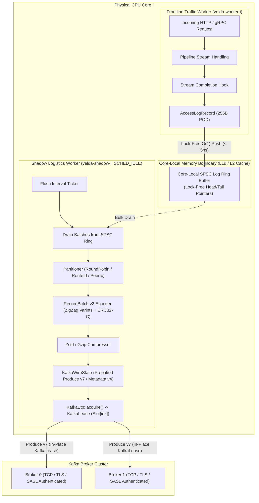

# Kafka Log Shipper (`kafka_log_shipper`) — Deep Systems Architecture

This document details the concurrency model, batch coalescing physics, wire serialization layout, and failover mechanics of the **Kafka Log Shipper Plugin** in **Velda Edge**.

---

## 1. Concurrency Model & Shadow Logistics Isolation



### Architectural Guarantees:
1. **Zero-IO Hot Path**: The frontline traffic worker (`velda-worker-{i}`) never touches network sockets, files, or strings.
2. **Lock-Free Emission**: Access logs are written to an isolated Single-Producer Single-Consumer (`SpscLogRing`) in core-local memory.
3. **No Producer Rebalance**: Because `kafka_log_shipper` operates purely as an active producer sending `ProduceRequest` (Api 0), adding or removing gateway pods produces zero consumer group rebalances on the Kafka cluster.

---

## 2. Kafka RecordBatch v2 Wire Layout

Every produce batch targeting a partition is serialized according to Kafka's Magic v2 specification:

```text
┌────────────────────────────────────────────────────────────────────────┐
│                    KAFKA RECORDBATCH V2 (MAGIC = 2)                   │
├────────────────────────┬───────────┬───────────────────────────────────┤
│ Field                  │ Type      │ Description                       │
├────────────────────────┼───────────┼───────────────────────────────────┤
│ baseOffset             │ INT64     │ First offset in batch (always 0)  │
│ batchLength            │ INT32     │ Byte length from epoch to end     │
│ partitionLeaderEpoch   │ INT32     │ Leader epoch (default -1)         │
│ magic                  │ INT8      │ Magic byte = 2                    │
│ crc                    │ UINT32    │ Castagnoli CRC32-C (from attrs)   │
│ attributes             │ INT16     │ Bits 0..2: Codec (0, 1=gz, 4=zstd)│
│ lastOffsetDelta        │ INT32     │ Record count - 1                  │
│ baseTimestamp          │ INT64     │ Earliest record timestamp (ms)    │
│ maxTimestamp           │ INT64     │ Maximum record timestamp (ms)     │
│ producerId             │ INT64     │ Producer ID (-1)                  │
│ producerEpoch          │ INT16     │ Producer epoch (-1)               │
│ baseSequence           │ INT32     │ Sequence number (-1)              │
│ recordsCount           │ INT32     │ Total records in this batch       │
│ records (compressed)   │ [Record]  │ Encoded records array (varints)   │
└────────────────────────┴───────────┴───────────────────────────────────┘
```

### Checksum Calculation
- **Polynomial**: Castagnoli `0x82F63B78` (CRC32-C).
- **Scope**: Computed over all bytes starting immediately after `crc` (from `attributes` to the very end of the batch payload).

---

## 3. Dynamic Partition Failover Handling

When the Kafka cluster triggers a partition leader election or rebalance:
1. The broker returns `error_code: 6` (`NOT_LEADER_OR_FOLLOWER`) or `3` (`UNKNOWN_TOPIC_OR_PARTITION`).
2. `KafkaWireState::produce_records` detects this error code, triggers `refresh_metadata().await`, and queries the broker pool for updated partition topology.
3. Subsequent produce batches are immediately routed to the new leader broker without downtime.
