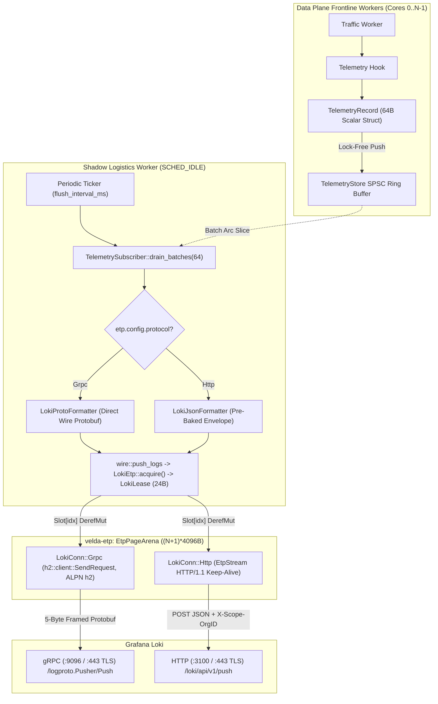

# Grafana Loki Log Shipper — Architecture Specification

This document details the internal subsystem architecture, threading model, memory geometry, and operational boundaries of the **Grafana Loki Log Shipper Plugin** (`loki_log_shipper`).

---

## 1. Subsystem Mission & Responsibilities

The `loki_log_shipper` is an autonomous background logistics plugin (`pbww() == 80`) designed to:
1. Drain reference-counted 64-byte `TelemetryRecord` batches from `velda_observability::TelemetryStore` via lock-free core-local SPSC ring buffers.
2. Partition log records into bounded-cardinality protocol family streams (`protocol="http"`, `protocol="grpc"`, `protocol="raw"`).
3. Format records into Loki JSON (`json/template.rs`) or direct wire Protobuf (`proto/template.rs`), pre-baking HTTP/1.1 or HTTP/2 gRPC request metadata once at startup in `wire.rs`.
4. Borrow pooled connections in-place via `velda_etp::loki::LokiEtp` (`24`-byte `LokiLease` addressing a `64`-byte cache-line `ArenaSlot<LokiConn>` inside `(N + 1) * 4096B` `EtpPageArena<LokiConn>`).

---

## 2. Architecture & Data Flow

---

## 3. Core Architectural Invariants

### Invariant 1: Strict Separation of Pool Lifecycle (`velda-etp`) vs Wire Framing (`wire.rs`)
* `LokiEtp` (`crates/velda-etp/src/loki/`) owns `ColdConnectBlueprint` (LKG IP/DNS freeze + optional TLS/mTLS + ALPN `h2` for gRPC), `(N + 1) * 4096B` `EtpPageArena<LokiConn>`, `Semaphore`, warm pre-connection, background replenishment, and in-place `LokiLease::reconnect()` / `recreate_in_background()`.
* `wire.rs` owns request header/URI baking (`bake_wire_template`), `Content-Length` stamping (`velda_core::lut::decimal::fast_write_u64`), 5-byte gRPC length prefixing, HTTP/1.1 response draining (`httparse::Response` with bounds-checked `.get(..)` slicing), and gRPC trailer checking (`grpc-status == "0"`).

### Invariant 2: Single-Cache-Line Dual-Protocol `ArenaSlot<LokiConn>`
* `LokiConn` stores either `Http(EtpStream)` (40 bytes) or `Grpc(h2::client::SendRequest<bytes::Bytes>)` (32 bytes), fitting inside `ArenaSlot<LokiConn>` = **64 bytes** (`#[repr(C, align(64))]`, verified at compile time with `assert!(size_of::<ArenaSlot<LokiConn>>() == 64)`).
* `LokiLease` holds `{ pool: Arc<LokiEtp>, slot_idx: usize, broken: bool }` = **24 bytes** (`assert!(size_of::<LokiLease>() == 24)`).

### Invariant 3: Bounded Label Cardinality & Zero-Allocation Scratch Buffers
* `LokiLogShipperConfig::labels` keys are validated at config load time against `[a-zA-Z_][a-zA-Z0-9_]*`.
* `LokiJsonFormatter` and `LokiProtoFormatter` clear and reuse pre-allocated scratch vectors (`payload_buf`, `head_buf`, `resp_buf`) across ticks.
* Request IDs are converted to 32 lowercase hex characters via `fast_write_hex32`, and integers via the division-free 2-digit lookup table (`DIGIT_PAIRS`).

### Invariant 4: In-Place Reconnect & 30-Second Cool-Down Shield
* On an initial transport error (EOF / reset / broken H2 connection), `wire::push_logs` calls `lease.reconnect().await` in-place on `Slot[idx]` and retries once.
* On timeout, `Connection: close`, HTTP `>= 500`, or persistent H2 error, `lease.recreate_in_background()` marks the slot broken for replacement in `LokiEtp`.
* Exceeding 10 consecutive failed flushes engages a 30-second cool-down that drains and discards incoming ring batches lock-free so gateway memory stays bounded.
