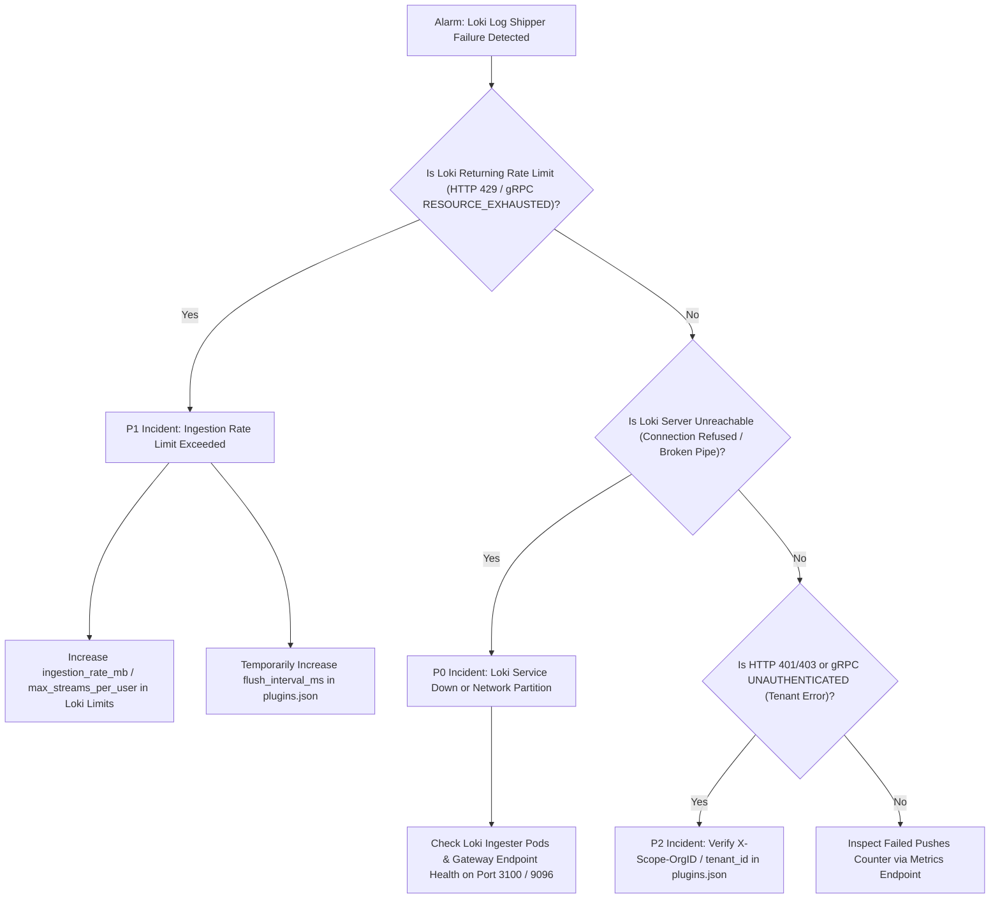

# Site Reliability Engineering Runbook: Grafana Loki Log Shipper (`loki_log_shipper`)

This runbook provides emergency operational procedures, severity classification matrices, diagnostic commands, and incident mitigation workflows for the `loki_log_shipper` plugin across both **HTTP JSON** and **gRPC Protobuf** transports in production environments.

---

## 1. Operational Overview & Service Level Objectives

- **Primary Duty**: Continuously drain access log records from `velda_observability::LogStore`, partition them into protocol family streams, and push to Grafana Loki via HTTP (`/loki/api/v1/push` on port 3100) or gRPC (`/logproto.Pusher/Push` on port 9096).
- **Service Level Indicator (SLI)**: Ratio of successfully shipped access log records to records emitted by frontline workers:
  $$\text{SLI} = \frac{\text{shipped\_records}}{\text{emitted\_records}} \times 100\%$$
- **Service Level Objective (SLO)**: $\ge 99.99\%$ of records successfully delivered to Loki within a 5-second rolling window under healthy network conditions.

---

## 2. Severity Classification & Triage Matrix

| Severity Level | Threshold Condition | Customer Impact | Target Resolution Time |
| :--- | :--- | :--- | :--- |
| **P0 (Critical)** | Loki ingester unreachable (100% push failures); `failed_pushes` climbing rapidly. | Total loss of live Grafana log stream visibility. | **< 15 minutes** |
| **P1 (Major)** | Loki returning HTTP 429 or gRPC `RESOURCE_EXHAUSTED` (Rate limit exceeded); records throttled. | Log delivery delayed; stale records dropped to protect RAM. | **< 1 hour** |
| **P2 (Medium)** | Tenant ID authentication error (HTTP 401/403 or gRPC `UNAUTHENTICATED`/`PERMISSION_DENIED`). | Logs rejected by Loki gateway. | **< 4 hours** |
| **P3 (Minor)** | Idle connection timeout closed by intermediate load balancer. | None (transparently reconnected on next tick). | **< 24 hours** |

---

## 3. Incident Decision Flowchart



---

## 4. Diagnostic Command Toolkit

### 4.1 Testing Loki HTTP Ingestion Endpoint (Port 3100)
```bash
# Verify Loki readiness
curl -v http://loki:3100/ready

# Perform test push to Loki HTTP JSON API
curl -v -H "Content-Type: application/json" -X POST "http://loki:3100/loki/api/v1/push" \
  --data '{"streams": [{"stream": {"service": "test", "protocol": "http"}, "values": [["'"$(date +%s%N)"'", "test log"]]}]}'
```

### 4.2 Testing Loki gRPC Ingestion Endpoint (Port 9096)
```bash
# Verify Loki gRPC endpoint with grpcurl
grpcurl -plaintext loki:9096 list

# Inspect logproto.Pusher service
grpcurl -plaintext loki:9096 describe logproto.Pusher
```

### 4.3 Inspecting Active TCP & H2 Connection State
```bash
# Check established persistent TCP socket to port 3100 (HTTP) or port 9096 (gRPC)
ss -t -a 'dport = :3100 or dport = :9096'
```

### 4.4 Monitoring Loki Log Shipper Export Metrics
```bash
# Query edge metrics endpoint for export health
curl -s http://127.0.0.1:9091/metrics | grep -E "loki_log_shipper"
```

---

## 5. Emergency Remediation Procedures

### Remediation 1: Mitigating Loki Ingestion Throttling (P1)
If Loki rate limits are exceeded during high-traffic bursts, increase `flush_interval_ms` and `max_batch_size` to coalesce records into larger, less frequent requests:
```json
{
  "id": "loki_log_shipper",
  "phase": "background",
  "config": {
    "protocol": "grpc",
    "endpoint": "grpc://loki:9096",
    "tenant_id": "velda-production",
    "service_name": "velda-edge",
    "flush_interval_ms": 250,
    "max_batch_size": 2500,
    "connect_timeout_ms": 2000,
    "request_timeout_ms": 2000,
    "labels": {
      "env": "production"
    }
  }
}
```
Apply dynamically via configuration synchronization:
```bash
curl -X POST http://127.0.0.1:9090/v1/config/sync -d @plugins.json
```
