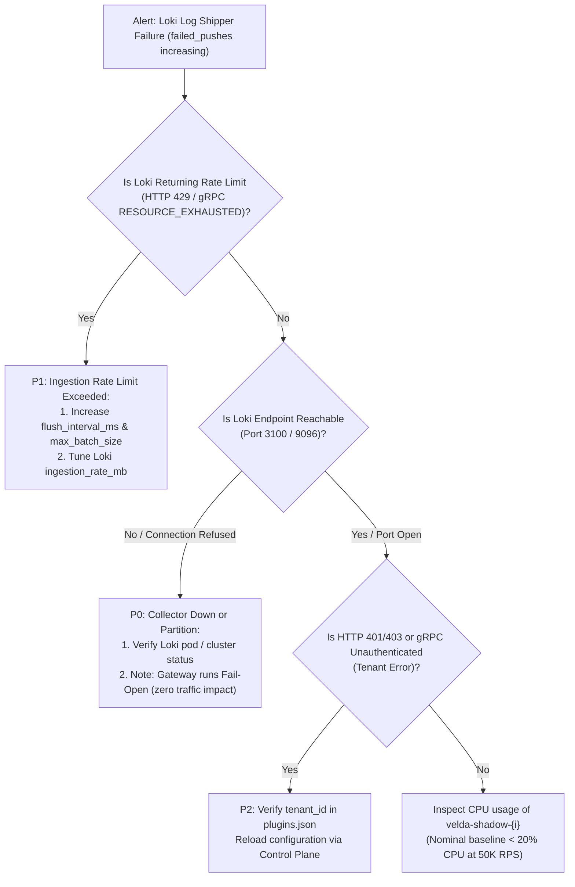

# Grafana Loki Log Shipper — SRE On-Call Runbook & Incident Triage Guide

This runbook guides Site Reliability Engineers (SREs) and on-call operators in diagnosing, troubleshooting, and resolving production incidents involving the **Grafana Loki Log Shipper Plugin** (`loki_log_shipper`).

---

## 1. Parameter Reference & Operational Impact

| Field | Production Range | Operational Impact | Recommended Default |
| :--- | :--- | :--- | :--- |
| `protocol` | `"http"` \| `"grpc"` | `"grpc"` uses binary Protobuf over HTTP/2, saving CPU and network bandwidth. `"http"` emits standard JSON over HTTP/1.1. | `"grpc"` |
| `endpoint` | Valid URI | Target Grafana Loki ingestion endpoint. If unreachable, shipper backs off without blocking request traffic. | `"grpc://127.0.0.1:9096"` |
| `tenant_id` | Alphanumeric string | Injected as `X-Scope-OrgID` (HTTP) or `x-scope-orgid` (gRPC). Required for multi-tenant Loki clusters. | `""` or `"velda-production"` |
| `service_name` | ASCII string | Logical service name injected into the `service` stream label. | `"velda-edge-prod"` |
| `flush_interval_ms` | `50 ..= 60000` | Periodic timer interval for waking up shadow worker to drain SPSC rings and ship buffered records. Lower values reduce log latency. | `100` |
| `max_batch_size` | `1 ..= 10000` | Maximum number of log records grouped into a single push payload. | `1000` |
| `connect_timeout_ms`| `100 ..= 60000` | Connection establishment timeout. Prevents hung TCP/TLS handshakes from blocking the shadow task loop. | `1000` |
| `request_timeout_ms`| `100 ..= 60000` | Export request timeout before aborting and logging a failure. | `1000` |
| `labels` | Key-value pairs | Static stream labels attached to every stream descriptor. Must remain low cardinality. | `{"env": "prod"}` |

---

## 2. Tuned Production Presets

### Preset A: High-Throughput Kubernetes Production Daemon (gRPC / HTTP/2)
```json
{
  "protocol": "grpc",
  "endpoint": "grpc://loki.logging.svc.cluster.local:9096",
  "tenant_id": "velda-production",
  "service_name": "velda-edge-production",
  "flush_interval_ms": 100,
  "max_batch_size": 1000,
  "connect_timeout_ms": 1000,
  "request_timeout_ms": 1000,
  "labels": {
    "env": "production",
    "cluster": "us-east-1"
  }
}
```
*Rationale: Direct Protobuf serialization and persistent HTTP/2 stream multiplexing maximize log delivery throughput.*

### Preset B: Standard REST / JSON Profile (HTTP/1.1 Keep-Alive)
```json
{
  "protocol": "http",
  "endpoint": "http://loki.logging.svc.cluster.local:3100/loki/api/v1/push",
  "tenant_id": "velda-production",
  "service_name": "velda-edge-production",
  "flush_interval_ms": 100,
  "max_batch_size": 1000,
  "connect_timeout_ms": 1000,
  "request_timeout_ms": 1000,
  "labels": {
    "env": "production"
  }
}
```
*Rationale: Pre-baked static JSON envelope and 2-digit LUT allow direct ingestion into HTTP-based Loki gateways.*

### Preset C: Secure Cross-Datacenter WAN Logging (gRPC + TLS)
```json
{
  "protocol": "grpc",
  "endpoint": "grpcs://loki.monitoring.aws.internal:9096",
  "tenant_id": "velda-prod-wan",
  "service_name": "velda-edge-wan",
  "flush_interval_ms": 200,
  "max_batch_size": 2000,
  "connect_timeout_ms": 2000,
  "request_timeout_ms": 2000,
  "labels": {
    "region": "eu-west-1"
  }
}
```
*Rationale: 200ms cadence and 2000-record batching minimize WAN packet overhead and TLS renegotiation.*

---

## 3. SRE Incident Triage Matrix (P0 – P3)

| Severity | Incident Pattern | Symptoms & Indicators | Immediate Mitigation Action |
| :---: | :--- | :--- | :--- |
| **P0** | **Loki Ingester Outage / Total Push Failure** | Loki completely unreachable; 100% push failures; `failed_pushes` climbs rapidly. | 1. Note: Gateway runs Fail-Open (zero client traffic impact).<br>2. Check Loki ingester pods and gateway health on port 3100/9096.<br>3. Route to backup Loki instance via hot reload. |
| **P1** | **Ingestion Rate Limit Exceeded (HTTP 429)** | Loki returns HTTP 429 or gRPC `RESOURCE_EXHAUSTED`; records throttled. | 1. Increase `flush_interval_ms` to 250ms and `max_batch_size` to 2500.<br>2. Increase `ingestion_rate_mb` in Loki cluster limits configuration. |
| **P2** | **Tenant ID / Organization Authentication Error** | Loki returns HTTP 401/403 or gRPC `UNAUTHENTICATED` / `PERMISSION_DENIED`. | 1. Verify `tenant_id` in `plugins.json` matches the tenant registered in Loki.<br>2. Reload configuration. |
| **P3** | **Idle Connection Termination by Load Balancer** | Intermediate load balancer closes idle connection; reconnects on next tick. | Transparently recovered on next push tick; no operator action required. |

---

## 4. Incident Triage Decision Flowchart



---

## 5. Diagnostic CLI Toolkit

### Command 1: Test Loki HTTP Ingestion Endpoint (Port 3100)
Verify Loki readiness and perform a manual push test:
```bash
# Verify Loki readiness
curl -v http://127.0.0.1:3100/ready

# Test push to Loki HTTP JSON API
curl -v -H "Content-Type: application/json" -X POST "http://127.0.0.1:3100/loki/api/v1/push" \
  --data '{"streams": [{"stream": {"service": "test", "protocol": "http"}, "values": [["'"$(date +%s%N)"'", "test log"]]}]}'
```

### Command 2: Test Loki gRPC Ingestion Endpoint (Port 9096)
Verify Loki gRPC endpoint using `grpcurl`:
```bash
grpcurl -plaintext 127.0.0.1:9096 describe logproto.Pusher
```

### Command 3: Inspect Active TCP Connection State
Verify established persistent connections:
```bash
ss -t -a 'dport = :3100 or dport = :9096'
```

### Command 4: Monitor Per-Thread CPU Utilization
Ensure shadow logistics execution does not steal CPU from traffic cores:
```bash
pidstat -p $(pgrep velda-edge) -t 1 5
```

---

## 6. Emergency Playbooks

### Playbook A: Mitigating Loki Ingestion Throttling (P1)
If Loki rate limits are exceeded during high-traffic bursts, increase batching intervals to coalesce records into fewer, larger payloads:
1. Update `plugins.json`:
   ```json
   {
     "id": "loki_log_shipper",
     "config": {
       "protocol": "grpc",
       "endpoint": "grpc://loki:9096",
       "tenant_id": "velda-production",
       "service_name": "velda-edge",
       "flush_interval_ms": 250,
       "max_batch_size": 2500,
       "connect_timeout_ms": 2000,
       "request_timeout_ms": 2000,
       "labels": {
         "env": "production"
       }
     }
   }
   ```
2. Apply immediately without gateway restart:
   ```bash
   curl -X POST http://127.0.0.1:8080/api/v1/plugins/reload
   ```

### Playbook B: Rotating Multi-Tenant Organization ID (Zero-Downtime Reload)
When re-assigning tenant isolation domains:
1. Update `tenant_id` in `plugins.json`.
2. Push reload notification. The shadow worker seamlessly applies the new tenant identifier on the next push cycle.

### Playbook C: Dynamically Disabling Loki Shipper (Zero-Downtime Bypass)
To stop the log shipper without interrupting client traffic:
1. Remove the `loki_log_shipper` block from `plugins.json`.
2. Push reload notification. The shadow worker cleanly cancels the background export task.
