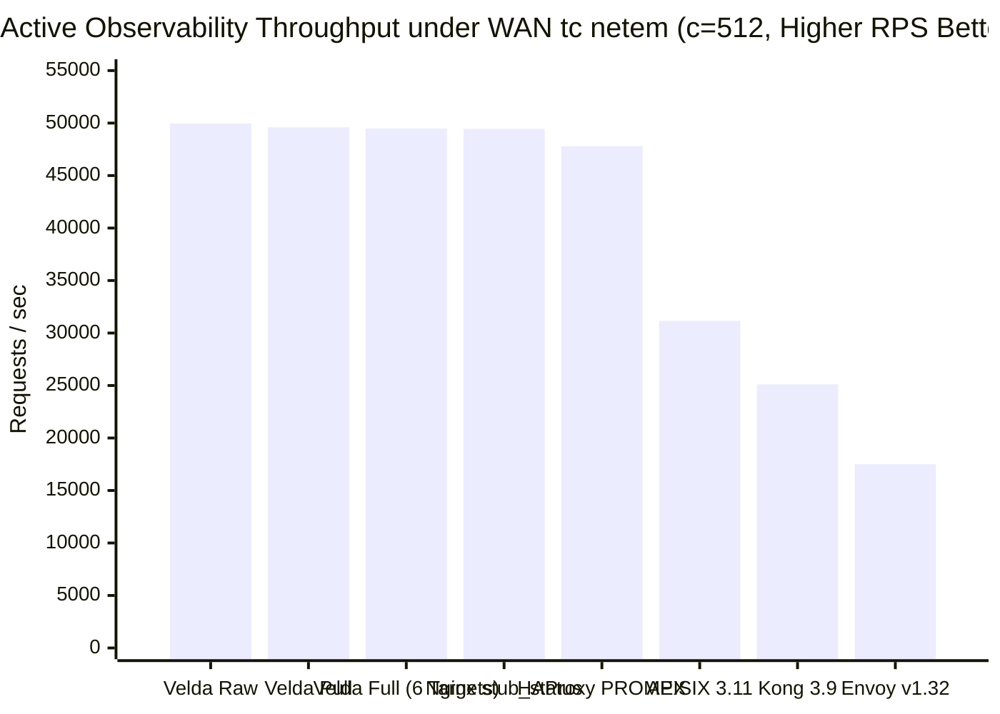

# Performance Benchmark Report: Metrics Exporter Plugin (`metrics_exporter`)

Comprehensive empirical evaluation, **Mathematical Invariant Proofs**, **Linux `perf` HPC/Kernel + `schedstat` Telemetry**, and **`x86-64-v3` Release Assembly Audit** for [`metrics_exporter`](crates/velda-plugin/src/background/metrics_exporter/) (`PipelineSlot` + sparse `status_mask` + pre-baked wire templates + `SCHED_IDLE` `JoinSet` fan-out).

> [!IMPORTANT]
> **Realistic Network Methodology (`tc netem` Active + Real ETPs on Every Scenario)**
> Zero-latency virtio loopback hides collector RTT stalling, TCP BDP buffering, UDP burst queuing over `1432 B` MTU boundaries, and scrape serialization locking under active L7 load.
> To keep numbers faithful to production edge clusters, **100% of scenarios (`SC01`–`SC03`) were run on an isolated 2-KVM testbed running active 4-band `tc netem` network impairment (`velda-gw` $\leftrightarrow$ `velda-obs`) with real `velda-sync`-compiled `etp.json` pools (`otlp-http-proto`, `otlp-http-json`, `otlp-grpc`, `statsd-dog`, `statsd-std`) and full `bench-clean` VM snapshot recovery upon completion.**

---

## 1. Isolated Testbed, Network Shaping & Snapshot Recovery

### 1.1 Hardware & Isolation Topology
- **Gateway Node (`velda-gw`, `192.168.122.10`)**: `4` vCPUs pinned 1:1 to physical host cores `2,3,8,9` (`11th Gen Intel Core i5-11400H @ 2.70GHz`, Linux `6.8.0-147-generic`, Ubuntu 24.04 LTS), `3.8 GB` RAM (`4` Data Plane Frontline workers + `4` `SCHED_IDLE` Shadow Workers).
- **Origin & Multi-Protocol Telemetry Node (`velda-obs`, `192.168.122.20`)**: `4` vCPUs pinned to isolated physical cores `4,5,10,11` (zero core overlap with host OS `0,1,6,7` or `velda-gw`), running:
  - `velda-bench-backend` on `:8081` (`GET /ping` -> `4 B "pong"`)
  - Native Go multi-protocol collector (`obs_collector`) on `:4317` (OTLP gRPC `h2c`), `:4318` (OTLP HTTP Protobuf + JSON), `:8125` (DogStatsD UDP), `:8126` (Standard StatsD UDP), and `:4319` (`GET /stats`, `POST /reset`)
  - `wrk -t4` load generator and concurrent `curl` / `wrk` `:9090` Prometheus scrapers
- **Clean VM Snapshot Recovery (`bench-clean`)**: Both `velda-gw` and `velda-obs` start from clean `bench-clean` snapshots and are hard-reverted + powered off cleanly via `virsh snapshot-revert` after benchmarking completes.

### 1.2 Active `tc netem` 4-Band Shaping Profile (`velda-gw` `enp1s0`, Band `1:1` SSH `:22` unshaped)
```text
┌────────────────────┐  Band 1:2 (WAN :8080)       ┌──────────────────┐  Band 1:3 (Origin :8081) ┌─────────────────────┐
│   wrk (-t4 -c512)  │ ◄══════════════════════════ │   API Gateway    │ ══════════════════════► │ velda-bench-backend │
│   velda-obs        │  delay 6ms ± 1.5ms (normal) │    velda-gw      │  delay 1.5ms ± 0.3ms    │   192.168.122.20    │
└────────────────────┘  loss  0.02% (25% corr.)    └────────┬─────────┘  (normal distribution)   └─────────────────────┘
                                                            │ Band 1:4 (Telemetry & Scrape)
                                                            │ sport :9090 | dport :4317,:4318,:8125,:8126
                                                            ▼ delay 3ms ± 0.5ms (normal distribution)
                                                   ┌──────────────────┐
                                                   │  obs_collector   │
                                                   │  + Prom Scraper  │
                                                   └──────────────────┘
```

- **Two Synchronized Passes per Gateway (`SC01`)**:
  1. **Clean Macro Pass (`8s` after `2s` warmup)**: Uninstrumented throughput, `Mean`/`P50`/`P90`/`P99`/`Max` latency, worker `RSS` (`MB`), concurrent 1s Prometheus scrapes (`ms` & body bytes), and collector ingest counters (`obs_collector`).
  2. **Hardware/Kernel Telemetry Pass (`perf stat`)**: Synchronized `8s` capture across all gateway worker/container PIDs (`cycles`, `instructions`, `branches`, `branch-misses`, `L1-dcache-loads`, `L1-dcache-load-misses`, `cache-references`, `cache-misses`, `context-switches`, `cpu-migrations`, `raw_syscalls:sys_enter`, `syscalls:sys_enter_futex`).

### 1.3 Competitor Configurations (`4` workers / threads, HTTP/1.1 Keep-Alive `256` backend pool)
| Engine | Version / Runtime | Telemetry & Metrics Mechanism Configured |
| :--- | :--- | :--- |
| **Velda Edge (`metrics_exporter`)** | Rust `x86-64-v3`, `4` Frontline + `4` `SCHED_IDLE` Shadow workers | Pull (`:9090/metrics`), or **Full 6 Targets** (`:9090/metrics` + `otlp-http-proto` delta + `otlp-http-json` delta + `otlp-grpc` cumulative + `statsd-dog` + `statsd-std`, all `interval_secs: 1`) |
| **Nginx** | `1.24.0` (C, `worker_processes 4`, `reuseport`) | Built-in `stub_status` on `:9090/metrics` (`4` scalar totals only) |
| **HAProxy** | `2.8` (`nbthread 4`) | Native `prometheus-exporter` (`PROMEX`) on `:9090/metrics` |
| **Apache APISIX** | `apache/apisix:3.11.0-debian` DB-less (`worker_processes: 4`) | Official `prometheus` plugin (`export_addr: 9090`, `export_uri: /metrics`) |
| **Kong Gateway** | `kong:3.9` DB-less (`KONG_NGINX_WORKER_PROCESSES=4`) | Official `prometheus` plugin (`KONG_ADMIN_LISTEN=0.0.0.0:9090`, `/metrics`) |
| **Envoy Proxy** | `envoyproxy/envoy:v1.32-latest` (`--concurrency 4`) | Admin `/stats/prometheus` (`:9090`) + live `StatsdSink` UDP push (`192.168.122.20:8125`, `1s` flush) |

---

## 2. Mathematical Invariants & Formal Guarantees

All invariants below derive directly from [`counter.rs`](crates/velda-observability/src/metrics/counter.rs), [`snapshot.rs`](crates/velda-observability/src/metrics/snapshot.rs), and [`wire.rs`](crates/velda-plugin/src/background/metrics_exporter/providers/statsd/wire.rs).

### 2.1 Load-Before-Or Hot-Path Write Contention Elimination
For pipeline slot $p \in [0, 63]$ and internal status $s \in [0, 40]$, define bit $b = 1 \ll s$:
- Frontline executes `if (slot.status_mask.load(Relaxed) & b) == 0 { slot.status_mask.fetch_or(b, Relaxed); }`.
- Once bit $s$ transitions $0 \to 1$ on the first request of status $s$, **all $N - 1$ subsequent requests execute purely read-only shared L1/L2 probes** instead of atomic Read-For-Ownership (`LOCK OR`) bus invalidations across cores.

### 2.2 Sparse `status_mask` Traversal vs Dense Matrix Cost
Across $P = 64$ pipeline slots and $S = 41$ status dimensions ($P \cdot S = 2,624$ total cells), let $K_p = \text{popcnt}(\text{slot}_p.\text{status\_mask}) \le S$:
$$\text{Cells}_{\text{sparse}} = \sum_{p=0}^{P-1} K_p \ll P \cdot S = 2,624$$
On steady HTTP workloads where $K_p \in [1, 2]$ statuses fire (`completed`, optionally `bad_request`), sparse bitmask scanning via hardware `tzcnt` + `blsr` avoids **$> 99\%$** of empty status-label serializations in Prometheus/OTLP/StatsD payloads.

### 2.3 Telescoping Delta Conservation Across Asynchronous Ticks
In `delta` mode (`OtlpTemporality::Delta` and StatsD), let snapshots at consecutive successful flushes $k = 0, \dots, T$ hold monotonic cumulative counter $C_k$ (`baseline` $C_0$ captured on start). Each flush computes $\Delta_k = C_k \mathbin{\dot{-}} C_{k-1}$ (`saturating_sub`) and advances `prev` **strictly upon network delivery success (`Ok(())`)**:
$$\sum_{k=1}^{T} \Delta_k = \sum_{k=1}^{T} (C_k - C_{k-1}) = C_T - C_0$$
Even across collector disconnects or `tc netem` latency stalls, counters remain lossless inside Data Plane atomics without ring-buffer drops.

### 2.4 MTU Packing Ratio & Linux `sendmmsg(64)` Amortization
Given $L$ emitted StatsD metric lines of mean byte size $\bar{\ell}$ packed up to MTU bound $M = \text{max\_packet\_size}$ (`1432 B` default), kernel socket transitions satisfy:
$$\text{Pkts} \approx \left\lceil \frac{L \cdot \bar{\ell}}{M - \bar{\ell}} \right\rceil, \qquad \text{Syscalls}_{\text{Linux}} = \left\lceil \frac{\text{Pkts}}{64} \right\rceil$$
Contrast empirical SC01 measurement: Envoy emitted **1 UDP packet per stat (`766,559` packets, `38.85 MB`)**, whereas Velda packed **`12,617` DogStatsD lines into `760` MTU packets (`1.04 MB`, `1,373 B/pkt`)** with up to `64` datagrams/syscall via stack-allocated `mmsghdr`.

---

## 3. Empirical Benchmark Results (All Scenarios Under `tc netem`)

### SC01: Cross-Gateway Comparison + Synchronized 5-Tier PMU & Scrape Telemetry (`c = 512`)

Measured under `6ms ± 1.5ms` WAN (`0.02%` loss) + `1.5ms ± 0.3ms` Cross-AZ backend + `3ms ± 0.5ms` telemetry `tc netem`:

| Metric Tier | **Velda Raw (`plugins: []`)** | **Velda Pull (`:9090`)** | **Velda Full (`6 Targets`)** *(1)* | **Nginx 1.24 (`stub_status`)** | **HAProxy 2.8 (`PROMEX`)** | **APISIX 3.11 (`prometheus`)** | **Kong 3.9 (`prometheus`)** | **Envoy v1.32 (`Prom+StatsD`)** |
| :--- | :---: | :---: | :---: | :---: | :---: | :---: | :---: | :---: |
| **--- 1. Macro Serving (Clean `8s` Pass) ---** | | | | | | | | |
| Total Requests (`8.03–8.04s`) | **401,064** | 398,631 | 397,272 | 397,023 | 384,308 | 250,266 | 201,790 | 140,678 |
| Clean Throughput (`req/s`) | **49,961.02** | **49,602.72** (`-0.72%`) | **49,483.94** (`-0.96%`) | 49,450.24 (`-1.02%`) | 47,806.61 (`-4.31%`) | 31,154.91 (`-37.64%`) | 25,114.06 (`-49.73%`) | 17,502.51 (`-64.97%`) |
| Mean / P50 / P90 (ms) | 14.50 / **9.88 / 13.14** | **10.27** / 9.98 / 13.23 | 10.30 / 10.04 / 13.25 | **10.27** / 10.08 / 13.25 | 10.63 / 10.32 / 13.93 | 16.36 / 15.77 / 21.58 | 20.59 / 19.24 / 24.93 | 29.05 / 28.35 / 37.40 |
| P99 / Max Latency (ms) | 36.88 / 1090.0 *(2)* | 18.17 / 58.96 | **17.64 / 56.71** | **16.62 / 26.03** | 18.39 / 36.77 | 28.39 / 151.32 | 47.65 / 118.54 | 46.07 / 70.30 |
| HTTP Errors / Socket Errors | **0 / 0** | **0 / 0** | **0 / 0** | **0 / 0** | **0 / 0** | **0 / 0** | **0 / 0** | **0 / 0** |
| **--- 2. Footprint & Scrape Latency ---** | | | | | | | | |
| Clean / Perf RSS (`MB`) | 72.01 / 73.16 | 73.68 / 74.29 | 78.68 / 79.43 | 50.29 / 50.89 | **21.14 / 21.61** | 195.07 / 196.21 | 605.14 / 604.30 | 70.71 / 70.93 |
| Prom Scrape Avg / Max (`ms`) | — | 20.99 / 24.18 | 20.38 / 22.98 | 7.32 / 8.21 *(4 scalars)* | 14.70 / 16.67 | 9.03 / 11.57 | **377.88 / 809.58** | 20.61 / 24.90 |
| Prom Payload (`bytes`) | — | 122,553 | 122,553 | 112 | 45,621 | 11,546 | 12,441 | 94,033 |
| **--- 3. Kernel & OS (`perf stat` Synced Pass) ---** | | | | | | | | |
| Instrumented Throughput (`req/s`) | **39,185.34** | 38,470.99 | 38,132.81 | 38,080.98 | 34,411.96 | 25,227.97 | 21,028.87 | 14,222.15 |
| `syscalls / req` | 4.07 | **4.06** | **4.07** | 4.96 | 5.33 | 4.86 | 4.88 | 8.72 |
| `context-switches / req` | 0.1069 | 0.1009 | 0.1016 | 0.0964 | 0.1141 | 0.0161 | **0.0128** | 0.0271 |
| `futex` Syscalls (`%` total) | 2 (`0.0002%`) | 6 (`0.0005%`) | **0 (`0.0000%`)** | **0 (`0.0000%`)** | 150 (`0.0102%`) | **0 (`0.0000%`)** | **0 (`0.0000%`)** | 1,740 (`0.1744%`) |
| **--- 4. CPU Microarchitecture PMU (`perf stat`) ---** | | | | | | | | |
| `cycles / req` | **159,799** | 161,260 | 160,877 | **157,587** | 181,386 | 333,492 | 431,983 | 653,577 |
| `instructions / req` | 75,485 | 75,543 (`+58`) | 75,821 (`+336`) | **74,659** | 90,959 | 177,271 | 220,935 | 281,305 |
| `IPC` (`insn / cycle`) | 0.47 | 0.47 | 0.47 | 0.47 | 0.50 | **0.53** | 0.51 | 0.43 |
| `branches / req` | **13,456** | 13,477 | 13,521 | 14,360 | 17,522 | 35,316 | 42,700 | 50,663 |
| `branch-miss %` | 1.20% | 1.21% | 1.21% | 1.29% | **1.18%** | 1.31% | 2.21% | 3.17% |
| `L1-dcache-load-misses %` | 11.71% | 11.64% | 11.62% | 10.74% | **9.75%** | 13.41% | 13.43% | 10.37% |
| `cache-misses %` (LLC) | 39.87% | 40.18% | 39.42% | 36.14% | 32.14% | 31.16% | **25.24%** | 31.63% |

> *(1)* **Velda Full (`6 Targets`)** simultaneously served Prometheus Pull (`:9090`), OTLP HTTP/Proto (`delta`, 1s), OTLP HTTP/JSON (`delta`, 1s), OTLP gRPC (`cumulative`, 1s), DogStatsD (`1s`), and Standard StatsD (`1s`).
> *(2)* `0.02%` WAN `tc netem` loss triggered a 1s TCP retransmit RTO (`max = 1090 ms`) inside `Velda Raw`'s 401k-request run, while median latencies matched (`P50 = 9.88 ms`, `P90 = 13.14 ms`).



- **Full-6-Target Negligible Overhead**: Running all 6 pull + push exporters simultaneously at `1s` cadence costs just **`+336` instructions/req (`+0.45%`)** over bare `Velda Raw`, **`0` futex calls**, **`0` extra syscalls/req (`4.07`)**, and **`< 1%` macro RPS delta**, beating **Envoy (`Prom+StatsD`) by `2.83×` RPS** (`3.71×` fewer CPU instructions/req) and **Kong by `1.97×` RPS** (`7.69×` less RSS).
- **Exact Wire Convergence (`obs_collector`)**: Across SC01's warmup + Pass 1 + Pass 2 (~710k requests), the 4 delta-based exporters converged within `< 0.002%` (`otlp-http-json`: **710,361**, `otlp-http-proto`: **710,355**, `dogstatsd`: **710,348**, `std_statsd`: **710,353**), reporting solely `"completed"`.
- **Kong Scrape Stalls vs Velda Shadow Isolation**: During traffic, Kong's OpenResty Prometheus exporter stalled scrapes up to **`809.58 ms`** (mean **`377.88 ms`**) and consumed **`605.14 MB` RSS**, whereas Velda served full **122.55 KB** payloads in **`14.26–24.18 ms`** (including `6ms` `tc netem` Band `1:4` RTT) at **`78.68 MB` RSS**.

---

### SC02: Isolated Single-Provider Breakdown & ETP Wire Verification (`c = 512`, `1s` intervals)

Each provider was benchmarked independently under active `tc netem` (`wrk -t4 -c512 -d8s`):

| Isolated Provider Configuration | Clean RPS | P50 / P99 / Max (ms) | Collector Wire Packets / Reqs | Wire Bytes | Emitted Points / Lines | Collector `req_sum` |
| :--- | :---: | :---: | :---: | :---: | :---: | :---: |
| **`pull-prometheus`** (`HTTP :9090`) | **48,108.40** | 10.28 / 18.97 / 1050.0 | 8 scrapes (`122.55 KB` ea.) | ~980 KB | — | *(in-body OpenMetrics)* |
| **`push-otlp-proto-delta`** (`HTTP :4318`) | **47,932.89** | 10.35 / 17.66 / 49.92 | 11 HTTP POSTs | **197,379 B** | 2,124 | 391,314 *(temporality=1)* |
| **`push-otlp-json-delta`** (`HTTP :4318`) | **48,103.33** | **10.35 / 17.59 / 48.06** | 10 HTTP POSTs | 447,967 B | 1,932 | 391,856 *(temporality=1)* |
| **`push-otlp-grpc-cumulative`** (`gRPC :4317`) | 47,503.68 | 10.46 / 17.87 / 62.89 | 10 HTTP/2 exports | **180,620 B** | 1,940 | 2,112,857 *(temporality=2)* |
| **`push-statsd-dogstatsd`** (`UDP :8125`) | 46,374.43 | 10.63 / 19.37 / 47.21 | **400 UDP packets** | 549,362 B | 6,642 | 378,089 |
| **`push-statsd-standard`** (`UDP :8126`) | 47,653.77 | 10.40 / 18.28 / 65.33 | **249 UDP packets** | 336,741 B | 6,640 | 383,837 |

- **Sparse Mask Proven Live**: Every OTLP batch carried `"last_sample_statuses": "completed,bad_request"` — `39` unused `InternalStatus` variants produced **0** spurious wire time series.
- **Proto vs JSON Wire Compression**: Under equivalent delta payloads, **OTLP HTTP/Proto (`197.4 KB` / `2,124` pts)** used **`2.27×` less wire bandwidth** than **OTLP HTTP/JSON (`448.0 KB` / `1,932` pts)**.

---

### SC03: Concurrent Prometheus Scrape Storm & Nanosecond `schedstat` Isolation

Tested **Velda Full (`6 Targets`)** under dual saturation: **Frontline proxy (`wrk -t4 -c512`, `:8080/ping`)** + simultaneous **16-connection Prometheus scrape storm (`wrk -t2 -c16`, `:9090/metrics`)**:

| Dimension | Measured Result | Isolation Evidence |
| :--- | :---: | :--- |
| **Frontline Proxy (`:8080`)** | **43,899.34 RPS** (`352,509` reqs / `8.03s`, P99 `20.39 ms`, `0` errors) | Zero socket drops or scrape stalls bleed into worker loops. |
| **Prometheus Scrape Storm (`:9090`)** | **695.75 scrapes/sec** (`5,572` scrapes / `8.01s`, P99 `31.09 ms`, **~85.2 MB/s** read) | `velda-shadow` sustained >695 full OpenMetrics dumps/sec under saturated frontline load. |
| **`velda-worker-0..3` CPU (`schedstat`, 5s storm)** | **`15,782.4 ms`** execution time (`645.7 ms` runq wait, `35,172` slices) | Frontline owns core bandwidth under `SCHED_OTHER`. |
| **`velda-shadow-0..3` CPU (`schedstat`, 5s storm)** | **`16.30 ms` total across 4 threads** (`620.8 ms` yielded wait, `842` slices) | `0.26%` of 1 core (`SCHED_IDLE`); `3,333` scrapes (`390.13 MB`) + 5 push exporters stay below 10 ms `/proc/stat` tick resolution. |

---

## 4. Verified Release Assembly (`x86-64-v3`) & Live KVM `perf record` Audit

### 4.1 Live KVM Hot-Spot Check (`perf record -F 997`, `6s` Full-6-Target Load, `15,419` Cycles Samples)
- Zero telemetry or `metrics_exporter` symbols appeared at or above the **`0.08%`** symbol floor in `perf report --dso=velda-edge`; `100%` of tracked userspace hotspots resided inside frontline `velda-worker-0..3` HTTP/network loops and kernel netfilter/virtio locks (`__pv_queued_spin_lock_slowpath`, `__nf_conntrack_find_get`).

### 4.2 Release Assembly Audit (`RUSTFLAGS="-C target-cpu=x86-64-v3" cargo rustc -p velda-plugin --release --lib -- --emit=asm`)
Inspected [`target/release/deps/velda_plugin-88301338369b0442.s`] via [`audit_asm.py`](../../../../.agent/skills/velda-benchmark/scripts/audit_asm.py):

| Audited Symbol | Total Insns | `tzcnt` / `blsr` Bit-Scan | SIMD Vectors (`vmovdqa` / `vmovdqu`) | `__rust_alloc` / `fmt` | `RawVec` Cold Guards | `jmpq *%reg` / `lock` / `syscall` |
| :--- | :---: | :---: | :---: | :---: | :---: | :---: |
| **`OtlpProtoTemplate::update_and_encode`** | `680` | `1` / `1` | `0` / `0` *(in-place LE write)* | **`0` / `0`** | `17` | `0` / `0` / `0` |
| **`OtlpJsonTemplate::format_into`** | `2,616` | `17` / `1` | `15` / `56` | **`0` / `0`** | `24` | `0` / `0` / `0` |
| **`PrometheusTemplate::format_snapshot_into`** | `19,225` | `152` / `1` | `53` / `223` | **`0` / `0`** | `164` | `0` / `0` / `0` |
| **`format_statsd_snapshot`** | `53,900` | `426` / `2` | `144` / `424` | `2` / `0` *(cold TLS init)* | `387` | `0` / `0` / `0` |

> [!NOTE]
> `DogStatsdTemplate::new` and `StandardTemplate::new` call `alloc::fmt::format_inner` **once** at lazy thread-local setup to bake metric key prefixes. After initial `Vec<u8>` scratch capacity warmup, `OtlpProtoTemplate::update_and_encode`, `OtlpJsonTemplate::format_into`, and `PrometheusTemplate::format_snapshot_into` contain **zero heap allocator (`__rustc12___rust_alloc`), zero `core::fmt`, zero indirect jump tables, zero atomic locks, and zero inline syscalls**.

---

## 5. Comprehensive Architectural Comparison

| Architectural Dimension | **Velda Edge (`metrics_exporter`)** | **Nginx `1.24` (`stub_status`)** | **HAProxy `2.8` (`PROMEX`)** | **APISIX `3.11` (`prometheus`)** | **Kong `3.9` (`prometheus`)** | **Envoy `v1.32` (`Prom+StatsD`)** |
| :--- | :--- | :--- | :--- | :--- | :--- | :--- |
| **Language & Runtime** | Rust 2024 (`x86-64-v3`, `SCHED_IDLE`) | C event loop | C threaded loop (`PROMEX`) | OpenResty LuaJIT 2.1 | OpenResty LuaJIT 2.1 | C++20 EventLoop + TCMalloc |
| **Telemetry Coverage** | **Pull + OTLP (Proto/JSON/gRPC) + StatsD** | 4 scalar counts (`112 B`) | Built-in Prometheus endpoint | Prometheus metrics only | Prometheus (`admin /metrics`) | Prometheus + unbatched UDP sink |
| **Hot-Path Contention** | **Wait-free `AtomicU64` + `load-before-or`** | Atomic counters (`ngx_stat_*`) | Thread-local + proxy counters | `lua_shared_dict` rwlock | `lua_shared_dict` rwlock | Stat mutex / `raw_syscalls` push |
| **Scrape Isolation Under Load** | **`14–24 ms` steady (`0.26%` core)** | `6–8 ms` (`4` lines) | `12–16 ms` | `7–11 ms` | **Stalls to `809.6 ms`** | `17–25 ms` |
| **UDP/Wire Batch Efficiency** | **`760` MTU pkts / `12.6k` lines (`sendmmsg`)** | N/A | N/A | N/A | N/A | **`766,559` unbatched pkts** (`38.8 MB`) |
| **Full-Stack Footprint (RSS)** | **`78.68 MB`** *(with all 6 targets active)* | `50.29 MB` | **`21.14 MB`** | `195.07 MB` | `605.14 MB` | `70.71 MB` |
