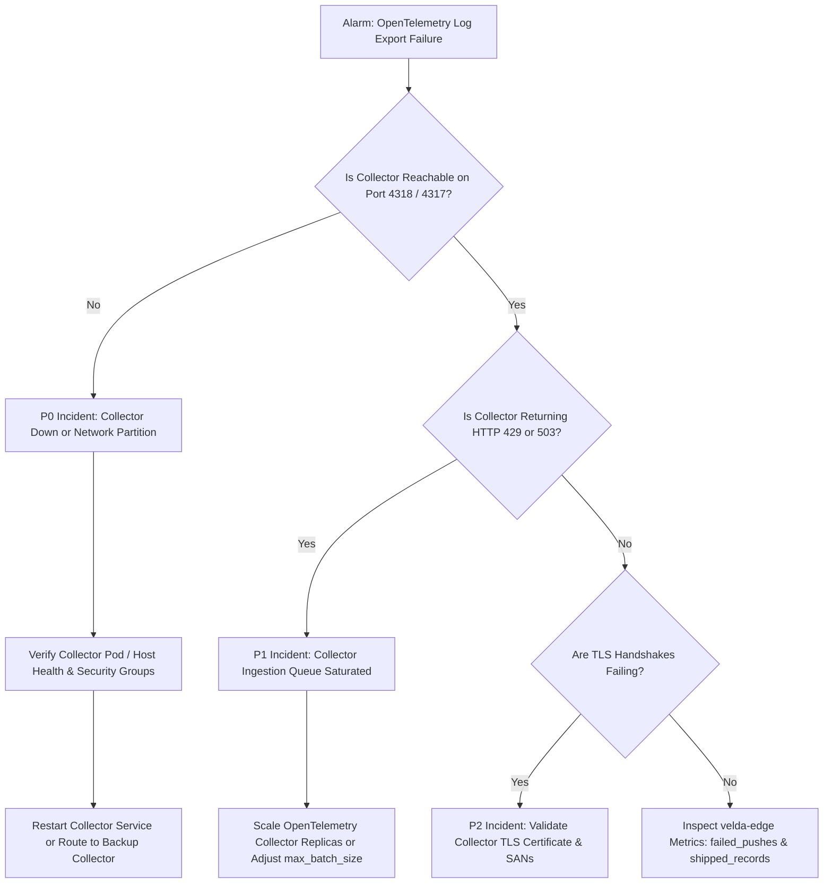

# Site Reliability Engineering Runbook: OpenTelemetry Log Shipper (`otlp_log_shipper`)

This runbook provides emergency operational procedures, severity classification matrices, diagnostic commands, and incident mitigation workflows for the `otlp_log_shipper` plugin in production environments.

---

## 1. Operational Overview & Service Level Objectives

- **Primary Duty**: Continuously drain and export access logs to downstream OpenTelemetry Collector instances over HTTP/1.1 or gRPC.
- **Service Level Indicator (SLI)**: Ratio of successfully shipped access log records to records emitted by frontline workers:
  $$\text{SLI} = \frac{\text{shipped\_records}}{\text{emitted\_records}} \times 100\%$$
- **Service Level Objective (SLO)**: $\ge 99.99\%$ of records successfully delivered to collector within a 5-second rolling window under healthy network conditions.

---

## 2. Severity Classification & Triage Matrix

| Severity Level | Threshold Condition | Customer Impact | Target Resolution Time |
| :--- | :--- | :--- | :--- |
| **P0 (Critical)** | Collector completely unreachable (100% export failures); `failed_pushes` climbing rapidly. | Total loss of centralized edge observability. | **< 15 minutes** |
| **P1 (Major)** | Collector ingestion rate throttled (HTTP 429 / 503); export latency spikes above `request_timeout_ms`. | Log delivery delayed; stale records dropped to protect RAM. | **< 1 hour** |
| **P2 (Medium)** | Intermittent TLS certificate validation failures connecting to collector endpoint. | Intermittent log export drops during renewal. | **< 4 hours** |
| **P3 (Minor)** | Collector connection closed on idle by upstream firewall requiring transparent reconnect. | None (transparently reconnected on next tick). | **< 24 hours** |

---

## 3. Incident Decision Flowchart



---

## 4. Diagnostic Command Toolkit

### 4.1 Testing Collector Endpoint Connectivity
```bash
# Test HTTP collector endpoint
curl -v -X POST http://otel-collector:4318/v1/logs \
  -H "Content-Type: application/json" \
  -d '{"resourceLogs":[]}'

# Test gRPC collector endpoint
grpcurl -plaintext otel-collector:4317 list
```

### 4.2 Inspecting Active TCP Connection State to Collector
```bash
# Check established persistent TCP socket to port 4318 or 4317
ss -t -a 'dport = :4318 or dport = :4317'
```

### 4.3 Monitoring Log Shipper Export Metrics
```bash
# Query edge metrics endpoint for export health
curl -s http://127.0.0.1:9091/metrics | grep -E "otlp_log_shipper"
```

---

## 5. Emergency Remediation Procedures

### Remediation 1: Collector Blackhole Mitigation (P0)
If the primary OpenTelemetry Collector fails, dynamically redirect export traffic to the fallback collector via configuration synchronization:
```json
{
  "id": "otlp_log_shipper",
  "phase": "background",
  "config": {
    "protocol": "http",
    "endpoint": "http://otel-collector-backup.monitoring.svc.cluster.local:4318/v1/logs",
    "service_name": "velda-edge-production",
    "flush_interval_ms": 100,
    "max_batch_size": 1000,
    "connect_timeout_ms": 1000,
    "request_timeout_ms": 1000,
    "headers": {}
  }
}
```
Apply immediately without restart:
```bash
curl -X POST http://127.0.0.1:9090/v1/config/sync -d @plugins.json
```
