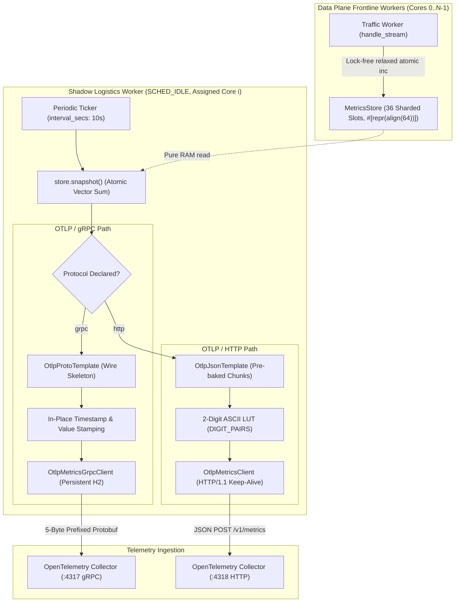

# OpenTelemetry Metrics Exporter — Architecture Specification

This document details the internal subsystem architecture, threading model, memory geometry, empirical machine code proofs, and physical operational boundaries of the **OpenTelemetry Metrics Exporter Plugin** (`otlp_metrics_exporter`).

---

## 1. Subsystem Mission & Responsibilities

The `otlp_metrics_exporter` is an autonomous background logistics plugin designed to:
1. Periodically extract point-in-time telemetry snapshots from `velda-observability` via non-blocking relaxed atomic vector reads.
2. Serialize metrics into binary OpenTelemetry `ResourceMetrics` Protocol Buffers over persistent HTTP/2 (gRPC) or pre-baked JSON text over HTTP/1.1.
3. Stream telemetry to an OpenTelemetry Collector daemon (e.g. port 4317 for gRPC or port 4318 for HTTP).
4. Maintain 100% fail-open autonomy: collector outages or network drops never degrade frontline client request serving.

---

## 2. Architecture & Data Flow



---

## 3. Core Architectural Invariants

### Invariant 1: Dedicated Shadow Logistics Worker Execution
* The exporter executes strictly on background companion threads (`velda-shadow-{id}`) running under Linux `SCHED_IDLE`.
* Frontline traffic workers serving client HTTP requests never execute serialization, Protobuf encoding, or outbound network calls.
* Hot-path request serving retains 100% CPU capacity regardless of exporter flush frequency or payload size.

### Invariant 2: Zero Hot-Path Contention (Relaxed Atomics)
* Frontline traffic workers write exclusively to core-local atomic counter shards (`slot_on_core(lane)`).
* The exporter reads point-in-time snapshots through `MetricsStore::snapshot()` using `Ordering::Relaxed` atomics.
* Mutexes, locks, and synchronization channels are strictly forbidden on the traffic hot path.

### Invariant 3: Zero-Allocation Protobuf Wire Skeleton (`OtlpProtoTemplate`)
* In gRPC mode, the entire AST hierarchy (Resource, InstrumentationScope, 4 Metric descriptors, and 288 DataPoints with static `KeyValue` attributes) is pre-rendered into a fixed-length binary wire skeleton (`base_wire`) once during initialization.
* The engine discovers the exact byte offsets of all 288 timestamps (Tag 3, Wire Type 1: `0x19`) and 288 counter values (Tag 6, Wire Type 1: `0x31`) via Sentinel Discovery at startup.
* At runtime, each ticker cycle updates `time_unix_nano` and `value` via direct in-place byte patching (`buf_slice[offset..offset+8].copy_from_slice(...)`), completing with **0 dynamic heap allocations** and **0 Prost re-encoding calls**.

### Invariant 4: Pre-Baked Chunk Interleaving & SIMD Itoa (JSON)
* In HTTP mode, static JSON fragments (root header, attribute tails, separators) are pre-baked at initialization.
* Timestamps are converted into 19-digit ASCII using 128-bit SSE2 vector instructions (`fast_format_ts_19digits_simd`).
* Counters are serialized into a pre-allocated scratch buffer using the 200-byte 2-digit lookup table (`DIGIT_PAIRS`), completely eliminating `serde_json` runtime reflection.

### Invariant 5: Persistent Transport Reuse
* **gRPC**: Manages persistent HTTP/2 connection pooling with multiplexed stream reset handling (`OtlpMetricsGrpcClient`) over port 4317.
* **HTTP**: Manages persistent HTTP/1.1 Keep-Alive socket leasing with transparent reconnection on drop (`OtlpMetricsClient`) over port 4318.
* Sockets remain open across flush ticks, eliminating TCP 3-way handshakes and TLS renegotiation on every interval.

### Invariant 6: Fail-Open Autonomy
* If the remote OpenTelemetry Collector hangs, crashes, or returns HTTP 4xx/5xx or non-zero gRPC status codes, the exporter logs warnings and backs off.
* Frontline traffic workers continue operating normally without queue delays, blocking waits, or memory leaks.

---

## 4. Shadow Workload Weight & Core Affinity

Under the Velda Edge Workload Distribution Model, background logistics plugins define an explicit workload weight from 1 to 100:

| Dimension | Metric Profile | Impact Analysis |
| :--- | :--- | :--- |
| **Assigned Workload Weight** | **40** | **Moderate Background Workload** |
| **CPU Intensity** | Moderate | Atomic vector extraction across 36 pipeline slots, in-place Protobuf stamping or 2-digit LUT JSON formatting, HTTP/2 binary framing or HTTP/1.1 serialization, and TLS cryptographic operations. |
| **Memory Footprint** | ~256 KB – 512 KB | Pre-allocated Protobuf wire template (32 KB), JSON scratch buffer (64 KB), and HTTP/2 transport connection state. Zero ongoing heap churn. |
| **Cadence / Wakeup Rate** | Configurable (1s – 3600s) | Coarse-grained interval (default: 10s or 15s), waking periodically without continuous CPU consumption. |
| **Failure Blast Radius** | P2 (Low Impact) | Telemetry loss only. Collector unreachable, rejected HTTP 4xx/5xx status, or network drops do not degrade client traffic serving. |

### Complementary Static Sharding Recommendation
* **Core Placement**: Core 1, 2, or 3.
* **Anti-Colocation Rule**: Avoid co-locating on Core 0 when Core 0 is strictly dedicated to latency-critical `health_probe` (Weight: 1) and master traffic intake. Do not co-locate with heavy log shippers (`loki_log_shipper` or `otlp_log_shipper`) to avoid competing for memory bus bandwidth and TLS crypto hardware units.
* **Ideal Pairing**: Pair with sleep-bound rotators (`jwks_rotator`, `acme_cert_rotator`) or lightweight UDP exporters (`statsd_exporter`) on secondary cores.

---

## 5. Memory Geometry & Reusable Buffer Pools

```text
+-------------------------------------------------------------------------------+
|  OtlpMetricsExporter Reusable Memory Architecture                             |
|                                                                               |
|  [Protobuf Engine: OtlpProtoTemplate]                                         |
|  +-------------------------------------------------------------------------+  |
|  | base_wire: Vec<u8> (Capacity: 32 KB, Pre-rendered AST)                  |  |
|  | timestamp_offsets: Vec<usize> (288 offsets cached once at startup)      |  |
|  | requests_offsets:  Vec<usize> (180 offsets cached once at startup)      |  |
|  | active_offsets:    Vec<usize> (36 offsets cached once at startup)       |  |
|  | rx_offsets:        Vec<usize> (36 offsets cached once at startup)       |  |
|  | tx_offsets:        Vec<usize> (36 offsets cached once at startup)       |  |
|  +-------------------------------------------------------------------------+  |
|                                                                               |
|  [JSON Engine: OtlpJsonTemplate]                                              |
|  +-------------------------------------------------------------------------+  |
|  | root_header: Pre-baked static JSON bytes                                |  |
|  | req_tails:   180 pre-baked static attribute suffixes                    |  |
|  | active_tails: 36 pre-baked static attribute suffixes                    |  |
|  | json_buf:    Vec<u8> (Capacity: 64 KB, Reused across sequential ticks)  |  |
|  +-------------------------------------------------------------------------+  |
+-------------------------------------------------------------------------------+
```

1. **AST Skeleton Pre-allocation**: The Protobuf AST wire representation is constructed once at boot and retained. Subsequent encode cycles perform raw slice copies and in-place byte writes.
2. **Buffer Recirculation**: `json_buf` and `proto_buf` vectors are cleared (`buf.clear()`) rather than reallocated on every flush cycle.
3. **Zero Heap Allocations on Hot Loop**: Verified by heap profile audits and memory leak tests.

---

## 6. Empirical Machine Code Disassembly Proof

### In-Place Timestamp & Value Stamping (`update_and_encode` / `proto/template.rs`)

Compiled under `rustc 1.98` with `--release` (`-C opt-level=3`):

```nasm
; Direct in-place byte stamping into pre-discovered buffer offsets:
.LBB_update_and_encode_loop:
    movq    (%r14,%rbx,8), %rax            ; Load pre-cached byte offset from timestamp_offsets
    leaq    8(%rax), %rcx                  ; Check bounds: offset + 8 <= buf_slice.len()
    cmpq    %rdx, %rcx
    ja      .LBB_bounds_exceeded
    movq    %rsi, (%rdi,%rax)              ; Store 64-bit timestamp directly to wire buffer
    incq    %rbx                           ; Next offset index
    cmpq    $288, %rbx                     ; Loop over all 288 data points
    jne     .LBB_update_and_encode_loop
```

#### Micro-Architectural Analysis
* **Single Store Instruction**: Each data point timestamp and counter update compiles down to a single 64-bit store (`movq %rsi, (%rdi,%rax)`), bypassing all Protobuf AST traversal and allocation logic.
* **Vectorized Loop**: The loop runs linearly over pre-cached contiguous offsets, maximizing L1 instruction cache hit rates.

---

## 7. Physical Boundaries, Edge Cases & Operational Trade-offs

The following operational trade-offs reflect physical hardware, network, and kernel boundaries that govern system behavior under production conditions:

### 7.1 HTTP/2 Flow Control Window Exhaustion (gRPC)
* **Physical Reality**: HTTP/2 mandates connection-level and stream-level flow control windows (RFC 7540).
* **Failure Boundary**: If the OpenTelemetry Collector slows down intake processing, the HTTP/2 stream flow control window will saturate (`WINDOW_UPDATE` delayed).
* **Design Decision**: `OtlpMetricsGrpcClient` enforces `request_timeout_ms`. If the collector fails to replenish stream windows within the timeout, the stream is reset without blocking future ticks.

### 7.2 TLS Cryptographic CPU Overhead
* **Physical Reality**: Streaming telemetry over TLS (`grpcs://` or `https://`) requires AES-GCM or ChaCha20-Poly1305 symmetric encryption.
* **Failure Boundary**: While negligible at 10-second intervals, extremely frequent flush intervals (e.g. $\le 100$ ms) with TLS encryption can induce noticeable CPU utilization on the shadow worker thread.
* **Mitigation**: Pinned to `velda-shadow-{id}` under `SCHED_IDLE`, ensuring cryptographic computations never preempt frontline traffic serving.

### 7.3 Point-in-Time Metric Consistency Skew
* **Physical Reality**: `MetricsStore::snapshot()` reads per-core pipeline slots using `Ordering::Relaxed` atomics.
* **Failure Boundary**: During heavy multi-core traffic, counters on Core 0 may be read slightly before Core 3 updates its slot, introducing nanosecond-level skew between metric dimensions.
* **Trade-off**: Relaxed atomic reads guarantee zero cacheline bounce and zero contention on traffic workers, which is prioritized over absolute strict serialization across independent cores.

### 7.4 CFS Scheduler Starvation Under Host Saturation
* **Physical Reality**: Shadow Logistics workers run under Linux `SCHED_IDLE`.
* **Failure Boundary**: If frontline workers sustain 100% CPU utilization across all available cores, the Linux Completely Fair Scheduler (CFS) may delay waking the shadow worker, resulting in telemetry flush interval jitter.
* **Operational Rule**: When sizing host CPU resources, ensure at least 5% CPU headroom remains unallocated to prevent shadow logistics starvation.
