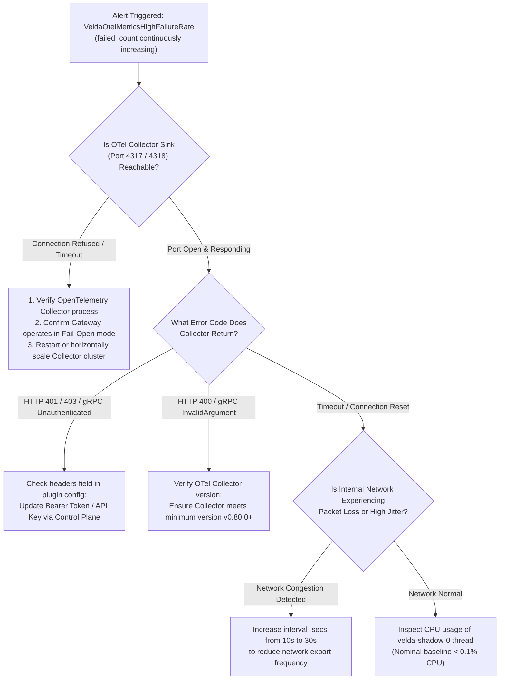

# OpenTelemetry Metrics Exporter Plugin (`otlp_metrics_exporter`) — SRE Operational Runbook

This document is the emergency incident response guide (**SRE Incident Playbook & On-Call Runbook**) designed for SREs, DevOps engineers, and operators managing Velda Edge Gateway clusters and monitoring the OpenTelemetry metrics export pipeline in production.

---

## 1. On-Call Triage Matrix

| Severity | Symptoms & Alerts | Root Cause | Immediate Mitigation | Target SLA |
| :---: | :--- | :--- | :--- | :---: |
| **P0** | Edge Gateway cluster experiences latency spikes or process crashes when exporter is enabled | Memory exhaustion (OOM), host kernel panic, or system resource starvation | Activate Emergency Bypass (disable `otlp_metrics_exporter` plugin via Control Plane API) | **< 5 minutes** |
| **P1** | `VeldaOtelMetricsHighFailureRate` (`failed_count` metric continuously increments) | Downstream OpenTelemetry Collector is crashed, unresponsive, or unreachable on port 4317/4318 | Check OpenTelemetry Collector cluster; Gateway remains 100% Fail-Open without impacting user traffic | **< 15 minutes** |
| **P2** | `VeldaOtelMetricsRejected` (Collector returns HTTP 4xx or non-zero gRPC status) | Authentication failure (missing or expired Bearer token in `headers`), or invalid `service_name` | Update the `headers` field in the plugin configuration via Control Plane | **< 30 minutes** |
| **P3** | Metrics dashboard on Grafana/Datadog displays gaps or stale graphs | `interval_secs` is configured too high (e.g., 60s) or collector disk intake is throttling | Adjust `interval_secs` to `10` or `15` seconds via Control Plane API | **< 2 hours** |

---

## 2. Incident Decision Flowchart



---

## 3. Field Diagnostic CLI Toolkit

When alerted by PagerDuty or Prometheus, SSH directly into the affected Velda Edge node and execute the following diagnostic commands:

### 3.1 Check Success vs Failure Export Counters
```bash
# Inspect system logs from the velda-edge service
journalctl -u velda-edge -n 100 --no-pager | grep "otlp_metrics"

# Stream live export logs with JSON filter
journalctl -u velda-edge -f -o cat | grep -E "Flushed OTLP metrics|Failed to send OTLP"
```
*Assessment*:
- `Flushed OTLP metrics batch via gRPC successfully` $\to$ Export pipeline is operating nominally.
- `Failed to send OTLP metrics via gRPC to collector: connection refused` $\to$ Target Collector is down or stopped listening.

### 3.2 Inspect Socket Connection State to OpenTelemetry Collector
```bash
# Inspect TCP socket status to Collector (port 4317 for gRPC or 4318 for HTTP)
ss -tinh 'dport = :4317 or dport = :4318'

# Test raw network reachability to Collector
nc -zv <IP_OTEL_COLLECTOR> 4317

# For HTTP JSON mode:
curl -v -X POST "http://<IP_OTEL_COLLECTOR>:4318/v1/metrics" \
  -H "Content-Type: application/json" \
  -d '{"resourceMetrics":[]}'
```
*Assessment*:
- `Connection refused` or `Operation timed out` $\to$ Collector is offline or blocked by firewall security group.
- Socket state displays `ESTAB` with `timer:(keepalive)` $\to$ Persistent TCP connection is healthy.

### 3.3 Verify CPU Separation Between Frontline and Shadow Workers
```bash
# Monitor per-thread CPU utilization (Worker vs Shadow)
pidstat -u -t -p $(pgrep velda-edge) 1 5
```
*Assessment*:
- `velda-worker-{id}` (Frontline Workers): Solely responsible for request traffic. Must show zero jitter from export cycles.
- `velda-shadow-0` (Shadow Worker): Operates under `SCHED_IDLE`. Nominal CPU consumption must remain $< 0.8\%$.

---

## 4. Emergency Remediation Procedures

### Scenario 1: OpenTelemetry Collector Outage During Traffic Spikes
When the backend OpenTelemetry Collector cluster collapses completely under heavy infrastructure load:
1. **Confirm User Traffic Impact**:
   - By virtue of **Fail-Open Autonomy**, even if the Collector experiences 100% downtime, frontline worker threads (`velda-worker-*`) continue serving traffic with **0 ns latency impact**.
   - Do **NOT** restart the Gateway process.
2. **Throttle Export Frequency (If Internal Network is Congested)**:
   Submit an updated configuration via the Go Control Plane API to increase `interval_secs`:
   ```bash
   curl -X PUT http://<CONTROL_PLANE_IP>:8080/api/v1/plugins/otlp_metrics_exporter \
     -H "Content-Type: application/json" \
     -d '{
       "protocol": "grpc",
       "endpoint": "grpc://10.0.1.50:4317",
       "interval_secs": 60,
       "connect_timeout_ms": 5000,
       "request_timeout_ms": 10000,
       "service_name": "velda-edge-prod",
       "headers": {}
     }'
   ```

### Scenario 2: Authentication Credentials Expired (HTTP 401 / gRPC Unauthenticated)
When a rotated API key or Bearer token is rejected by the Collector:
1. Generate a valid token from your secret management system (HashiCorp Vault / AWS Secrets Manager).
2. Push the updated token via Control Plane:
   ```bash
   curl -X PUT http://<CONTROL_PLANE_IP>:8080/api/v1/plugins/otlp_metrics_exporter \
     -H "Content-Type: application/json" \
     -d '{
       "protocol": "grpc",
       "endpoint": "grpc://10.0.1.50:4317",
       "interval_secs": 10,
       "connect_timeout_ms": 5000,
       "request_timeout_ms": 10000,
       "service_name": "velda-edge-prod",
       "headers": {
         "authorization": "Bearer <NEW_TOKEN>"
       }
     }'
   ```
3. Verify that log messages transition back to `Flushed OTLP metrics batch successfully`.

### Scenario 3: Complete Emergency Bypass (Disable Plugin)
If an unknown memory leak or panic occurs in the background logistics worker:
```bash
curl -X DELETE http://<CONTROL_PLANE_IP>:8080/api/v1/plugins/otlp_metrics_exporter
```
The Control Plane updates the LKG runtime snapshot in RAM within $< 10\ \mu\text{s}$, cleanly stopping the background exporter task.
