# OpenTelemetry Metrics Exporter Plugin (`otlp_metrics_exporter`) — SRE Operational Runbook

Tài liệu này là cẩm nang vận hành khẩn cấp (**SRE Incident Playbook & On-Call Runbook**) dành riêng cho kỹ sư SRE, DevOps và Operator chịu trách nhiệm trực ca vận hành cụm Velda Edge Gateway và giám sát đường truyền OpenTelemetry Metrics trong môi trường Production.

---

## 1. Ma Trận Ứng Cứu Sự Cố Khẩn Cấp (On-Call Triage Matrix)

| Mức Độ | Triệu Chứng & Cảnh Báo | Nguyên Nhân Khả Dĩ | Hành Động Khắc Phục Nhanh (Mitigation) | SLA Xử Lý |
| :---: | :--- | :--- | :--- | :---: |
| **P0** | Toàn bộ cụm Edge Gateway bị nghẽn độ trễ hoặc sập tiến trình khi bật exporter | Xung đột phần cứng, tràn bộ nhớ hệ điều hành (OOM), lỗi nhân mạng | Kích hoạt cờ Emergency Bypass (tắt plugin runtime qua Control Plane) | **< 5 phút** |
| **P1** | `VeldaOtelMetricsHighFailureRate` (`failed_count` tăng liên tục) | Cụm OTel Collector phía sau bị sập, quá tải, hoặc đứt kết nối mạng cổng 4317/4318 | Kiểm tra cụm OTel Collector; Gateway tự động Fail-Open không ảnh hưởng traffic phục vụ | **< 15 phút** |
| **P2** | `VeldaOtelMetricsRejected` (Collector trả về mã lỗi HTTP 4xx hoặc gRPC status khác 0) | Sai cấu hình xác thực (thiếu Bearer token trong `headers`), hoặc sai `service_name` | Cập nhật lại trường `headers` trong cấu hình plugin qua Control Plane | **< 30 phút** |
| **P3** | Biểu đồ Metrics trên Grafana/Prometheus bị đứt đoạn hoặc gián đoạn hiển thị | `interval_secs` cấu hình quá dài (ví dụ: 60s) hoặc collector bị nghẽn đĩa nạp | Điều chỉnh `interval_secs` về 10s hoặc 15s qua Control Plane API | **< 2 giờ** |

---

## 2. Cây Quyết Định Xử Lý Sự Cố (Triage Flowchart)

```mermaid
flowchart TD
    Alert["Cảnh Báo Kích Hoạt: VeldaOtelMetricsHighFailureRate\n(failed_count tăng liên tục)"] --> CheckCollector{"OTel Collector Sink\n(Port 4317 / 4318) Còn Sống Không?"}
    
    CheckCollector -->|Chết / Timeout / Port Closed| ActionCollector["1. Kiểm tra tiến trình OpenTelemetry Collector\n2. Xác nhận Gateway vẫn đang Fail-Open an toàn\n3. Khởi động lại hoặc mở rộng quy mô cụm Collector"]
    CheckCollector -->|Vẫn Mở Cổng| CheckAuth{"Collector Trả Về Mã Lỗi Gì?"}
    
    CheckAuth -->|HTTP 401 / 403 / gRPC Unauthenticated| ActionAuth["Kiểm tra trường headers trong cấu hình plugin:\nCập nhật Bearer Token / API Key mới qua Control Plane"]
    CheckAuth -->|HTTP 400 / gRPC InvalidArgument| ActionSchema["Kiểm tra phiên bản collector:\nOTel Collector phiên bản tối thiểu v0.80.0+"]
    CheckAuth -->|Timeout / Connection Reset| CheckNetwork{"Mạng Giữa Edge và Collector\nCó Bị Packet Loss / Latency Cao?"}
    
    CheckNetwork -->|Nghẽn Mạng Nội Bộ| ActionInterval["Tăng interval_secs từ 10s lên 30s\nđể giảm tần suất đẩy metrics ra mạng"]
    CheckNetwork -->|Mạng Bình Thường| CheckShadow["Kiểm tra tải CPU của luồng velda-shadow-0\n(Bình thường < 0.1% CPU)"]
```



---

## 3. Bộ Lệnh Chẩn Đoán Trực Tiếp Tại Hiện Trường (Diagnostic CLI Toolkit)

Khi nhận cảnh báo từ PagerDuty/Prometheus, SSH trực tiếp vào node Velda Edge bị cảnh báo và thực thi tuần tự các lệnh sau:

### 3.1 Kiểm Tra Bộ Đếm Đẩy Metrics Thành Công vs Thất Bại
```bash
# Đọc log hệ thống từ tiến trình velda-edge
journalctl -u velda-edge -n 100 --no-pager | grep "otlp_metrics"

# Hoặc đọc log chi tiết qua bộ lọc JSON
journalctl -u velda-edge -f -o cat | grep -E "Flushed OTLP metrics|Failed to send OTLP"
```
*Đánh giá*:
- Nếu thấy log `Flushed OTLP metrics batch via gRPC successfully` $\to$ Quá trình xuất bản hoạt động hoàn hảo.
- Nếu thấy log `Failed to send OTLP metrics via gRPC to collector: connection refused` $\to$ Collector tại địa chỉ đích đã ngừng lắng nghe.

### 3.2 Kiểm Tra Trạng Thái Kết Nối Socket Tới OTel Collector
```bash
# Kiểm tra trạng thái socket TCP tới Collector (port 4317 gRPC hoặc 4318 HTTP)
ss -tinh 'dport = :4317 or dport = :4318'

# Kiểm tra mở cổng trực tiếp tới OTel Collector
nc -zv <IP_OTEL_COLLECTOR> 4317
# hoặc nếu dùng HTTP:
curl -v -X POST "http://<IP_OTEL_COLLECTOR>:4318/v1/metrics" \
  -H "Content-Type: application/json" \
  -d '{"resourceMetrics":[]}'
```
*Đánh giá*: 
- Nếu kết quả trả về `Connection refused` hoặc `Operation timed out` $\to$ Cụm OTel Collector bị treo hoặc firewall chặn cổng.
- Nếu trạng thái socket hiển thị `ESTAB` với `timer:(keepalive)` $\to$ Kết nối Keep-Alive đang được duy trì tốt.

### 3.3 Kiểm Tra Phân Bổ CPU Của Frontline Worker vs Shadow Worker
```bash
# Theo dõi % CPU tiêu thụ của từng luồng (Worker vs Shadow)
pidstat -u -t -p $(pgrep velda-edge) 1 5
```
*Đánh giá*:
- Luồng `velda-worker-{id}` (Frontline): Chịu trách nhiệm phục vụ traffic, không được có hiện tượng giật tải do exporter.
- Luồng `velda-shadow-0` (Shadow Worker): Chạy dưới `SCHED_IDLE`, chịu trách nhiệm xuất bản OTLP. Tải CPU bình thường phải $< 0.1\%$.

---

## 4. Quy Trình Ứng Cứu Khẩn Cấp (Emergency Mitigation)

### Kịch Bản 1: Cụm OTel Collector Sập Trong Sự Kiện Flash Sale
Khi cụm OTel Collector bị sập hoàn toàn do lưu lượng hạ tầng quá tải:
1. **Kiểm tra tác động tới người dùng**:
   - Nhờ thiết kế **Fail-Open Autonomy**, dù Collector có chết 100%, các luồng frontline worker (`velda-worker-*`) vẫn tiếp tục phục vụ lưu lượng downstream bình thường với **0 ns trễ gia tăng**.
   - Không cần vội vã khởi động lại Gateway.
2. **Hạ tải tần suất đẩy metrics (Nếu mạng nội bộ bị nghẽn)**:
   Gửi cấu hình cập nhật qua Go Control Plane API để tăng `interval_secs`:
   ```bash
   curl -X PUT http://<CONTROL_PLANE_IP>:8080/api/v1/plugins/otlp_metrics \
     -H "Content-Type: application/json" \
     -d '{
       "interval_secs": 60,
       "protocol": "grpc",
       "endpoint": "grpc://10.0.1.50:4317",
       "connect_timeout_ms": 5000,
       "request_timeout_ms": 10000,
       "service_name": "velda-edge-prod",
       "headers": {}
     }'
   ```
   *Hiệu quả*: Gateway tự động nạp cấu hình mới trong RAM mà không cần restart tiến trình (`RuntimeSnapshot` reload).

### Kịch Bản 2: Chuyển Đổi Dự Phòng Giữa gRPC và HTTP
Nếu hạ tầng proxy trung gian chặn binary gRPC (HTTP/2 trailers):
1. Đổi giao thức sang HTTP/1.1 JSON:
   ```json
   {
     "protocol": "http",
     "endpoint": "http://10.0.1.50:4318/v1/metrics",
     "interval_secs": 15,
     "connect_timeout_ms": 3000,
     "request_timeout_ms": 5000,
     "service_name": "velda-edge-prod",
     "headers": {}
   }
   ```
2. Exporter sẽ tự động chuyển sang cơ chế `format_otlp_metrics_into` với bảng tra siêu tốc `DIGIT_PAIRS`.

---

## 5. Quy Tắc Cảnh Báo Chuẩn Cho Prometheus / Alertmanager

```yaml
groups:
  - name: velda_otlp_metrics_exporter_alerts
    rules:
      - alert: VeldaOtelMetricsHighFailureRate
        expr: rate(velda_plugin_otlp_metrics_failed_total[5m]) > 0.5
        for: 2m
        labels:
          severity: warning
          tier: telemetry
        annotations:
          summary: "Velda Edge OTLP Metrics Exporter thất bại khi đẩy số liệu"
          description: "Tỷ lệ thất bại khi xuất bản metrics tới OTel Collector vượt quá 0.5 lỗi/giây trong 2 phút qua. Kiểm tra kết nối cổng 4317/4318."

      - alert: VeldaOtelMetricsZeroFlushes
        expr: increase(velda_plugin_otlp_metrics_flushed_total[15m]) == 0
        for: 5m
        labels:
          severity: critical
          tier: telemetry
        annotations:
          summary: "Velda Edge không xuất bản được batch metrics nào trong 15 phút"
          description: "Cụm Collector có thể đã offline hoàn toàn hoặc cấu hình endpoint không thể phân giải DNS."
```
