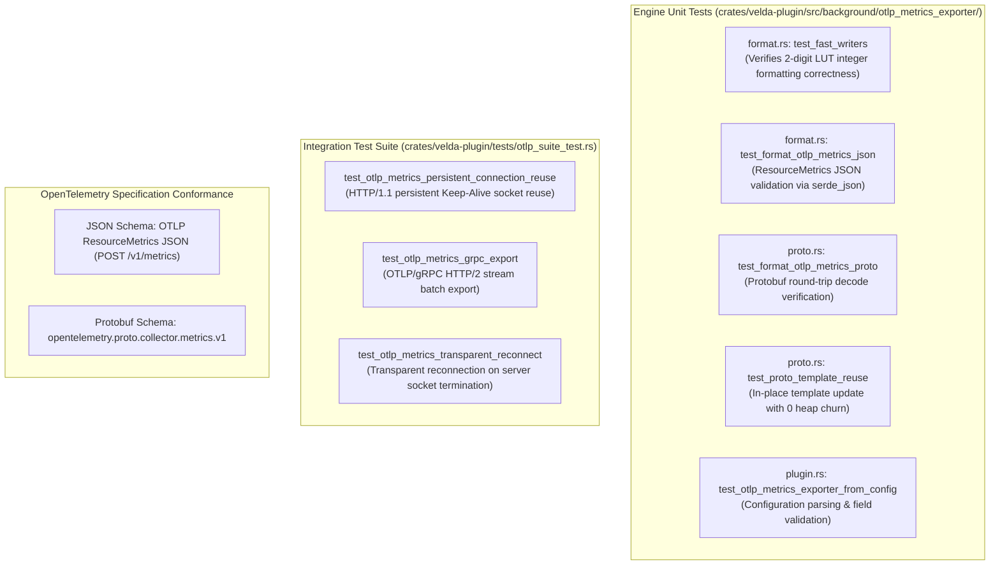

# OpenTelemetry Metrics Exporter Plugin (`otlp_metrics_exporter`) — Test Specification

This document details the automated unit test catalog, integration test suite, connection lifecycle validation, schema conformance checks, and reproduction instructions for the **`otlp_metrics_exporter`** background plugin in Velda Edge.

---

## 1. Test Architecture & Scope

The `otlp_metrics_exporter` test suite verifies schema conformance, zero-heap-churn serialization mechanics, connection reuse, and fault tolerance across four test boundaries:



---

## 2. Automated Test Catalog

### 2.1 Engine Unit Tests (`crates/velda-plugin/src/background/otlp_metrics_exporter/`)

| Test Identifier | Module | Description | Key Assertions & Invariants |
| :--- | :--- | :--- | :--- |
| `test_fast_writers` | `format.rs` | Verifies stack-based integer ASCII formatting. | `fast_write_u64` formats 0, single-digit, double-digit, and large integers; `fast_write_i64` handles negative values; `fast_format_u128_into` outputs correct nanosecond strings. |
| `test_format_otlp_metrics_json` | `format.rs` | Verifies JSON payload validity. | Emitted payload deserializes via `serde_json::Value`, contains `resourceMetrics`, valid `service.name`, and at least 4 metric definitions. |
| `test_format_otlp_metrics_proto` | `proto.rs` | Verifies Protobuf message generation. | Output bytes decode successfully via `ExportMetricsServiceRequest::decode`, matching metric names `velda.requests.total`, `velda.active_streams`, `velda.bytes_received_total`, `velda.bytes_transmitted_total`. |
| `test_proto_template_reuse` | `proto.rs` | Verifies in-place AST template reuse. | Multiple consecutive `update_and_encode` calls on `OtlpProtoTemplate` produce identical wire lengths without heap churn or AST re-allocation. |
| `test_otlp_metrics_exporter_from_config` | `plugin.rs` | Verifies declarative plugin instantiation. | Correctly parses `protocol: "grpc"`, `endpoint`, `interval_secs: 15`, `connect_timeout_ms`, and `headers`. |

---

### 2.2 Integration Test Catalog (`crates/velda-plugin/tests/otlp_suite_test.rs`)

| Test Identifier | Scope | Transport | Verification & Assertions |
| :--- | :--- | :--- | :--- |
| `test_otlp_metrics_persistent_connection_reuse` | Telemetry Export | OTLP/HTTP (JSON) | Mock HTTP server verifies that sequential metric flushes reuse the identical underlying TCP connection (`keep-alive`) without establishing new sockets. |
| `test_otlp_metrics_grpc_export` | Telemetry Export | OTLP/gRPC (Protobuf) | Mock gRPC server validates binary Protobuf frame delivery over HTTP/2, verifying that second flush transmits cleanly over the warm H2 stream. |
| `test_otlp_metrics_transparent_reconnect` | Resiliency | OTLP/HTTP (JSON) | Mock server drops the client connection after the first batch; client detects `ConnectionClosed` and transparently reconnects on the next flush attempt. |

---

## 3. Schema & Protocol Conformance Verification

### 3.1 JSON Conformance (`POST /v1/metrics`)
The emitted JSON conforms strictly to the OpenTelemetry ResourceMetrics JSON specification:
```json
{
  "resourceMetrics": [
    {
      "resource": {
        "attributes": [
          {"key": "service.name", "value": {"stringValue": "velda-edge"}},
          {"key": "telemetry.sdk.name", "value": {"stringValue": "velda-edge"}},
          {"key": "telemetry.sdk.language", "value": {"stringValue": "rust"}}
        ]
      },
      "scopeMetrics": [
        {
          "scope": {
            "name": "velda-edge",
            "version": "0.1.0"
          },
          "metrics": [
            {
              "name": "velda.requests.total",
              "description": "Total number of HTTP requests processed across pipeline dimensions",
              "unit": "1",
              "sum": {
                "aggregationTemporality": 2,
                "isMonotonic": true,
                "dataPoints": [...]
              }
            }
          ]
        }
      ]
    }
  ]
}
```

### 3.2 Protobuf Conformance
Protobuf messages compile and decode against:
- `opentelemetry.proto.collector.metrics.v1.ExportMetricsServiceRequest`
- Resource attributes include `service.name`, `telemetry.sdk.name`, `telemetry.sdk.language`.
- Metric numbers are typed as `as_int` (signed 64-bit integer) matching counter and gauge representations.

---

## 4. Test Execution & Reproduction Commands

To execute the complete automated test suite locally:

```bash
# 1. Run unit tests in format.rs, proto.rs, and plugin.rs
cargo test -p velda-plugin --lib background::otlp_metrics_exporter

# 2. Run the end-to-end OTLP integration test suite
cargo test -p velda-plugin --test otlp_suite_test

# 3. Run all tests across the velda-plugin crate
cargo test -p velda-plugin

# 4. Strict clippy compiler lint verification
cargo clippy -p velda-plugin --all-targets --all-features -- -D warnings

# 5. Format validation
cargo fmt --check
```
