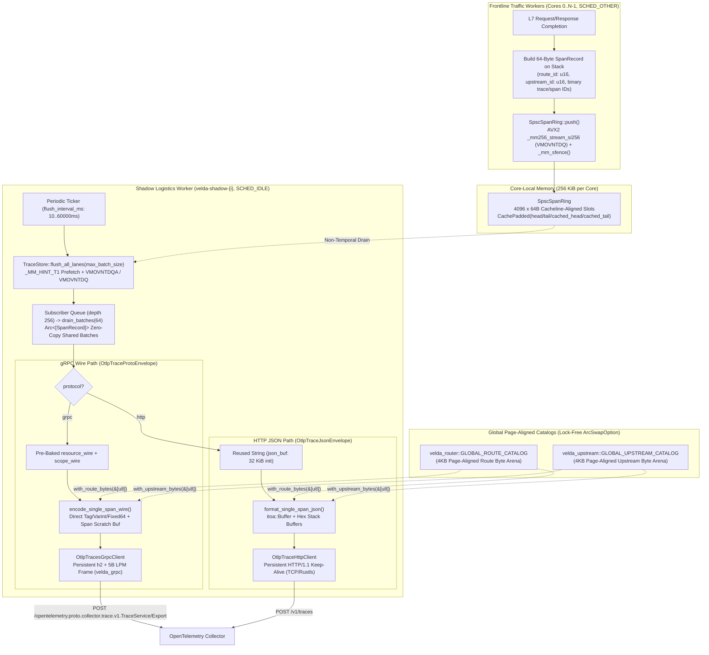

# OpenTelemetry Trace Exporter — Deep-Dive Architecture Specification

This document specifies the internal subsystem architecture, cacheline memory geometry, non-temporal SIMD ring transport, lock-free catalog resolution, direct Protobuf wire encoding, and failure isolation boundaries of the **OpenTelemetry Trace Exporter Plugin** (`otlp_trace_exporter`).

---

## 1. Subsystem Mission & Architectural Boundaries

`otlp_trace_exporter` operates strictly in `phase: "background"` on Shadow Logistics threads (`velda-shadow-{id}` under Linux `SCHED_IDLE`). Its design enforces a hard structural separation between **hot-path telemetry capture** and **background wire serialization / network export**:

1. **Pure-Integer Data Plane Capture (`velda-observability`)**: Frontline traffic workers never handle route strings, upstream names, JSON, or Protobuf. Upon request completion, workers emit only a fixed 64-byte scalar [`SpanRecord`](../../../../velda-observability/src/traces/record.rs) containing numeric IDs (`route_id: u16`, `upstream_id: u16`, `status_code: u16`, timestamps, and binary trace/span IDs).
2. **Non-Temporal L1D-Bypassing Handoff (`SpscSpanRing`)**: Core-local ring buffers decouple producers (Frontline workers) from the background flusher (`TraceStore::flush_all_lanes`) without mutexes or L1D cache pollution.
3. **Lock-Free Catalog Late Binding**: Symbolic strings (route patterns and upstream names) live outside `velda-observability` in 4KB page-aligned contiguous byte catalogs owned by `velda-router` (`RouteCatalog`) and `velda-upstream` (`UpstreamCatalog`). Background exporters resolve IDs to raw `&[u8]` slices at export time via lock-free `ArcSwapOption` loads.
4. **Zero-AST Wire Formatting**: In gRPC mode, `OtlpTraceProtoEnvelope` writes compliant OpenTelemetry Protobuf wire bytes directly into reusable scratch buffers without instantiating Prost AST structs.

---

## 2. End-to-End Subsystem Data Flow



---

## 3. Memory Geometry: The 64-Byte Cacheline `SpanRecord`

Every captured span occupies exactly **64 bytes** (`size_of::<SpanRecord>() == 64`, `align_of::<SpanRecord>() == 64`), enforced via compile-time assertions in [`velda_observability::traces::record`](../../../../velda-observability/src/traces/record.rs).

```text
Offset (Bytes)   0                   8                  16                  24
                ┌───────────────────┬───────────────────┬───────────────────┬───────────────────┐
Line 0 (0..31)  │ start_time_nano   │  end_time_nano    │        trace_id [0..15] (16B)         │
                │      (u64)        │      (u64)        │      (128-bit W3C Trace ID)           │
                └───────────────────┴───────────────────┴───────────────────┴───────────────────┘
Offset (Bytes)  32                  40        44    46    48   50 51 52 53 54 55                  63
                ┌───────────────────┬─────────┬─────┬─────┬────┬──┬──┬──┬──┬──┬───────────────────┐
Line 1 (32..63) │  span_id [0..7]   │client_ip│rt_id│up_id│st  │os│mt│kd│ip│fl│  _reserved [9B]   │
                │  (64-bit, 8B)     │  [u8;4] │ u16 │ u16 │u16 │u8│u8│u8│u8│u8│                   │
                └───────────────────┴─────────┴─────┴─────┴────┴──┴──┴──┴──┴──┴───────────────────┘
                  Total = 64 Bytes | #[repr(C, align(64))] | Zero Heap Pointers | 1 CPU Cache Line
```

### Field-by-Field Mapping

| Byte Range | Field | Type | Purpose & Invariants |
| :--- | :--- | :--- | :--- |
| `0..8` | `start_time_unix_nano` | `u64` | Request start timestamp in nanoseconds since Unix epoch. |
| `8..16` | `end_time_unix_nano` | `u64` | Response completion timestamp in nanoseconds since Unix epoch. |
| `16..32` | `trace_id` | `[u8; 16]` | Raw binary 128-bit trace identifier (derived from `RequestId(u128)`). |
| `32..40` | `span_id` | `[u8; 8]` | Raw binary 64-bit span identifier. |
| `40..44` | `client_ip` | `[u8; 4]` | IPv4 octets when `ip_kind != 0`. |
| `44..46` | `route_id` | `u16` | Dense index into `RouteCatalog` (`UNMATCHED_ROUTE_ID = u16::MAX` resolves to `b"unmatched"`). |
| `46..48` | `upstream_id` | `u16` | Dense index into `UpstreamCatalog` (`UNASSIGNED_UPSTREAM_ID = u16::MAX` omits `net.peer.name`). |
| `48..50` | `status_code` | `u16` | HTTP status code emitted in `http.status_code`. |
| `50..51` | `otlp_status` | `u8` | OTLP `StatusCode` enum (`0` = UNSET, `1` = OK, `2` = ERROR). |
| `51..52` | `method` | `u8` | Canonical [`HttpMethod`](../../../../velda-core/src/lut.rs) integer encoding. |
| `52..53` | `span_kind` | `u8` | OTLP `SpanKind` (`2` = `SPAN_KIND_SERVER`). |
| `53..54` | `ip_kind` | `u8` | Client IP indicator (`0` = None, `4` = IPv4). |
| `54..55` | `flags` | `u8` | W3C trace flags (`1` = Sampled). |
| `55..64` | `_reserved` | `[u8; 9]` | Explicit cacheline padding bytes. |

---

## 4. Non-Temporal SPSC Ring Transport (`SpscSpanRing`)

Each traffic worker core owns an independent `SpscSpanRing` (default `DEFAULT_TRACE_CORE_RING_CAPACITY = 4096` slots = **256 KiB** per core) inside [`TraceStore`](../../../../velda-observability/src/traces/store.rs).

### 4.1 MESI False-Sharing Isolation
All control pointers are isolated onto separate 64-byte cache lines via `#[repr(align(64))] struct CachePadded<T>(T)`:
- Producer-owned lines: `head`, `cached_tail`
- Consumer-owned lines: `tail`, `cached_head`

The producer checks `cached_tail` locally (`Ordering::Relaxed`) and only loads `tail` with `Ordering::Acquire` when the local shadow index indicates the ring is full. Similarly, the consumer only reloads `head` when `cached_head` indicates the queue is empty.

### 4.2 L1D Cache Bypass via Non-Temporal Stores & Streaming Loads ("L1 is Gold")
Because a worker thread writing 64-byte trace records does not immediately re-read those records, standard cached writes (`mov`) would evict hot routing tables or HTTP parser buffers from L1D. To prevent this:
1. **Producer (`push`) on `x86_64` with AVX2**:
   - Loads the 64-byte stack `SpanRecord` into two 256-bit YMM registers (`_mm256_load_si256`).
   - Issues two non-temporal streaming stores (`_mm256_stream_si256` / `VMOVNTDQ`) directly into the ring slot, routing via Write-Combining buffers to RAM/LLC without allocating lines in L1D.
   - Executes `_mm_sfence()` before publishing `head` with `Ordering::Release`.
   - *(Falls back to 4 × 128-bit `_mm_stream_si128` when AVX2 is unavailable, or `ptr::copy_nonoverlapping` + `fence(Release)` on non-x86_64).*
2. **Consumer (`drain_batch`) on `x86_64` with AVX2**:
   - Stages upcoming slots 4 entries ahead into L2/L3 using `_mm_prefetch(slot, _MM_HINT_T1)`, explicitly skipping L1D (`T1` rather than `T0`).
   - Executes `_mm256_stream_load_si256` (`VMOVNTDQA`) to read slots without polluting L1D, paired with `_mm256_stream_si256` (`VMOVNTDQ`) into the destination `Vec<SpanRecord>` batch buffer, followed by `_mm_sfence()`.
3. **Zero-Subscriber Fast Discard**: If no trace exporter is subscribed (`subscribers.is_empty()`), `TraceStore::discard_all` advances `tail = head` in $\mathcal{O}(1)$ without copying bytes.

---

## 5. Lock-Free Page-Aligned Catalog Resolution

Route paths and upstream names are resolved lazily on the background thread via two 4KB page-aligned catalogs (`align = 4096`):
- [`velda_router::RouteCatalog`](../../../../velda-router/src/catalog.rs) via `velda_router::with_route_bytes(record.route_id, |bytes| ...)`
- [`velda_upstream::UpstreamCatalog`](../../../../velda-upstream/src/catalog.rs) via `velda_upstream::with_upstream_bytes(record.upstream_id, |bytes| ...)`

### Memory Layout of `RouteCatalog` / `UpstreamCatalog`
```text
┌───────────────────────────────────────────────────────────────────────────┐
│ Page-Aligned Buffer (k × 4096 bytes, published via ArcSwapOption)         │
├───────────────────────────────────────────────┬───────────────────────────┤
│ Index Table (N × 4B)                          │ Packed Raw UTF-8 Data     │
│ Slot i: (offset: u16, len: u16)               │ [route0][route1][route2]… │
└───────────────────────────────────────────────┴───────────────────────────┘
```
- **O(1) Resolution**: `get_bytes` reads `slot_offset = idx * 4`, extracts `(offset, len)`, and returns `&slice[offset..offset + len]`.
- **Fallback Safety**: If `id == u16::MAX` (`UNMATCHED_ROUTE_ID` / `UNASSIGNED_UPSTREAM_ID`), out of bounds, or no catalog is loaded, the resolver passes static slice `b"unmatched"`.
- **Zero Lock Contention**: Config reloads swap the `Arc<RouteCatalog>` / `Arc<UpstreamCatalog>` atomically via `ArcSwapOption::store`; readers load lock-free pointers.

---

## 6. Wire Serialization Architecture

### 6.1 Direct Protobuf Wire Serializer (`proto/template.rs`)

Instead of constructing an AST of `ExportTraceServiceRequest` -> `Vec<ResourceSpans>` -> `Vec<ScopeSpans>` -> `Vec<Span>` -> `Vec<KeyValue>` (which triggers multiple heap `String` and `Vec` allocations per span), [`OtlpTraceProtoEnvelope`](proto/template.rs) serializes directly to raw Protobuf wire bytes:

1. **Startup Pre-Baking (`OtlpTraceProtoEnvelope::new`)**:
   - `resource_wire`: Pre-encodes `Resource { attributes: [KeyValue("service.name", service_name)] }` once.
   - `scope_wire`: Pre-encodes `InstrumentationScope { name: "velda.edge.router", version: CARGO_PKG_VERSION }` once.
2. **Span Framing (`encode_single_span_wire`)**:
   - Reuses persistent `single_span` (256-byte init) and `spans_wire` (16 KiB init) scratch buffers owned by `OtlpTraceProtoEnvelope` (`format_spans_wire(&mut self, ...)`), appending directly:
     - Tag `1` (`0x0A`, len `16`): `record.trace_id`
     - Tag `2` (`0x12`, len `8`): `record.span_id`
     - Tag `5` (`0x2A`): Span name `"<method> <route_bytes>"` directly blitted via `with_route_bytes`
     - Tag `6` (`0x30`, varint): `record.span_kind`
     - Tag `7` (`0x39`, fixed64): `record.start_time_unix_nano.to_le_bytes()`
     - Tag `8` (`0x41`, fixed64): `record.end_time_unix_nano.to_le_bytes()`
     - Tag `9` (`0x4A`, repeated `KeyValue`):
       - `http.status_code` (`IntValue`)
       - `http.method` (`StringValue`)
       - `http.target` (`StringValue` directly from `RouteCatalog` `&[u8]`)
       - `velda.route_id` (`IntValue`, when `route_id != UNMATCHED_ROUTE_ID`)
       - `net.peer.name` (`StringValue` directly from `UpstreamCatalog` `&[u8]`, when `upstream_id != UNASSIGNED_UPSTREAM_ID`)
       - `net.peer.ip` (`StringValue`, stack-formatted `[u8; 16]` IPv4 ASCII, when `ip_kind != 0`)
     - Tag `15` (`0x7A`): `Status { code: record.otlp_status }`
   - Each finished span length is prefixed with `0x12` (tag `2` of `ScopeSpans`) + varint length and appended to `spans_wire`, which is then wrapped with `resource_wire` and `scope_wire` into `out_buf`.
3. **Wire Compliance Verification**: Unit tests verify byte-for-byte decoding against the official `opentelemetry-proto` crate (`ExportTraceServiceRequest::decode`).

### 6.2 JSON Wire Envelope (`json/template.rs`)
- Uses a single caller-owned `String` (`json_buf`, initial capacity 32 KiB) cleared per flush tick (`buf.clear()`).
- Converts integers via stack-allocated `itoa::Buffer` without `format!` or `to_string()`.
- Converts raw `&[u8]` catalog slices via borrowed `std::str::from_utf8(bytes)` directly into `buf.push_str(...)`.
- Encodes 128-bit `trace_id` and 64-bit `span_id` into fixed stack hex arrays (`[u8; 32]`, `[u8; 16]`).

---

## 7. Transport Layer & Failure Isolation

| Transport | Client Implementation | Framing & Protocol Mechanics | Resilience & Backoff |
| :--- | :--- | :--- | :--- |
| **`grpc`** | [`OtlpTracesGrpcClient`](proto/client.rs) | Persistent HTTP/2 (`h2`) connection multiplexer; encodes 5-byte gRPC LPM header via `velda_grpc::encode_grpc_frame`; `POST /opentelemetry.proto.collector.trace.v1.TraceService/Export`; validates HTTP 200 and `grpc-status == 0`. | `connect_timeout` & `request_timeout` guards; drops broken `h2` handle so next tick transparently reconnects. |
| **`http`** | [`OtlpTraceHttpClient`](json/client.rs) | Persistent HTTP/1.1 Keep-Alive stream (plaintext TCP or Rustls TLS); `POST /v1/traces` with `Content-Type: application/json`. | Reconnects on broken pipe/EOF/timeout; logs warning and increments `failed_spans` without stalling traffic workers. |
