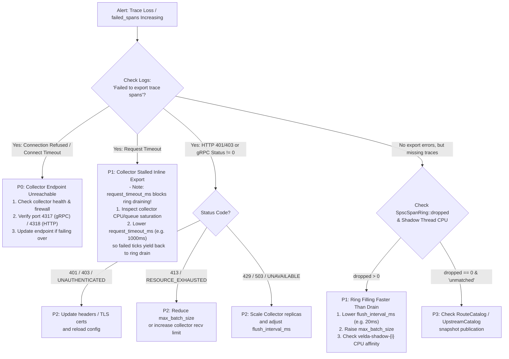

# OpenTelemetry Trace Exporter — SRE On-Call Runbook & Incident Triage Guide

This runbook equips Site Reliability Engineers (SREs) and on-call operators with diagnostic workflows, incident severity matrices, and actionable remediation steps for the **OpenTelemetry Trace Exporter Plugin** (`otlp_trace_exporter`).

---

## 1. Parameter Reference & Operational Impact

| Field | Validated Range | Operational Impact | Typical Production Baseline |
| :--- | :--- | :--- | :--- |
| `protocol` | `"http"` \| `"grpc"` | `"grpc"` encodes binary Protobuf wire payloads over HTTP/2 (`4317`); `"http"` encodes JSON payloads over HTTP/1.1 (`4318`). | `"grpc"` |
| `endpoint` | `http://`, `https://`, or `grpc://` | Target collector URL. Unreachable collectors drop export batches without affecting client request serving. | `"grpc://127.0.0.1:4317"` |
| `service_name` | Non-empty string | Logical resource identifier (`service.name`) pre-baked into exported spans. | `"velda-edge-prod"` |
| `flush_interval_ms` | `10 ..= 60_000` | Interval for waking the background worker to drain `TraceStore` SPSC rings. Smaller intervals reduce ring accumulation risk under high RPS. | `100` *(or `20`–`50` under heavy burst)* |
| `max_batch_size` | `1 ..= 10_000` | Maximum `SpanRecord`s drained per lane flush. Larger batches amortize network round-trips at the expense of larger single payloads. | `1000` |
| `connect_timeout_ms` | `100 ..= 60_000` | TCP/TLS handshake timeout to collector. Prevents dead sockets from hanging the shadow worker loop. | `1000` |
| `request_timeout_ms` | `100 ..= 60_000` | Export round-trip timeout. Because exports await inline within `run()`, oversized timeouts stall ring draining during collector hangs. | `1000` |
| `headers` | String key-value map (`{}` if unused) | Custom HTTP/gRPC metadata headers (e.g., `authorization`, tenant headers). | `{}` |

---

## 2. Configuration Profiles

### Profile A: Production gRPC Collector (`4317`)
```json
{
  "id": "otlp_trace_exporter",
  "config": {
    "protocol": "grpc",
    "endpoint": "grpc://otel-collector.monitoring.svc.cluster.local:4317",
    "service_name": "velda-edge-prod",
    "flush_interval_ms": 50,
    "max_batch_size": 1000,
    "connect_timeout_ms": 1000,
    "request_timeout_ms": 1000,
    "headers": {}
  }
}
```

### Profile B: HTTP/JSON Collector (`4318`) with Bearer Authentication
```json
{
  "id": "otlp_trace_exporter",
  "config": {
    "protocol": "http",
    "endpoint": "https://otel-collector.monitoring.svc.cluster.local:4318/v1/traces",
    "service_name": "velda-edge-prod",
    "flush_interval_ms": 100,
    "max_batch_size": 1000,
    "connect_timeout_ms": 1000,
    "request_timeout_ms": 1000,
    "headers": {
      "authorization": "Bearer <secret-token>"
    }
  }
}
```

---

## 3. SRE Incident Triage Matrix (P0 – P3)

> [!NOTE]
> **Fail-Open Blast Radius**: `otlp_trace_exporter` runs strictly on background shadow threads (`SCHED_IDLE`). Even complete collector failure cannot block, reject, or delay downstream client traffic serving. P0/P1 below refer to **telemetry pipeline outage** severity.

| Severity | Incident Pattern | Observable Symptoms & Logs | Immediate Mitigation Action |
| :---: | :--- | :--- | :--- |
| **P0** | **Collector Unreachable / Total Trace Outage** | `failed_spans` climbs steadily; `shipped_spans` stalls at `0`; logs emit `"Failed to export trace spans via gRPC"` or `"Failed to export trace spans via HTTP"` with connection refused / timeout. | 1. Verify downstream client traffic is unaffected (Fail-Open).<br>2. Check OpenTelemetry Collector pod/daemon health and listening ports (`4317`/`4318`).<br>3. Fail over `endpoint` in `plugins.json` if collector cluster is down. |
| **P1** | **Ring Overflow & Dropped Spans Under Load** | `SpscSpanRing::dropped` climbs on frontline cores; spans are missing in trace backend while collector is up. | 1. Inspect `request_timeout_ms` — a stalled collector blocks the inline flush loop and stops `flush_all_lanes` from draining SPSC rings (`4096` slots/core).<br>2. Reduce `flush_interval_ms` (e.g. `100` -> `20` ms) and increase `max_batch_size` (up to `10000`) if collector is healthy.<br>3. Check `velda-shadow-{i}` CPU starvation under heavy frontline load. |
| **P2** | **Collector Rejection / Auth / Payload Errors** | Logs show `gRPC export failed with HTTP status: 401/403/413/429` or `gRPC rejected with status ...`. | 1. For `401`/`403`/`UNAUTHENTICATED`: verify `headers` auth tokens and reload config.<br>2. For `413` / `RESOURCE_EXHAUSTED`: lower `max_batch_size` (e.g. `10000` -> `1000`) or raise collector `max_recv_msg_size_mib`.<br>3. For `429` / `503`: scale collector workers horizontally. |
| **P3** | **Routes Resolved as `"unmatched"`** | Traces show span names `"GET unmatched"` or missing `net.peer.name` despite traffic matching routes. | 1. Verify `RouteCatalog` and `UpstreamCatalog` atomic swaps completed on reload (`set_global_route_catalog`, `set_global_upstream_catalog`).<br>2. Confirm `route_id != UNMATCHED_ROUTE_ID` is stamped in `SpanRecord` before emission. |

---

## 4. Incident Triage Decision Flowchart



---

## 5. On-Call Diagnostic Toolkit & Recovery Playbooks

### 5.1 Verify Collector Network Reachability & TLS
```bash
# Check gRPC port (4317) or HTTP port (4318) connectivity from the gateway host
nc -zv otel-collector.monitoring.svc.cluster.local 4317

# Test HTTPS/TLS collector endpoint certificate and handshake
openssl s_client -connect otel-collector.monitoring.svc.cluster.local:4318 -servername otel-collector.monitoring.svc.cluster.local
```

### 5.2 Monitor `velda-edge` Exporter Logs & Thread State
```bash
# Filter trace exporter warnings and lifecycle events
journalctl -u velda-edge -n 200 --no-pager | grep -E "otlp_trace_exporter|trace spans|Trace Exporter"

# Inspect per-thread CPU usage (confirm velda-shadow-{i} is not 100% pegged or starved)
ps -eLo pid,tid,cls,ni,psr,%cpu,comm | grep -E "velda-worker|velda-shadow"
```

### 5.3 Playbook: Collector Hang Causing Ring Saturation
**Root Cause**: `OtlpTraceExporterPlugin::run` calls `send_traces` / `send_traces_json` sequentially inside its flush loop. If `request_timeout_ms` is set high (e.g. `30000` ms) while a collector hangs silently without TCP RST, the loop pauses for 30s per attempt, during which frontline 4096-slot rings will fill and drop spans.
1. Set `connect_timeout_ms` and `request_timeout_ms` to bounded values (e.g. `1000` ms) so broken collector connections abort promptly.
2. Restore collector availability or swap `endpoint` in config to a healthy collector node and trigger configuration reload.

### 5.4 Playbook: Emergency Telemetry Disable Without Downtime
Because trace export is decoupled via `TraceStore`, if collector outages generate unwanted log noise or outbound retry traffic:
1. Remove the `otlp_trace_exporter` block from `plugins.json` and trigger hot reload.
2. Once `active_subscriber_count` returns to `0`, `TraceStore::discard_all` discards queued spans in $\mathcal{O}(1)$ with zero network I/O and zero impact to live traffic.
