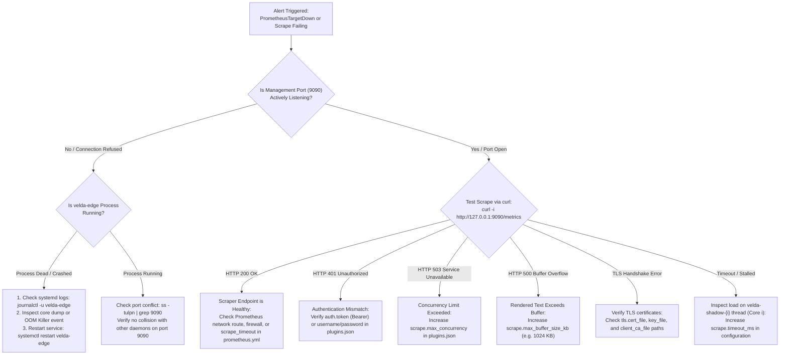

# Prometheus Metrics Exporter Plugin (`prometheus_exporter`) — SRE Operational Runbook

This document serves as the operational runbook and emergency incident playbook for SRE, DevOps, and Platform Engineers responsible for operating Prometheus telemetry pipelines across Velda Edge Gateway clusters.

---

## 1. Configuration Parameter Reference

All configuration blocks (`scrape`, `tls`, `cors`, `auth`) are strictly validated at bootstrap and hot-reload by `validation.rs`. There are no implicit defaults or silent fallbacks.

| Field | Type | Validation Constraints | Operational Description | Recommended Production Value |
| :--- | :---: | :--- | :--- | :--- |
| `listen` | `String` | Non-empty; valid `IP:PORT` socket address. | Dedicated IP:Port socket to bind and expose OpenMetrics scrapes. Must not overlap with any traffic listener. | `"0.0.0.0:9090"` |
| `path` | `String` | Must start with `/`. | HTTP URI path where scrapers request telemetry. | `"/metrics"` |
| `protocol` | `String` | `"http"` or `"https"`. | Transport protocol for management telemetry server. | `"http"` (or `"https"`) |
| `scrape.timeout_ms` | `u64` | `100` to `120_000` ms. | Per-scrape connection timeout threshold. Clamps hung connections or slowloris scrapers. | `5000` (5s) |
| `scrape.max_concurrency` | `usize` | `1` to `1024`. | Max concurrent scrapers permitted simultaneously via semaphore. Excess requests receive HTTP 503. | `16` |
| `scrape.max_buffer_size_kb` | `usize` | `8` to `4096` KB. | Hard upper bound on reusable scratch buffer capacity for OpenMetrics serialization. | `256` (256 KB) |
| `tls.mode` | `String` | `"none"`, `"tls"`, or `"mtls"`. | Transport Layer Security mode. If `"none"`, cert paths must be `null`. | `"none"` (or `"mtls"`) |
| `tls.cert_file` | `String?` | Non-empty file path if `tls`/`mtls`; `null` if `none`. | Path to server X.509 certificate file in PEM format. | `null` |
| `tls.key_file` | `String?` | Non-empty file path if `tls`/`mtls`; `null` if `none`. | Path to server private key file in PEM format. | `null` |
| `tls.client_ca_file` | `String?` | Non-empty file path if `mtls`; `null` otherwise. | Path to client CA bundle for mutual TLS verification of scrapers. | `null` |
| `cors.enabled` | `bool` | `true` or `false`. | Enables CORS preflight (`OPTIONS`) and headers for direct Web UI queries. | `false` |
| `cors.allow_origins` | `Vec<String>` | Non-empty if `cors.enabled == true`; otherwise `[]`. | Allowed HTTP origins permitted to execute cross-origin requests. | `[]` |
| `auth.mode` | `String` | `"none"`, `"bearer"`, or `"basic"`. | Authentication mode for scrapers. | `"none"` (or `"bearer"`) |
| `auth.token` | `String?` | Non-empty if `bearer`; `null` if `none`/`basic`. | Secret bearer token required in `Authorization: Bearer <token>`. | `null` |
| `auth.username` | `String?` | Non-empty if `basic`; `null` if `none`/`bearer`. | HTTP Basic authentication username. | `null` |
| `auth.password` | `String?` | Non-empty if `basic`; `null` if `none`/`bearer`. | HTTP Basic authentication password. | `null` |

---

## 2. Tuned Operational Configuration Presets

### Preset 1: Kubernetes Cluster Internal Scraping (Standard Production)
Designed for internal Kubernetes pod scraping over virtual container networking (CNI) by Prometheus Operator or VictoriaMetrics Agent.

```json
{
  "id": "prometheus_exporter",
  "type": "prometheus_exporter",
  "enabled": true,
  "config": {
    "listen": "0.0.0.0:9090",
    "path": "/metrics",
    "protocol": "http",
    "scrape": {
      "timeout_ms": 5000,
      "max_concurrency": 16,
      "max_buffer_size_kb": 256
    },
    "tls": {
      "mode": "none",
      "cert_file": null,
      "key_file": null,
      "client_ca_file": null
    },
    "cors": {
      "enabled": false,
      "allow_origins": [],
      "allow_methods": [],
      "allow_headers": []
    },
    "auth": {
      "mode": "none",
      "token": null,
      "username": null,
      "password": null
    }
  }
}
```

---

### Preset 2: Zero-Trust & High-Security Environment (mTLS + Bearer Token)
Designed for perimeter edge gateways where scrapers traverse public networks, DMZs, or multi-tenant clouds requiring mutual cryptographic proof and token authentication.

```json
{
  "id": "prometheus_exporter",
  "type": "prometheus_exporter",
  "enabled": true,
  "config": {
    "listen": "0.0.0.0:9090",
    "path": "/metrics",
    "protocol": "https",
    "scrape": {
      "timeout_ms": 10000,
      "max_concurrency": 16,
      "max_buffer_size_kb": 512
    },
    "tls": {
      "mode": "mtls",
      "cert_file": "/etc/velda/certs/server-cert.pem",
      "key_file": "/etc/velda/certs/server-key.pem",
      "client_ca_file": "/etc/velda/certs/scraper-ca.pem"
    },
    "cors": {
      "enabled": false,
      "allow_origins": [],
      "allow_methods": [],
      "allow_headers": []
    },
    "auth": {
      "mode": "bearer",
      "token": "secret-prometheus-token-2026",
      "username": null,
      "password": null
    }
  }
}
```

---

### Preset 3: High-Throughput Prometheus HA Pair & Grafana Direct Queries
Designed for enterprise environments with redundant HA Prometheus servers, VictoriaMetrics clusters, and direct browser queries from Grafana dashboards.

```json
{
  "id": "prometheus_exporter",
  "type": "prometheus_exporter",
  "enabled": true,
  "config": {
    "listen": "0.0.0.0:9090",
    "path": "/metrics",
    "protocol": "http",
    "scrape": {
      "timeout_ms": 10000,
      "max_concurrency": 64,
      "max_buffer_size_kb": 1024
    },
    "tls": {
      "mode": "none",
      "cert_file": null,
      "key_file": null,
      "client_ca_file": null
    },
    "cors": {
      "enabled": true,
      "allow_origins": ["https://grafana.internal.net"],
      "allow_methods": ["GET", "OPTIONS"],
      "allow_headers": ["Authorization"]
    },
    "auth": {
      "mode": "none",
      "token": null,
      "username": null,
      "password": null
    }
  }
}
```

---

## 3. Incident Triage Matrix (P0–P3)

| Severity | Symptoms & Alerts | Root Cause Analysis | Rapid Mitigation Action | Resolution SLA |
| :---: | :--- | :--- | :--- | :---: |
| **P0** | **`PrometheusTargetDown`**<br>Prometheus server reports `connection refused` on `:9090/metrics`. All dashboards blank. | Management port conflict (port 9090 already bound by another daemon), or gateway process crash. | 1. Check `ss -tulpn \| grep 9090`.<br>2. Check `journalctl -u velda-edge -n 100`.<br>3. Kill conflicting process or change port in `plugins.json`. | **< 5 minutes** |
| **P1** | **Scrape Rejections (`503 Service Unavailable`)**<br>Scrapers receive 503. Log reports `max concurrent scrapers reached`. | Concurrency Semaphore exhausted (`max_concurrency` exceeded by HA scrapers or hung connections). | 1. Increase `scrape.max_concurrency` from 16 to 64.<br>2. Inspect scraper IP sources and network latency.<br>3. Trigger hot-reload via Control Plane. | **< 15 minutes** |
| **P2** | **Buffer Overflow (`500 Internal Server Error`)**<br>Scraper fails with HTTP 500. Log shows `PluginError::Config` / Buffer capacity exceeded. | Metrics text size exceeds `scrape.max_buffer_size_kb` (e.g. extensive dynamic routes expansion). | 1. Increase `max_buffer_size_kb` from 256 to 1024 KB.<br>2. Hot-reload configuration.<br>3. Measure serialized byte size via `curl \| wc -c`. | **< 30 minutes** |
| **P2** | **Scrape Timeout (`context deadline exceeded`)**<br>Prometheus server marks scrape timed out after 5s or 10s. | Host CPU saturation on Core 0 starving the `SCHED_IDLE` companion worker, or network RTT spike. | 1. Verify Core 0 CPU utilization via `pidstat -u 1`.<br>2. Increase `scrape_timeout` in `prometheus.yml`.<br>3. Ensure CFS CPU quota headroom for shadow tasks. | **< 30 minutes** |
| **P3** | **Scrape Unauthorized (`401 Unauthorized`)**<br>Prometheus scraper receives HTTP 401. | Bearer token or HTTP Basic credentials rotated in Prometheus server but not in `plugins.json`. | Re-align `auth.token` or `auth.username`/`auth.password` between `prometheus.yml` and gateway config. | **< 2 hours** |
| **P3** | **TLS Handshake Failure**<br>Scraper reports `x509: certificate signed by unknown authority`. | Expired server certificate or missing client CA in mTLS mode. | Check certificate expiry via `openssl x509 -in cert.pem -text`; update paths in `tls.cert_file`. | **< 2 hours** |

---

## 4. Incident Triage Decision Flowchart



---

## 5. Field Diagnostic CLI Toolkit

When triaging Prometheus exporter incidents, execute the following commands on the affected node:

### 5.1 Direct Scrape Verification
```bash
# 1. Plaintext HTTP Scrape
curl -i -m 5 http://127.0.0.1:9090/metrics

# 2. Bearer Authentication Scrape
curl -i -m 5 -H "Authorization: Bearer <SECRET_TOKEN>" http://127.0.0.1:9090/metrics

# 3. HTTP Basic Authentication Scrape
curl -i -m 5 -u "scraper_user:secret_password" http://127.0.0.1:9090/metrics

# 4. HTTPS / TLS Scrape
curl -i -m 5 --cacert /etc/velda/certs/ca.pem https://127.0.0.1:9090/metrics

# 5. Mutual TLS (mTLS) Scrape
curl -i -m 5 \
  --cert /etc/velda/certs/client-cert.pem \
  --key /etc/velda/certs/client-key.pem \
  --cacert /etc/velda/certs/ca.pem \
  https://127.0.0.1:9090/metrics

# 6. CORS Preflight Verification
curl -i -X OPTIONS \
  -H "Origin: https://grafana.internal" \
  -H "Access-Control-Request-Method: GET" \
  http://127.0.0.1:9090/metrics
```

### 5.2 Socket & Buffer Capacity Inspection
```bash
# Verify port 9090 is bound by velda-edge
ss -tulpn | grep 9090

# Measure actual serialized payload byte size
curl -s http://127.0.0.1:9090/metrics | wc -c

# Count active scraped metric lines
curl -s http://127.0.0.1:9090/metrics | grep -v '^#' | wc -l
```

### 5.3 Thread Scheduling & Operational Logs
```bash
# Check CPU usage of shadow worker thread
pidstat -t -p $(pgrep -f velda-edge) 1 5

# Inspect Prometheus exporter operational logs
journalctl -u velda-edge -n 100 --no-pager | grep -i "prometheus"
```

---

## 6. Emergency Remediation Playbooks

### Playbook 1: Mitigating Concurrency Semaphore Exhaustion (`503 Service Unavailable`)
1. Identify current concurrency load in logs:
   ```bash
   journalctl -u velda-edge -n 50 --no-pager | grep -i "max_concurrency"
   ```
2. Update `plugins.json` with expanded concurrency allowance:
   ```json
   {
     "scrape": {
       "max_concurrency": 64
     }
   }
   ```
3. Trigger hot-reload:
   ```bash
   systemctl reload velda-edge
   ```

---

### Playbook 2: Remediating Buffer Capacity Exceeded (`HTTP 500`)
1. Measure exact OpenMetrics serialized output:
   ```bash
   curl -s http://127.0.0.1:9090/metrics | wc -c
   ```
2. If output is nearing or exceeding `max_buffer_size_kb`, double the allocation:
   ```json
   {
     "scrape": {
       "max_buffer_size_kb": 1024
     }
   }
   ```
3. Hot-reload configuration and verify clean HTTP 200 response.

---

### Playbook 3: Management Port Collision Resolution
1. Identify process occupying port 9090:
   ```bash
   lsof -i :9090
   ```
2. If an orphaned daemon is holding the socket, terminate it cleanly:
   ```bash
   kill -15 <PID>
   ```
3. If port 9090 is assigned to an external host monitoring agent, re-assign Prometheus exporter to an available port (e.g. `9145`) in `plugins.json` and update `prometheus.yml`.
