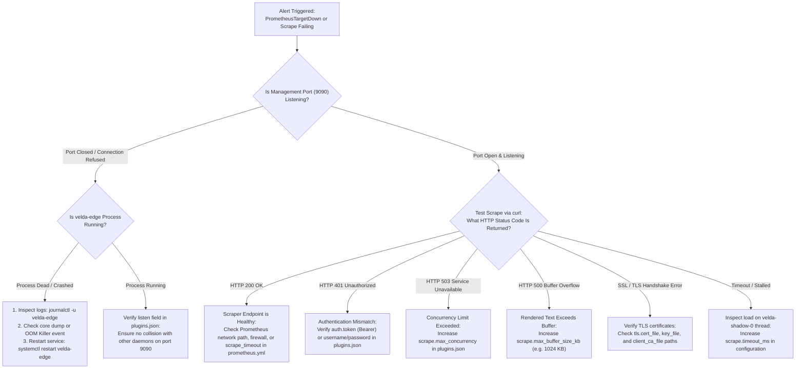

# Prometheus Metrics Exporter Plugin (`prometheus_exporter`) — SRE Operational Runbook

This document serves as the emergency incident playbook and on-call runbook (**SRE Incident Playbook & On-Call Runbook**) designed for SRE, DevOps, and Platform Engineers responsible for operating Velda Edge Gateway clusters, monitoring Prometheus scrapers, and diagnosing telemetry outages.

---

## 1. Emergency Incident Triage Matrix (On-Call Triage Matrix)

| Severity | Symptoms & Alerts | Root Cause Analysis | Rapid Mitigation Action | Resolution SLA |
| :---: | :--- | :--- | :--- | :---: |
| **P0** | `PrometheusTargetDown` (Prometheus/VictoriaMetrics cannot reach `:9090/metrics`; `Connection Refused`) | Port collision (port 9090 bound by another daemon), or gateway process crash | Inspect listening sockets via `ss -tulpn \| grep 9090`; check `journalctl -u velda-edge` for fatal startup errors | **< 5 minutes** |
| **P1** | `PrometheusScrapeFailing503` (Scraper receives `503 Service Unavailable`) | Concurrency Semaphore exhaustion (active scrapers exceed `scrape.max_concurrency`), or slow client connections holding permits | Increase `scrape.max_concurrency` via Control Plane API or hot-reload; verify scraper pool network latency | **< 15 minutes** |
| **P2** | `PrometheusBufferOverflow` (Scraper receives `500 Internal Server Error`; log shows `PluginError::BufferOverflow`) | Number of active routes/pipelines expanded beyond scratch buffer capacity (`max_buffer_size_kb`) | Increase `scrape.max_buffer_size_kb` in `plugins.json` (e.g. from 256 to 1024 KB); trigger hot reload | **< 30 minutes** |
| **P2** | `PrometheusScrapeTimeout` (Prometheus reports scrape timeout > 5s) | Host-wide CPU saturation, or configured `scrape.timeout_ms` threshold is lower than serialization duration | Increase `scrape.timeout_ms` to 10000ms; verify shadow worker CPU scheduling under `SCHED_IDLE` | **< 30 minutes** |
| **P3** | `PrometheusScrapeUnauthorized` (Scraper receives `401 Unauthorized`) | Token or Basic credentials rotated in Prometheus server but not updated in `plugins.json` | Re-align `auth.token` or `auth.username`/`auth.password` between `prometheus.yml` and gateway configuration | **< 2 hours** |
| **P3** | `PrometheusTlsHandshakeFailed` (Scraper fails with SSL certificate validation error) | Server certificate expired, SNI mismatch, or scraper client certificate missing in mTLS mode | Verify certificate validity via `openssl x509 -in cert.pem -text`; update `tls.cert_file` / `tls.client_ca_file` | **< 2 hours** |

---

## 2. Incident Triage Decision Flowchart (Triage Flowchart)



---

## 3. Diagnostic CLI Toolkit (Field Diagnostics)

When an alert fires, SSH into the affected Velda Edge node and execute the following commands in sequence:

### 3.1 Direct Scrape Verification via `curl`
```bash
# 1. Plaintext HTTP Scrape (Default)
curl -i -m 5 http://127.0.0.1:9090/metrics

# 2. Bearer Authentication Scrape
curl -i -m 5 -H "Authorization: Bearer <SECRET_TOKEN>" http://127.0.0.1:9090/metrics

# 3. HTTP Basic Authentication Scrape
curl -i -m 5 -u "scraper_user:secret_password" http://127.0.0.1:9090/metrics

# 4. HTTPS / TLS Scrape
curl -i -m 5 --cacert /etc/velda/certs/ca.pem https://127.0.0.1:9090/metrics

# 5. Mutual TLS (mTLS) Scrape with Client Certificate
curl -i -m 5 \
  --cert /etc/velda/certs/client-cert.pem \
  --key /etc/velda/certs/client-key.pem \
  --cacert /etc/velda/certs/ca.pem \
  https://127.0.0.1:9090/metrics

# 6. CORS Preflight Verification
curl -i -X OPTIONS \
  -H "Origin: https://grafana.internal" \
  -H "Access-Control-Request-Method: GET" \
  http://127.0.0.1:9090/metrics
```

*Response Evaluation*:
- `HTTP/1.1 200 OK`: Exporter functioning normally. Output contains valid OpenMetrics metric series.
- `HTTP/1.1 401 Unauthorized`: Missing or invalid `Authorization` header.
- `HTTP/1.1 503 Service Unavailable`: Max concurrent scrapes exceeded.
- `HTTP/1.1 500 Internal Server Error`: Formatter buffer overflow (`max_buffer_size_kb` too small).
- `HTTP/1.1 204 No Content`: Successful CORS preflight response with `Access-Control-Allow-Origin`.

---

### 3.2 Socket State & Port Conflict Verification
```bash
# Verify port 9090 is listened by velda-edge
ss -tulpn | grep 9090

# Check process PID and socket details
lsof -i :9090
```

---

### 3.3 Inspecting Exporter Operational Logs
```bash
# Inspect Prometheus exporter startup and socket binding logs
journalctl -u velda-edge -n 100 --no-pager | grep -i "prometheus"

# Follow logs in real-time for scrape rejections or buffer warnings
journalctl -u velda-edge -f -o cat | grep -E "Exporter|Prometheus|BufferOverflow"
```

---

## 4. Emergency Remediation Procedures

### 4.1 Remediating Concurrency Semaphore Exhaustion (`503 Service Unavailable`)
If multiple scraper replicas (e.g. Prometheus HA pairs + Grafana live queries) exhaust the semaphore:
1. Update `plugins.json`:
   ```json
   {
     "scrape": {
       "timeout_ms": 10000,
       "max_concurrency": 32,
       "max_buffer_size_kb": 512
     }
   }
   ```
2. Trigger runtime hot-reload:
   ```bash
   velda-cli reload
   ```
3. Verify scrape success: `curl -i http://127.0.0.1:9090/metrics`.

### 4.2 Remediating Buffer Overflow (`PluginError::BufferOverflow`)
When running a large number of routes or pipeline dimensions, the formatted metrics output may exceed `max_buffer_size_kb`:
1. Check current metric size in memory:
   ```bash
   # Temporarily increase buffer limit to 2048 KB
   sed -i 's/"max_buffer_size_kb": [0-9]*/"max_buffer_size_kb": 2048/' /etc/velda/plugins.json
   velda-cli reload
   ```
2. Measure response byte size:
   ```bash
   curl -s http://127.0.0.1:9090/metrics | wc -c
   ```
3. Set permanent `max_buffer_size_kb` with 50% headroom above measured byte count.

### 4.3 Management Port Colliding with Another Daemon
1. Identify process occupying port 9090:
   ```bash
   lsof -i :9090
   ```
2. If it is an orphaned or stale service: `kill -9 <PID>`.
3. If port 9090 is reserved on this host, update `listen: "0.0.0.0:9145"` in `plugins.json` and reload.
