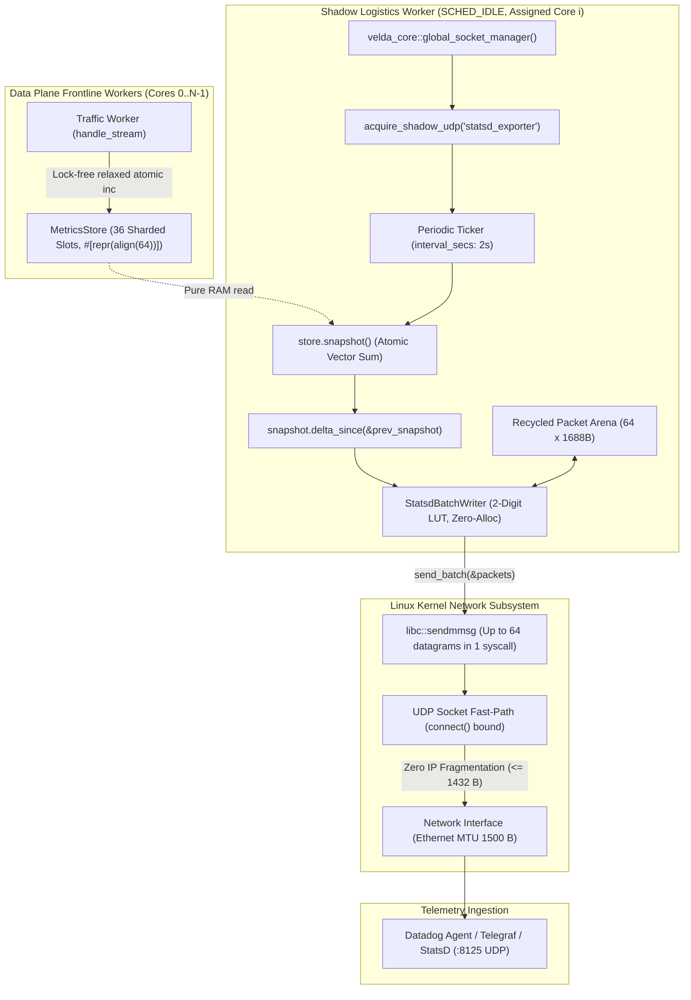

# StatsD Exporter — Architecture Specification

This document details the internal subsystem architecture, socket allocation model, serialization mechanics, memory geometry, empirical machine code proofs, and physical operational boundaries for the **StatsD / DogStatsD Metrics Exporter Plugin** (`statsd_exporter`).

---

## 1. Subsystem Mission & Responsibilities

The `statsd_exporter` is an autonomous background logistics plugin (`phase: "background"`) designed to:
1. Periodically extract point-in-time telemetry snapshots from `velda-observability` via non-blocking relaxed atomic vector reads.
2. Serialize metrics into DogStatsD (tag-based) or Standard StatsD (dot-notation) line protocol text without dynamic heap allocation.
3. Pack metric lines into strictly bounded UDP datagrams matching host MTU boundaries ($\le 1432$ bytes).
4. Stream datagrams to local or remote UDP collectors via kernel fast-path non-blocking sockets and vectorized `libc::sendmmsg` syscalls.

---

## 2. Architecture & Data Flow



---

## 3. Core Architectural Invariants

### Invariant 1: Central Core Socket Ownership & Anti-Conflict
Under Section 2.8 and 2.9 of the Velda Edge Engineering Rules:
* The exporter **never** invokes raw socket binding syscalls directly.
* All sockets are authoritatively requested from `velda_core::global_socket_manager().acquire_shadow_udp()`.
* The Core Socket Manager guarantees that shadow ports never collide with active Data Plane Traffic ports (`:80`, `:443`, `:8080`, `:8443`).
* Upon graceful shutdown or configuration reload, `release_shadow_udp()` cleanly unregisters the claim and returns the socket descriptor to the operating system.

### Invariant 2: Zero Write Contention on Frontline Workers
* The exporter executes strictly on background companion worker threads (`velda-shadow-{id}`) under Linux `SCHED_IDLE`.
* Telemetry is read through `MetricsStore::snapshot()`, which reads `Ordering::Relaxed` atomics across core lanes and performs a vector summation.
* Frontline traffic workers serving client requests never wait on locks, channels, mutexes, or socket buffers.

### Invariant 3: Zero Dynamic Heap Allocation per Line
* Integer formatting avoids `format!`, `write!`, and `String` allocations by employing `DIGIT_PAIRS` — a stack-based 200-byte 2-digit ASCII lookup table.
* Decimal conversion converts two digits per iteration (`n /= 100`), reducing hardware division instructions by 50%.
* Output bytes are written directly into a pre-allocated reusable packet buffer (`Vec<u8>`).

### Invariant 4: MTU-Bounded Batching (Anti-IP Fragmentation)
* Standard Ethernet MTU is 1500 bytes. When subtracting IP headers (20 bytes for IPv4, 40 bytes for IPv6) and UDP headers (8 bytes), standard maximum safe UDP payload without fragmentation is **1432 bytes**.
* `StatsdBatchWriter` checks `current_packet_len + next_line_len > max_packet_size`.
* When the limit is reached, it flushes the current datagram into the packet pool and starts a new packet.
* Metric lines are **never** sliced across packet boundaries. Every UDP datagram contains complete, parseable newline-delimited lines.

### Invariant 5: Kernel Fast-Path `connect()`
* Standard UDP requires kernel routing lookups and ARP cache validation on every `sendto(dest)` call.
* `StatsdTransport` executes `socket.connect(destination).await` once at startup.
* In Linux, connecting a UDP socket stores the 4-tuple directly in the kernel socket control block (`struct sock`), enabling subsequent `send()` syscalls to skip routing table lookups.

### Invariant 6: Vectorized `sendmmsg` Batched Transmission
* Instead of issuing individual `send()` syscalls for each 1432-byte datagram, `StatsdTransport::send_batch` leverages Linux `libc::sendmmsg`.
* All datagrams comprising an entire snapshot are submitted in a single kernel transition (Ring 3 -> Ring 0), minimizing OS context switches.
* Stack-allocated `[libc::mmsghdr; 64]` and `[libc::iovec; 64]` arrays guarantee zero heap allocations during packet batching.

### Invariant 7: Cumulative vs Delta Accounting
* Metrics emitted as StatsD counters (`|c`) represent interval deltas.
* `StatsdExporterPlugin` tracks `prev_snapshot` and calculates `snapshot.delta_since(&prev_snapshot)` on every tick.
* When traffic is idle between ticks, emitted counter values are `0|c` rather than re-transmitting monotonic totals that would inflate ingestion metrics.

---

## 4. Shadow Workload Weight & Core Affinity

Under the Velda Edge Workload Distribution Model, background logistics plugins define an explicit workload weight from 1 to 100:

| Dimension | Metric Profile | Impact Analysis |
| :--- | :--- | :--- |
| **Assigned Workload Weight** | **20** | **Moderate-Low Background Workload** |
| **CPU Intensity** | Low-to-Moderate | Periodic timer wakeup (default: 2s), relaxed atomic vector sum across 36 pipeline slots, 2-digit LUT byte formatting, and 1 vectorized `sendmmsg` syscall. Active CPU duration is typically under 1 ms per flush cycle. |
| **Memory Footprint** | ~150 KB | Fixed reusable packet arena (64 pre-allocated buffers $\times 1688$ bytes) + scratch formatting buffers. Zero ongoing heap churn. |
| **Cadence / Wakeup Rate** | Configurable (1s – 3600s) | Coarse-grained interval (default: 2s), producing minimal scheduler interruptions. |
| **Failure Blast Radius** | P2 (Low Impact) | Telemetry loss only. Dropped UDP packets or dead collectors have zero impact on live client traffic serving. |

### Complementary Static Sharding Recommendation
* **Core Placement**: Core 1, 2, or 3.
* **Anti-Colocation Rule**: Avoid co-locating on Core 0 when Core 0 is strictly dedicated to latency-critical `health_probe` (Weight: 1) and master traffic intake. Do not pair with heavy log shippers (`loki_log_shipper` or `otlp_log_shipper`) on cores with constrained memory bandwidth.
* **Ideal Pairing**: Pair with sleep-bound rotators (`jwks_rotator`, `acme_cert_rotator`) or lightweight service discovery background tasks on secondary cores.

---

## 5. Memory Geometry & Scratch Buffer Pooling

```text
+-------------------------------------------------------------------------------+
|  StatsdExporter Reusable Scratch Buffer Arena Layout                          |
|                                                                               |
|  [Packet Arena Pool: Vec<Vec<u8>> (Capacity: 64 buffers, max_packet_size + 256)]
|  +-----------------------------------+--------------------+------+            |
|  | metric1:val|c\n                   | metric2:val|g\n    | ...  |  (Buf 0)   |
|  +-----------------------------------+--------------------+------+            |
|  | metric3:val|c\n                   | metric4:val|g\n    | ...  |  (Buf 1)   |
|  +-----------------------------------+--------------------+------+            |
|  <------------------ Length <= 1432 Bytes (MTU Safety) ------------->         |
|                                                                               |
|  [Stack-Allocated Vectorized I/O Headers: try_sendmmsg_chunk]                 |
|  +-----------------------------------------------------------------+          |
|  | [libc::iovec; 64]   (iov_base points to slice, iov_len = len)   | (Stack)  |
|  | [libc::mmsghdr; 64] (msg_hdr.msg_iov configured, msg_name=null) | (Stack)  |
|  +-----------------------------------------------------------------+          |
+-------------------------------------------------------------------------------+
```

1. **Recycled Buffers**: The packet pool is pre-warmed with 64 vectors at startup and cleared/reused on every flush cycle via `clear()` and `extend_from_slice()`.
2. **Stack-Allocated Structs**: Vectorized `iovec` and `mmsghdr` structures are declared directly on the call stack inside `try_sendmmsg_chunk`, avoiding heap allocation during transmission.
3. **Cache Warmth**: Scratch memory remains resident in L1/L2 data cache across successive ticks.

---

## 6. Empirical Machine Code Disassembly Proof

### Division-Free 2-Digit LUT & SIMD Itoa (`fast_write_u64_slice` / `lut.rs`)

Compiled under `rustc 1.98` with `--release` (`-C opt-level=3`):

```nasm
; Inspection of fast_write_u64_slice: n < 10 fast-path
.LBB_fast_write_u64_1:
    cmpq    $9, %rsi
    ja      .LBB_fast_write_u64_2
    addb    $48, %sil                      ; Direct ASCII conversion (b'0' + n)
    movb    %sil, (%rdi)                   ; Write single byte to destination buffer
    movl    $1, %eax                       ; Return length = 1
    retq

; n < 100 2-digit LUT branch
.LBB_fast_write_u64_2:
    cmpq    $99, %rsi
    ja      .LBB_fast_write_u64_3
    leaq    (%rsi,%rsi), %rax              ; Multiply index by 2 (rem = n * 2)
    movzwl  DIGIT_PAIRS(%rax), %ecx        ; 16-bit word load (loads 2 ASCII digits in 1 instruction)
    movw    %cx, (%rdi)                    ; 16-bit word store to destination buffer
    movl    $2, %eax                       ; Return length = 2
    retq

; SIMD Lemire & Muła vectorization for 10-digit integers:
; Uses 128-bit SSE2 instructions to convert 5 digit pairs simultaneously:
.LBB_simd_10digits:
    movdqu  (%rdi), %xmm0                  ; Load digit pairs into XMM vector register
    pmulhuw .LCPI_MUL_6554(%rip), %xmm0    ; Parallel reciprocal multiply: tens = (pairs * 6554) >> 16
    pmullw  .LCPI_MUL_10(%rip), %xmm0      ; ones = pairs - tens * 10
    psllw   $8, %xmm1                      ; Pack tens and ones into adjacent bytes
    por     %xmm1, %xmm0
    paddb   .LCPI_ASCII_ZERO(%rip), %xmm0  ; Parallel add 0x30 ('0') across all 10 bytes in 1 cycle
    movdqu  %xmm0, (%rsi)                  ; Store all 10 ASCII characters to buffer
```

#### Micro-Architectural Analysis
* **Zero Hardware `DIV` Syscalls**: Replaces expensive hardware division (`idivq`, 20–40 cycles) with reciprocal multiplication (`pmulhuw`, `pmullw`, 3–4 cycles).
* **Word-Aligned Pair Writes**: Employs 16-bit `movw` and 128-bit `movdqu` instructions, converting multi-digit integers without byte-by-byte looping.

---

## 7. Physical Boundaries, Edge Cases & Operational Trade-offs

The following operational trade-offs reflect physical hardware, network, and kernel boundaries that govern system behavior under production conditions:

### 7.1 UDP Fire-and-Forget Semantics & Packet Loss Under Load
* **Physical Reality**: UDP is inherently connectionless and stateless. Datagrams emitted by `sendmmsg` have no acknowledgment (ACK), flow control, or retransmission mechanisms.
* **Failure Boundary**: If the remote StatsD daemon crashes, hangs, or if intermediate network switches experience buffer bloat, packets will be silently dropped without feedback to the Data Plane.
* **Design Decision**: Velda intentionally accepts fire-and-forget delivery for telemetry to ensure that monitoring backends can never backpressure or stall client traffic serving.

### 7.2 Vectorized `sendmmsg` Socket Buffer Saturation
* **Physical Reality**: The Linux kernel allocates fixed-size UDP socket buffers (`wmem_default` / `wmem_max`).
* **Failure Boundary**: If telemetry flushes occur faster than the network card can serialize packets, `sendmmsg` may return `EWOULDBLOCK` or `ENOBUFS`.
* **Mitigation**: `StatsdTransport::send_batch_linux` checks the return value, waits for writability via `socket.writable().await`, and yields cooperative task execution before retrying.

### 7.3 Point-in-Time Metric Consistency Skew
* **Physical Reality**: `MetricsStore::snapshot()` reads per-core pipeline slots using `Ordering::Relaxed` atomics.
* **Failure Boundary**: During heavy multi-core traffic, counters on Core 0 may be read slightly before Core 3 updates its slot, introducing nanosecond-level skew between metric dimensions.
* **Trade-off**: Relaxed atomic reads guarantee zero cacheline bounce and zero contention on traffic workers, which is prioritized over absolute strict serialization across independent cores.

### 7.4 CFS Scheduler Starvation Under Host Saturation
* **Physical Reality**: Shadow Logistics workers run under Linux `SCHED_IDLE`.
* **Failure Boundary**: If frontline workers or host processes sustain 100% CPU utilization across all available cores, the Linux Completely Fair Scheduler (CFS) may delay waking the shadow worker, resulting in telemetry flush interval jitter.
* **Operational Rule**: When sizing host CPU resources, ensure at least 5% CPU headroom remains unallocated to prevent shadow logistics starvation.
