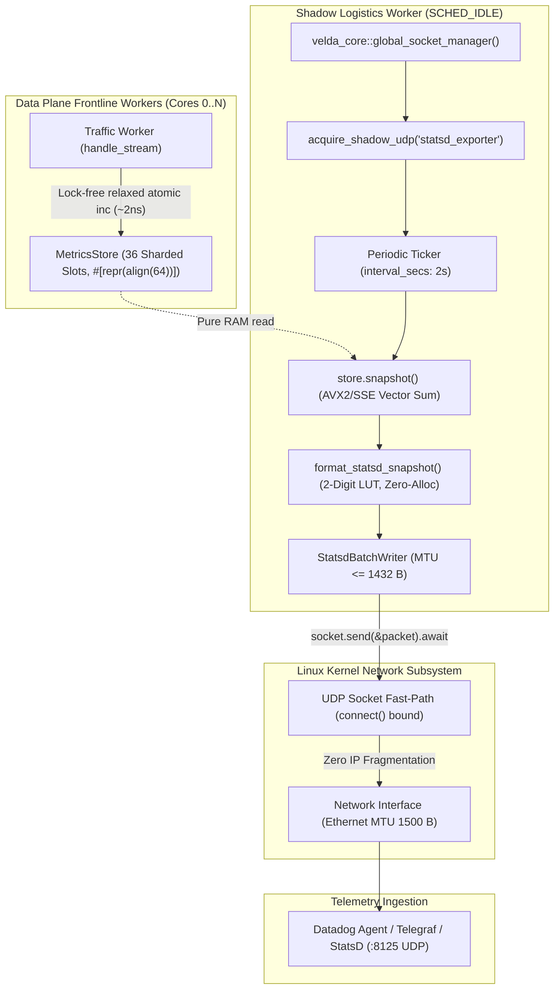

# StatsD Exporter — Architecture Specification

This document details the internal subsystem architecture, socket allocation model, serialization mechanics, and hardware invariants of the **StatsD / DogStatsD Metrics Exporter Plugin**.

---

## 1. Subsystem Mission & Responsibilities

The `statsd_exporter` is an autonomous background logistics plugin (`phase: "background"`) designed to:
1. Periodically extract point-in-time telemetry snapshots from `velda-observability` via non-blocking vector summation.
2. Serialize metrics into DogStatsD (tag-based) or Standard StatsD (dot-notation) line protocol text without dynamic heap allocation.
3. Pack metric lines into strictly bounded UDP datagrams matching host MTU boundaries ($\le 1432$ bytes).
4. Stream datagrams to local or remote UDP collectors via kernel fast-path non-blocking sockets.

---

## 2. Architecture & Data Flow



---

## 3. Core Architectural Invariants

### Invariant 1: Core Socket Ownership & Anti-Conflict
Under Section 2.8 and 2.9 of the Velda Edge Engineering Rules:
* The exporter **never** invokes raw socket binding directly.
* All sockets are authoritatively requested from [`velda_core::global_socket_manager().acquire_shadow_udp()`](../../../../velda-core/src/socket.rs).
* The Core Socket Manager guarantees that shadow ports never collide with active Data Plane Traffic ports (`:80`, `:443`, `:8080`, `:8443`).
* Upon graceful shutdown, `release_shadow_udp()` cleanly unregisters the claim and returns the socket to the operating system.

### Invariant 2: Zero Write Contention on Frontline Workers
* The exporter executes strictly on background worker threads.
* Telemetry is read through `MetricsStore::snapshot()`, which reads `Ordering::Relaxed` atomics across core lanes and performs a vector summation (`accumulate_fn` via AVX2 256-bit or SSE2 128-bit instructions).
* Frontline traffic workers serving client requests never wait on locks, channels, or socket buffers.

### Invariant 3: Zero Dynamic Heap Allocation per Line
* Integer formatting avoids `format!`, `write!`, and `String` allocations by employing `DIGIT_PAIRS` — a stack-based 2-digit lookup table.
* Decimal conversion converts two digits per iteration (`n /= 100`), reducing hardware division instructions by 50%.
* Output bytes are written directly into a pre-allocated reusable packet buffer (`Vec<u8>`).

### Invariant 4: MTU-Bounded Batching (Anti-IP Fragmentation)
* Standard Ethernet MTU is 1500 bytes. When subtracting IP headers (20 bytes for IPv4, 40 bytes for IPv6) and UDP headers (8 bytes), standard maximum safe UDP payload without fragmentation is **1432 bytes** (or 1472 bytes on IPv4).
* `StatsdBatchWriter` checks `current_packet_len + next_line_len > max_packet_size`.
* When the limit is reached, it flushes the current datagram and starts a new packet.
* Metric lines are **never** sliced across packet boundaries. Every UDP datagram contains complete, parseable newline-delimited lines.

### Invariant 5: Kernel Fast-Path `connect()`
* Standard UDP requires kernel routing lookups and ARP cache validation on every `send_to(dest)` call.
* `StatsdTransport` executes `socket.connect(destination).await` once at startup.
* In Linux, connecting a UDP socket stores the 4-tuple directly in the socket inode, enabling subsequent `send()` syscalls to skip routing table lookups and reach line-rate wire transmission.

### Invariant 6: Vectorized `sendmmsg` Batched Transmission
* Instead of issuing individual `send()` syscalls for each 1432-byte datagram, `StatsdTransport::send_batch` leverages Linux `libc::sendmmsg`.
* All ~17–30 MTU datagrams comprising an entire snapshot are submitted in a single kernel transition (Ring 3 -> Ring 0), reducing OS context switch overhead by up to 95%.
* Stack-allocated `[libc::mmsghdr; 64]` and `[libc::iovec; 64]` arrays guarantee zero heap allocations during packet batching.

---

## 4. Memory Layout & Scratch Buffers

```text
+--------------------------------------------------------------------------+
|  StatsdExporter Reusable Scratch Buffer Layout                           |
|                                                                          |
|  [Packet Buffer: Vec<u8> (Capacity: max_packet_size + 256, e.g. 1688 B)] |
|  +-----------------------------------+--------------------+------+       |
|  | metric1:val|c\n                   | metric2:val|g\n    | ...  |       |
|  +-----------------------------------+--------------------+------+       |
|  <------------------ Length <= 1432 Bytes ----------------------->       |
|                                                                          |
|  [Line Scratch Buffer: Vec<u8> (Capacity: 256 Bytes)]                    |
|  +-------------------------------------------------------+               |
|  | velda.requests.total:1|c|#downstream:h1,pipe:buffered |               |
|  +-------------------------------------------------------+               |
+--------------------------------------------------------------------------+
```

1. Reused continuously across all timer intervals.
2. Kept permanently cache-hot in L1/L2 data cache.
3. Zero memory leaks and zero GC pauses.
