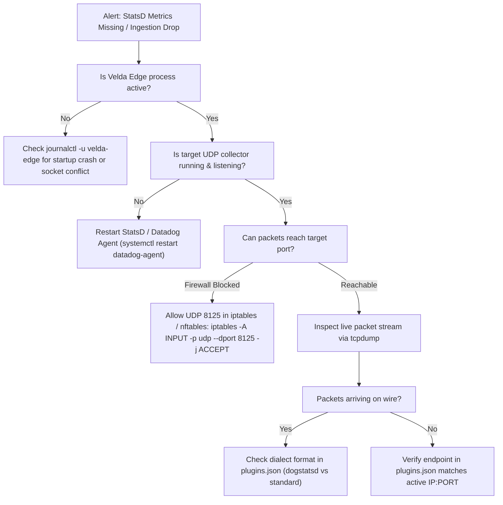

# StatsD Exporter — SRE On-Call Runbook & Incident Triage Guide

This runbook guides Site Reliability Engineers (SREs) and on-call operators in diagnosing, troubleshooting, and resolving production incidents involving the **StatsD / DogStatsD Metrics Exporter Plugin**.

---

## 1. SRE Incident Triage Matrix (P0 – P3)

| Severity | Incident Pattern | Symptoms & Indicators | Immediate Mitigation Action |
| :---: | :--- | :--- | :--- |
| **P0** | **Process Panic on Startup / Socket Conflict** | Gateway fails boot with `SocketError::Conflict` on shadow UDP | Check `endpoint` and ensure UDP socket is not colliding with another system service. Run `ss -ulpn`. |
| **P1** | **Telemetry Blackhole (Metrics Missing)** | Datadog/Telegraf charts show zero incoming data points | Verify UDP daemon is active, firewall allows UDP port 8125, check `journalctl` for network unreachable errors. |
| **P2** | **UDP Packet Drops / Network Buffer Overflow** | Metrics arriving sporadically, counter gaps detected | Increase OS UDP receive buffer (`net.core.rmem_max`), or increase `max_packet_size` if within MTU. |
| **P3** | **Dialect Mismatch / Tag Ingestion Failure** | Metrics ingested as dot-notation strings instead of tagged gauges | Verify `dialect` in `plugins.json`: use `"dogstatsd"` for Datadog/Vector and `"standard"` for Graphite. |

---

## 2. Incident Triage Decision Flowchart



---

## 3. Diagnostic CLI Toolkit

### Command 1: Inspect Active UDP Sockets & Claims
Verify that the exporter has cleanly registered its shadow UDP socket:
```bash
# Check UDP listeners and active connections
ss -u -a -p | grep velda
```

### Command 2: Capture Live StatsD UDP Datagrams via `tcpdump`
Inspect live metric packets in real-time on port 8125:
```bash
sudo tcpdump -i any -nn -X -s 0 udp port 8125 -c 10
```

### Command 3: Emulate a Mock UDP Receiver
If the upstream Datadog agent is down, test gateway emission using `netcat`:
```bash
nc -u -l -p 8125
```

### Command 4: Check UDP Buffer Drops at Kernel Level
Check if Linux kernel is dropping UDP packets due to full socket receive/send buffers:
```bash
netstat -su | grep -E "buffer errors|packet receive errors|receive buffer errors"
```

---

## 4. Emergency Procedures

### Procedure A: Dynamically Disabling Exporter (Zero-Downtime)
To stop the exporter without restarting the gateway or interrupting client traffic:
1. Update `plugins.json` in Control Plane to remove the `statsd_exporter` block.
2. Push reload notification:
   ```bash
   curl -X POST http://127.0.0.1:8080/api/v1/plugins/reload
   ```
3. Shadow worker receives the reload signal, invokes `release_shadow_udp()`, and cleans up background tasks.

### Procedure B: Tuning UDP Buffer Sizes in Linux Kernel
If high metric cardinality causes UDP buffer drops:
```bash
# Set maximum OS receive & send buffer sizes to 16MB
sudo sysctl -w net.core.rmem_max=16777216
sudo sysctl -w net.core.wmem_max=16777216
```
