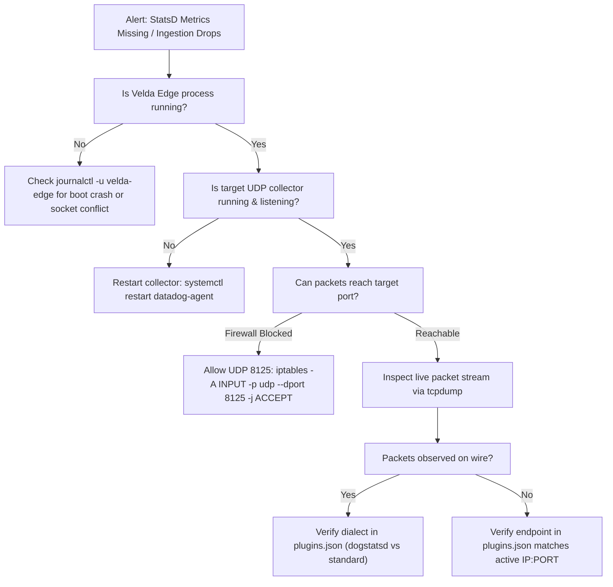

# StatsD Exporter — SRE On-Call Runbook & Incident Triage Guide

This runbook guides Site Reliability Engineers (SREs) and on-call operators in diagnosing, troubleshooting, and resolving production incidents involving the **StatsD / DogStatsD Metrics Exporter Plugin** (`statsd_exporter`).

---

## 1. Parameter Reference & Operational Impact

| Field | Production Range | Operational Impact | Recommended Default |
| :--- | :--- | :--- | :--- |
| `endpoint` | Valid `IP:PORT` | UDP target destination for metrics push. If unresolved or unreachable, exporter reports errors but never disrupts traffic serving. | `"127.0.0.1:8125"` |
| `interval_secs` | `1 ..= 3600` | Flush interval in seconds. Lower values increase collector freshness but generate more UDP network packets. Higher values reduce telemetry network load. | `2` |
| `prefix` | ASCII string | Global metric name prefix. Used by metrics backends to namespace gateway metrics. | `"velda"` |
| `dialect` | `"dogstatsd"` \| `"standard"` | Metric formatting dialect. `"dogstatsd"` emits multidimensional tags (`#k:v`). `"standard"` emits classic dot-separated metric paths. | `"dogstatsd"` |
| `max_packet_size` | `256 ..= 65507` | Upper bound on UDP payload size. Values exceeding network path MTU ($\le 1432$ bytes recommended) risk kernel IP fragmentation and silent packet loss. | `1432` |

---

## 2. Tuned Production Presets

### Preset A: Kubernetes Sidecar / Node Agent (Datadog / Vector)
```json
{
  "endpoint": "127.0.0.1:8125",
  "interval_secs": 2,
  "prefix": "velda",
  "dialect": "dogstatsd",
  "max_packet_size": 1432
}
```
*Rationale: Local loopback transmission ensures minimal packet loss and zero WAN routing overhead while delivering 2-second telemetry granularity.*

### Preset B: High-Throughput Central InfluxDB / Telegraf Daemon
```json
{
  "endpoint": "10.0.10.50:8125",
  "interval_secs": 5,
  "prefix": "edge_ingress",
  "dialect": "standard",
  "max_packet_size": 1432
}
```
*Rationale: Coarser 5-second interval reduces network PPS on the central metrics collector while maintaining full gateway health visibility.*

### Preset C: WAN Edge / VPN Tunnel MTU-Constrained Environment
```json
{
  "endpoint": "198.51.100.25:8125",
  "interval_secs": 10,
  "prefix": "edge_remote",
  "dialect": "dogstatsd",
  "max_packet_size": 1024
}
```
*Rationale: Conservative 1024-byte packet ceiling guarantees datagrams traverse VPN encapsulation tunnels without triggering IP fragmentation.*

---

## 3. SRE Incident Triage Matrix (P0 – P3)

| Severity | Incident Pattern | Symptoms & Indicators | Immediate Mitigation Action |
| :---: | :--- | :--- | :--- |
| **P0** | **Process Panic on Startup / Socket Conflict** | Gateway fails to boot with `SocketError::Conflict` or binding errors during shadow UDP acquisition. | Verify `endpoint` in `plugins.json`. Run `ss -ulpn` to ensure target UDP port is not conflicting with an existing service on the node. |
| **P1** | **Telemetry Blackhole (Metrics Missing)** | Datadog/Telegraf dashboards show 0 incoming data points from Velda Edge. | 1. Check if the collector daemon is alive (`systemctl status datadog-agent`).<br>2. Run `nc -u -l -p 8125` to verify datagram emission.<br>3. Inspect firewall rules (`iptables`, `nftables`) for UDP drops. |
| **P2** | **UDP Packet Drops / Buffer Overflow** | Metrics appear intermittently; counter deltas show sudden unexpected gaps. | 1. Check kernel UDP drop counters: `netstat -su \| grep -E "buffer errors\|receive buffer errors"`.<br>2. Increase Linux kernel UDP buffer size via `sysctl` (`rmem_max`, `wmem_max`). |
| **P3** | **Dialect Mismatch / Tag Ingestion Failure** | Metrics ingested as literal dot-notation strings instead of tagged dimensions in Datadog. | Check `dialect` in `plugins.json`: use `"dogstatsd"` for Datadog/Vector and `"standard"` for classic StatsD/Graphite. Reload configuration. |

---

## 4. Incident Triage Decision Flowchart



---

## 5. Diagnostic CLI Toolkit

### Command 1: Inspect Active UDP Sockets & Claims
Verify that the exporter has acquired its shadow UDP socket:
```bash
ss -u -a -p | grep velda
```

### Command 2: Capture Live StatsD UDP Datagrams via `tcpdump`
Inspect live metric packets on the wire in real-time:
```bash
sudo tcpdump -i any -nn -X -s 0 udp port 8125 -c 10
```

### Command 3: Emulate a Mock UDP Receiver
If the upstream Datadog agent or Telegraf daemon is unresponsive, test gateway emission using `netcat`:
```bash
nc -u -l -p 8125
```

### Command 4: Check UDP Buffer Drops at Kernel Level
Check if the Linux kernel is dropping UDP packets due to exhausted socket buffers:
```bash
netstat -su | grep -E "buffer errors|packet receive errors|receive buffer errors"
```

### Command 5: Check NIC-Level Packet Drops
Verify that the physical or virtual network interface is not dropping UDP datagrams under burst conditions:
```bash
ethtool -S eth0 | grep -E "drop|miss|error"
```

---

## 6. Emergency Playbooks

### Playbook A: Dynamically Disabling Exporter (Zero-Downtime Reload)
To stop the exporter without interrupting live client traffic:
1. Remove or comment out the `statsd_exporter` block in `plugins.json`.
2. Issue a hot-reload signal to the Control Plane:
   ```bash
   curl -X POST http://127.0.0.1:8080/api/v1/plugins/reload
   ```
3. The shadow worker unregisters the socket via `release_shadow_udp()` and terminates the background task.

### Playbook B: Tuning Linux Kernel UDP Buffers
If high metric cardinality or burst flushes trigger UDP buffer drops:
```bash
# Set maximum OS receive and send buffer sizes to 16 MB
sudo sysctl -w net.core.rmem_max=16777216
sudo sysctl -w net.core.wmem_max=16777216
sudo sysctl -w net.core.rmem_default=2097152
sudo sysctl -w net.core.wmem_default=2097152
```

### Playbook C: Resolving MTU Truncation and Silent Packet Loss
If metric packets are dropped across WAN or cloud overlay networks:
1. Check the path MTU to the collector:
   ```bash
   ping -M do -s 1400 10.0.10.50
   ```
2. If packets fail to pass without fragmentation, adjust `max_packet_size` in `plugins.json` to `1024` or `512`.
3. Reload configuration.
