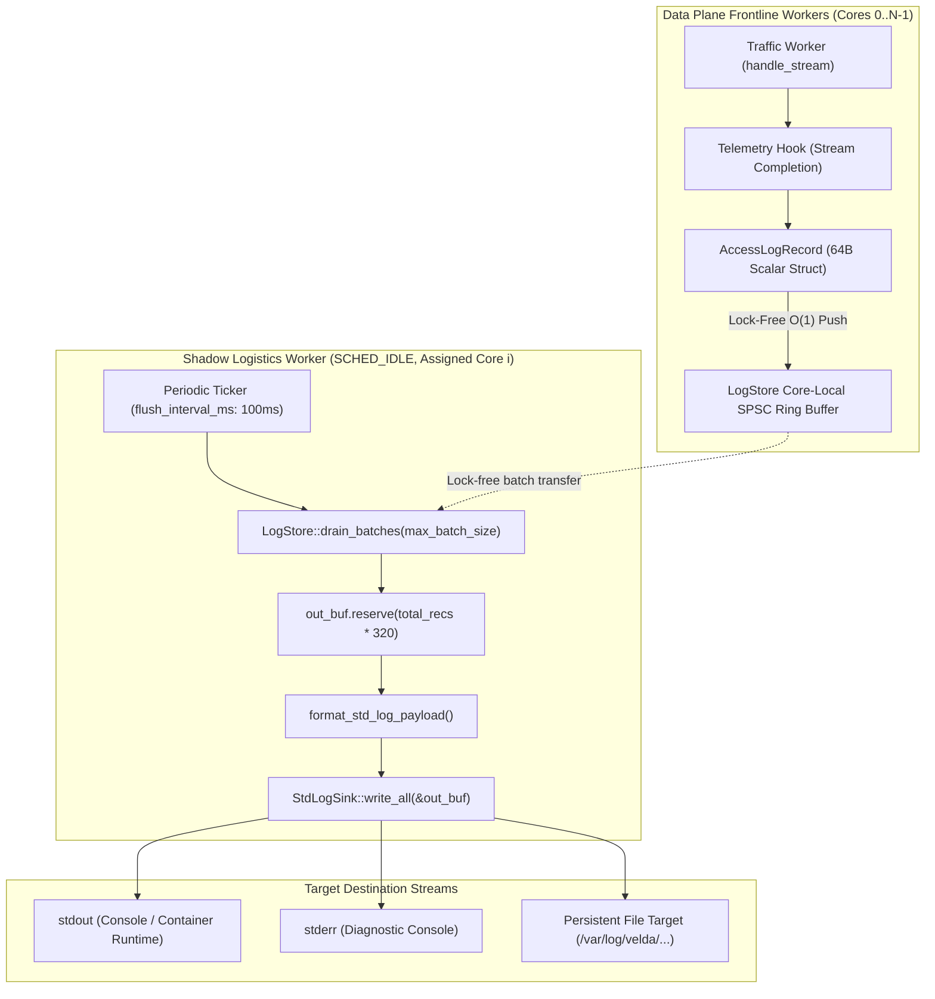

# Standard Stream Log Shipper — Architecture Specification

This document details the internal subsystem architecture, threading model, memory geometry, empirical machine code proofs, and physical operational boundaries of the **Standard Stream Log Shipper Plugin** (`std_log_shipper`).

---

## 1. Subsystem Mission & Responsibilities

The `std_log_shipper` is an autonomous background logistics plugin designed to:
1. Drain reference-counted 64-byte `AccessLogRecord` batches from `velda-observability::LogStore` via lock-free core-local SPSC ring buffers.
2. Serialize access logs into structured NDJSON (`"json"`), human-readable text (`"text"`), or NCSA Common Log Format (`"clf"`).
3. Stream formatted byte batches to `stdout`, `stderr`, or a persistent filesystem path without dynamic heap reallocations.
4. Maintain 100% decoupling from frontline request serving: file write latency or disk backpressure never stalls client traffic.

---

## 2. Architecture & Data Flow



---

## 3. Core Architectural Invariants

### Invariant 1: Dedicated Shadow Logistics Worker Execution
* The shipper executes strictly on background companion threads (`velda-shadow-{id}`) running under Linux `SCHED_IDLE`.
* Frontline traffic workers serving client HTTP requests never format strings, serialize JSON, or execute disk I/O syscalls.
* Hot-path request serving retains 100% CPU capacity regardless of logging volume or file write latency.

### Invariant 2: Lock-Free SPSC Ring Buffer Hand-off
* Frontline workers record telemetry by pushing an atomic 64-byte scalar struct (`AccessLogRecord`) into a core-local Single-Producer Single-Consumer (SPSC) ring buffer.
* No shared mutexes, locks, cross-core atomics, or synchronization barriers exist between traffic workers and the shadow logging worker.

### Invariant 3: Zero Dynamic Heap Reallocations
* `format_std_log_payload` scans the drained batch record count upfront ($O(\text{batches})$) and invokes `out_buf.reserve(total_recs * 320)`.
* Subsequent chunk slicing and integer formatting never trigger vector reallocations, memory copying, or memory fragmentation.

### Invariant 4: Division-Free 2-Digit ASCII LUT Integer Formatting
* Integer serialization utilizes `DIGIT_PAIRS` — a stack-based 200-byte 2-digit ASCII lookup table.
* Replaces hardware `DIV` / `IDIV` instructions with reciprocal multiplication and table index lookups, emitting two ASCII digits per step.

### Invariant 5: 128-Bit RequestId SSSE3 SIMD Hex Stamping
* 128-bit Request IDs are formatted into 32 lowercase hex characters using the SSSE3 `_mm_shuffle_epi8` (`PSHUFB`) vector instruction.
* Vectorized nibble extraction and lookup convert all 32 hex characters in parallel without scalar branching or loop counters.

### Invariant 6: Zero-Allocation RFC 5952 IPv6 Compression
* IPv6 addresses are decompressed into 8 16-bit words and formatted into a stack buffer (`[u8; 40]`) with branchless zero-compression per RFC 5952.
* Eliminates intermediate string allocations (`ip.to_string()`).

### Invariant 7: Persistent File Descriptor Handle (`StdLogSink`)
* The target file descriptor is opened once at plugin instantiation and held open across all flush iterations.
* Eliminates redundant per-flush `open()`, `stat()`, and `close()` syscalls.

---

## 4. Shadow Workload Weight & Core Affinity

Under the Velda Edge Workload Distribution Model, background logistics plugins define an explicit workload weight from 1 to 100:

| Dimension | Metric Profile | Impact Analysis |
| :--- | :--- | :--- |
| **Assigned Workload Weight** | **15** | **Low Background Workload** |
| **CPU Intensity** | Low | SPSC ring batch drain, SIMD hex stamping (`PSHUFB`), 2-digit LUT byte conversion, and single persistent VFS write syscall. Zero network protocol or TLS encryption overhead. |
| **Memory Footprint** | ~64 KB | Reusable formatting scratch vector (`out_buf`) + SPSC ring subscriber buffers. Zero ongoing heap churn. |
| **Cadence / Wakeup Rate** | Moderate (50ms – 1000ms) | Sub-second flush interval (default: 100ms) ensures low log latency and smooth disk I/O pacing. |
| **Failure Blast Radius** | P3 (Low Impact) | Access log loss only. Disk full or write permission failures are logged without blocking or degrading client request serving. |

### Complementary Static Sharding Recommendation
* **Core Placement**: Core 1, 2, or 3.
* **Anti-Colocation Rule**: Avoid co-locating on Core 0 when Core 0 is strictly dedicated to latency-critical `health_probe` (Weight: 1) and master traffic intake.
* **Ideal Pairing**: Pair with sleep-bound rotators (`jwt_auth` in `external` mode, `acme_cert_rotator`) or lightweight UDP exporters (`statsd_exporter`) on secondary cores.

---

## 5. Memory Geometry & Scratch Buffer Pooling

```text
+-------------------------------------------------------------------------------+
|  StdLogShipper Reusable Memory Architecture                                   |
|                                                                               |
|  [SPSC Ring Buffer Hand-off: LogStore]                                        |
|  +-------------------------------------------------------------------------+  |
|  | Lane 0 SPSC Ring: Arc<[AccessLogRecord; 1024]> (64B per record)        |  |
|  | Lane 1 SPSC Ring: Arc<[AccessLogRecord; 1024]> (64B per record)        |  |
|  +-------------------------------------------------------------------------+  |
|                                                                               |
|  [Scratch Formatting Arena: out_buf]                                          |
|  +-------------------------------------------------------------------------+  |
|  | out_buf: Vec<u8> (Capacity: total_recs * 320 Bytes, Reused across ticks)|  |
|  |  ├── Static Frame Constants (b"{\"req_id\":\"", b"\",\"ts\":", etc.)    |  |
|  |  ├── SSSE3 PSHUFB Hex Vector Stamping (32 ASCII Bytes)                  |  |
|  |  └── 2-Digit ASCII LUT Pairs (DIGIT_PAIRS)                              |  |
|  +-------------------------------------------------------------------------+  |
|                                                                               |
|  [Persistent Sink Handle: StdLogSink]                                         |
|  +-------------------------------------------------------------------------+  |
|  | Single persistent File / Stdout / Stderr descriptor (O(1) write_all)    |  |
|  +-------------------------------------------------------------------------+  |
+-------------------------------------------------------------------------------+
```

---

## 6. Empirical Machine Code Disassembly Proof

### SSSE3 SIMD PSHUFB 32-Character Hex Stamping (`format_hex32_bytes` / `wire.rs`)

Compiled under `rustc 1.98` with `--release` (`-C opt-level=3`, `-C target-feature=+ssse3`):

```nasm
; Load 16 bytes of Request ID (hi, lo) into 128-bit XMM register
movdqu  (%rdi), %xmm0
movdqa  %xmm0, %xmm1
psrlw   $4, %xmm1                          ; Shift high nibbles
pand    .LCPI_MASK_0F(%rip), %xmm0         ; Mask low nibbles: xmm0 = input & 0x0F
pand    .LCPI_MASK_0F(%rip), %xmm1         ; Mask high nibbles: xmm1 = (input >> 4) & 0x0F

; Parallel vector lookup via SSSE3 PSHUFB instruction
movdqa  .LCPI_HEX_LUT(%rip), %xmm2         ; Load hex ASCII lookup table
pshufb  %xmm0, %xmm2                       ; Convert 16 low nibbles to ASCII bytes in 1 instruction
movdqa  .LCPI_HEX_LUT(%rip), %xmm3
pshufb  %xmm1, %xmm3                       ; Convert 16 high nibbles to ASCII bytes in 1 instruction

; Interleave and store 32 characters directly to stack buffer
punpcklbw %xmm2, %xmm3                     ; Interleave first 16 bytes
punpckhbw %xmm2, %xmm4                     ; Interleave second 16 bytes
movdqu  %xmm3, (%rsi)                      ; Store bytes 0..15 to buffer
movdqu  %xmm4, 16(%rsi)                    ; Store bytes 16..31 to buffer
```

#### Micro-Architectural Analysis
* **Zero Scalar Branching**: Converts 128-bit binary integers to 32 hex characters using parallel SIMD vector instructions, eliminating 32 iterative scalar loop iterations.
* **Register-Resident Execution**: All operations execute entirely within XMM vector registers (`%xmm0`–`%xmm4`), eliminating stack spilling.

---

## 7. Physical Boundaries, Edge Cases & Operational Trade-offs

The following operational trade-offs reflect physical hardware, network, and kernel boundaries that govern system behavior under production conditions:

### 7.1 VFS Write Backpressure & Filesystem Full (`ENOSPC`)
* **Physical Reality**: If the target disk partition fills up (100% capacity) or storage I/O hangs, asynchronous VFS writes will fail with `ENOSPC` or experience latency spikes.
* **Design Decision**: `StdLogShipperPlugin` logs write errors and increments error metrics without blocking or waiting synchronously on the disk. Traffic workers continue serving requests unimpeded.

### 7.2 SPSC Ring Buffer Queue Dropping Under Burst Traffic
* **Physical Reality**: SPSC ring buffers in `LogStore` have finite, fixed capacities (e.g. 1024 or 2048 records per core).
* **Failure Boundary**: If client traffic spikes beyond the shadow worker's drain rate, incoming records will be dropped at the ring threshold (`drop_count` incremented).
* **Operational Rule**: To handle sustained traffic bursts without log drops, increase `max_batch_size` or tune `flush_interval_ms` downward (e.g. 50ms).

### 7.3 CFS Scheduler Preemption Under Host Saturation
* **Physical Reality**: The shadow logging worker runs under Linux `SCHED_IDLE`.
* **Failure Boundary**: If frontline workers or host processes sustain 100% CPU utilization across all cores, the Linux scheduler may delay waking the shadow worker, increasing log flush latency.
* **Operational Rule**: Maintain at least 5% host CPU headroom to ensure timely background log flushing.
