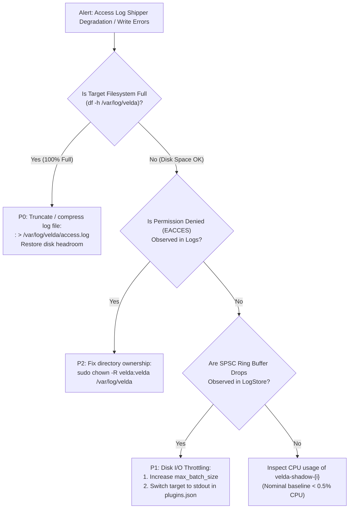

# Standard Stream Log Shipper — SRE On-Call Runbook & Incident Triage Guide

This runbook guides Site Reliability Engineers (SREs) and on-call operators in diagnosing, troubleshooting, and resolving production incidents involving the **Standard Stream Log Shipper Plugin** (`std_log_shipper`).

---

## 1. Parameter Reference & Operational Impact

| Field | Production Range | Operational Impact | Recommended Default |
| :--- | :--- | :--- | :--- |
| `target` | `"stdout"`, `"stderr"`, or absolute file path | Destination output stream. If logging to disk, disk I/O performance and filesystem capacity directly impact flush regularity. | `"/var/log/velda/access.log"` or `"stdout"` |
| `format` | `"json"`, `"text"`, `"clf"` | Output serialization dialect. `"json"` provides structured key-value format for log forwarders. `"text"` and `"clf"` provide human-readable web server formats. | `"json"` |
| `flush_interval_ms` | `50 ..= 60000` | Periodic timer interval for draining SPSC rings. Lower values minimize log latency; higher values improve write batching efficiency. | `100` |
| `max_batch_size` | `1 ..= 10000` | Maximum number of log records drained and formatted per cycle. Sizing controls peak scratch buffer allocation. | `1000` |

---

## 2. Tuned Production Presets

### Preset A: High-Throughput Production Profile (Structured JSON via File Stream)
```json
{
  "target": "/var/log/velda/access.log",
  "format": "json",
  "flush_interval_ms": 100,
  "max_batch_size": 1000
}
```
*Rationale: Persistent file descriptor reuse combined with 100ms batched NDJSON formatting ensures low OS syscall overhead on dedicated log disks.*

### Preset B: Containerized Kubernetes / Docker Pod Profile (Standard Output)
```json
{
  "target": "stdout",
  "format": "json",
  "flush_interval_ms": 100,
  "max_batch_size": 1000
}
```
*Rationale: Direct emission to stdout allows container engines (CRI-O, containerd) to capture and route access logs to central logging daemons.*

### Preset C: Low-Overhead Staging / Legacy Web Analytics Profile (Common Log Format)
```json
{
  "target": "/var/log/velda/access_clf.log",
  "format": "clf",
  "flush_interval_ms": 250,
  "max_batch_size": 2000
}
```
*Rationale: Standard NCSA Common Log Format consumes minimal disk bandwidth and formats cleanly for legacy log parsers.*

---

## 3. SRE Incident Triage Matrix (P0 – P3)

| Severity | Incident Pattern | Symptoms & Indicators | Immediate Mitigation Action |
| :---: | :--- | :--- | :--- |
| **P0** | **Filesystem Full (`ENOSPC`)** | Target disk reports 100% usage; `write_all` fails with `No space left on device`. | Compress or truncate active log file immediately: `gzip -c /var/log/velda/access.log > /var/log/velda/access.log.$(date +%s).gz && : > /var/log/velda/access.log`. |
| **P1** | **Disk I/O Throttling & SPSC Ring Drops** | Flush duration exceeds interval; log records appear dropped during peak traffic spikes. | Increase `max_batch_size` to 2000, or dynamically switch target stream to `stdout` or a dedicated high-speed NVMe mount. |
| **P2** | **Permission Denied (`EACCES`)** | Gateway fails to write to file target with `Permission denied`. | Check file and directory ownership: `chown -R velda:velda /var/log/velda` and ensure correct write permissions (`chmod 755`). |
| **P3** | **Format / Dialect Incompatibility** | Ingestion pipeline (Logstash/Vector) fails to parse logs due to unexpected format. | Verify `format` in `plugins.json` (ensure `"json"` is set for structured SIEM ingestion). Reload configuration. |

---

## 4. Incident Triage Decision Flowchart



---

## 5. Diagnostic CLI Toolkit

### Command 1: Inspect Per-Thread CPU Utilization
Ensure the shadow logging worker operates cleanly without CPU spikes:
```bash
pidstat -p $(pgrep velda-edge) -t 1 5
```

### Command 2: Monitor Real-Time Log File Ingestion Rate
Check written records per second:
```bash
tail -f /var/log/velda/access.log | pv -l -r > /dev/null
```

### Command 3: Inspect Disk Space and Inode Headroom
Verify storage availability on the log target mount:
```bash
df -h /var/log/velda
df -i /var/log/velda
```

### Command 4: Inspect Shipper Log Output for I/O Errors
Check journald output for sink write failures:
```bash
journalctl -u velda-edge -f -o cat | grep "std_log_shipper"
```

---

## 6. Emergency Playbooks

### Playbook A: Immediate Disk Full Recovery (P0)
If the access log partition fills up completely:
1. Archive and truncate the log file in a single atomic step:
   ```bash
   gzip -c /var/log/velda/access.log > /var/log/velda/access.log.$(date +%s).gz && : > /var/log/velda/access.log
   ```
2. Verify disk space has been recovered:
   ```bash
   df -h /var/log/velda
   ```
3. The shadow worker automatically resumes writes without requiring a gateway restart.

### Playbook B: Dynamically Switching Target Stream to Standard Output (P1)
If physical disk I/O degrades during an incident:
1. Update `target` in `plugins.json`:
   ```json
   {
     "id": "std_log_shipper",
     "config": {
       "target": "stdout",
       "format": "json",
       "flush_interval_ms": 100,
       "max_batch_size": 2000
     }
   }
   ```
2. Push reload notification:
   ```bash
   curl -X POST http://127.0.0.1:8080/api/v1/plugins/reload
   ```

### Playbook C: Resolving File Permission Failures (P2)
When deployment changes break file ownership:
```bash
sudo mkdir -p /var/log/velda
sudo chown -R $(id -u):$(id -g) /var/log/velda
sudo chmod 755 /var/log/velda
```
