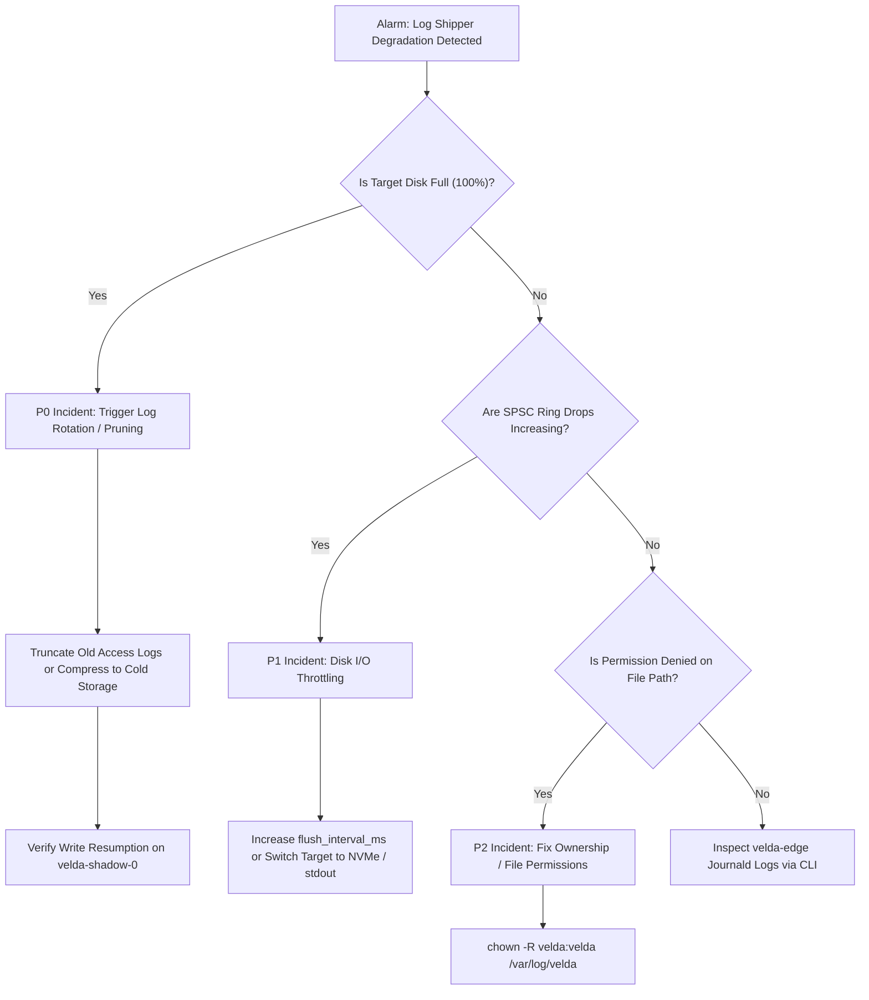

# Site Reliability Engineering Runbook: Standard Stream Log Shipper (`std_log_shipper`)

This runbook provides emergency operational procedures, severity classification matrices, diagnostic commands, and incident mitigation workflows for the `std_log_shipper` plugin in production environments.

---

## 1. Operational Overview & Service Level Objectives

- **Primary Duty**: Continuously drain and persist access logs from `velda_observability::LogStore` to local files or standard streams.
- **Service Level Indicator (SLI)**: Ratio of successfully shipped access log records to records emitted by frontline workers:
  $$\text{SLI} = \frac{\text{shipped\_records}}{\text{emitted\_records}} \times 100\%$$
- **Service Level Objective (SLO)**: $\ge 99.999\%$ of records successfully persisted within a 1-second rolling window.

---

## 2. Severity Classification & Triage Matrix

| Severity Level | Threshold Condition | Customer Impact | Target Resolution Time |
| :--- | :--- | :--- | :--- |
| **P0 (Critical)** | Filesystem target disk completely full (100% usage); shadow worker blocked on `write_all`. | Risk of log loss or disk exhaustion on edge host. | **< 15 minutes** |
| **P1 (Major)** | Flush latency exceeds `flush_interval_ms * 10`; SPSC ring buffer drops detected. | Delayed observability reporting; partial log truncation. | **< 1 hour** |
| **P2 (Medium)** | Permission denied writing to destination path (`/var/log/velda/access.log`). | Logs directed to fallback stderr or discarded. | **< 4 hours** |
| **P3 (Minor)** | Minor CPU deviation on shadow worker (`velda-shadow-0`). | None (CFS ensures frontline traffic workers are never preempted). | **< 24 hours** |

---

## 3. Incident Decision Flowchart



---

## 4. Diagnostic Command Toolkit

### 4.1 Inspecting Shadow Worker Process & CPU Usage
```bash
# Check CPU usage of velda-edge workers
pidstat -p $(pgrep velda-edge) -t 1 5
```

### 4.2 Verifying Target Log File Ingestion Rate
```bash
# Monitor real-time throughput of written log records
tail -f /var/log/velda/access.log | pv -l -r > /dev/null
```

### 4.3 Checking Disk Free Space & Inodes
```bash
df -h /var/log/velda
df -i /var/log/velda
```

---

## 5. Emergency Remediation Procedures

### Remediation 1: Immediate Disk Full Recovery (P0)
1. Compress and archive existing raw logs:
   ```bash
   gzip -c /var/log/velda/access.log > /var/log/velda/access.log.$(date +%s).gz && : > /var/log/velda/access.log
   ```
2. Verify disk headroom restored:
   ```bash
   df -h /var/log/velda
   ```

### Remediation 2: Switching Target to Standard Output in Containerized Environments (P1)
If local disk I/O bottlenecks occur, dynamically update `plugins.json` to stream via stdout:
```json
{
  "id": "std_log_shipper",
  "phase": "background",
  "config": {
    "target": "stdout",
    "format": "json",
    "flush_interval_ms": 100,
    "max_batch_size": 2000
  }
}
```
Apply the updated configuration via dynamic synchronization:
```bash
curl -X POST http://127.0.0.1:9090/v1/config/sync -d @plugins.json
```
