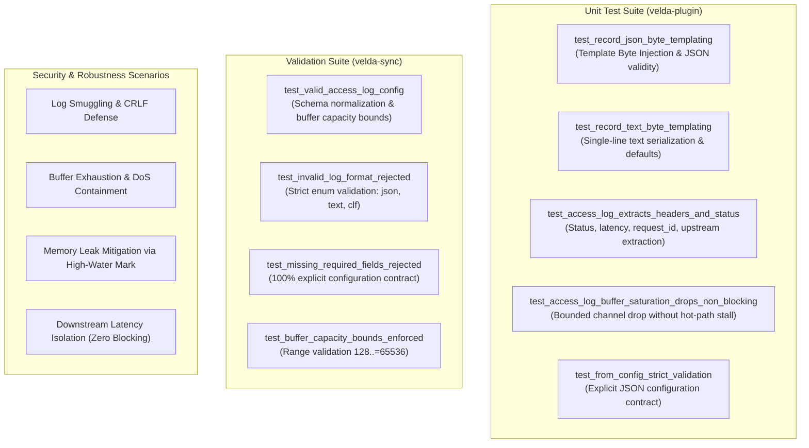

# Access Log Plugin (`access_log`) — Test Specification

This document details the test architecture, automated unit test catalog, adversarial security validation, and live verification reproduction for the **`access_log`** post-response plugin in Velda Edge.

---

## 1. Test Architecture & Scope

The `access_log` test suite validates functional correctness, non-blocking queue semantics, and zero-allocation serialization across four key dimensions:



---

## 2. Automated Unit Test Catalog

### 2.1 Engine Unit Tests (`crates/velda-plugin/src/post_response/access_log/`)

| Test Identifier | Module | Description | Assertions & Invariants |
| :--- | :--- | :--- | :--- |
| `test_record_json_byte_templating` | `record.rs` | Validates `write_json` assembling JSON output directly into a byte buffer without dynamic tree serializers. | - Generates valid UTF-8 JSON starting with `{` and ending with `}`.<br>- Numbers and floats formatted accurately (`status: 200`, `latency_ms: 12.34`).<br>- Optional fields serialize cleanly or map to `null`. |
| `test_record_text_byte_templating` | `record.rs` | Validates `write_text` single-line text formatting into a byte buffer. | - Formats single-line log with `status=404`, `req_id=-`, `bytes=0`, `latency_ms=-`. |
| `test_access_log_extracts_headers_and_status` | `plugin.rs` | Validates `on_response` extraction of metadata headers and response status into a `LogRecord`. | - Status extracted as `200`.<br>- Content length parsed as `Some(256)`.<br>- Headers extracted: `x-request-id`, `x-route-id`, `x-upstream-addr`, `x-response-time`.<br>- Increments `logged_count` by 1. |
| `test_access_log_buffer_saturation_drops_non_blocking` | `plugin.rs` | Simulates an overloaded log receiver with bounded capacity `1`. | - First record fills capacity (`logged_count = 1`).<br>- Second record immediately drops non-blocking (`dropped_count = 1`).<br>- Worker execution completes with **0 latency delay**. |
| `test_from_config_strict_validation` | `plugin.rs` | Validates strict configuration parsing from JSON manifest. | - Rejects partial or incomplete JSON manifests.<br>- Normalizes format string to `LogFormat` enum. |

---

## 3. Security & Robustness Scenarios

### 3.1 Downstream Latency Isolation (Zero Blocking)
- **Threat**: In conventional proxies, if disk I/O freezes or a syslog daemon stalls, the proxy thread blocks on `write()`, causing downstream request latency to spike from milliseconds to seconds.
- **Velda Defense**: `AccessLogPlugin` utilizes a non-blocking `try_send`. If the queue is saturated, log entries are dropped immediately, ensuring client requests are processed with deterministic sub-millisecond execution.

### 3.2 Memory Leak & OOM Defense
- **Threat**: Memory bloat caused by logging massive request headers or giant URIs that enlarge thread-local serialization buffers.
- **Velda Defense**: The background consumer checks `buffer.capacity() > 4096` on every cycle. If enlarged by an anomalous request, the buffer is immediately shrunk back to `512` bytes, releasing excess memory back to the operating system.

---

## 4. Verification Reproduction

To execute all unit tests and verify code quality across the workspace:

```bash
# 1. Run access_log unit test suite
cargo test -p velda-plugin --lib post_response::access_log

# 2. Check code quality with Clippy
cargo clippy -p velda-plugin --lib -- -D warnings

# 3. Verify code formatting
cargo fmt --check
```
