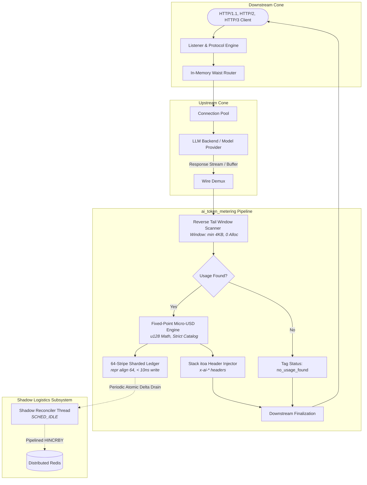
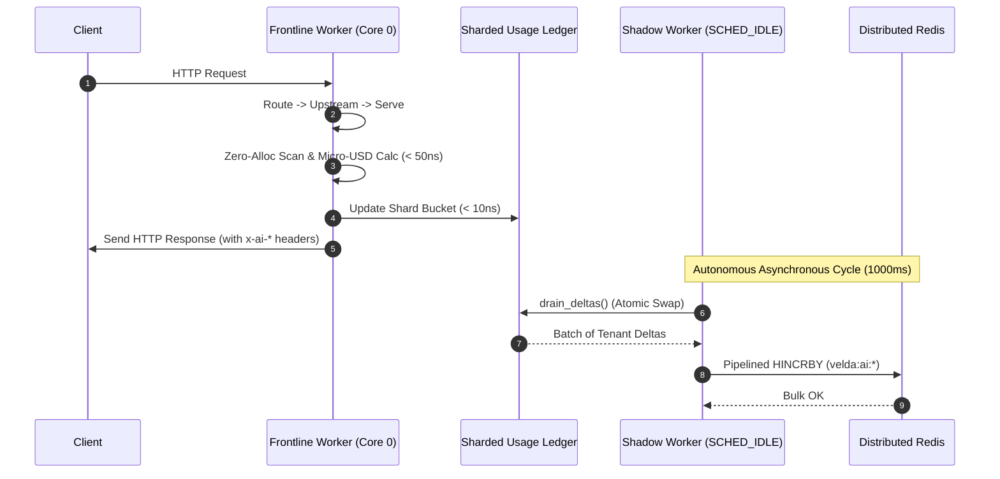

# AI Token Metering Plugin — Architectural Design Specification

This document details the architectural invariants, hardware-level optimization patterns, and concurrency model of the `ai_token_metering` plugin in **Velda Edge**.

---

## 1. System Topology & Lifecycle Integration

In accordance with the **Hourglass Architecture** ([`docs/HOURGLASS_MODEL.md`](../../../../../docs/HOURGLASS_MODEL.md)), the `ai_token_metering` plugin executes strictly in the bottom cone during the `post_response` phase. It does not participate in ingress routing, downstream connection acceptance, or upstream connection dispatching.



---

## 2. Hardware-Conscious Design Invariants

### 2.1 Zero-Allocation Reverse Tail Window Scanner

Traditional API Gateways (such as Kong or Apache APISIX) parse downstream HTTP response bodies by deserializing the entire JSON payload into an Abstract Syntax Tree (AST) using libraries like Lua `cjson` or Python/Go JSON decoders. For large LLM payloads (e.g. 50KB to 1MB context chunks), full JSON deserialization induces substantial heap churn, garbage collection pauses, and cache pollution.

#### Design Invariants:
1. **OpenAI Envelope Geometry**: In both OpenAI REST responses and the final payload of Server-Sent Events (SSE) streams, the `"usage"` envelope is structured adjacent to the termination of the payload:
   ```json
   {
     "id": "chatcmpl-mock-1",
     "choices": [ ... large generation content ... ],
     "usage": {
       "prompt_tokens": 1540,
       "completion_tokens": 320,
       "total_tokens": 1860,
       "prompt_tokens_details": { "cached_tokens": 1024 }
     }
   }
   ```
2. **Reverse Window Boundary**: The scanner limits search bounds to the trailing 4,096 bytes of the payload:
   $$\text{Scan Offset} = \max\left(0, \text{len} - 4096\right)$$
3. **Zero Heap Traversal**: The byte slice is scanned in reverse using fast SIMD-friendly memchr routines. Numerical fields are parsed directly from ASCII bytes to `u64` integers without generating temporary string slices or allocating heap containers. Execution completes in $< 35\text{ ns}$.

```
Payload Buffer [ ... 128 KB Content Body ... | 4 KB Tail Window ]
                                             ^
                                             └── Reverse Scan starts here
                                                 Matches: b"\"usage\""
                                                 Parses: prompt_tokens, completion_tokens, cached_tokens
```

---

## 3. Micro-USD Fixed-Point Arithmetic

To prevent floating-point non-determinism, CPU IEEE-754 precision degradation, and rounding errors in financial ledgers, all monetary rates and accumulated costs are represented as **Micro-USD** ($10^{-6}\text{ USD}$ or $\$0.000001$).

### 3.1 Mathematical Formulation

Given:
- $T_{\text{prompt}}$: Total prompt tokens consumed.
- $T_{\text{cached}}$: Prompt tokens served from cache ($T_{\text{cached}} \le T_{\text{prompt}}$).
- $T_{\text{comp}}$: Completion tokens produced.
- $R_p$: Base prompt rate ($\mu\text{USD}$ per $1,000,000$ tokens).
- $R_c$: Cached prompt rate ($\mu\text{USD}$ per $1,000,000$ tokens).
- $R_m$: Completion rate ($\mu\text{USD}$ per $1,000,000$ tokens).

The total request expense $C$ in Micro-USD is computed as:
$$C = \left\lfloor \frac{(T_{\text{prompt}} - T_{\text{cached}}) \times R_p + T_{\text{cached}} \times R_c + T_{\text{comp}} \times R_m}{1,000,000} \right\rfloor$$

### 3.2 Overflow Invariant
Multiplications are performed using unsigned 128-bit integers (`u128`). Even with maximum single-call limits ($100,000,000$ tokens) and high model rates ($\$500$ per million tokens $= 500,000,000\,\mu\text{USD}$), maximum intermediate products equal $5 \times 10^{16}$, well below the `u128::MAX` boundary ($3.4 \times 10^{38}$). Division by $1,000,000$ evaluates in $< 3\text{ ns}$ on modern x86_64 / aarch64 hardware.

### 3.3 Strict No-Fallback Catalog Enforcement
If the upstream model is omitted from the static configuration:
- The system **never** applies default pricing or estimates rates.
- Request cost is strictly evaluated to `0`.
- The response header is flagged with `x-ai-metering-status: unpriced_model`.
- Raw token metrics are persistently accumulated in the unpriced ledger for compliance verification.

---

## 4. Multi-Tenant Cache-Line Aligned Ledger

High-throughput proxying across multiple worker threads often degrades due to **false sharing** in symmetric multiprocessing (SMP) systems. When threads running on different CPU cores update adjacent data structures located within the same 64-byte L1 cache line, the CPU's MESI cache coherence protocol repeatedly invalidates cache lines across cores.

```
False Sharing Problem (Non-Aligned):
┌────────────────────────────── 64-Byte Cache Line ──────────────────────────────┐
│ Core 0 Shard Lock (Mutex) │ Core 1 Shard Lock (Mutex) │ Coherence Invalidations │
└────────────────────────────────────────────────────────────────────────────────┘
  ▲ Core 0 Write                               ▲ Core 1 Write (Stalled)

Velda Solution (#[repr(align(64))]):
┌────────────────────────────── Cache Line 0 (Core 0) ──────────────────────────┐
│ Shard 0 Lock + Local Bucket Map + Padding (Pad to 64 bytes)                    │
└────────────────────────────────────────────────────────────────────────────────┘
┌────────────────────────────── Cache Line 1 (Core 1) ──────────────────────────┐
│ Shard 1 Lock + Local Bucket Map + Padding (Pad to 64 bytes)                    │
└────────────────────────────────────────────────────────────────────────────────┘
```

### 4.1 Implementation Invariant
The ledger partitions consumers across 64 distinct stripe shards:
```rust
#[repr(align(64))]
pub struct CacheAlignedShard {
    pub lock: Mutex<HashMap<u64, ConsumerUsageEntry>>,
}
```
1. **Shard Index Resolution**:
   $$\text{Shard Index} = \left(\text{Hash} \oplus (\text{Hash} \gg 32)\right) \land 63$$
2. **Lock Hold Duration**: Mutex lock duration is bounded to $< 10\text{ ns}$, updating only in-memory atomic/integer counters before immediate release.
3. **Lock Freedom on Query**: The frontline serving worker records deltas instantly, keeping the hot path uncontended.

---

## 5. Frontline Serving vs Shadow Logistics Separation

Velda Edge strictly decouples request-serving worker threads from external synchronization tasks.



### 5.1 Frontline Traffic Worker Contract
- Worker threads (`velda-worker-{id}`) execute pinned to physical CPU cores.
- **Strict Prohibition**: Frontline workers **must never** open TCP sockets, perform network DNS resolution, serialize JSON, or execute blocking Redis operations.

### 5.2 Shadow Logistics Worker Contract
- Runs as an independent OS thread (`velda-ai-sync`) affined to non-critical CPU allocations under Linux `SCHED_IDLE`.
- Wakes up periodically (configurable, default: `1,000 ms`).
- Atomically drains accumulated delta records from the 64 ledger shards via `drain_deltas()`.
- Packages deltas into batch pipelined `HINCRBY` commands to update Redis keys:
  - `{prefix}:ai:prompt_tokens`
  - `{prefix}:ai:completion_tokens`
  - `{prefix}:ai:cost_micro_usd`
---

## 6. Reverse Permission Granting & Runtime Isolation

In accordance with Velda Edge's security contract and zero-copy invariants, `ai_token_metering` explicitly declares reverse permissions in Rust at compile time:

```rust
fn capability(&self) -> PluginCapability {
    PluginCapability::new(AccessLevel::Write, AccessLevel::Read)
}
```

### 6.1 Capability Invariants & Protection Against Runtime Injection
1. **`payload: AccessLevel::Read` (Read-Only Body Inspection)**:
   - Grants read-only inspection access to `resp.body.as_slice()`.
   - The plugin **never** mutates, transforms, or re-encodes downstream payload bytes, guaranteeing wire integrity.
   - The Data Plane Serving Engine uses this flag to know that response body buffering is required on routes attaching this plugin. Routes without payload plugins automatically default to **Zero-Copy Direct Streaming**.
2. **`header: AccessLevel::Write` (Header Mutation)**:
   - Grants authority to append the 7 `x-ai-*` telemetry headers to `resp.headers`.
3. **Immutability Against Configuration Tampering**:
   - Capabilities are hardcoded in Rust traits, **never** read from or overridden by JSON configurations.
   - Even if an attacker tampers with `plugins.json`, a plugin compiled as `header_only` can never be granted payload access, and `ai_token_metering` can never be granted unconstrained write authority over downstream body streams.
4. **Compile-Time Phase Binding**:
   - `instantiate_plugin` enforces strict compile-time whitelist pattern matching. Arbitrary dynamic code injection, `.so` dynamic loading, and script evaluations are architecturally impossible in Velda Edge.

