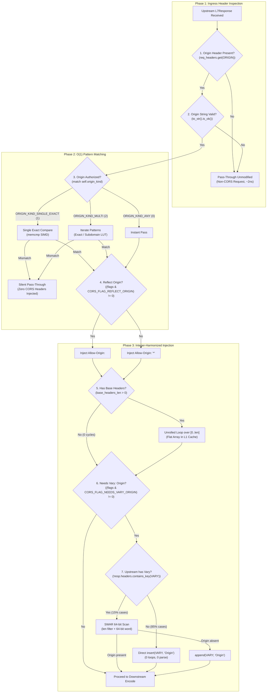

# CORS Post-Response Plugin (`cors`) — Architectural Specification

This document specifies the internal engine design, execution pipeline, memory invariants, and hardware optimizations of the **`cors`** post-response plugin (W3C Fetch / RFC 6454 / RFC 9110).

---

## 1. System Mindset & Architectural Invariants

The `cors` post-response plugin operates at the Layer 7 egress phase of request handling, immediately following upstream response reception and directly preceding downstream wire encoding. It enforces five primary invariants:

1. **Integer-Harmonized Execution (`flags: u8`, `origin_kind: u8`)**:
   Static configuration states and origin evaluation strategies are pre-compiled into compact 8-bit integers, executing on the CPU ALU via single-instruction bitwise tests (`TEST AL, imm8`) and $O(1)$ fast jumps without runtime boolean branching.
2. **Flat Contiguous Header Template (`base_headers_len: u8`)**:
   Static response headers (`credentials`, `expose-headers`, `max-age`) are stored in a 3-element contiguous array in L1 cache, eliminating `HeaderMap` dynamic hash table lookups and bucket allocations.
3. **SWAR 64-Bit Integer Vary Origin Filter**:
   When upstream emits a `Vary` header, token scanning uses integer-length filtering (`len != 6 && len != 1`) and 64-bit SWAR (SIMD-Within-A-Register) word comparisons (`0x0000_6e69_6769_726f`), executing with zero UTF-8 decoding and zero heap allocations.
4. **Single-Hash Fast-Path Vary Injection**:
   For upstream responses without a `Vary` header (>85% of traffic), `Vary: Origin` is inserted directly without loops or scanning.
5. **Non-CORS Fast Pass-Through**:
   Downstream requests lacking an `Origin` header (same-origin, curl, or server-to-server calls) bypass CORS processing in a single pointer comparison (~2ns).

---

## 2. End-to-End Response Hot-Path Pipeline



---

## 3. Core Architectural Subsystems

### 3.1 Integer Configuration Bitmask (`flags: u8`)

Rather than inspecting multiple boolean fields across memory lines:
```rust
pub const CORS_FLAG_ALLOW_ALL_ORIGINS: u8 = 1 << 0;
pub const CORS_FLAG_ALLOW_CREDENTIALS: u8 = 1 << 1;
pub const CORS_FLAG_REFLECT_ORIGIN: u8    = 1 << 2;
pub const CORS_FLAG_NEEDS_VARY_ORIGIN: u8 = 1 << 3;
```
During initialization, all conditions are compiled into a single 8-bit byte. On the hot path:
- `(self.flags & CORS_FLAG_REFLECT_ORIGIN) != 0` compiles to a single `TEST AL, 4` instruction.
- `(self.flags & CORS_FLAG_NEEDS_VARY_ORIGIN) != 0` compiles to a single `TEST AL, 8` instruction.

---

### 3.2 Pre-Baked Flat Array Template (`base_headers`)

Traditional proxies evaluate configuration flags dynamically per response or allocate a dynamic `HeaderMap`:
In Velda Edge, static response headers (credentials, expose-headers, max-age) are pre-baked into a fixed 3-element flat array:
```rust
pub struct CorsResponsePlugin {
    pub id: String,
    pub config: CorsConfig,
    pub flags: u8,
    pub origin_kind: u8,
    pub base_headers: [(HeaderName, HeaderValue); 3],
    pub base_headers_len: u8,
}
```
- **Zero Bucket Overhead**: Avoids allocating and hashing internal `HeaderMap` buckets for 0–3 headers.
- **Single-Cycle Skip**: If `base_headers_len == 0`, a single register comparison (`CMP AL, 0; JZ ...`) bypasses the loop entirely.
- **L1 Cache Residency**: The 3 `(HeaderName, HeaderValue)` tuples fit cleanly into CPU L1 data cache.

---

### 3.3 64-Bit SWAR Integer Filter for `Vary: Origin`

When responses vary by origin, emitting `Vary: Origin` prevents cross-origin cache poisoning (RFC 9110 Section 12.5.5).

Rather than decoding UTF-8 and iterating strings, Velda uses an integer length filter and a 64-bit SWAR word comparator:

```rust
const ORIGIN_U64_LE: u64 = 0x0000_6e69_6769_726f;
const ASCII_LOWERCASE_MASK_6B: u64 = 0x0000_2020_2020_2020;

#[inline(always)]
fn is_token_origin_swar(token: &[u8]) -> bool {
    debug_assert_eq!(token.len(), 6);
    let mut buf = [0u8; 8];
    buf[..6].copy_from_slice(token);
    let val = u64::from_le_bytes(buf);
    (val | ASCII_LOWERCASE_MASK_6B) == ORIGIN_U64_LE
}
```

1. **Integer Length Filter**: Every token with `len != 6 && len != 1` (e.g. `Accept-Encoding` [15], `User-Agent` [10]) is discarded in **1 CPU cycle** without inspecting individual bytes.
2. **Single-Instruction Comparison**: When `len == 6`, a single 64-bit integer OR (`|`) and comparison (`==`) verifies `"origin"` (case-insensitive) in 1 instruction.

---

### 3.4 Hardware-Accelerated Subdomain Pattern Matching

Origins configured with wildcard subdomain patterns (e.g. `https://*.example.com`) are evaluated by [`OriginPattern::Subdomain`](../../pre_route/cors_preflight/origin.rs).

- Validates that the incoming origin begins with the expected protocol/host prefix and ends with the exact domain suffix using fast SIMD `memcmp` equality.
- Every byte within the wildcard label is validated against `SUBDOMAIN_CHAR_LUT`, an L1 cache-resident 256-byte table.
- Neutralizes CVE-2020-7662 delimiter injection attacks in $O(1)$ time with zero branches.

---

## 4. Concurrency & Memory Invariants

- **Read-Only Shared State**: `CorsResponsePlugin` is completely stateless during execution.
- **Thread Safety**: Safely shared across worker threads without `Mutex`, `RwLock`, or atomic synchronization.
- **Memory Footprint**: Total memory footprint of an instantiated `CorsResponsePlugin` is **< 200 bytes** in RAM.
