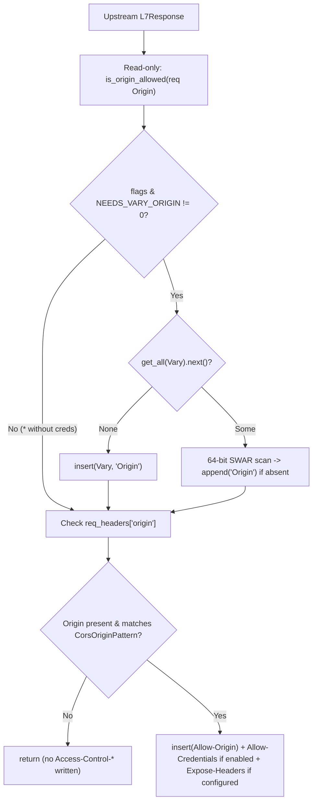

# Architecture (`post_response::cors`)

## 1. Design Principles

1. **Self-Contained Ownership**: Completely isolated inside `crates/velda-plugin/src/post_response/cors/` (`origin.rs`, `validation.rs`, `plugin.rs`, `mod.rs`) with zero cross-phase imports from `pre_route`.
2. **Validate Then Write**: Origin matching is read-only and completes before any response header is touched. A missing or disallowed `Origin` writes no `Access-Control-*` header; the plugin never writes a header and removes it later.
3. **Direct 1-Shot Writes**: Pre-bakes immutable `HeaderValue` templates at config compile time (`HeaderValue::from_static` / atomic `Bytes` ref-count clones) and inserts each enabled header exactly once on `resp.headers`, without routing static strings through `HeaderWorkspace`'s `u128` numeric register deferrals.
4. **RFC 9110 §12.5.5 Cache Poisoning Immunity**: Any origin-dependent policy emits `Vary: Origin` unconditionally across allowed, disallowed, and non-`Origin` responses while deduplicating upstream `Vary` lists via a 64-bit SWAR scanner.

---

## 2. Execution Flow & Memory Layout

### 2.1 Struct Layout (`CorsResponsePlugin`)
- `flags: u8`: 4-bit configuration mask (`ALLOW_ALL_ORIGINS`, `ALLOW_CREDENTIALS`, `REFLECT_ORIGIN`, `NEEDS_VARY_ORIGIN`).
- `origin_kind: u8`: Jump discriminator (`ANY = 0`, `SINGLE_EXACT = 1`, `MULTI = 2`).
- `expose_headers: Option<HeaderValue>`: Pre-validated `Access-Control-Expose-Headers` value (`Allow-Credentials` uses compile-time static `"true"` without cloning).

---

## 3. Byte-Level Origin Matching & SWAR `Vary` Mechanics

- **UTF-8 Boundary-Safe `CorsOriginPattern::matches_bytes(&[u8])`** ([origin.rs](origin.rs)):
  - Compares ASCII case-insensitively on raw `&[u8]` slices (immune to invalid UTF-8 char-boundary `split_at` panics).
  - Subdomain wildcards (`https://*.domain`) verify every wildcard byte through a branchless 256-byte `SUBDOMAIN_CHAR_LUT` (`[a-zA-Z0-9.-]`), blocking path (`/`), userinfo (`@`), query (`?`), fragment (`#`), port (`:`), leading/trailing `-`/`.`, and `..` injections (CVE-2020-7662 / CVE-2021-23440).
- **64-Bit SWAR `Vary` Token Scanner** ([plugin.rs](plugin.rs)):
  - Splits `Vary` header bytes by `,`, trims ASCII whitespace with `[u8]::trim_ascii()`, discards any token where `len != 6 && token != b"*"` in integer arithmetic, and compares 6-byte tokens against `0x0000_6e69_6769_726f` (`"origin\0\0"`) using `(u64::from_le_bytes(buf) | 0x0000_2020_2020_2020) == ORIGIN_U64_LE`.

---

## 4. Security Invariants

1. **Constructor Parity (`new` / `with_config` / `from_config`)**: All construction entrypoints enforce RFC 6454 (`*` or `null` forbidden when `allow_credentials == true`, `*` forbidden in `expose_headers` when `allow_credentials == true`, non-empty `allow_origins`).
2. **Protocol & Streaming Safety**: Declares `SupportedProtocols::ALL_HTTP` and `PluginCapability::header_only(AccessLevel::Write)`.
3. **PBWW Scheduling**: Declares `pbww() -> 0` (hot-path only, zero background tasks or network I/O).
