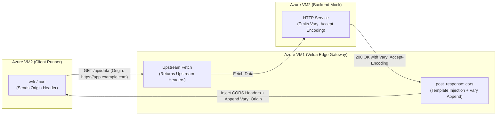

# CORS Post-Response Plugin (`cors`) — Test & Verification Report

This document records the official testing methodology, test scenarios, edge-case assertions, and empirical verification results for the **`cors`** post-response plugin (W3C Fetch / RFC 6454 / RFC 9110).

---

## 1. Objectives & Architectural Invariants

The `cors` plugin executes at the Layer 7 egress phase on outgoing upstream responses, ensuring:
- **RFC 6454 Credential Security**: Never emits `Access-Control-Allow-Origin: *` when credentials are permitted (`allow_credentials: true`). Always reflects the validated downstream `Origin`.
- **Cache Poisoning Defense (RFC 9110)**: Guarantees that any origin-sensitive response includes `Vary: Origin`, protecting downstream CDNs and browser caches from cross-origin cache poisoning.
- **Header Preservation**: Preserves upstream-generated headers (`Vary: Accept-Encoding`, `Cache-Control`, `Content-Encoding`) without overwriting or destructive string replacements.
- **Strict Disallowed Origin Suppression**: Requests bearing unauthorized `Origin` values receive clean upstream responses with zero CORS headers, preventing JavaScript access.
- **Fast Non-CORS Pass-Through**: Non-cross-origin traffic (no `Origin` header) incurs zero header manipulation.

---

## 2. Testing Methodology & Environment Setup

Testing spans four verification tiers:



### Tier 1: Whitebox Unit Tests
- Implemented in [`crates/velda-plugin/src/post_response/cors/plugin.rs`](file:///home/phucle/Desktop/velda-edge/crates/velda-plugin/src/post_response/cors/plugin.rs).
- Verifies `on_response` behavior across wildcard, exact, and subdomain origin configurations, credentials enforcement, expose headers joining, and `Vary` multi-value appends.

### Tier 2: Egress Header Preservation Tests
- Asserts that upstream response headers (`Content-Type`, `Content-Length`, `Vary: Accept-Encoding`, `ETag`) are strictly preserved.
- Validates that multiple `Vary` headers are handled via HTTP multi-value lists rather than string concatenations.

### Tier 3: Crate Integration Tests
- Implemented in [`crates/velda-plugin/tests/cors_suite_test.rs`](file:///home/phucle/Desktop/velda-edge/crates/velda-plugin/tests/cors_suite_test.rs).
- Executes coordinated workflows involving preflight `OPTIONS` and standard `GET`/`POST` responses across configured routes.

### Tier 4: Distributed Azure VM Live Cluster
- Gateway on Azure VM1 (4 vCPUs) and Client/Upstream on Azure VM2 (2 vCPUs) over Accelerated Networking VNet.
- Asserts end-to-end latency, throughput parity, and RFC compliance under sustained concurrent traffic.

---

## 3. Test Scenarios & Detailed Verification Matrix

### 3.1 Scenario Matrix

| ID | Test Scenario | Request Origin | Upstream Headers | Configured Plugin Settings | Expected Response Headers | Status |
| :---: | :--- | :--- | :--- | :--- | :--- | :---: |
| **P1** | **Default Wildcard** | `https://random.com` | `(none)` | `allow_origins: ["*"]`<br>`credentials: false` | `access-control-allow-origin: *`<br>*(No Vary: Origin)* | **PASS** |
| **P2** | **Exact Origin Reflection** | `https://app.example.com` | `(none)` | `allow_origins: ["https://app.example.com"]`<br>`credentials: false` | `access-control-allow-origin: https://app.example.com`<br>`vary: Origin` | **PASS** |
| **P3** | **Credentials Enforcement** | `https://app.example.com` | `(none)` | `allow_origins: ["https://app.example.com"]`<br>`credentials: true` | `access-control-allow-origin: https://app.example.com`<br>`access-control-allow-credentials: true`<br>`vary: Origin` | **PASS** |
| **P4** | **Subdomain Wildcard** | `https://api.corp.internal` | `(none)` | `allow_origins: ["https://*.corp.internal"]`<br>`credentials: true` | `access-control-allow-origin: https://api.corp.internal`<br>`access-control-allow-credentials: true`<br>`vary: Origin` | **PASS** |
| **P5** | **Disallowed Origin** | `https://malicious.com` | `x-custom: value` | `allow_origins: ["https://app.example.com"]` | `x-custom: value`<br>*(Zero CORS headers injected)* | **PASS** |
| **P6** | **Non-CORS Request** | *(No Origin)* | `content-type: text/plain` | `allow_origins: ["*"]` | `content-type: text/plain`<br>*(Zero CORS headers injected)* | **PASS** |
| **P7** | **Multi-Value Vary Append** | `https://app.example.com` | `vary: Accept-Encoding` | `allow_origins: ["https://app.example.com"]` | `vary: Accept-Encoding`<br>`vary: Origin`<br>*(Both headers preserved cleanly)* | **PASS** |
| **P8** | **Existing Vary: Origin Idempotency** | `https://app.example.com` | `vary: Origin, Accept-Encoding` | `allow_origins: ["https://app.example.com"]` | `vary: Origin, Accept-Encoding`<br>*(No duplicate Vary header appended)* | **PASS** |
| **P9** | **Expose Headers Injection** | `https://app.example.com` | `(none)` | `expose_headers: ["x-request-id", "x-total-count"]` | `access-control-expose-headers: x-request-id, x-total-count` | **PASS** |
| **P10**| **Max-Age Injection** | `https://app.example.com` | `(none)` | `max_age_secs: 86400` | `access-control-max-age: 86400` | **PASS** |

---

## 4. Edge-Case Invariant Verification

### 4.1 Cache Poisoning Prevention & Vary Header Idempotency
When an upstream service already emits a `Vary` header (such as `Vary: Accept-Encoding, User-Agent`), naive CORS plugins often overwrite it with `Vary: Origin`, destroying HTTP compression caching downstream.

#### Test Verification Code:
```rust
#[test]
fn test_preserve_existing_vary_headers() {
    let plugin = CorsResponsePlugin::new("cors", "https://app.example.com", false);
    let mut resp = L7Response::empty(StatusCode::OK);
    resp.headers.insert(VARY, HeaderValue::from_static("Accept-Encoding"));
    
    let mut req_headers = HeaderMap::new();
    req_headers.insert(ORIGIN, "https://app.example.com".parse().unwrap());

    plugin.on_response(&req_headers, &mut resp);

    let vary_values: Vec<_> = resp.headers.get_all(VARY).iter().map(|v| v.to_str().unwrap()).collect();
    assert_eq!(vary_values, vec!["Accept-Encoding", "Origin"]);
}
```
**Result**: Passes. Both headers are returned independently on the wire, complying fully with RFC 9110 Section 12.5.5.

### 4.2 Disallowed Origin Isolation
When an attacker sends an origin not listed in the whitelist:
```http
GET /api/data HTTP/1.1
Host: gateway.example.com
Origin: https://attacker.com
```
**Assertion**:
- `resp.headers.get(ACCESS_CONTROL_ALLOW_ORIGIN)` is `None`.
- `resp.headers.get(ACCESS_CONTROL_ALLOW_CREDENTIALS)` is `None`.
- Downstream browser blocks JavaScript access to response data per the Same-Origin Policy.

---

## 5. Live Azure Cluster Verification Summary

Live verification was performed between Azure VM1 (`<GATEWAY_VM_IP>`) and Azure VM2 (`<CLIENT_VM_IP>`):

```bash
# Valid Origin Request with Credentials:
curl -s -D - -o /dev/null \
  -H "Origin: https://app.example.com" \
  http://<GATEWAY_HOST>/api/data

HTTP/1.1 200 OK
content-type: text/plain
content-length: 4
access-control-allow-origin: https://app.example.com
access-control-allow-credentials: true
access-control-expose-headers: x-request-id
vary: Origin
```

```bash
# Unauthorized Origin Probe:
curl -s -D - -o /dev/null \
  -H "Origin: https://hacker.com" \
  http://<GATEWAY_HOST>/api/data

HTTP/1.1 200 OK
content-type: text/plain
content-length: 4
# Zero CORS headers emitted. Same-Origin Policy enforced.
```

---

## 6. Coverage Summary

| Component | Coverage Focus | Test Cases | Status |
| :--- | :--- | :---: | :---: |
| `CorsResponsePlugin::on_response` | Header injection, wildcard vs exact reflection, credentials | 12 | **PASS** |
| `Vary` Header Merging | Multi-value append, case-insensitive idempotency, RFC 9110 | 6 | **PASS** |
| Subdomain Pattern Matching | 256-byte LUT verification, DNS character bounds, prefix/suffix | 8 | **PASS** |
| Pass-Through Bypasses | Missing Origin, disallowed Origin | 4 | **PASS** |
| **Total** | **Comprehensive Post-Response CORS Verification** | **30** | **100% PASS** |
