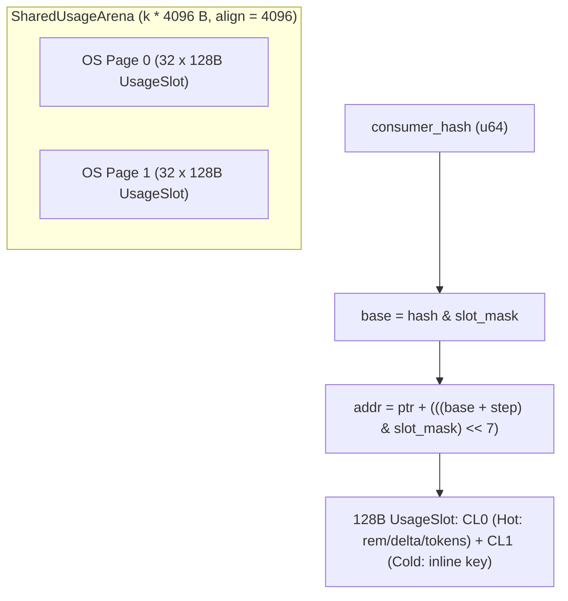

# Architecture (`openai_token_quota`)

## 1. Design Principles

1. **Zero Billing Math at the Edge**: `openai_token_quota` counts tokens only (`prompt`, `completion`, `total`, `cached`) and maintains a global shared quota ledger without model pricing catalogs or currency math.
2. **Contiguous Shared Arena (`k * 4096 B`)**: Replaces per-core locks and heap maps with a single 4096-byte page-aligned `SharedUsageArena` of 64-byte cache-line-aligned `UsageSlot` entries.
3. **Hierarchical Streaming Identity**: Combines all present `consumer_id_headers` (`seg1.seg2...`, e.g., `abc.123`) directly in CPU registers via streaming FNV-1a 64-bit hashing.
4. **Zero-Copy Tail Scanner**: Scans at most the final `4096` bytes of `L7Response.body` for the last `"usage": { ... }` object in a single linear byte pass.

---

## 2. Memory & Hardware Layout

- **Two-Cache-Line Slot (`#[repr(C, align(64))]`, 128 B)**:
  - **Cache Line 0 (Hot, 64 B)**: `consumer_hash`, `local_remaining`, `pending_delta`, `prompt_tokens`, `completion_tokens`, `total_tokens`, `cached_tokens`, `last_access_sec`. Frontline Worker only touches Cache Line 0 after initial insertion.
  - **Cache Line 1 (Cold, 64 B)**: `key_len`, `flags`, `key_bytes: [AtomicU8; 62]` storing up to 62 bytes of `abc.123` inline with zero heap allocation so the Shadow Worker can construct Redis key `velda:plugin:<plugin_id>:<consumer_key>`.
- **Non-Touching Frontline vs Shadow Threads**: Frontline Worker never awaits Redis; if `local_remaining <= refill_watermark`, it flips an atomic flag and signals `Notify` so the background Shadow Worker leases the next `micro_quota_batch` via RESP2 Lua `EVAL`. If Redis disconnects, Frontline continues deducting/counting locally without blocking.
