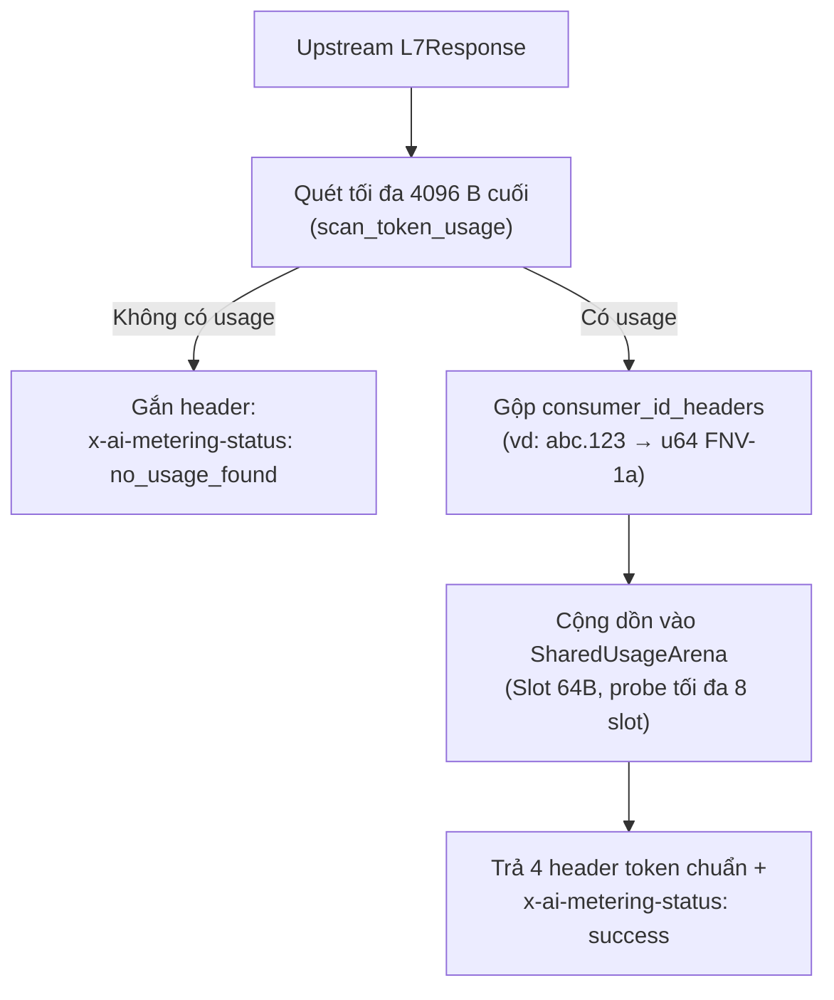

# OpenAI Token Quota (`openai_token_quota`)

Zero-allocation, shared-arena post-response plugin (`phase: "post_response"`) for counting LLM prompt, completion, total, and cached tokens directly from upstream OpenAI-compatible, Anthropic, and Gemini JSON payloads and injecting standard response headers.

---

## Execution Flow



---

## Configuration (`plugins.json`)

```json
{
  "plugins": [
    {
      "id": "openai_token_quota",
      "config": {
        "mode": "distributed",
        "consumer_id_headers": ["x-tenant-id", "x-user-id"],
        "ledger_slots": 4096,
        "redis_url": "redis://127.0.0.1:6379",
        "micro_quota_batch": 5000,
        "refill_watermark": 1000,
        "sync_interval_ms": 500
      }
    }
  ]
}
```

| Field | Type | Required | Default | Description |
| :--- | :--- | :---: | :---: | :--- |
| `mode` | `String` | No | `"local"` | `"local"` (RAM-only) or `"distributed"` (Shadow Worker leases micro-quotas from Redis `velda:plugin:<plugin_id>:<key>`). |
| `consumer_id_headers` | `Vec<String>` | Yes | — | Ordered request headers combined hierarchically with `.` (e.g. `abc.123`) into a 64-bit FNV-1a consumer hash. |
| `ledger_slots` | `usize` | No | `4096` | Tổng số slot `128 B` cấp phát trước trong vùng nhớ liên tục `SharedUsageArena` (mỗi user `abc.123` chiếm 1 slot; lũy thừa của 2 trong `64..=1048576`, mặc định `4096` slot = `512 KB`). |
| `local_default_quota` | `i64` | No | `0` | Hạn mức khởi tạo local mỗi slot trong chế độ `"local"` (`0` = pure counter). |
| `redis_url` | `String` | If `distributed` | `null` | Địa chỉ Redis (`redis://host:port`) cho Shadow Worker trong chế độ `"distributed"`. |
| `redis_password` | `String` | No | `null` | Mật khẩu Redis (`AUTH`). |
| `redis_tls` | `Object` | No | `null` | Cấu hình TLS / mTLS (`ca_pem`, `client_cert_pem`, `client_key_pem`, `insecure_skip_verify`) qua `velda-tls`. |
| `micro_quota_batch` | `u64` | No | `5000` | Kích thước gói micro-quota lấy từ Redis mỗi lần refill. |
| `batch_users` | `usize` | No | `64` | Số lượng consumer keys tối đa gom vào 1 Multi-Key Lua `EVAL` trong 1 Round-Trip (`1..=512`). |
| `refill_watermark` | `i64` | No | `1000` | Ngưỡng `local_remaining` kích hoạt Shadow Worker xin thêm micro-quota từ Redis. |
| `sync_interval_ms` | `u64` | No | `500` | Chu kỳ quét nền của Shadow Worker (ms). |
| `shadow_weight` | `u32` | No | `25` | Trọng số điều phối tác vụ Shadow Worker (`1..=100`, cùng thang đo `BackgroundPlugin::weight`). |

---

## Emitted Response Headers

| Header | Condition | Value |
| :--- | :--- | :--- |
| `x-ai-prompt-tokens` | Usage found | Prompt/input token count |
| `x-ai-completion-tokens` | Usage found | Completion/output token count |
| `x-ai-total-tokens` | Usage found | Total token count |
| `x-ai-cached-tokens` | Usage found | Cached prompt token count (`"0"` unconditionally when zero) |
| `x-ai-metering-status` | Always | `"success"` or `"no_usage_found"` |
