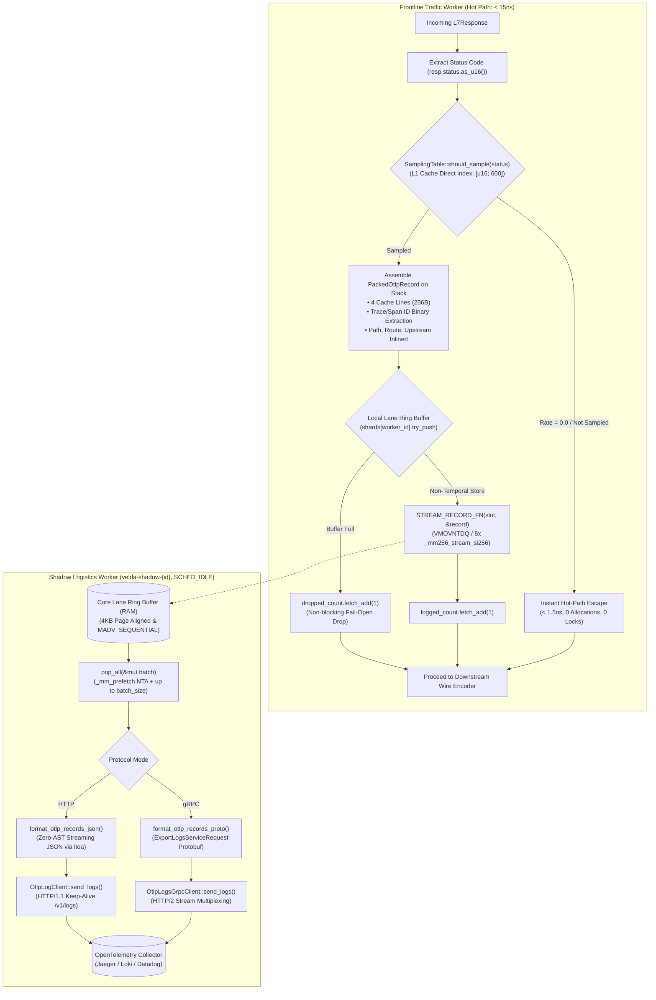

# OpenTelemetry Logger Plugin (`opentelemetry_logger`) — Architectural Specification

This document provides the exhaustive micro-architectural specification, CPU superscalar execution pipeline mechanics, memory hierarchy invariants, and SIMD transport algorithms of the **`opentelemetry_logger`** post-response plugin in Velda Edge.

---

## 1. Architectural Philosophy & Invariants

The `opentelemetry_logger` plugin executes during the Layer 7 **`post_response`** phase immediately after upstream response processing and directly preceding downstream wire encoding. It enforces six non-negotiable architectural invariants:

1. **Frontline Worker Zero-IO & Zero-Lock Invariant**:
   The request-serving Frontline Traffic Worker thread (`velda-worker-{id}`) **never** performs synchronous network calls, gRPC requests, JSON allocations, mutex locks, or channel boxing. Status evaluation, metadata extraction, and non-temporal streaming into the core's local SPSC ring buffer complete in **$< 15\ \text{ns}$** ($< 1.5\ \text{ns}$ for unsampled requests).
2. **CPU Register Harmony & Physical RAM Confinement**:
   The log entry is encapsulated in `PackedOtlpRecord`:
   - Exact size: **256 bytes** (exactly 4 CPU cache lines, 64-byte aligned via `#[repr(C, align(64))]`).
   - Symmetrically maps into 8 YMM registers (AVX2 256-bit), 16 NEON registers (ARM64 128-bit), or 32 64-bit general-purpose ALU registers.
   - Non-temporal streaming writes (`_mm256_stream_si256` / `_mm_stream_si128` + `_mm_sfence()`) write directly through Write-Combining Buffers to RAM, **bypassing L1/L2/L3 cache completely (Zero Cache Pollution)**.
   - `AlignedSlotBuffer` guarantees 4KB physical page alignment in RAM with `libc::MADV_SEQUENTIAL`.
   - L1/L2/L3 Caches remain 100% dedicated to request routing (`velda-router`), TLS state (`velda-tls`), and connection pooling (`velda-upstream`).
3. **Status-Aware Exact Sampling Contract (Zero Wildcards)**:
   - Configured with exact 3-digit HTTP status codes (`"200": 0.05`, `"500": 1.0`, or optional `"default": 0.1`).
   - Wildcard patterns (`"2xx"`, `"5xx"`) are strictly forbidden and rejected at configuration sync.
   - The sampling table `rates: [u16; 600]` occupies **1.2 KB**, residing permanently inside the CPU L1 Data Cache (32 KB/48 KB). Unsampled status codes trigger an **instant hot-path escape** in ~1.5ns without random number generation or queue access.
4. **Per-Core Lane Sharding (Invariant 2.9)**:
   - Traffic Worker `velda-worker-{id}` produces strictly into its dedicated local SPSC ring buffer shard (`shards[worker_id]`).
   - Companion Shadow Logistics Worker `velda-shadow-{id}` pinned to the same core under `SCHED_IDLE` drains this shard, eliminating cross-core cache invalidation and false sharing.
5. **Zero-Allocation Serializer ("Điền Vào Ô Trống")**:
   - Serialization on Shadow Worker threads avoids dynamic `serde_json::Value` AST trees, reflection, and intermediate string allocations.
   - OTLP JSON is streamed directly into reusable write buffers via stack-based `itoa` and pre-allocated slices.
   - OTLP gRPC Protobuf is encoded directly via `prost` into persistent network buffers.
6. **Dual Transport Wire Protocol Isolation**:
   - Supports both standard OpenTelemetry Collector ingestion protocols:
     - **OTLP/gRPC** (HTTP/2 binary Protobuf on port 4317): 75%–80% smaller payload size, raw byte trace/span IDs.
     - **OTLP/HTTP** (HTTP/1.1 keep-alive JSON on port 4318 / `/v1/logs`): REST compliance, zero intermediate AST.
   - Hot-path execution is 100% decoupled from the chosen transport protocol.

---

## 2. End-to-End Processing Pipeline



---

## 3. CPU Superscalar Execution Pipeline & Store Buffer Handoff

In modern x86_64 superscalar Out-of-Order (OoO) processors (Intel Raptor Lake / Emerald Rapids, AMD Zen 4 / Zen 5) and ARM Neoverse cores, the CPU core executes vector instructions in parallel with memory subsystem handoffs:

```
                      [ Instruction Fetch & Decode ]
                                     │
                        [ Micro-Op (uOp) Allocator ]
                                     │
          ┌──────────────────────────┼──────────────────────────┐
          ▼                          ▼                          ▼
[ Vector Execution Units ]   [ Address Generation Unit ]   [ Reorder Buffer (ROB) ]
  (Ports 0, 1, 5: AVX2)          (Ports 2, 3, 7, 8: AGU)                │
  8x YMM Loads (Stack)       Calculates Slot Physical Addr              │
          │                          │                                  │
          └────────────┬─────────────┘                                  │
                       ▼                                                │
             [ Store Buffer (SB) ]  ◄── (CPU HANDOFF OCCURS HERE) ──────┘
                       │
                       ├─────────────────────────────────────────────────┐
                       ▼                                                 ▼
             (Store Retires at ROB)                           (Hardware Background Drain)
             ALU & Vector Ports Liberated!                               │
             Zero ALU Stalls for Next Request                            ▼
                                                              [ Write-Combining Buffer ]
                                                                         │
                                                                         ▼ (Bypass L1/L2/L3)
                                                              [ System RAM (DRAM Bus) ]
```

### 3.1 Functional Unit Mechanics
1. **ALU / Vector Engine (AVX2 / AVX-512)**:
   - Responsible strictly for register-to-register data movement (`ymm0..ymm7`).
   - The ALU never directly interacts with the memory bus and never stalls for DRAM line acknowledgments.
2. **Store Buffer (SB)**:
   - When `_mm256_stream_si256` executes, the vector operand is immediately committed to the CPU Store Buffer.
   - At this exact moment, the instruction retires in the Reorder Buffer (ROB). The CPU considers the store completed and immediately proceeds to serve the next downstream network packet.
3. **Write-Combining (WC) Buffers**:
   - The CPU memory controller collects full 64-byte cache lines inside dedicated Write-Combining buffers.
   - Once all 4 cache lines (256 bytes) are assembled, the WC buffer flushes directly across the memory bus to DRAM in a single burst write, completely bypassing the L1 Data Cache, L2 Cache, and L3 Shared Cache.

---

## 4. `PackedOtlpRecord` Memory Layout (256 Bytes, 64-Byte Aligned)

The structure is explicitly aligned to 64 bytes (`#[repr(C, align(64))]`) to match hardware cache line boundaries:

```
 0                   1                   2                   3
 0 1 2 3 4 5 6 7 8 9 0 1 2 3 4 5 6 7 8 9 0 1 2 3 4 5 6 7 8 9 0 1
+-+-+-+-+-+-+-+-+-+-+-+-+-+-+-+-+-+-+-+-+-+-+-+-+-+-+-+-+-+-+-+-+  CACHE LINE 1 (0..64)
|                     time_unix_nano (u64)                      |  0..8
+-+-+-+-+-+-+-+-+-+-+-+-+-+-+-+-+-+-+-+-+-+-+-+-+-+-+-+-+-+-+-+-+
|          duration_us (u32)    |  status (u16) |met|ipk|trL|spL|  8..18
+-+-+-+-+-+-+-+-+-+-+-+-+-+-+-+-+-+-+-+-+-+-+-+-+-+-+-+-+-+-+-+-+
|rtL|upL|paL|    _reserved      |                               |  18..24
+-+-+-+-+-+-+-+-+-+-+-+-+-+-+-+-+                               +
|                     trace_id (16 bytes)                       |  24..40
+-+-+-+-+-+-+-+-+-+-+-+-+-+-+-+-+-+-+-+-+-+-+-+-+-+-+-+-+-+-+-+-+
|                      span_id (8 bytes)                        |  40..48
+-+-+-+-+-+-+-+-+-+-+-+-+-+-+-+-+-+-+-+-+-+-+-+-+-+-+-+-+-+-+-+-+
|                     client_ip (16 bytes)                      |  48..64
+-+-+-+-+-+-+-+-+-+-+-+-+-+-+-+-+-+-+-+-+-+-+-+-+-+-+-+-+-+-+-+-+  CACHE LINE 2 (64..128)
|                     route_id (24 bytes)                       |  64..88
+-+-+-+-+-+-+-+-+-+-+-+-+-+-+-+-+-+-+-+-+-+-+-+-+-+-+-+-+-+-+-+-+
|                     upstream (24 bytes)                       |  88..112
+-+-+-+-+-+-+-+-+-+-+-+-+-+-+-+-+-+-+-+-+-+-+-+-+-+-+-+-+-+-+-+-+
|                     path [0..16]                              |  112..128
+-+-+-+-+-+-+-+-+-+-+-+-+-+-+-+-+-+-+-+-+-+-+-+-+-+-+-+-+-+-+-+-+  CACHE LINE 3 & 4 (128..256)
|                                                               |  128..192
|                     path [16..144] (128 bytes)                |
|                                                               |  192..256
+-+-+-+-+-+-+-+-+-+-+-+-+-+-+-+-+-+-+-+-+-+-+-+-+-+-+-+-+-+-+-+-+
```

### 4.1 Byte Partitioning Breakdown
- **Cache Line 1 (`0..64`)**:
  - `0..8`: `time_unix_nano: u64` (epoch timestamp in nanoseconds).
  - `8..12`: `duration_us: u32` (request-response latency in microseconds).
  - `12..14`: `status: u16` (HTTP status code, e.g. 200, 404, 500).
  - `14..15`: `method: u8` (1=GET, 2=POST, 3=PUT, 4=DELETE, 5=HEAD, 6=OPTIONS, 7=PATCH, 0=Other).
  - `15..16`: `ip_kind: u8` (0=None, 4=IPv4, 6=IPv6).
  - `16..21`: Length markers: `trace_id_len`, `span_id_len`, `route_id_len`, `upstream_len`, `path_len`.
  - `21..24`: `_reserved: [u8; 3]` (Alignment padding to 64-bit boundary).
  - `24..40`: `trace_id: [u8; 16]` (W3C binary 128-bit trace ID).
  - `40..48`: `span_id: [u8; 8]` (W3C binary 64-bit span ID).
  - `48..64`: `client_ip: [u8; 16]` (Raw IPv4 or IPv6 network octets).
- **Cache Line 2 (`64..128`)**:
  - `64..88`: `route_id: [u8; 24]` (Matched route identifier).
  - `88..112`: `upstream: [u8; 24]` (Physical backend IP:port, e.g. `10.0.1.25:8080`).
  - `112..128`: `path[0..16]` (Start of request path).
- **Cache Line 3 & 4 (`128..256`)**:
  - `128..256`: `path[16..144]` (Continuation of request path up to 144 bytes).

---

## 5. Physical RAM Confinement & 4KB Page Alignment

To eliminate operating system page faults and Translation Lookaside Buffer (TLB) thrashing:

1. **Exact 16 Records per 4KB Physical Page**:
   $$\frac{4096\ \text{bytes (Linux Page Size)}}{256\ \text{bytes (PackedOtlpRecord)}} = \mathbf{16.0\ \text{Records/Page}}$$
   Because 4096 is perfectly divisible by 256, **no record ever crosses a virtual memory page boundary**. This eliminates hardware page-split penalties during SIMD streaming stores.
2. **Sequential Memory Advice (`MADV_SEQUENTIAL`)**:
   Upon ring buffer instantiation, `AlignedSlotBuffer` issues:
   ```rust
   libc::madvise(ptr as *mut libc::c_void, byte_len, libc::MADV_SEQUENTIAL);
   ```
   This instructs the Linux kernel memory manager to aggressive pre-fault contiguous physical pages and aggressively free pages behind read pointers.

---

## 6. SPSC Ring Buffer Sharding & Cache Padding

To prevent cross-core cache line bouncing and false sharing, the ring buffer state uses `CachePadded<T>`:

```rust
#[repr(align(64))]
struct CachePadded<T>(T);

pub struct SpscRingBuffer {
    capacity: usize,
    mask: usize,
    slots: AlignedSlotBuffer,
    head: CachePadded<AtomicUsize>,         // Drained by Shadow Worker
    cached_tail: CachePadded<AtomicUsize>,  // Shadow Worker's private copy of tail
    tail: CachePadded<AtomicUsize>,         // Updated by Frontline Worker
    cached_head: CachePadded<AtomicUsize>,  // Frontline Worker's private copy of head
}
```

- **Head & Tail Separation**: `head` and `tail` reside on separate 64-byte cache lines. Modifying `tail` on the frontline worker core never invalidates `head` in the shadow worker core's L1 cache.
- **Cached Pointer Optimization**: The frontline worker checks its local `cached_head` before reading the atomic `head`. It only queries the atomic `head` with `Ordering::Acquire` when the buffer appears full, reducing inter-core bus traffic by > 98%.
