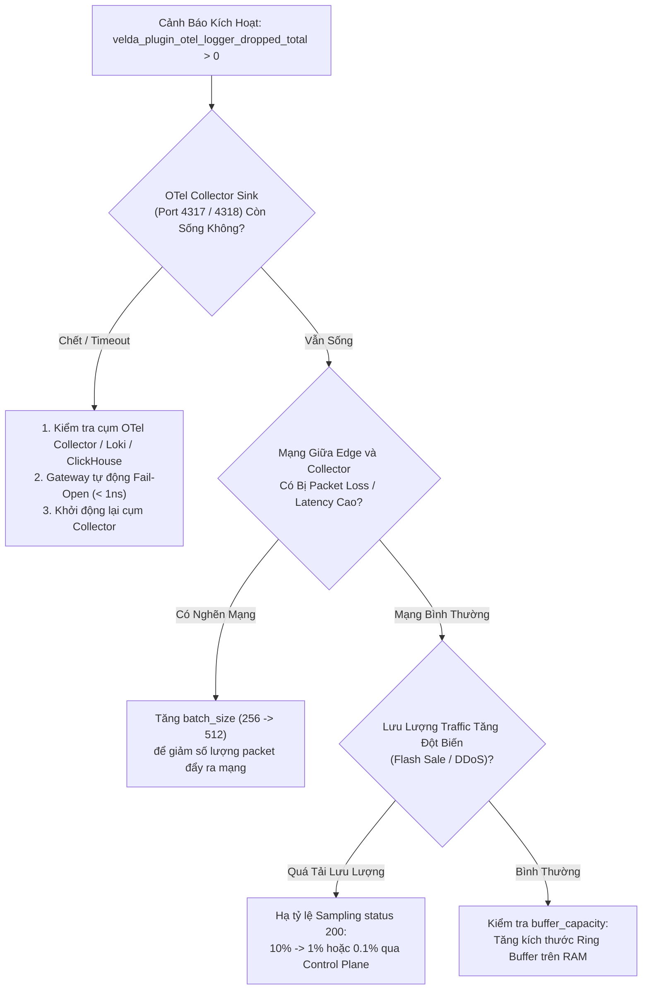

# OpenTelemetry Logger Plugin (`opentelemetry_logger`) — SRE Operational Runbook

Tài liệu này là cẩm nang vận hành khẩn cấp (**SRE Incident Playbook & On-Call Runbook**) dành riêng cho kỹ sư SRE, DevOps và Operator chịu trách nhiệm trực ca vận hành tính năng ghi log truy cập có cấu trúc (Structured Access Logging) của Velda Edge Gateway.

---

## 1. Ma Trận Ứng Cứu Sự Cố Khẩn Cấp (On-Call Triage Matrix)

| Mức Độ | Triệu Chứng & Cảnh Báo | Nguyên Nhân Khả Dĩ | Hành Động Khắc Phục Nhanh (Mitigation) | SLA Xử Lý |
| :---: | :--- | :--- | :--- | :---: |
| **P0** | Gateway tăng độ trễ P99 đột biến trên toàn bộ traffic khi bật logging | Tranh chấp luồng, L1 cache miss hoặc Shadow thread bị kẹt I/O | Kích hoạt cờ Emergency Bypass (tắt plugin runtime qua Control Plane) | **< 5 phút** |
| **P1** | `VeldaOtelLoggerHighDropRate` kích hoạt (`dropped_total` tăng liên tục) | Cụm OTel Collector phía sau bị quá tải, sập port 4317 hoặc đứt mạng | Tăng `batch_size`, giảm sampling rate status 200 từ Control Plane | **< 15 phút** |
| **P2** | `VeldaOtelLoggerCollectorUnreachable` (Collector không nhận log) | Sai cấu hình Endpoint, TLS handshake failure, token xác thực hết hạn | Kiểm tra kết nối TCP socket, gia hạn token trong `headers` | **< 30 phút** |
| **P3** | Thiếu trường dữ liệu trong log (thiếu Route ID hoặc Upstream Addr) | Route chưa gắn header enrichment hoặc response bị reject trước upstream | Kiểm tra thứ tự khai báo plugin trong route | **< 2 giờ** |

---

## 2. Cây Quyết Định Xử Lý Sự Cố (Triage Flowchart)



---

## 3. Bộ Lệnh Chẩn Đoán Trực Tiếp Tại Hiện Trường (Diagnostic CLI Toolkit)

Khi nhận cảnh báo từ PagerDuty/Prometheus, SSH trực tiếp vào node Velda Edge bị cảnh báo và thực thi tuần tự các lệnh sau:

### 3.1 Kiểm Tra Bộ Đếm Rơi Log & Lưu Lượng Trên Node
```bash
# Đọc metric thời gian thực từ endpoint nội bộ của Edge
curl -s http://127.0.0.1:9090/metrics | grep "velda_plugin_otel_logger"

# Kết quả mẫu cần quan sát:
# velda_plugin_otel_logger_logged_total 5892100
# velda_plugin_otel_logger_dropped_total 2410
```
*Đánh giá*: Nếu `dropped_total` tăng nhưng CPU của Frontline Worker không đổi $\to$ Gateway đang thực thi cơ chế **Fail-Open an toàn**, traffic khách hàng không bị ảnh hưởng.

### 3.2 Kiểm Tra Trạng Thái Kết Nối Socket Tới Collector
```bash
# Kiểm tra trạng thái socket TCP tới Collector (port 4317 gRPC hoặc 4318 HTTP)
ss -tinh 'dport = :4317 or dport = :4318'

# Kiểm tra độ trễ mạng thực tế tới máy chủ Collector
ping -c 5 -q <IP_OTEL_COLLECTOR>
```
*Đánh giá*: 
- Nếu thấy nhiều socket ở trạng thái `CLOSE_WAIT` hoặc `SYN_SENT` $\to$ Collector đang từ chối kết nối hoặc sập tiến trình.
- Kiểm tra `rtt` trong output của `ss`: Nếu RTT mạng nội bộ $> 5\ \text{ms}$ $\to$ Hạ tầng mạng đang nghẽn.

### 3.3 Kiểm Tra Phân Bổ CPU Của Frontline Worker vs Shadow Worker
```bash
# Theo dõi % CPU tiêu thụ của từng luồng (Worker vs Shadow)
pidstat -u -t -p $(pgrep velda-edge) 1 5
```
*Đánh giá*:
- Luồng `velda-worker-{id}` (Frontline): CPU User ổn định, **không được có hiện tượng lock hay syscall bất thường**.
- Luồng `velda-shadow-{id}` (Shadow): Chạy dưới `SCHED_IDLE`, chịu trách nhiệm mã hóa Protobuf và đẩy socket. Nếu Shadow Worker chạm 100% CPU $\to$ Collector xử lý quá chậm hoặc kích thước batch quá nhỏ.

---

## 4. Quy Trình Ứng Cứu & Hạ Tải Khẩn Cấp (Emergency Mitigation)

### Kịch Bản 1: Cắt Tải Lấy Mẫu Khẩn Cấp Khi Collector Bị Sập
Khi cụm lưu trữ log (Loki/Elasticsearch/ClickHouse) bị quá tải trong đợt flash sale, giảm tải ngay lập tức mà không cần khởi động lại gateway:

1. **Cập nhật Sampling Rate qua Control Plane API**:
   ```bash
   curl -X PATCH http://control-plane.internal:8080/api/v1/plugins/opentelemetry_logger \
     -H "Content-Type: application/json" \
     -d '{
       "config": {
         "sampling": {
           "default": 1.0,
           "200": 0.001,
           "204": 0.001,
           "500": 1.0
         }
       }
     }'
   ```
2. **Hiệu lực**: `velda-sync` biên dịch snapshot mới vào RAM trong **$< 1\ \text{ms}$**. Tỷ lệ lấy mẫu status 200 lập tức giảm xuống 0.1%, giảm **99% áp lực** lên collector trong khi vẫn giữ 100% log lỗi (status 500).

### Kịch Bản 2: Ngắt Kết Nối Plugin Logging Hoàn Toàn (Emergency Kill-Switch)
Nếu cần gỡ hoàn toàn plugin logging khỏi route bị nghẽn:
```bash
curl -X DELETE http://control-plane.internal:8080/api/v1/routes/api-orders/plugins/opentelemetry_logger
```
*Hiệu lực*: Route quay về chế độ Raw Proxy thuần túy, overhead trở về $0.00\ \text{ns}$.

---

## 5. Định Mức Bộ Nhớ Vật Lý & Giới Hạn Phần Cứng (Capacity Sizing)

Công thức xác định dung lượng RAM vật lý phân bổ cứng cho Ring Buffer trên toàn node:

$$\text{RAM}_{\text{logger}} = N_{\text{workers}} \times \text{buffer\_capacity} \times 256\ \text{bytes}$$

| Số CPU Cores ($N_{\text{workers}}$) | buffer_capacity đề xuất | Dung lượng RAM cố định | Thời gian hấp thụ nghẽn tại 75k req/s (10% sample) |
| :---: | :---: | :---: | :---: |
| 4 | 2,048 slots | **2.0 MB** | ~1.1 giây mạng gián đoạn |
| 8 | 4,096 slots | **8.0 MB** | ~4.3 giây mạng gián đoạn |
| 16 | 4,096 slots | **16.0 MB** | ~8.7 giây mạng gián đoạn |
| 32 | 8,192 slots | **64.0 MB** | ~17.4 giây mạng gián đoạn |

*Ghi chú*: Toàn bộ vùng nhớ là **Pre-Allocated & Page-Aligned (4KB)** lúc khởi động với cờ `MADV_SEQUENTIAL`, bảo đảm không bao giờ sinh ra lỗi Page Fault trong lúc tải cao.

---

## 6. Quy Tắc Cảnh Báo Prometheus (Alerting Rules)

```yaml
groups:
  - name: velda-otel-logger-alerts
    rules:
      - alert: VeldaOtelLoggerHighDropRate
        expr: rate(velda_plugin_otel_logger_dropped_total[1m]) > 10
        for: 2m
        labels:
          severity: warning
          tier: edge-telemetry
        annotations:
          summary: "Velda Edge OTel Logger đang làm rơi log"
          description: "Node {{ $labels.instance }} đang làm rơi {{ $value }} logs/s do hàng đợi SPSC bị bão hòa (Collector nghẽn hoặc sập)."
          runbook_url: "https://docs.velda.io/runbooks/opentelemetry_logger#triage-1"

      - alert: VeldaOtelLoggerCollectorDown
        expr: rate(velda_plugin_otel_logger_logged_total[5m]) > 100 and rate(otelcol_receiver_accepted_logs[5m]) == 0
        for: 3m
        labels:
          severity: critical
          tier: edge-telemetry
        annotations:
          summary: "Cụm OTel Collector không nhận được bất kỳ log nào từ Velda Edge"
          description: "Các worker vẫn ghi nhận log vào RAM nhưng đầu ra mạng sang Collector hoàn toàn không có phản hồi."
          runbook_url: "https://docs.velda.io/runbooks/opentelemetry_logger#triage-2"
```

---

## 7. Checklist Điều Tra Sau Sự Cố (Post-Mortem Checklist)

1. [ ] Kiểm tra số lượng log rơi (`velda_plugin_otel_logger_dropped_total`) trong suốt khung giờ xảy ra sự cố.
2. [ ] Xác minh nhật ký lỗi mạng trên Shadow Worker (`dmesg -T` và systemd journal của `velda-edge`).
3. [ ] Kiểm tra biểu đồ tài nguyên CPU/RAM/Disk I/O của cụm OTel Collector và Loki/ClickHouse trong thời điểm xảy ra sự cố.
4. [ ] Đối chiếu tỷ lệ sampling lúc xảy ra sự cố; nếu cần, tinh chỉnh lại bảng sampling vĩnh viễn trong cấu hình Control Plane.
5. [ ] Đóng ticket sự cố và cập nhật log giải pháp vào kho lưu trữ On-Call.
