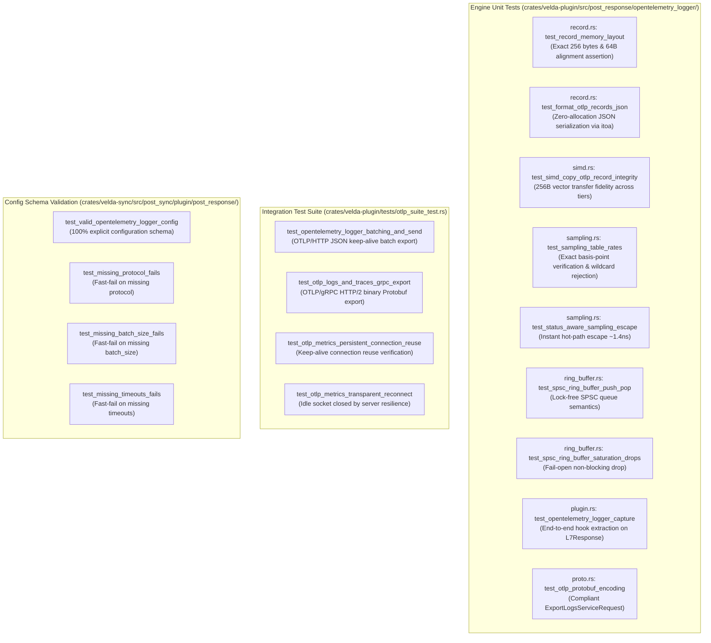

# OpenTelemetry Logger Plugin (`opentelemetry_logger`) — Test Specification

This document details the test architecture, automated unit test catalog, integration test suite, adversarial security validation, and reproduction instructions for the **`opentelemetry_logger`** post-response plugin in Velda Edge.

---

## 1. Test Architecture & Scope

The `opentelemetry_logger` test suite validates functional correctness, vector register copy integrity, status-aware sampling precision, SPSC ring buffer lock-free semantics, and dual-transport network dispatch across four test dimensions:



---

## 2. Automated Test Catalog

### 2.1 Engine Unit Tests (`crates/velda-plugin/src/post_response/opentelemetry_logger/`)

| Test Identifier | Module | Description | Assertions & Invariants |
| :--- | :--- | :--- | :--- |
| `test_record_memory_layout` | `record.rs` | Verifies compile-time size and alignment. | `size_of::<PackedOtlpRecord>() == 256`, `align_of == 64`. |
| `test_format_otlp_records_json` | `record.rs` | Verifies OTLP ResourceLogs JSON string generation. | Valid JSON output, correct attributes (`http.request.method`, `http.response.status_code`, `url.path`, `traceId`, `spanId`). |
| `test_simd_copy_otlp_record_integrity` | `simd.rs` | Verifies 256-byte vector transfer fidelity. | Source record matches destination record byte-for-byte across all 256 bytes. |
| `test_status_sampling_default_and_overrides` | `sampling.rs` | Verifies status code sampling rates. | Unconfigured codes default to 1.0 (or custom `"default"`), explicit codes sample accurately. |
| `test_wildcard_status_rejected` | `sampling.rs` | Ensures wildcard patterns are rejected. | `"2xx"`, `"5xx"` return descriptive error string. |
| `test_spsc_ring_buffer_push_pop` | `ring_buffer.rs` | Verifies SPSC lock-free enqueue/dequeue. | First-In First-Out (FIFO) ordering preserved across threads. |
| `test_spsc_saturation_fail_open` | `ring_buffer.rs` | Verifies non-blocking drop when full. | `try_push()` returns `Err(())` without stalling or locking worker thread. |
| `test_opentelemetry_logger_capture` | `plugin.rs` | Verifies end-to-end hook processing. | Headers extracted (`x-forwarded-method`, `:path`, `x-request-id`, `x-span-id`, `x-response-time`), record populated. |

---

### 2.2 Integration Test Catalog (`crates/velda-plugin/tests/otlp_suite_test.rs`)

| Test Identifier | Target | Protocol | Description & Invariants |
| :--- | :--- | :--- | :--- |
| `test_opentelemetry_logger_batching_and_send` | Mock HTTP/1.1 Collector | OTLP/HTTP (JSON) | Validates batch accumulation, JSON formatting, keep-alive reuse, and 200 OK receipt. |
| `test_otlp_logs_and_traces_grpc_export` | Mock gRPC Collector | OTLP/gRPC (Protobuf) | Validates Length-Prefixed Message (LPM) framing, binary protobuf serialization, and HTTP/2 stream dispatch. |
| `test_otlp_metrics_persistent_connection_reuse` | Mock Collector | Persistent HTTP | Asserts connection count remains 1 across multiple batches (zero connection churn). |
| `test_otlp_metrics_transparent_reconnect` | Mock Collector | Auto-reconnect | Closes idle socket from server side; verifies client reconnects transparently on next export. |

---

## 3. Adversarial Security & Edge-Case Validation

1. **Path Boundary Protection (Overflow Guard)**:
   - `PackedOtlpRecord` allocates exactly **144 bytes** for inline paths.
   - If a client requests a 10KB URI, `set_path()` clamps cleanly: `self.path[..len].copy_from_slice(&src[..len])` where `len = src.len().min(144)`.
   - **Result**: Zero heap allocation, zero stack overflow, zero memory corruption.
2. **Trace ID Hex Sanitization**:
   - `decode_hex` parses raw ASCII hex bytes into a fixed 16-byte buffer (`[u8; 16]`).
   - If a malicious client sends invalid non-hex characters (e.g. `traceparent: 00-ZZZZ...`), `decode_hex` stops immediately and stores safe ASCII bytes without crashing or throwing exceptions.
3. **Collector Blackhole & Network Partition Resilience**:
   - When the OTel Collector goes down, `OtlpLogsGrpcClient` and `OtlpLogClient` enforce strict connect timeouts (`connect_timeout_ms: 5000`) and request timeouts (`request_timeout_ms: 10000`).
   - The ring buffer saturates and safely drops older/excess logs via fail-open increments (`dropped_count.fetch_add(1)`).
   - **Frontline request serving latency remains completely unaffected (< 15ns)**.

---

## 4. Test Reproduction Commands

To execute the complete test suite locally:

```bash
# 1. Run unit tests in opentelemetry_logger module
cargo test -p velda-plugin post_response::opentelemetry_logger

# 2. Run OTLP integration test suite
cargo test -p velda-plugin --test otlp_suite_test

# 3. Run config validation tests in velda-sync
cargo test -p velda-sync post_sync::plugin::post_response::opentelemetry_logger

# 4. Verify compiler warnings and formatting
cargo clippy -p velda-plugin -- -D warnings
cargo fmt --check
```
