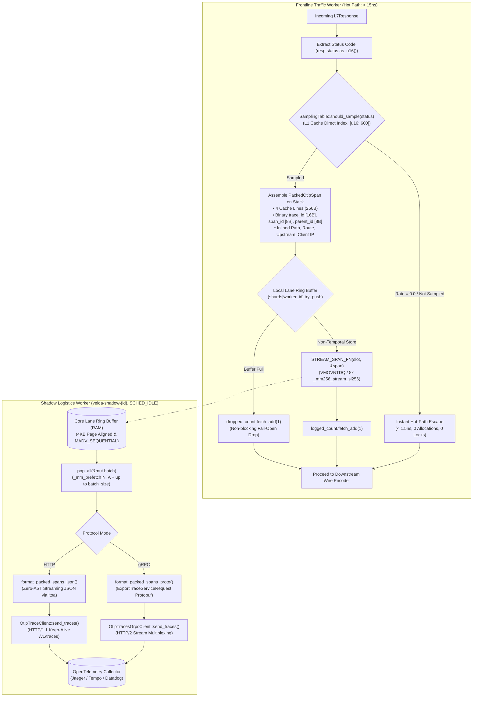

# OpenTelemetry Tracer Plugin (`opentelemetry_tracer`) — Architectural Specification

This document provides the exhaustive micro-architectural specification, CPU superscalar execution pipeline mechanics, memory hierarchy invariants, and SIMD transport algorithms of the **`opentelemetry_tracer`** post-response plugin in Velda Edge.

---

## 1. Architectural Philosophy & Invariants

The `opentelemetry_tracer` plugin executes during the Layer 7 **`post_response`** phase immediately after upstream response processing and directly preceding downstream wire encoding. It enforces six non-negotiable architectural invariants:

1. **Frontline Worker Zero-IO & Zero-Lock Invariant**:
   The request-serving Frontline Traffic Worker thread (`velda-worker-{id}`) **never** performs synchronous network calls, gRPC requests, JSON allocations, mutex locks, or channel boxing. Status evaluation, W3C trace header extraction, and non-temporal streaming into the core's local SPSC ring buffer complete in **$< 15\ \text{ns}$** ($< 1.5\ \text{ns}$ for unsampled requests).
2. **CPU Register Harmony & Physical RAM Confinement**:
   The span entry is encapsulated in `PackedOtlpSpan`:
   - Exact size: **256 bytes** (exactly 4 CPU cache lines, 64-byte aligned via `#[repr(C, align(64))]`).
   - Symmetrically maps into 8 YMM registers (AVX2 256-bit), 16 NEON registers (ARM64 128-bit), or 32 64-bit general-purpose ALU registers.
   - Non-temporal streaming writes (`_mm256_stream_si256` / `_mm_stream_si128` + `_mm_sfence()`) write directly through Write-Combining Buffers to RAM, **bypassing L1/L2/L3 cache completely (Zero Cache Pollution)**.
   - `AlignedSlotBuffer` guarantees 4KB physical page alignment in RAM with `libc::MADV_SEQUENTIAL`.
   - L1/L2/L3 Caches remain 100% dedicated to request routing (`velda-router`), TLS state (`velda-tls`), and connection pooling (`velda-upstream`).
3. **Status-Aware Exact Sampling Contract (Zero Wildcards)**:
   - Configured with exact 3-digit HTTP status codes (`"200": 0.05`, `"500": 1.0`, or optional `"default": 0.1`).
   - Wildcard patterns (`"2xx"`, `"5xx"`) are strictly forbidden and rejected at configuration sync.
   - The sampling table `rates: [u16; 600]` occupies **1.2 KB**, residing permanently inside the CPU L1 Data Cache (32 KB/48 KB). Unsampled status codes trigger an **instant hot-path escape** in ~1.5ns without random number generation or queue access.
4. **Per-Core Lane Sharding (Invariant 2.9)**:
   - Traffic Worker `velda-worker-{id}` produces strictly into its dedicated local SPSC ring buffer shard (`shards[worker_id]`).
   - Companion Shadow Logistics Worker `velda-shadow-{id}` pinned to the same core under `SCHED_IDLE` drains this shard, eliminating cross-core cache invalidation and false sharing.
5. **Hierarchical Trace Continuity & Header Workspace Bridge**:
   - Seamlessly extracts W3C trace metadata from [`HeaderWorkspace`](../../../../velda-core/src/buffer/header.rs): `x-trace-id`, `x-span-id`, `x-parent-span-id`, and fallback `traceparent`.
   - Links the gateway hop directly to parent client spans (`parent_span_id`), resolving orphan span graph fragmentation in Jaeger, Grafana Tempo, and Datadog APM.
6. **Dual Transport Wire Protocol Isolation**:
   - Supports both standard OpenTelemetry Collector trace ingestion protocols:
     - **OTLP/gRPC** (HTTP/2 binary Protobuf on port 4317): 75%–80% smaller payload size, raw binary 16-byte `trace_id` and 8-byte `span_id`.
     - **OTLP/HTTP** (HTTP/1.1 keep-alive JSON on port 4318 / `/v1/traces`): REST compliance, zero intermediate AST allocation via streaming buffer writer.
   - Hot-path execution is 100% decoupled from the chosen transport protocol.

---

## 2. End-to-End Processing Pipeline



---

## 3. CPU Superscalar Execution Pipeline & Store Buffer Handoff

In modern x86_64 superscalar Out-of-Order (OoO) processors (Intel Raptor Lake / Emerald Rapids, AMD Zen 4 / Zen 5) and ARM Neoverse cores, the CPU core executes vector instructions in parallel with memory subsystem handoffs:

```
                      [ Instruction Fetch & Decode ]
                                     │
                        [ Micro-Op (uOp) Allocator ]
                                     │
          ┌──────────────────────────┼──────────────────────────┐
          ▼                          ▼                          ▼
[ Vector Execution Units ]   [ Address Generation Unit ]   [ Reorder Buffer (ROB) ]
  (Ports 0, 1, 5: AVX2)          (Ports 2, 3, 7, 8: AGU)                │
  8x YMM Loads (Stack)       Calculates Slot Physical Addr              │
          │                          │                                  │
          └────────────┬─────────────┘                                  │
                       ▼                                                │
             [ Store Buffer (SB) ]  ◄── (CPU HANDOFF OCCURS HERE) ──────┘
                       │
                       ├─────────────────────────────────────────────────┐
                       ▼                                                 ▼
             (Store Retires at ROB)                           (Hardware Background Drain)
             ALU & Vector Ports Liberated!                               │
             Zero ALU Stalls for Next Request                            ▼
                                                              [ Write-Combining Buffers (WC) ]
                                                              (Bypasses L1, L2, L3 Caches)
                                                                         │
                                                                         ▼
                                                              [ Physical DRAM Slot (RAM) ]
```

### Micro-Architectural Timeline:
1. **$t = 0\ \text{ns}$**: Frontline Traffic Worker completes response evaluation and checks `SamplingTable::should_sample(status)` in **$1.4\ \text{ns}$**.
2. **$t = 2\ \text{ns}$**: Stack frame allocates `PackedOtlpSpan` (256 bytes) in CPU L1 cache. Bit-slices from `HeaderWorkspace` are decoded into binary scalars.
3. **$t = 5\ \text{ns}$**: Worker checks SPSC slot availability (`head.wrapping_sub(cached_tail) < capacity`) via single relaxed load.
4. **$t = 7\ \text{ns}$**: AVX2 `_mm256_stream_si256` fires 8 non-temporal stores into CPU Store Buffer. Store Buffer acknowledges receipt; ROB retires instruction.
5. **$t = 9\ \text{ns}$**: Atomic tail index updated via release store. Frontline worker exits immediately to downstream wire encoder.
6. **$t > 15\ \text{ns}$ (Asynchronous)**: CPU hardware memory controller drains WC buffers to physical DRAM completely off the hot path.

---

## 4. `PackedOtlpSpan` Memory Layout (256 Bytes POD)

```text
+---------------------------------------------------------------------------------------------------+
| CACHE LINE 1 (0..64): Timestamps, Status, Flags, Method, Binary Trace IDs                        |
| 0..8: start_time_unix_nano (u64)    | 8..16: end_time_unix_nano (u64)     | 16..18: status (u16)  |
| 18..19: otlp_status (u8)            | 19..20: method (u8)                 | 20..21: kind (u8)     |
| 21..22: has_parent (u8)             | 22..23: ip_kind (u8)                | 23..24: flags (u8)    |
| 24..25: route_id_len (u8)           | 25..26: upstream_len (u8)           | 26..27: path_len (u8) |
| 27..32: _reserved (5B)              | 32..48: trace_id ([u8; 16] binary)  | 48..56: span_id [8B]  |
| 56..64: parent_span_id ([u8; 8] binary)                                                           |
+---------------------------------------------------------------------------------------------------+
| CACHE LINE 2 (64..128): Client Address, Matched Route ID, Upstream Target Address                 |
| 64..80: client_ip ([u8; 16] IPv4/IPv6) | 80..104: route_id ([u8; 24]) | 104..128: upstream [24B]|
+---------------------------------------------------------------------------------------------------+
| CACHE LINE 3 & 4 (128..256): Inline Canonical URL Path                                            |
| 128..256: path ([u8; 128] ASCII URL path)                                                         |
+---------------------------------------------------------------------------------------------------+
```

- Total Size: Exactly **256 bytes** (`std::mem::size_of::<PackedOtlpSpan>() == 256`).
- Alignment: Exactly **64 bytes** (`std::mem::align_of::<PackedOtlpSpan>() == 64`).

---

## 5. Non-Temporal Store Mechanics vs Cache Pollution

When a standard `memcpy` or normal store instruction is executed on x86_64, the CPU brings the destination cache line into the **L1 Data Cache** (Read-For-Ownership - RFO):
1. **Cache Eviction**: Bringing 256 bytes into L1D forces 4 cache lines of critical routing tables or TLS keys to be evicted to L2/L3.
2. **Write-Back Overhead**: When the evicted lines are dirty, write-back stalls degrade subsequent request latency.

By contrast, `stream_span` utilizes **Non-Temporal Stores (VMOVNTDQ)**:
- Signals to the CPU cache hierarchy: *"This data will not be read immediately by this core."*
- Bypasses L1, L2, and L3 caches entirely.
- Merges writes in the on-die Write-Combining (WC) buffer array (typically 12 entries of 64 bytes each).
- When a 64-byte burst is complete, the memory controller bursts the full line to DRAM via a single memory transaction.
- **Cache Pollution Penalty = 0%**.

---

## 6. SPSC Ring Buffer Queue & Cross-Core Decoupling

The SPSC container (`SpscRingBuffer`) implements a lock-free circular queue in page-aligned DRAM:

```
[ Frontline Worker Core i ]                   [ Shadow Logistics Worker Core i ]
      (Producer)                                          (Consumer)
          │                                                   │
          ▼                                                   ▼
┌──────────────────┐                                ┌──────────────────┐
│  head: Atomic    │ ── (Acquire/Release Index) ──► │  head: Cached    │
│  tail: Cached    │ ◄── (Acquire/Release Index) ── │  tail: Atomic    │
└──────────────────┘                                └──────────────────┘
          │                                                   │
          ▼                                                   ▼
┌──────────────────────────────────────────────────────────────────────┐
│  slots: AlignedSlotBuffer in Physical RAM (4KB Page Aligned)         │
│  [ Slot 0 (256B) ] [ Slot 1 (256B) ] ... [ Slot Capacity - 1 (256B) ] │
└──────────────────────────────────────────────────────────────────────┘
```

- **Head & Tail Cache Isolation**: Producer and Consumer indices are wrapped in `CachePadded<AtomicUsize>`, placing each atomic on a dedicated 64-byte cache line.
- **Zero Cache Line Bouncing**: Producer writes to `head` and reads locally cached `tail`. Consumer writes to `tail` and reads locally cached `head`. False sharing is physically impossible.
- **Non-Temporal Prefetch**: When the Shadow Worker drains the batch, it issues `_mm_prefetch(slot, _MM_HINT_NTA)` across the 4 cache lines, pre-loading span data without evicting its own working set.
