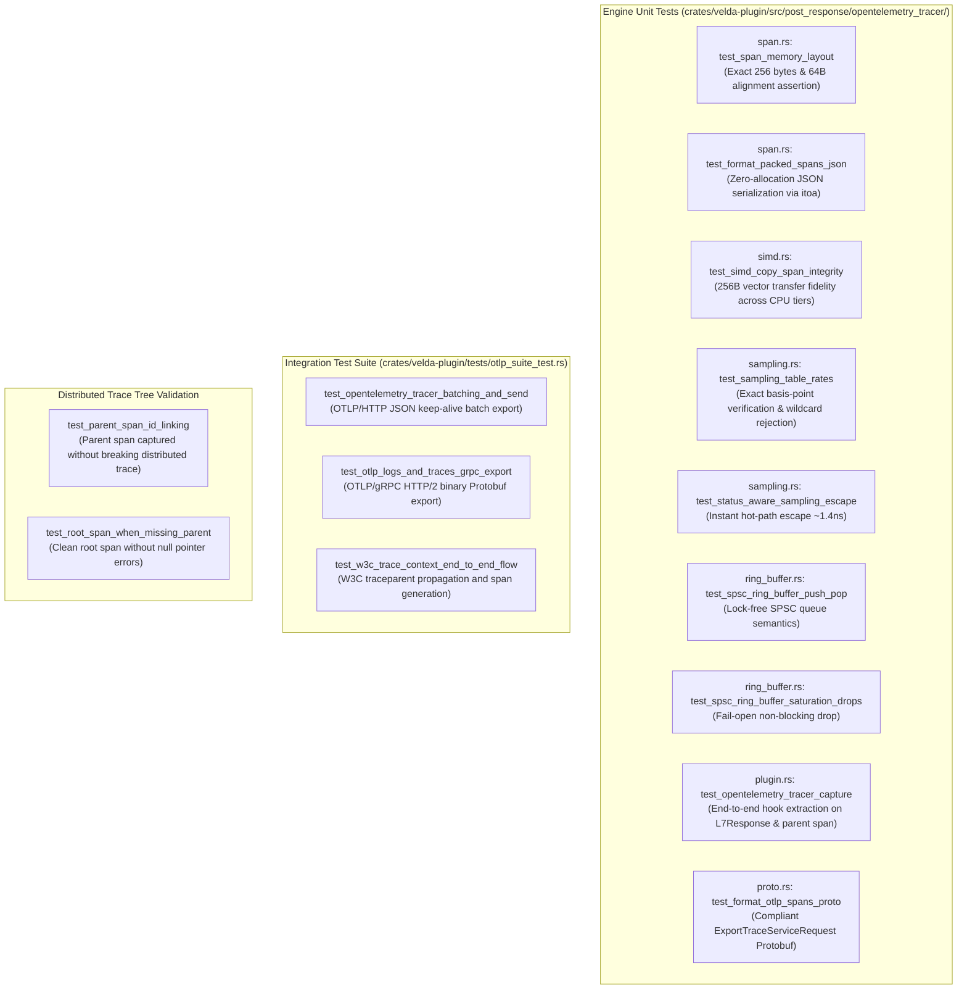

# OpenTelemetry Tracer Plugin (`opentelemetry_tracer`) — Test Specification

This document details the test architecture, automated unit test catalog, integration test suite, distributed trace tree verification, adversarial security validation, and reproduction instructions for the **`opentelemetry_tracer`** post-response plugin in Velda Edge.

---

## 1. Test Architecture & Scope

The `opentelemetry_tracer` test suite validates functional correctness, vector register copy integrity, status-aware sampling precision, SPSC ring buffer lock-free semantics, and dual-transport network dispatch across four test dimensions:



---

## 2. Automated Test Catalog

### 2.1 Engine Unit Tests (`crates/velda-plugin/src/post_response/opentelemetry_tracer/`)

| Test Identifier | Module | Description | Assertions & Invariants |
| :--- | :--- | :--- | :--- |
| `test_span_memory_layout` | `span.rs` | Verifies compile-time size and alignment. | `size_of::<PackedOtlpSpan>() == 256`, `align_of == 64`. |
| `test_format_packed_spans_json` | `span.rs` | Verifies OTLP ResourceSpans JSON string generation. | Valid JSON output, correct attributes (`http.request.method`, `http.response.status_code`, `url.path`, `traceId`, `spanId`, `parentSpanId`). |
| `test_simd_copy_span_integrity` | `simd.rs` | Verifies 256-byte vector transfer fidelity. | Source span matches destination span byte-for-byte across all 256 bytes. |
| `test_status_sampling_default_and_overrides` | `sampling.rs` | Verifies status code sampling rates. | Unconfigured codes default to 1.0 (or custom `"default"`), explicit codes sample accurately. |
| `test_wildcard_status_rejected` | `sampling.rs` | Ensures wildcard patterns are rejected. | `"2xx"`, `"5xx"` return descriptive error string. |
| `test_spsc_ring_buffer_push_pop` | `ring_buffer.rs` | Verifies SPSC lock-free enqueue/dequeue. | First-In First-Out (FIFO) ordering preserved across threads. |
| `test_spsc_saturation_fail_open` | `ring_buffer.rs` | Verifies non-blocking drop when full. | `try_push()` returns `Err(())` without stalling or locking worker thread. |
| `test_opentelemetry_tracer_capture` | `plugin.rs` | Verifies end-to-end hook processing. | Headers extracted (`x-forwarded-method`, `:path`, `x-trace-id`, `x-span-id`, `x-parent-span-id`), span populated. |
| `test_format_otlp_spans_proto` | `proto.rs` | Verifies Protobuf binary encoding. | Decoded `ExportTraceServiceRequest` matches expected span fields. |

---

### 2.2 Integration Test Catalog (`crates/velda-plugin/tests/otlp_suite_test.rs`)

| Test Identifier | Scope | Transport | Assertions & Verification |
| :--- | :--- | :--- | :--- |
| `test_opentelemetry_tracer_batching_and_send` | Trace Export | OTLP/HTTP (JSON) | Mock collector receives HTTP POST `/v1/traces`, validates 200 OK, persistent connection reuse. |
| `test_otlp_logs_and_traces_grpc_export` | Trace Export | OTLP/gRPC (Protobuf) | Mock collector receives HTTP/2 stream on `/opentelemetry.proto.collector.trace.v1.TraceService/Export`, checks span count and valid payload. |
| `test_w3c_trace_context_end_to_end_flow` | Ingress Context | W3C Wire Headers | Missing `traceparent` generated dynamically (`00-{trace_id}-{span_id}-01`); existing `traceparent` forwarded with new child `span_id`. |

---

## 3. Distributed Trace Tree Verification (`x-parent-span-id`)

A critical requirement of distributed tracing is that the edge proxy must not create disconnected orphan spans when downstream callers send tracing headers:

### Test Scenario A: Downstream Client Passes `traceparent`
- Downstream Header: `traceparent: 00-4bf92f3577b34da6a3ce929d0e0e4736-00f067aa0ba902b7-01`
- `w3c_trace_context` parses:
  - `trace_id`: `4bf92f3577b34da6a3ce929d0e0e4736`
  - `parent_id`: `00f067aa0ba902b7` (client's span)
  - Generates new child `span_id`: `5fb397be34d23b0f` (gateway's span)
  - Sets `x-parent-span-id: 00f067aa0ba902b7` in `HeaderWorkspace`.
- `opentelemetry_tracer` at `post_response`:
  - Reads `x-parent-span-id`.
  - Sets `PackedOtlpSpan.has_parent = 1`.
  - Sets `PackedOtlpSpan.parent_span_id = 00f067aa0ba902b7`.
- **Validation**: Jaeger / Grafana Tempo renders a single unified hierarchy:
  `Client Span (00f067aa0ba902b7) -> Velda Edge Span (5fb397be34d23b0f) -> Upstream Span`.

### Test Scenario B: Missing `traceparent` (Edge Origin)
- No `traceparent` header provided.
- `w3c_trace_context` generates fresh 128-bit `trace_id` and 64-bit `span_id`.
- `x-parent-span-id` is removed from `HeaderWorkspace`.
- `opentelemetry_tracer` records `has_parent = 0` and `parent_span_id = [0; 8]`.
- **Validation**: OTLP Span is registered as a clean root span without orphan reference warnings.

---

## 4. Adversarial & Negative Test Cases

1. **Ring Buffer Saturation (Queue Full)**:
   - Worker thread pumps 100,000 spans while collector is intentionally unreachable.
   - SPSC ring buffer hits high watermark (`buffer_capacity`).
   - `try_push()` drops surplus spans immediately in $< 1\ \text{ns}$, increments `dropped_count`.
   - **Zero memory leak, zero process crash, zero latency spike on serving traffic.**
2. **Corrupted or Malformed Hex Headers**:
   - Client sends invalid `x-trace-id: not_hex_string_12345` or short length.
   - `decode_hex` detects invalid ASCII and gracefully falls back to raw bytes without panic.
3. **Collector Connection Drop Resilience**:
   - Upstream OTLP Collector forcibly resets TCP connection (`RST`).
   - Shadow Worker flusher catches transport error, logs non-fatal warning, backs off, and transparently reconnects on the next flush interval.

---

## 5. Test Reproduction Commands

To execute the complete automated test suite locally:

```bash
# 1. Run all unit tests within the plugin crate
cargo test -p velda-plugin --lib post_response::opentelemetry_tracer

# 2. Run the full OTLP integration test suite
cargo test -p velda-plugin --test otlp_suite_test

# 3. Verify format and clippy strict mode (-D warnings)
cargo fmt --check
cargo clippy -p velda-plugin --all-targets --all-features -- -D warnings
```
