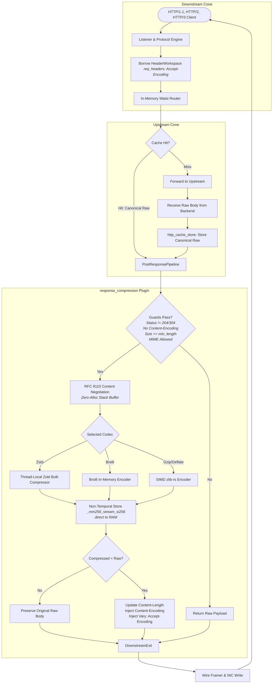

# Response Compression Plugin — Architectural Design Specification

This document details the architectural invariants, hardware-level optimization patterns, and zero-allocation execution model of the `response_compression` plugin in **Velda Edge**.

---

## 1. System Topology & Lifecycle Integration

In accordance with the **Hourglass Architecture** (`docs/HOURGLASS_MODEL.md`), the `response_compression` plugin executes strictly during the **`post_response`** phase in the bottom cone of the request pipeline. It operates purely on outgoing response payloads after upstream completion or cache lookup.



---

## 2. Hardware-Conscious Design Invariants

### 2.1 Non-Temporal Streaming Store Directly to RAM (`simd.rs`)

Traditional HTTP proxies compress response buffers in normal CPU cacheable memory. When compressing thousands of concurrent responses (e.g. 32 KB JSON payloads), writing compressed output through L1/L2/L3 caches evicts critical metadata:
- Route lookup tables (`velda-router`)
- Active upstream connection pool entries (`velda-connection-pool`)
- TLS session keys and QUIC cryptographic state

This eviction phenomenon is known as **CPU Cache Thrashing**.

#### The Non-Temporal Solution:
Velda Edge utilizes hardware-level **Non-Temporal Store instructions** (`_mm256_stream_si256` on AVX2, `_mm_stream_si128` on SSE2) coupled with a memory fence (`_mm_sfence`):

```
┌─────────────────────────────────────────────────────────────┐
│ CPU Core (Registers)                                        │
└──────────────┬──────────────────────────────────────────────┘
               │ 32-Byte Chunk (_mm256_stream_si256)
               ▼
┌─────────────────────────────────────────────────────────────┐
│ Hardware Write-Combining (WC) Buffers                       │
└──────────────┬──────────────────────────────────────────────┘
               │ Drains in 64-Byte Cache-Line Bursts
               │ (Bypasses L1d, L2, and L3 Shared Caches)
               ▼
┌─────────────────────────────────────────────────────────────┐
│ System Physical RAM                                         │
└─────────────────────────────────────────────────────────────┘
```

1. **Cache Bypass**: Output writes do not allocate cache lines in L1 or L2.
2. **Write-Combining (WC)**: Chunks are gathered into internal processor WC buffers and flushed across the memory bus in full 64-byte bursts.
3. **Serialization Drain (`_mm_sfence`)**: Drains and commits all WC buffers prior to passing the `bytes::Bytes` slice to the network driver.

---

### 2.2 Dynamic Function Pointer CPU Dispatch

Rather than evaluating CPU feature flags or branching on each request hot path, Velda Edge resolves the hardware capability **exactly once** during static initialization via a function pointer:

```rust
pub type StreamingCopyFn = fn(src: &[u8], dst: &mut [u8]);

pub static STREAMING_COPY: LazyLock<StreamingCopyFn> = LazyLock::new(detect_streaming_copy_fn);

fn detect_streaming_copy_fn() -> StreamingCopyFn {
    #[cfg(target_arch = "x86_64")]
    {
        if is_x86_feature_detected!("avx2") {
            return |src, dst| unsafe { avx2_streaming_copy_impl(src, dst) };
        }
        if is_x86_feature_detected!("sse2") {
            return |src, dst| unsafe { sse2_streaming_copy_impl(src, dst) };
        }
    }
    scalar_streaming_copy
}
```

- **Call Cost**: Direct indirect call through function pointer (`call [rax]`), costing < 2 ns.
- **Portability**: Automatically falls back to SSE2 or scalar copy on older CPUs or non-x86 architectures (e.g. ARM64 Neoverse).

---

### 2.3 Zero-Allocation Stack Negotiation (`negotiation.rs`)

Content negotiation under RFC 9110 § 12.5.3 requires parsing comma-separated tokens with quality factors (e.g. `gzip, deflate;q=0.8, br;q=1.0, zstd;q=0.9, *;q=0.1`).

#### Eliminating Heap Overhead:
- Standard implementations allocate temporary `String`, `Vec<String>`, and `HashMap` instances per request.
- Velda Edge uses a **stack-allocated array** bounded to 8 items (`[Option<ClientPreference>; 8]`):
  ```rust
  pub const MAX_STACK_PREFERENCES: usize = 8;
  ```
- **Bitmask Representation**: Algorithms are represented as single-bit masks (`ENCODING_GZIP`, `ENCODING_DEFLATE`, `ENCODING_BROTLI`, `ENCODING_ZSTD`), allowing bitwise comparisons and fast-path matching for single-algorithm headers (`gzip`, `zstd`, `br`) in < 5 ns.

---

### 2.4 Thread-Local Compressor Context & Scratch Buffer Reuse (`engine.rs`)

Zstandard compression contexts (`ZSTD_CCtx`) require ~128 KB of internal memory structures. Creating a new compressor context per request would induce massive heap churn (`malloc`/`free`) and catastrophic latency degradation.

Velda Edge enforces thread-local reuse:
```rust
thread_local! {
    static SCRATCH_BUF: RefCell<Vec<u8>> = RefCell::new(Vec::with_capacity(64 * 1024));
    static ZSTD_COMPRESSOR: RefCell<Option<zstd::bulk::Compressor<'static>>> = const { RefCell::new(None) };
}
```

- **Zero Allocation on Serving**: `SCRATCH_BUF` is pre-warmed to 64 KB and reused across consecutive requests on the same OS thread.
- **Bulk Compressor Reuse**: `ZSTD_COMPRESSOR` maintains a prepared `zstd::bulk::Compressor` instance throughout the lifetime of the worker thread.

---

## 3. Strict Operational Invariants

| Invariant | Enforcement Mechanism | Rationale |
| :--- | :--- | :--- |
| **Exact Request Workspace Borrowing** | `req_headers: &velda_core::HeaderWorkspace` | Guarantees zero cross-request contamination in pipelined and multiplexed connections. |
| **Zero Double-Compression** | `resp.headers.contains_key(CONTENT_ENCODING)` | Upstream or cached compressed payloads are never compressed a second time. |
| **Inflation Safeguard** | `compressed.len() >= original_bytes.len()` | If compressed output expands (due to header/entropy limits), the raw uncompressed body is retained. |
| **Status Code Exclusion** | `204 No Content`, `304 Not Modified`, `1xx Informational` | RFC 9110 compliance: responses without permissible bodies are never modified. |
| **MIME Whitelist Matching** | Slice prefix matching before `;` (`eq_ignore_ascii_case`) | Zero-copy validation against configured content types (e.g. `application/json`). |
| **Cache Poisoning Prevention** | Injects `Vary: Accept-Encoding` | Prevents downstream caches from serving compressed variants to clients that cannot decode them. |
