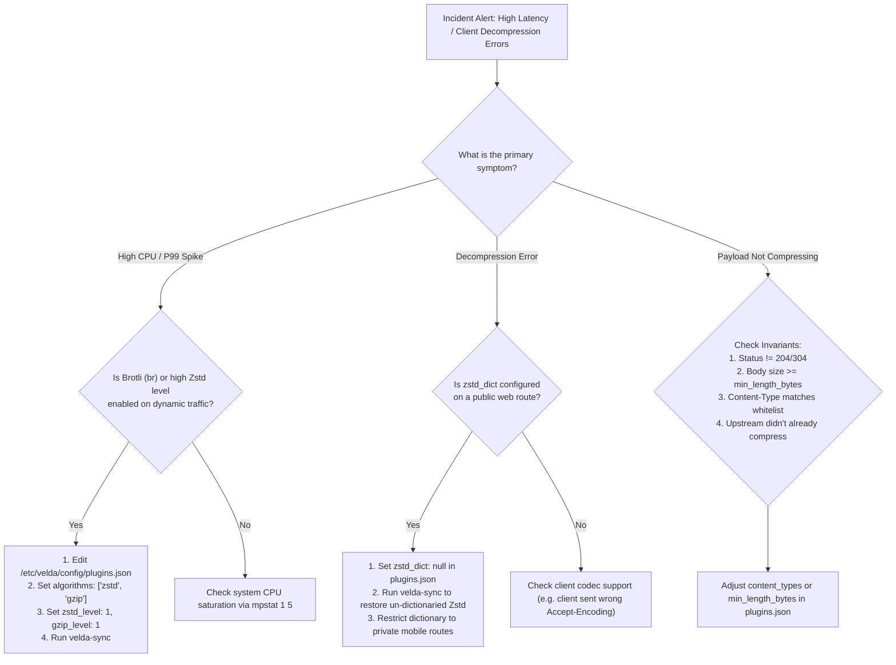

# Response Compression Plugin (`response_compression`) — SRE Operational Runbook

This document is the incident response and operational guide (**SRE On-Call Runbook**) for engineers managing HTTP response compression on Velda Edge Gateway clusters.

---

## 1. Incident Triage Matrix

| Severity | Symptoms & Alerts | Probable Cause | Immediate Remediation (Mitigation) | SLA |
| :---: | :--- | :--- | :--- | :---: |
| **P0** | Gateway P99 latency spikes dramatically (> 50 ms), CPU pinned at 100% | High-overhead codec (e.g. Brotli level > 3) enabled on high-throughput route | Hot-reload `plugins.json`: remove `"br"` from `algorithms` or prioritize `"zstd"` | **< 5 min** |
| **P1** | Mobile or external clients report `Dictionary mismatch` or `Corrupted payload` | `zstd_dict` enabled on route serving clients without matching dictionary | Revert `"zstd_dict": null` in `plugins.json`, run `velda-sync` | **< 15 min** |
| **P2** | Responses are served uncompressed despite client sending `Accept-Encoding` | Status 204/304, body < `min_length_bytes`, non-matching MIME, or upstream already compressed | Check `curl -i` response headers: `content-type`, `content-encoding`, payload size | **< 30 min** |
| **P3** | Downstream CDN serves compressed body to clients lacking decompression capability | Missing or stripped `Vary: Accept-Encoding` header by intermediate proxy | Verify CDN cache configuration; ensure `Vary` header is preserved | **< 2 hours** |

---

## 2. Incident Triage Flowchart



---

## 3. Diagnostic CLI Toolkit

When on-call, SSH to the impacted Velda Edge node and execute the following checks:

### 3.1 Verify Live Compression Negotiation
```bash
# Test Zstandard compression
curl -s -i -H "Accept-Encoding: zstd" http://127.0.0.1:80/api/v1/health | head -n 12

# Test Gzip compression
curl -s -i -H "Accept-Encoding: gzip" http://127.0.0.1:80/api/v1/health | head -n 12

# Test Brotli compression
curl -s -i -H "Accept-Encoding: br" http://127.0.0.1:80/api/v1/health | head -n 12
```

**Expected Headers**:
```http
HTTP/1.1 200 OK
content-type: application/json
content-encoding: zstd
vary: Accept-Encoding
content-length: <compressed_size>
```

### 3.2 Verify Active Configuration in Runtime Memory
Inspect `/etc/velda/config/plugins.json` on the node:
```bash
jq '.plugins[] | select(.id == "response_compression" or .plugin == "response_compression")' /etc/velda/config/plugins.json
```

### 3.3 Check Kernel CPU Breakdown
```bash
# Monitor User vs System vs SoftIRQ
mpstat 1 5
```
*Assessment*:
- If `%usr` is > 60%: Codec level is too high for current throughput. Lower `zstd_level` to `1` or `gzip_level` to `1`.
- If `%softirq` is > 40%: High packet volume. Compressing payloads will actually **reduce** network interrupts by shrinking wire bytes.

---

## 4. Emergency Configuration Changes (Runbook Procedures)

### 4.1 Emergency Dictionary Rollback
If clients report corrupted payloads due to dictionary mismatch:

1. Edit `/etc/velda/config/plugins.json`:
   ```json
   {
     "id": "edge_compression",
     "plugin": "response_compression",
     "config": {
       "algorithms": ["zstd", "br", "gzip"],
       "min_length_bytes": 256,
       "gzip_level": 1,
       "brotli_level": 2,
       "zstd_level": 1,
       "zstd_dict": null,
       "content_types": ["application/json", "text/"]
     }
   }
   ```
2. Recompile and sync runtime artifact:
   ```bash
   VELDA_STORAGE_DIR=/var/lib/velda timeout 3 /usr/local/bin/velda-sync
   sudo systemctl restart velda-edge.service
   ```
3. Verify un-dictionaried Zstd is now serving:
   ```bash
   curl -s -i -H "Accept-Encoding: zstd" http://127.0.0.1:80/api/v1/test | grep -i "content-encoding"
   ```

### 4.2 Emergency CPU Relief (Disable Brotli)
If CPU saturation occurs during traffic spikes:
1. Update `algorithms` in `plugins.json` to prioritize Zstandard and Gzip only:
   ```json
   "algorithms": ["zstd", "gzip"]
   ```
2. Re-sync with `velda-sync` and restart service.
