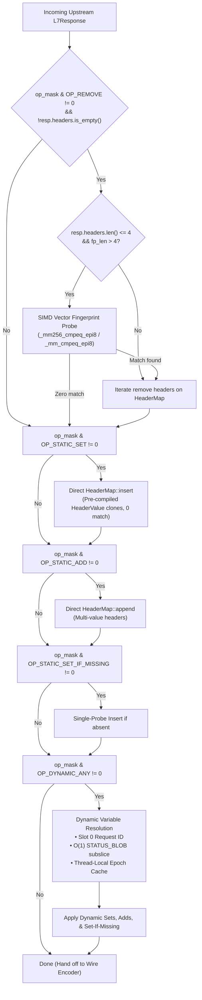
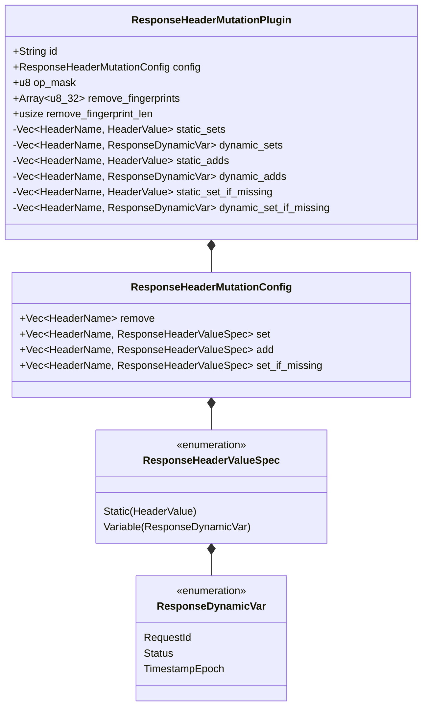

# Response Header Mutation Plugin (`response_header_mutation`) — Architectural Specification

This document details the internal architecture, zero-allocation data structures, single-instruction ALU bitmasks, SIMD vector-probed fingerprint filtering, and compile-time arithmetic status resolution of the **`response_header_mutation`** post-response plugin in Velda Edge.

---

## 1. Architectural Philosophy & Invariants

The `response_header_mutation` plugin executes during the Layer 7 **`post_response`** phase immediately after receiving an upstream `L7Response` and directly preceding downstream wire encoding. It modifies response headers in-place on the worker hot path, enforcing six core architectural invariants:

1. **Single-Instruction ALU Configuration Bitmask (`op_mask: u8`)**:
   Active mutation phases (`OP_REMOVE`, `OP_STATIC_SET`, `OP_STATIC_ADD`, `OP_STATIC_SET_IF_MISSING`, `OP_DYNAMIC_SET`, `OP_DYNAMIC_ADD`, `OP_DYNAMIC_SET_IF_MISSING`) are compiled into a compact 8-bit integer bitmask. On the hot path, CPU superscalar execution gates each step via a single machine instruction (`TEST AL, imm8`), eliminating heap pointer dereferencing and length branching over empty vectors.
2. **SIMD Vector-Probed Fingerprint Filter (SwissTable Technique)**:
   Configured header removal targets are hashed into 1-byte fingerprints packed into an aligned 32-byte array (`remove_fingerprints: [u8; 32]`). Responses with few headers (e.g. 2–3 headers) are evaluated in parallel using AVX2 (`_mm256_cmpeq_epi8` + `_mm256_movemask_epi8`) or SSE2 (`_mm_cmpeq_epi8`), bypassing linear removal scans when zero targets match.
3. **Arithmetic Workspace Deferral (`HeaderWorkspace`)**:
   Dynamic variables (`$request_id`, `$status`, `$timestamp_epoch`) are written as raw hardware integers (`u128`, `u16`, `u64`) directly into `resp.headers` (`set_hex128`, `set_status`, `set_u64`), deferring string materialization to the single batch `HeaderWorkspace::render()` pass at the end of the plugin phase.
4. **Zero-Allocation Coarse Epoch Read (`ingress_time_sec: u64`)**:
   Under high traffic load, `$timestamp_epoch` reads the pre-populated `req_headers.ingress_time_sec` (1 Hz background coarse clock) directly in $\le 0.5$ ns with zero clock syscalls and zero intermediate string formatting.
5. **In-Place Hot-Path Mutation**:
   Modifies outgoing `L7Response.headers` directly via mutable reference without cloning the response body, headers container, or allocating intermediary objects.
6. **Zero Automatic Overwrites**:
   Velda Edge never silently injects or removes headers without explicit declarative configuration in `plugins.json`.

---

## 2. End-to-End Response Hot-Path Pipeline



---

## 3. Subsystem Architecture & Memory Layout



---

## 4. Hardware Optimization Details

### 4.1 Single-Instruction ALU Bitmask Gating
Instead of checking `!self.config.remove.is_empty()` and dereferencing heap pointers across 7 vectors:
```rust
if (self.op_mask & OP_REMOVE) != 0 { ... }
if (self.op_mask & OP_STATIC_SET) != 0 { ... }
if (self.op_mask & OP_STATIC_ADD) != 0 { ... }
if (self.op_mask & OP_STATIC_SET_IF_MISSING) != 0 { ... }
if (self.op_mask & OP_DYNAMIC_ANY) != 0 { ... }
```
When a phase is inactive, the CPU evaluates the condition in **$\le 0.3$ ns (`test al, imm8`)**, saturating superscalar execution units.

### 4.2 SIMD SwissTable-Style Fingerprint Matching
Header names are hashed to an 8-bit fingerprint:
$$\text{FP}(h) = (\text{len} \times 37) \oplus h[0] \oplus h[\text{len}-1]$$
Configured removal targets are stored in a 32-byte vector. Under AVX2, evaluating whether an incoming header exists in the removal list executes via a broadcast and comparison in a single instruction:
```rust
let v_target = _mm256_set1_epi8(target as i8);
let v_fps = _mm256_loadu_si256(fingerprints.as_ptr() as *const __m256i);
let mask = _mm256_movemask_epi8(_mm256_cmpeq_epi8(v_fps, v_target)) as u32;
```
If `mask == 0`, the header is guaranteed not in the removal list, avoiding redundant hash map probing.

### 4.3 Compile-Time $O(1)$ HTTP Status String Table
All 500 standard HTTP codes (100..=599) are packed into a 1,500-byte static string slice generated at compile time:
```rust
const fn generate_status_blob() -> [u8; 1500] { ... }
static STATUS_BLOB_BYTES: [u8; 1500] = generate_status_blob();
```
Resolving `$status` calculates the exact slice offset via integer arithmetic:
```rust
let offset = ((code - 100) as usize) * 3;
let s = &STATUS_BLOB[offset..offset + 3];
HeaderValue::from_static(s)
```
This achieves zero branching, zero allocation, and zero latency jitter across all standard HTTP response codes.

---

## 5. Hot-Path Complexity & Performance Invariants

| Operation | Complexity | Memory Allocation | Hot-Path Description |
| :--- | :---: | :---: | :--- |
| **`remove`** | $O(N_{\text{remove}})$ or $O(1)$ SIMD | 0 bytes | Probed via 32-entry SIMD vector filter or amortized $O(1)$ lookup in `HeaderMap::remove`. |
| **`static_sets`** | $O(N_{\text{set\_static}})$ | 0 bytes | Amortized $O(1)$ atomic reference clone and table insertion. |
| **`static_adds`** | $O(N_{\text{add\_static}})$ | 0 bytes | Appends to existing multi-value header list via `HeaderMap::append`. |
| **`static_set_if_missing`** | $O(N_{\text{missing\_static}})$ | 0 bytes | Single presence check prior to insertion. |
| **`dynamic_sets` / `adds`** | $O(N_{\text{dynamic}})$ | 0 bytes | Resolves W3C Slot 0 Request ID, $O(1)$ status table, or thread-local epoch cache. |
