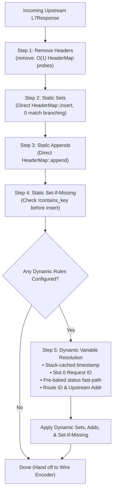
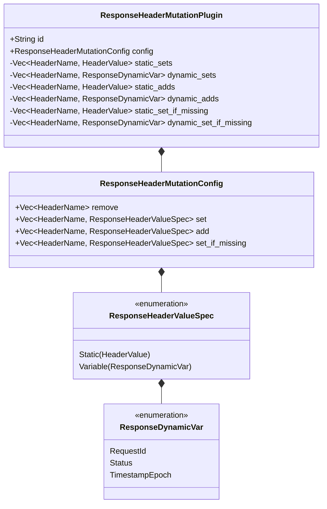

# Response Header Mutation Plugin (`response_header_mutation`) — Architectural Specification

This document details the internal architecture, zero-allocation data structures, pre-partitioned memory layout, and response transformation pipeline of the **`response_header_mutation`** post-response plugin in Velda Edge.

---

## 1. Architectural Philosophy & Invariants

The `response_header_mutation` plugin executes during the Layer 7 **`post_response`** phase immediately after receiving an upstream `L7Response` and directly preceding downstream wire encoding. It modifies response headers in-place on the worker hot path, enforcing five core architectural invariants:

1. **In-Place Hot-Path Mutation**:
   Modifies outgoing `L7Response.headers` directly via mutable reference without cloning the response body, headers container, or allocating intermediary objects.
2. **Pre-Partitioned Static & Dynamic Memory Layout**:
   Header rules are segregated into dedicated vectors at configuration load time:
   - `static_sets` vs `dynamic_sets`
   - `static_adds` vs `dynamic_adds`
   - `static_set_if_missing` vs `dynamic_set_if_missing`
   Static header entries are inserted/appended directly into `HeaderMap` with **0 runtime enum matches** and **0 dynamic variable checks**.
3. **Pre-Baked HTTP Status Code Fast-Path**:
   Standard HTTP status codes (`200`, `201`, `204`, `301`, `302`, `304`, `400`, `401`, `403`, `404`, `500`, `502`, `503`, `504`) are pre-baked as immutable static `HeaderValue` slices (`HeaderValue::from_static("200")`), eliminating string allocations and formatting overhead when resolving `$status`.
4. **Stack-Cached Dynamic Variables**:
   Dynamic evaluation resolves `$timestamp_epoch` once per response using a stack-allocated `itoa::Buffer`, caching the resulting `HeaderValue` on the stack for reuse across multiple header targets. Authoritative metadata (`$request_id`, `$route_id`, `$upstream_addr`) are propagated directly from `HeaderWorkspace` or response tracking tags.
5. **100% Lock-Free Serving**:
   Request workers read immutable plugin configuration without acquiring mutexes or atomic locks, maintaining deterministic single-digit nanosecond execution overhead.

---

## 2. End-to-End Response Hot-Path Pipeline

---

## 3. Subsystem Architecture & Memory Layout

---

## 4. Hot-Path Complexity & Performance Invariants

| Operation | Complexity | Memory Allocation | Hot-Path Description |
| :--- | :---: | :---: | :--- |
| **`remove`** | $O(N_{\text{remove}})$ | 0 bytes | Amortized $O(1)$ lookup per header in `HeaderMap::remove`. |
| **`static_sets`** | $O(N_{\text{set\_static}})$ | 0 bytes | Amortized $O(1)$ atomic reference clone and table insertion. |
| **`static_adds`** | $O(N_{\text{add\_static}})$ | 0 bytes | Appends to existing multi-value header list via `HeaderMap::append`. |
| **`static_set_if_missing`** | $O(N_{\text{missing\_static}})$ | 0 bytes | Presence test via `HeaderMap::contains_key` prior to insertion. |
| **`dynamic_sets` / `adds`** | $O(N_{\text{dynamic}})$ | 0 bytes (Status / Metadata) Stack-cached (Timestamp) | Resolves W3C Slot 0 Request ID or pre-baked static status strings. |
