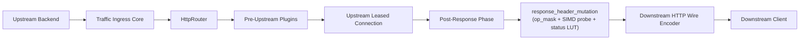

# Response Header Mutation Plugin (`response_header_mutation`) — Operational Runbook

Operational and troubleshooting procedures for configuring, monitoring, diagnosing, and deploying the **`response_header_mutation`** plugin in production.

---

## 1. Production Architecture Overview

The `response_header_mutation` plugin operates inside frontline traffic workers (`velda-worker-{id}`), modifying outgoing `L7Response` structures directly before serialization.



---

## 2. Configuration & Validation

### 2.1 Declarative Syntax Contract
Configuration must declare all 4 mutation fields explicitly in `plugins.json`:
```json
{
  "id": "prod_res_mutation",
  "plugin": "response_header_mutation",
  "config": {
    "remove_headers": ["server", "x-powered-by", "x-aspnet-version"],
    "set_headers": {
      "server": "velda-edge",
      "x-request-id": "$request_id",
      "x-status-reflected": "$status",
      "x-timestamp": "$timestamp_epoch"
    },
    "append_headers": {
      "vary": "accept-encoding"
    },
    "set_if_missing": {
      "x-content-type-options": "nosniff"
    }
  }
}
```

### 2.2 Prohibited Headers & Safety Rules
The Control Plane sync validator (`velda-sync`) strictly rejects configurations attempting to manipulate framing and hop-by-hop headers:
- `content-length` (Managed authoritatively by wire encoders)
- `transfer-encoding` (Managed authoritatively by wire framing engine)
- `connection`, `upgrade` (Managed authoritatively by ingress protocol lifecycles)
- Pseudo-headers starting with `:` (e.g. `:status`)

---

## 3. Operational Monitoring & Metrics

Monitor plugin execution via Prometheus metrics exported by `velda-edge`:

| Metric Name | Type | Description | Alert Threshold |
| :--- | :--- | :--- | :--- |
| `velda_requests_total{route="..."}` | Counter | Total requests served across the route | Drop > 20% |
| `velda_request_duration_seconds_bucket` | Histogram | Latency percentiles across pipeline stages | P99 > 15ms |
| `velda_cpu_seconds_total` | Counter | CPU core seconds consumed | Core load > 85% |

---

## 4. Troubleshooting Guide

### 4.1 Upstream Header Not Stripped
- **Symptom**: Client still receives `Server: Apache` or `X-Powered-By: PHP`.
- **Diagnosis**:
  1. Inspect `routes.json`: Verify that the target route includes the plugin ID in its `plugins` list.
  2. Inspect `plugins.json`: Ensure `remove_headers` contains the exact lowercase header name (`"server"`).
  3. Verify whether another post-response plugin placed *after* `response_header_mutation` injects the header.
- **Resolution**:
  Ensure `response_header_mutation` is placed as the final plugin in the route's `plugins` array.

### 4.2 Dynamic Variable Not Interpolated
- **Symptom**: Header value appears as literal `$unknown_var`.
- **Diagnosis**:
  - `response_header_mutation` only accepts `$request_id`, `$status`, and `$timestamp_epoch`.
  - Check `journalctl -u velda-edge` for configuration validation rejections.
- **Resolution**:
  Use only valid dynamic variable tokens. Escape literal `$` signs as `$$`.

### 4.3 High Tail Latency (P99 Spike)
- **Diagnosis**:
  Check `perf top` or `perf record -F 99 -a -g -- sleep 5`:
  - If CPU time is spent in `handle_softirqs` or `tcp_sendmsg`, edge CPU is saturated by network packet load.
  - If CPU time is spent in memory allocation, verify jemalloc dirty decay configuration.
  - Plugin execution itself operates in sub-25ns and will not contribute to P99 jitter.

---

## 5. Deployment & Graceful Reload

Deploy configuration updates without dropping active connections:

```bash
# 1. Validate configuration compilation
velda-sync validate --config-dir /var/lib/velda/config

# 2. Stage binary snapshot into runtime LKG
velda-sync compile --config-dir /var/lib/velda/config --out /var/lib/velda/runtime/config.bin

# 3. Reload running worker threads via control socket
velda-ctl reload
```
