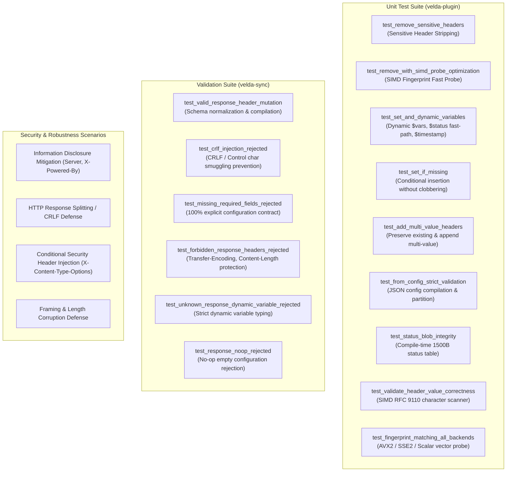

# Response Header Mutation Plugin (`response_header_mutation`) — Test Specification

This document details the test architecture, automated unit test catalog, adversarial security validation, and live verification reproduction for the **`response_header_mutation`** post-response plugin.

---

## 1. Test Architecture & Scope

The `response_header_mutation` test suite covers four essential functional, hardware-acceleration, and security dimensions:



---

## 2. Automated Test Catalog

### 2.1 Plugin Engine Suite (`crates/velda-plugin/src/post_response/response_header_mutation/`)

| Test Function | Source Module | Purpose | Key Assertions |
| :--- | :--- | :--- | :--- |
| `test_remove_sensitive_headers` | `plugin.rs` | Sensitive header stripping | Removes `x-powered-by` and `server`; preserves unrelated response headers. |
| `test_remove_with_simd_probe_optimization` | `plugin.rs` | SIMD fingerprint filter | Skips linear removal scan when zero response headers match fingerprint vector. |
| `test_set_and_dynamic_variables` | `plugin.rs` | Static set and dynamic variable resolution | Resolves `$request_id`, `$status` (`"201"`), and `$timestamp_epoch`. |
| `test_set_if_missing` | `plugin.rs` | Conditional insertion | Injects `x-content-type-options: nosniff` when missing; retains upstream value when present. |
| `test_add_multi_value_headers` | `plugin.rs` | Multi-value header appending | Appends `vary: Accept-Encoding` without overwriting existing `vary` entries. |
| `test_from_config_strict_validation` | `plugin.rs` | Configuration loading and partitioning | Pre-partitions static vs dynamic sets, adds, and set-if-missing rules. |
| `test_status_blob_integrity` | `var.rs` | Compile-time status table | Verifies 1,500-byte buffer correctly resolves all standard status codes 100..=599. |
| `test_validate_header_value_correctness` | `simd.rs` | RFC 9110 character validation | Validates acceptable chars; rejects CRLF, null, DEL, and control characters. |
| `test_fingerprint_matching_all_backends` | `simd.rs` | SIMD fingerprint matching | Validates AVX2, SSE2, and scalar fingerprint matching correctness. |

### 2.2 Sync Validation Suite (`crates/velda-sync/src/post_sync/plugin/post_response/response_header_mutation.rs`)

| Test Function | Purpose | Key Assertions |
| :--- | :--- | :--- |
| `test_valid_response_header_mutation` | Configuration normalization | Successfully validates and parses full response mutation manifest. |
| `test_crlf_injection_rejected` | HTTP Response Splitting defense | Rejects values containing `\r\n` or unprintable characters. |
| `test_missing_required_fields_rejected` | 100% explicit configuration invariant | Rejects configurations missing mandatory fields (`remove_headers`, `set_headers`, etc.). |
| `test_forbidden_response_headers_rejected` | Framing header protection | Rejects stripping or overriding `content-length` or `transfer-encoding`. |
| `test_unknown_response_dynamic_variable_rejected` | Dynamic variable validation | Rejects unsupported variables like `$unknown_var`. |
| `test_response_noop_rejected` | No-op configuration prevention | Rejects configurations where all transformation lists are empty. |

---

## 3. Security & Anti-Evasion Scenarios

### Scenario 1: Information Disclosure Defense
- **Threat**: Upstream backends often emit server version headers (`Server: Apache/2.4.41`, `X-Powered-By: PHP/7.4.3`) that reveal internal software stacks to attackers.
- **Mitigation**: `remove_headers` strips these tokens in $O(1)$ amortized time before the response leaves the edge.

### Scenario 2: HTTP Response Splitting & CRLF Defense
- **Threat**: An attacker attempts to inject newline characters (`\r\nSet-Cookie: admin=1`) into response headers via configuration or reflection.
- **Mitigation**: `velda-sync` and `simd.rs` validate every header string against RFC 9110 printable ASCII requirements (`0x20..=0x7E`), rejecting control characters at compile time and runtime.

### Scenario 3: Conditional Security Header Injection
- **Threat**: Forcing hard overwrite of security headers can break upstream applications that supply specialized `Content-Security-Policy` or `Cache-Control` headers.
- **Mitigation**: `set_if_missing` injects standard baseline policies only when the upstream has omitted them, preserving application-level overrides.

---

## 4. Running Test Suites

Execute test suites via Cargo:

```bash
# Run unit tests for response_header_mutation plugin
cargo test -p velda-plugin --lib post_response::response_header_mutation

# Run sync validator tests for response_header_mutation
cargo test -p velda-sync --lib post_sync::plugin::post_response::response_header_mutation
```
