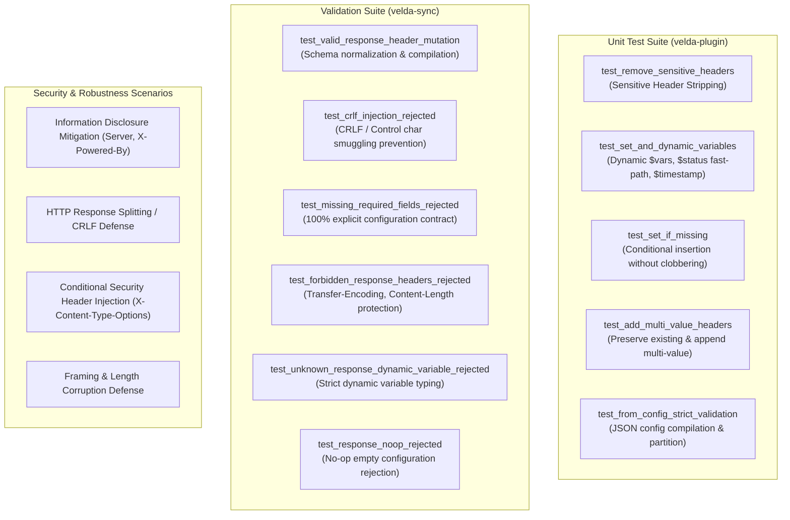

# Response Header Mutation Plugin (`response_header_mutation`) — Test Specification

This document details the test architecture, automated unit test catalog, adversarial security validation, and live verification reproduction for the **`response_header_mutation`** post-response plugin.

---

## 1. Test Architecture & Scope

The `response_header_mutation` test suite covers four essential functional and security dimensions:



1. **Information Disclosure Prevention & Header Stripping**:
   - Ensures upstream fingerprinting headers (`Server`, `X-Powered-By`, `X-AspNet-Version`) are removed prior to transmitting response frames to downstream clients.
2. **Dynamic Runtime Variable Interpolation**:
   - Validates resolution of `$request_id` (Slot 0 W3C request identifier), `$status` (numeric string), and `$timestamp_epoch` (Unix timestamp).
   - Validates that `$status` utilizes pre-baked static slices for common codes (`200`, `404`, `500`, etc.) without heap allocations.
3. **Conditional Header Insertion (`set_if_missing`)**:
   - Validates that default security headers (e.g. `X-Content-Type-Options: nosniff`) are injected only when the upstream backend did not already specify them.
4. **Declarative Synchronization & Defense-in-Depth (`velda-sync`)**:
   - Rejection of CRLF (`\r`, `\n`) or null bytes in header names or values to neutralize HTTP Response Splitting.
   - Rejection of manipulations targeting forbidden protocol framing headers (`Content-Length`, `Transfer-Encoding`, `Connection`).
   - Rejection of unrecognized dynamic variable tokens.
   - Rejection of empty or no-op configurations.

---

## 2. Automated Test Catalog

### 2.1 Plugin Engine Suite (`crates/velda-plugin/src/post_response/response_header_mutation/plugin.rs`)

| Test Function | Purpose | Key Assertions |
| :--- | :--- | :--- |
| `test_remove_sensitive_headers` | Sensitive header stripping | Removes `x-powered-by` and `server`; preserves unrelated response headers. |
| `test_set_and_dynamic_variables` | Static set and dynamic variable resolution | Sets static `x-gateway`; resolves `$request_id`, `$status` (`"200"`), and `$timestamp_epoch`. |
| `test_set_if_missing` | Conditional insertion | Injects `x-content-type-options: nosniff` when missing; retains upstream value when already present. |
| `test_add_multi_value_headers` | Multi-value header appending | Appends `vary: Accept-Encoding` without overwriting existing `vary` entries. |
| `test_from_config_strict_validation` | Configuration loading and partitioning | Pre-partitions static vs dynamic sets, adds, and set-if-missing rules. |

### 2.2 Sync Validation Suite (`crates/velda-sync/src/post_sync/plugin/post_response/response_header_mutation.rs`)

| Test Function | Purpose | Key Assertions |
| :--- | :--- | :--- |
| `test_valid_response_header_mutation` | Configuration normalization | Successfully validates and parses full response mutation manifest. |
| `test_crlf_injection_rejected` | HTTP Response Splitting defense | Rejects values containing `\r\n` or unprintable characters. |
| `test_missing_required_fields_rejected` | 100% explicit configuration invariant | Rejects configurations missing mandatory fields (`remove_headers`, `set_headers`, etc.). |
| `test_forbidden_response_headers_rejected` | Framing header protection | Rejects stripping or overriding `content-length` or `transfer-encoding`. |
| `test_unknown_response_dynamic_variable_rejected` | Dynamic variable validation | Rejects unsupported variables like `$unknown_var`. |
| `test_response_noop_rejected` | No-op configuration prevention | Rejects configurations where all transformation lists are empty. |

---

## 3. Security & Anti-Evasion Scenarios

### Scenario 1: Information Disclosure Defense
- **Threat**: Upstream backends often emit server version headers (`Server: Apache/2.4.41`, `X-Powered-By: PHP/7.4.3`) that reveal internal software stacks to attackers.
- **Mitigation**: `remove_headers` strips these tokens in $O(1)$ amortized time before the response leaves the edge.

### Scenario 2: HTTP Response Splitting & CRLF Defense
- **Threat**: An attacker attempts to inject newline characters (`\r\nSet-Cookie: admin=1`) into response headers via configuration or reflection.
- **Mitigation**: `velda-sync` validates every header string against RFC 9110 printable ASCII requirements (`0x20..=0x7E`), rejecting control characters at compile time.

### Scenario 3: Conditional Security Header Injection
- **Threat**: Forcing hard overwrite of security headers can break upstream applications that supply specialized `Content-Security-Policy` or `Cache-Control` headers.
- **Mitigation**: `set_if_missing` injects standard baseline policies only when the upstream has omitted them, preserving application-level overrides.

---

## 4. Running Test Suites

Execute test suites via Cargo:

```bash
# Run unit tests for response_header_mutation plugin
cargo test -p velda-plugin --lib post_response::response_header_mutation

# Run sync validator tests for response_header_mutation
cargo test -p velda-sync --lib post_sync::plugin::post_response::response_header_mutation

# Run full plugin crate test suite
cargo test -p velda-plugin
```

---

## 5. Live Azure Reproduction & Verification

Executed directly from client node (VM2 `172.16.0.5`) against gateway node (VM1 `172.16.0.4:80`):

```bash
# 1. Send request and inspect response headers
curl -s -i http://172.16.0.4:80/api/headermut/ping

# Expected Response Headers:
# HTTP/1.1 200 OK
# server: velda-edge
# x-content-type-options: nosniff
# x-request-id: <monotonic-uuid>
# x-status-reflected: 200
# (Server / X-Powered-By from backend are stripped)
```
