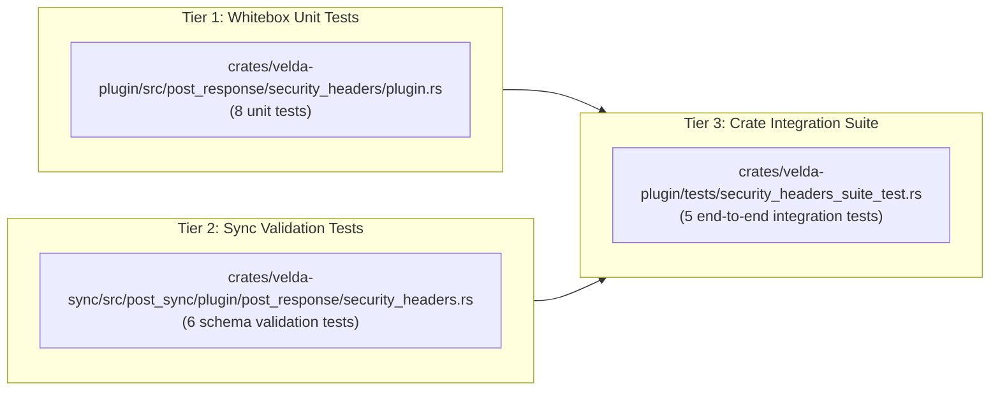

# Security Response Headers Plugin (`security_headers`) — Test & Verification Report

This document records the official testing methodology, test scenarios, edge-case assertions, and empirical verification results for the **`security_headers`** post-response plugin.

---

## 1. Objectives & Invariants

The `security_headers` plugin executes at the Layer 7 egress phase on outgoing upstream responses, ensuring:
- **Zero-Allocation Hot Path**: Pre-computes all headers into an inline flat array. Iteration executes with zero heap allocations.
- **64-Byte Cacheline Boundary Alignment**: Guarantees `align_of::<SecurityHeadersPlugin>() == 64` to prevent false sharing under high RPS.
- **OWASP L7 Hygiene Enforcement**: Protects browsers against Clickjacking, MIME confusion, SSL stripping, XSS, and Spectre side-channel attacks.
- **Declarative Contract Integrity**: Validates all configuration keys strictly with zero implicit defaults or silent fallbacks.

---

## 2. Test Execution Tiers



### Tier 1: Whitebox Unit Tests
- Implemented in [`crates/velda-plugin/src/post_response/security_headers/plugin.rs`](./plugin.rs).
- Verifies:
  - Default OWASP headers injection (`Strict-Transport-Security`, `X-Content-Type-Options: nosniff`, `X-Frame-Options: DENY`, `Referrer-Policy: strict-origin-when-cross-origin`).
  - 64-byte struct alignment and bitmask flags (`op_mask`).
  - Custom HSTS parameters with subdomains and preload.
  - Modern isolation directives (COOP, COEP, CORP, cross-domain policies, X-XSS-Protection: 0).
  - Explicit `"none"` value omissions.
  - Full disabling state producing zero header mutations.
  - JSON deserialization via `PluginConfig`.

### Tier 2: Declarative Sync Validation Tests
- Implemented in [`crates/velda-sync/src/post_sync/plugin/post_response/security_headers.rs`](../../../../velda-sync/src/post_sync/plugin/post_response/security_headers.rs).
- Verifies:
  - HSTS enabled with zero `max_age_secs` rejection.
  - Invalid frame options rejection (must be DENY, SAMEORIGIN, ALLOW-FROM, or none).
  - Invalid referrer policies rejection.
  - Invalid COOP, COEP, CORP directives rejection.
  - Rejection of missing required fields.

### Tier 3: Independent Integration Test Suite
- Implemented in [`crates/velda-plugin/tests/security_headers_suite_test.rs`](../../../tests/security_headers_suite_test.rs).
- Verifies:
  - Memory pointer verification ensuring header array resides directly within struct memory boundary (zero heap pointer indirection).
  - Multi-phase integration in response pipeline.
  - Bitmask composition matching configured headers.

---

## 3. Test Reproduction Commands

Execute the entire test battery via standard Cargo commands:

```bash
# 1. Run sync schema validation tests
cargo test -p velda-sync -- security_headers

# 2. Run whitebox plugin unit tests
cargo test -p velda-plugin -- security_headers

# 3. Run independent integration test suite
cargo test --test security_headers_suite_test

# 4. Strict clippy & formatting verification
cargo fmt --check
cargo clippy --all-targets --all-features -- -D warnings
```
