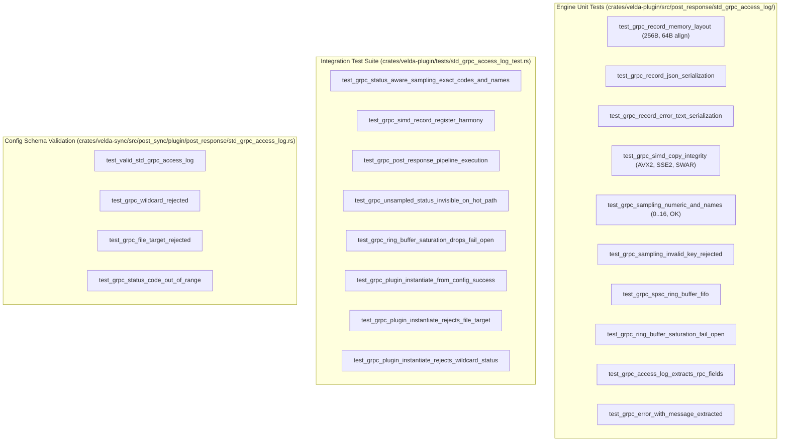

# Standard Stream gRPC Access Log Plugin (`std_grpc_access_log`) — Test Specification

---

## 1. Test Architecture

The `std_grpc_access_log` test suite validates functional correctness, vector register copy integrity, status-aware sampling precision, SPSC ring buffer lock-free semantics, and single-syscall batch draining across four test dimensions:



---

## 2. Reproduction Runbook

### Run All `std_grpc_access_log` Tests
```bash
# 1. Unit tests
cargo test -p velda-plugin --lib post_response::std_grpc_access_log

# 2. Integration tests
cargo test -p velda-plugin --test std_grpc_access_log_test

# 3. Declarative config validation tests
cargo test -p velda-sync --lib post_sync::plugin::post_response::std_grpc_access_log
```
